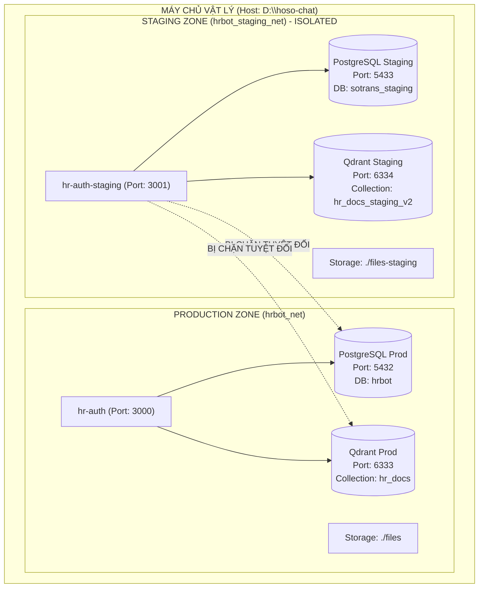

# SOTRANS HUB — KẾ HOẠCH BẢO VỆ TUYỆT ĐỐI PRODUCTION (CHECKPOINT 0)
## PRODUCTION SAFETY & STAGING ISOLATION PLAN

> **Dự án:** SOTRANS Hub — Logistics AI Platform  
> **Workspace:** `D:\hoso-chat`  
> **Mục tiêu:** Thiết lập hàng rào kỹ thuật ngăn chặn 100% mọi rủi ro xâm lấn, ghi đè, hoặc làm hỏng dữ liệu Production.

---

## 1. MƯỜI ĐIỀU LỆNH BẤT BIẾN (PRODUCTION SAFETY INVARIANTS)

1. **Tuyệt đối không thực thi lệnh phá hủy trên Production:** Nghiêm cấm chạy `DELETE`, `TRUNCATE`, `DROP` hoặc script cleanup đối với bất kỳ bảng hoặc cơ sở dữ liệu nào của Production.
2. **Bảo tồn toàn vẹn dữ liệu văn bản hiện có:** Tuyệt đối không xóa, không sửa, không ghi đè 3 văn bản chính sách (`QC-IS-2024`, `QC-DXCD-2026`, `QC-CNKV-2025`) đang lưu hành trên hệ thống.
3. **Bảo tồn cơ sở dữ liệu vector:** Không xóa, không tạo lại (recreate) collection `hr_docs` của Production.
4. **Bảo tồn tệp tin gốc:** Không xóa, không di chuyển các tệp tin trong thư mục `D:\hoso-chat\files\policies`.
5. **Không chạy migration trên Production:** Nghiêm cấm áp dụng các lệnh DDL hoặc migration của Staging lên cơ sở dữ liệu Production.
6. **Không kích hoạt Shadow Mode trên dữ liệu Production:** Mọi tác vụ kiểm thử Shadow chỉ được thực hiện trên môi trường Staging biệt lập hoặc qua tệp log giả lập.
7. **Không thay đổi trạng thái phê duyệt Production:** Không duyệt, không kích hoạt, không bãi bỏ văn bản trên Production ngoài quy trình chính thức.
8. **Không làm sai lệch quan hệ văn bản Production:** Không chèn hoặc cập nhật các quan hệ kiểm thử vào bảng `document_relationships` của Production.
9. **Không làm ô nhiễm chỉ mục tìm kiếm AI (RAG):** Không nạp các vector thử nghiệm vào collection chính của Chatbot.
10. **Bảo mật tuyệt đối thông tin xác thực:** Không hiển thị mật khẩu, JWT Secret hoặc API Key thật trong bất kỳ báo cáo hoặc nhật ký công khai nào.

---

## 2. THIẾT KẾ CÁCH LY MÔI TRƯỜNG STAGING (STAGING ISOLATION ARCHITECTURE)

Để phục vụ phát triển và kiểm thử Phase 3, một hệ sinh thái Staging độc lập hoàn toàn được định nghĩa trong tệp `docker-compose.staging.yml`:

### Các thông số cách ly:
* **Mạng nội bộ riêng biệt:** Mạng `hrbot_staging_net` (Driver: bridge) hoàn toàn không có cầu nối (no bridge/route) sang mạng Production `hrbot_net`.
* **Cổng dịch vụ tách rời:**
  * Backend API: Staging = `3001` (Prod = `3000`)
  * PostgreSQL: Staging = `5433` (Prod = `5432`)
  * Qdrant Vector: Staging = `6334` (Prod = `6333`)
* **Cơ sở dữ liệu độc lập:** Database `sotrans_staging`, user `staging_admin`, mật khẩu riêng.
* **Volume lưu trữ độc lập:** `staging_pg_data`, `staging_qdrant_data`, thư mục tệp tin riêng `files-staging/`.

---

## 3. BÀI KIỂM THỬ XÁC MINH CÁCH LY (PRE-ACTIVATION ISOLATION GATE)

Trước khi tiến hành bất kỳ thao tác ghi dữ liệu nào trong các Checkpoint, hệ thống bắt buộc phải vượt qua bài kiểm tra cách ly:

1. **Kiểm tra cổng kết nối:** 
   Thực thi lệnh kiểm tra kết nối từ container Staging tới cổng `5432` của Production. Kết quả bắt buộc phải là `Connection Refused` hoặc `Timeout` (không thể chạm vào Production).
2. **Kiểm tra biến môi trường:**
   Kiểm tra `DATABASE_URL` trong Staging container, đảm bảo hostname là `postgres-staging` hoặc cổng `5433`, tuyệt đối không chứa `5432` hay database `hrbot`.
3. **Kiểm tra File Storage:**
   Đảm bảo đường dẫn tệp tải lên trỏ vào `./files-staging/`, không ghi vào thư mục `./files/` của Production.

Nếu bất kỳ điều kiện nào ở trên không thỏa mãn: **DỪNG TOÀN BỘ TIẾN TRÌNH NGAY LẬP TỨC**.
