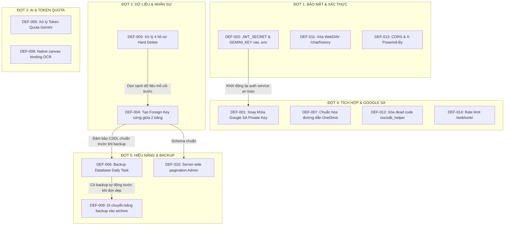

# KẾ HOẠCH KHẮC PHỤC TOÀN DIỆN HỆ THỐNG SOTRANS HUB
## SOTRANS HUB — COMPREHENSIVE REMEDIATION MASTER PLAN (SRMP-20261029)

> **Tài liệu:** Kế hoạch Khắc phục Tổng thể Hệ thống SOTRANS Hub  
> **Phiên bản:** 2.0 (Post-Testing Master Baseline)  
> **Ngày lập:** 29/10/2026  
> **Trạng thái thực thi:** CHỈ LẬP KẾ HOẠCH — TUYỆT ĐỐI CHƯA SỬA CODE — CHỜ PHÊ DUYỆT TỪNG ĐỢT  
> **Căn cứ tài liệu:** Đối chiếu trực tiếp từ `SYSTEM_TEST_PLAN.md`, `SYSTEM_TEST_REPORT.md`, `SYSTEM_BUG_REGISTER.md` và `SYSTEM_AUDIT_REPORT_20261028.md`.

---

### MỤC LỤC
1. [Mục tiêu và Nguyên tắc phân tích](#1-mục-tiêu-và-nguyên-tắc-phân-tích)
2. [Bảng tóm tắt lỗi ưu tiên cao nhất và Ma trận phân loại](#2-bảng-tóm-tắt-lỗi-ưu-tiên-cao-nhất-và-ma-trận-phân-loại)
3. [Chiến lược phân chia 5 Đợt sửa độc lập](#3-chiến-lược-phân-chia-5-đợt-sửa-độc-lập)
   - [Đợt 1: Bảo mật và Kiểm soát truy cập](#đợt-1-bảo-mật-và-kiểm-soát-truy-cập)
   - [Đợt 2: Tính toàn vẹn dữ liệu và Nghiệp vụ nhân sự](#đợt-2-tính-toàn-vẹn-dữ-liệu-và-nghiệp-vụ-nhân-sự)
   - [Đợt 3: AI, RAG, OCR và Quản trị Token](#đợt-3-ai-rag-ocr-và-quản-trị-token)
   - [Đợt 4: Tích hợp và Vận hành liên dịch vụ](#đợt-4-tích-hợp-và-vận-hành-liên-dịch-vụ)
   - [Đợt 5: Hiệu năng, Sao lưu và Trải nghiệm người dùng](#đợt-5-hiệu-năng-sao-lưu-và-trải-nghiệm-người-dùng)
4. [Ma trận phụ thuộc kỹ thuật (Technical Dependency Graph)](#4-ma-trận-phụ-thuộc-kỹ-thuật-technical-dependency-graph)
5. [Phân tích phạm vi tác động và Vùng ảnh hưởng (Blast Radius)](#5-phân-tích-phạm-vi-tác-động-và-vùng-ảnh-hưởng-blast-radius)
6. [Quản trị rủi ro và Kế hoạch ứng phó sự cố](#6-quản-trị-rủi-ro-và-kế-hoạch-ứng-phó-sự-cố)
7. [Lộ trình phê duyệt và Điều kiện kích hoạt từng giai đoạn](#7-lộ-trình-phê-duyệt-và-điều-kiện-kích-hoạt-từng-giai-đoạn)

---

### 1. MỤC TIÊU VÀ NGUYÊN TẮC PHÂN TÍCH

#### 1.1 Mục tiêu chính
- Xây dựng bản quy hoạch kỹ thuật tổng thể nhằm khắc phục dứt điểm 14 vấn đề kỹ thuật và nợ công nghệ đã được xác minh qua đợt kiểm thử toàn diện ngày 29/10/2026.
- Đảm bảo việc khắc phục không gây gián đoạn hệ thống đang vận hành (Zero-downtime hoặc Controlled Maintenance Window).
- Thiết lập ranh giới an toàn tuyệt đối: Không tự ý thay đổi dữ liệu nhân sự, không chạy migration khi chưa có bản sao lưu kiểm chứng, không làm lộ thông tin nhạy cảm.

#### 1.2 Nguyên tắc phân tích và lập kế hoạch
1. **Dựa trên bằng chứng thực tế:** Mọi phương án đề xuất đều bắt nguồn từ vị trí mã nguồn, cấu hình container hoặc truy vấn SQL cụ thể; không dựa trên giả định.
2. **Nguyên tắc "Tách biệt mối quan tâm" (Separation of Concerns):** Phân chia thành 5 đợt sửa độc lập. Tuyệt đối không gộp các thay đổi bảo mật với thay đổi schema hoặc refactor giao diện.
3. **Nguyên tắc can thiệp tối thiểu (Minimal Invasive Changes):** Ưu tiên giải pháp sửa đúng nguyên nhân gốc rễ, hạn chế tối đa việc viết lại toàn bộ kiến trúc đang ổn định.
4. **Không che giấu rủi ro:** Nêu rõ các rủi ro hồi quy (regression risk), tác động dây chuyền và điều kiện phải dừng triển khai (Emergency Stop Conditions).
5. **Bảo mật thông tin:** Tuyệt đối không đưa private key, token, mật khẩu hoặc dữ liệu cá nhân vào bất kỳ tài liệu kế hoạch nào.

---

### 2. BẢNG TÓM TẮT LỖI ƯU TIÊN CAO NHẤT VÀ MA TRẬN PHÂN LOẠI

```
+------------------------------------------------------------------------------------------------------------------------+
| MÃ ĐỊNH DANH | MỨC ĐỘ | LĨNH VỰC BỊ ẢNH HƯỞNG     | TÊN VẤN ĐỀ KỸ THUẬT                                 | TRẠNG THÁI   |
+------------------------------------------------------------------------------------------------------------------------+
| DEF-001      | P0     | Tích hợp & An toàn TT    | Lộ Google Service Account RSA Private Key trong code | Đã xác minh  |
| DEF-002      | P1     | Xác thực & Vận hành      | Lộ JWT_SECRET và GEMINI_API_KEY trong compose file   | Đã xác minh  |
| DEF-003      | P2     | Nghiệp vụ Nhân sự        | 4 Hồ sơ yêu cầu xóa thật vẫn tồn tại ACTIVE trong DB | Chờ phê duyệt|
| DEF-004      | P2     | Cơ sở Dữ liệu            | Thiếu ràng buộc Foreign Key cứng giữa 2 bảng nhân sự | Đã xác minh  |
| DEF-005      | P2     | Chatbot & AI Router      | Hạn ngạch Gemini Free Tier Token gây cạn kiệt 429    | Đã xác minh  |
| DEF-006      | P2     | Sao lưu & Phục hồi       | Thiếu tiến trình tự động sao lưu CSDL hàng ngày      | Đã xác minh  |
| DEF-007      | P2     | Tích hợp OneDrive        | Đường dẫn Windows tuyệt đối trong bảng lưu trữ sync  | Đã xác minh  |
| DEF-008      | P2     | Intake & OCR             | Thiếu native binding @napi-rs/canvas trên Windows host| Môi trường   |
| DEF-009      | P3     | Cơ sở Dữ liệu            | Tồn tại 2 bảng backup tàn dư trong schema public     | Đã xác minh  |
| DEF-010      | P3     | Frontend UI              | Phân trang Admin tải 100% hồ sơ vào RAM trình duyệt  | Đã xác minh  |
| DEF-011      | P3     | Nginx Gateway            | Location WebDAV /chat/history cũ không còn sử dụng   | Đã xác minh  |
| DEF-012      | P4     | Nợ kỹ thuật (Codebase)   | Dead code nocodb_helper.js (cổng 8084) không dùng   | Cải tiến     |
| DEF-013      | P4     | Bảo mật Backend          | CORS mở (*) và rò rỉ header X-Powered-By: Express   | Cải tiến     |
| DEF-014      | P4     | Nginx & Vận hành         | Tuyến Proxy /webhook/ n8n thiếu rate limiting        | Cải tiến     |
+------------------------------------------------------------------------------------------------------------------------+
```

---

### 3. CHIẾN LƯỢC PHÂN CHIA 5 ĐỢT SỬA ĐỘC LẬP

#### Đợt 1: Bảo mật và Kiểm soát truy cập (Security & Access Hardening)
*Mục tiêu trọng tâm:* Loại bỏ hoàn toàn các lỗ hổng rò rỉ thông tin xác thực, bảo vệ chữ ký JWT, củng cố ranh giới Nginx và loại bỏ cấu hình lỗi thời.
- **Các lỗi xử lý:**
  1. `DEF-002` (P1): Di dời `JWT_SECRET` và `GEMINI_API_KEY` từ `docker-compose.yml` vào `.env`, luân chuyển JWT Secret mới.
  2. `DEF-011` (P3): Gỡ bỏ block WebDAV `/chat/history` cũ trong `nginx/default.conf`.
  3. `DEF-013` (P4): Cấu hình giới hạn CORS theo domain nội bộ và gỡ bỏ header `X-Powered-By: Express` trong `auth-service/server.js`.
- **Phạm vi tác động:** `docker-compose.yml`, `.env`, `nginx/default.conf`, `auth-service/server.js`.
- **Rủi ro vận hành:** Người dùng đang đăng nhập sẽ bị yêu cầu đăng nhập lại (Session Invalidated) do đổi `JWT_SECRET`. Cần thực hiện vào khung giờ bảo trì ngoài giờ làm việc (sau 19:00).

#### Đợt 2: Tính toàn vẹn dữ liệu và Nghiệp vụ nhân sự (Data Integrity & HR Business)
*Mục tiêu trọng tâm:* Hoàn tất quyết định xử lý 4 hồ sơ nhân sự, làm sạch triệt để cơ sở dữ liệu và thiết lập ràng buộc toàn vẹn quan hệ cứng (Foreign Key Constraint).
- **Các lỗi xử lý:**
  1. `DEF-003` (P2): Xử lý dứt điểm 4 hồ sơ nhân sự yêu cầu xóa hoàn toàn (CCCD: `062095000277`, `079204001284`, `079205001589`, `080087002353`) theo phương án được Ban quản trị phê duyệt.
  2. `DEF-004` (P2): Thiết lập ràng buộc Khóa Ngoại `FOREIGN KEY (employee_id) REFERENCES employees(employee_code) ON UPDATE CASCADE ON DELETE CASCADE` giữa hai bảng nhân sự.
- **Phạm vi tác động:** Bảng `employees`, `hr_employee_profiles`, `hr_employee_staging`, vector embeddings trong Qdrant collection `hr_docs`.
- **Rủi ro vận hành:** Có thể gây lỗi ràng buộc nếu dữ liệu cha-con không khớp trước khi tạo constraint. Bắt buộc sao lưu toàn bộ database trước khi chạy transaction.

#### Đợt 3: AI, RAG, OCR và Quản trị Token (AI Router, RAG & Quota Management)
*Mục tiêu trọng tâm:* Chống quá tải hạn ngạch token Gemini, đảm bảo độ sẵn sàng của Chatbot và hoàn thiện môi trường OCR.
- **Các lỗi xử lý:**
  1. `DEF-005` (P2): Thiết lập hạn ngạch Pay-as-you-go trên Google AI Studio hoặc bổ sung cơ chế Token Budget Truncation trong `aiRouter.js`.
  2. `DEF-008` (P2): Chuẩn hóa cơ chế trích xuất OCR, bổ sung chỉ dẫn cài đặt native binding `@napi-rs/canvas` cho môi trường Windows Host hoặc chuyển hướng toàn bộ tác vụ OCR chạy trong Docker container Linux.
- **Phạm vi tác động:** `auth-service/services/aiRouter.js`, `auth-service/services/geminiService.js`, worker trích xuất file `fileProcessor.js`.
- **Rủi ro vận hành:** Rất thấp; không làm gián đoạn CSDL hoặc tài khoản người dùng.

#### Đợt 4: Tích hợp và Vận hành liên dịch vụ (External Integrations & Sync)
*Mục tiêu trọng tâm:* Luân chuyển khóa bảo mật Google Service Account, chuẩn hóa đường dẫn OneDrive xuyên nền tảng và dọn dẹp mã nguồn rác.
- **Các lỗi xử lý:**
  1. `DEF-001` (P0): Thu hồi RSA Private Key cũ trên Google Cloud Console, tạo khóa mới lưu tại file chứng thực bảo vệ, cập nhật `syncWorker.js` nạp credentials an toàn.
  2. `DEF-007` (P2): Chuẩn hóa đường dẫn lưu trữ OneDrive `storage_path` sang định dạng đường dẫn tương đối (Relative Path) hoặc POSIX path mapping.
  3. `DEF-012` (P4): Gỡ bỏ file dead code `nocodb_helper.js` (cổng 8084).
  4. `DEF-014` (P4): Thêm rate-limiting cho proxy `/webhook/` tới n8n trong cấu hình Nginx.
- **Phạm vi tác động:** `auth-service/services/syncWorker.js`, bảng `user_onedrive_sources`, thư mục `credentials/`, `nginx/default.conf`.
- **Rủi ro vận hành:** Gián đoạn tạm thời tiến trình đồng bộ Google Sheets nếu phân quyền Service Account mới chưa được chia sẻ vào Spreadsheet.

#### Đợt 5: Hiệu năng, Sao lưu và Trải nghiệm người dùng (Performance, Backup & UX)
*Mục tiêu trọng tâm:* Nâng cao khả năng chịu tải khi dữ liệu mở rộng quy mô, tự động hóa sao lưu phòng chống thảm họa và tối ưu hóa bộ nhớ trình duyệt.
- **Các lỗi xử lý:**
  1. `DEF-006` (P2): Thiết lập Windows Task Scheduler chạy tự động script `backup_database_daily.ps1` nén gzip lưu trữ 30 ngày.
  2. `DEF-009` (P3): Chuyển 2 bảng backup tàn dư (`chat_log_backup_20261018`, `chat_log_archive_legacy`) ra khỏi schema `public` sang schema `archive`.
  3. `DEF-010` (P3): Nâng cấp phân trang Server-side cho API `GET /api/employees` và giao diện `chat/hr-admin.html`.
- **Phạm vi tác động:** PostgreSQL public schema, `chat/hr-admin.html`, `auth-service/routes/employees.js`, thư mục `backups/`.
- **Rủi ro vận hành:** Cực thấp, chỉ ảnh hưởng đến việc hiển thị trang quản trị và cấu trúc schema lưu trữ nội bộ.

---

### 4. MA TRẬN PHỤ THUỘC KỸ THUẬT (TECHNICAL DEPENDENCY GRAPH)



*Phân tích phụ thuộc quan trọng:*
1. **DEF-003 bắt buộc phải thực thi trước DEF-004:** Cần xử lý dứt điểm 4 hồ sơ và đối soát dữ liệu 100% trước khi tạo ràng buộc `FOREIGN KEY` cứng. Nếu tạo khóa ngoại trước, việc xóa hồ sơ hoặc cập nhật sau này có thể bị chặn bởi ràng buộc toàn vẹn.
2. **DEF-006 nên sẵn sàng trước DEF-009:** Cần có quy trình backup hoạt động ổn định trước khi di chuyển hoặc loại bỏ các bảng tàn dư cũ.
3. **Đợt 1 và Đợt 4 độc lập với Đợt 2:** Việc xoay khóa bảo mật và cấu hình Nginx không ảnh hưởng đến dữ liệu nhân sự trong PostgreSQL.

---

### 5. PHÂN TÍCH PHẠM VI TÁC ĐỘNG VÀ VÙNG ẢNH HƯỞNG (BLAST RADIUS)

| Mã lỗi | Vùng ảnh hưởng (Blast Radius) | Dịch vụ gián đoạn tạm thời | Ảnh hưởng người dùng cuối | Khả năng hồi quy |
| :--- | :--- | :--- | :--- | :---: |
| **DEF-001** | `syncWorker.js`, Google Sheets API | Không gián đoạn dịch vụ web; chỉ ngưng sync Google Sheets trong 5 phút | Không ảnh hưởng người dùng chat | Rất thấp |
| **DEF-002** | `hr-auth` container, JWT tokens | Tái khởi động `hr-auth` mất ~3 giây | Phiên đăng nhập cũ hết hạn; người dùng đăng nhập lại | Thấp |
| **DEF-003** | Bảng nhân sự, Staging, Qdrant | Không gián đoạn dịch vụ | 4 hồ sơ bị loại bỏ khỏi danh sách tìm kiếm | Trung bình |
| **DEF-004** | Schema PostgreSQL (2 bảng) | Khóa bảng trong 100ms khi chạy ALTER TABLE | Hoàn toàn vô hình với người dùng | Thấp |
| **DEF-005** | `aiRouter.js` | Không gián đoạn | Giảm thiểu lỗi "Resource Exhausted" | Rất thấp |
| **DEF-006** | Windows Host Task Scheduler | Không gián đoạn (chạy nền lúc 01:00 AM) | Không ảnh hưởng | Không |
| **DEF-007** | Bảng `user_onedrive_sources` | Không gián đoạn | Đảm bảo tính di động khi dọn sang Linux | Rất thấp |
| **DEF-008** | Module OCR offline | Không gián đoạn | Cải thiện độ tin cậy trích xuất văn bản | Rất thấp |
| **DEF-009** | Schema `public` & `archive` | Khóa metadata trong 50ms khi đổi schema | Không ảnh hưởng | Rất thấp |
| **DEF-010** | `chat/hr-admin.html` | Không gián đoạn | Giao diện tải nhanh hơn, mượt hơn | Thấp |
| **DEF-011** | Nginx `default.conf` | Nginx reload cấu hình mất 500ms | Không ảnh hưởng | Rất thấp |
| **DEF-012** | Thư mục `auth-service` | Không gián đoạn (Dead code) | Không ảnh hưởng | Không |
| **DEF-013** | `auth-service/server.js` | Restart `hr-auth` cùng Đợt 1 | Chặn các trang web lạ gọi API trái phép | Thấp |
| **DEF-014** | Nginx `default.conf` | Nginx reload cùng Đợt 1 | Chống flood request vào webhook n8n | Thấp |

---

### 6. QUẢN TRỊ RỦI RO VÀ KẾ HOẠCH ỨNG PHÓ SỰ CỐ

#### 6.1 Các tình huống rủi ro có thể phát sinh
1. **Rủi ro 1: Khóa mới Google Service Account không đồng bộ được Sheet.**
   - *Nguyên nhân:* Email service account mới chưa được cấp quyền Share (Editor) trên Google Sheet.
   - *Ứng phó:* Giữ lại khóa cũ ở trạng thái sẵn sàng (chưa xóa trên GCP Console) trong vòng 24 giờ cho đến khi bài kiểm tra đồng bộ hai chiều đạt 100%.
2. **Rủi ro 2: Tạo Foreign Key bị lỗi `violates foreign key constraint`.**
   - *Nguyên nhân:* Tồn tại bản ghi có mã nhân viên trong bảng con mà không có trong bảng cha.
   - *Ứng phó:* Chạy script kiểm tra đối soát (`orphan check query`) trước. Nếu phát hiện sai lệch, dừng ngay lập tức và xuất báo cáo bản ghi lệch.
3. **Rủi ro 3: Xoay `JWT_SECRET` làm gián đoạn người dùng quản trị ban ngày.**
   - *Ứng phó:* Bắt buộc triển khai Đợt 1 vào khung giờ nghỉ (sau 19:00 hoặc ngày Chủ Nhật). Thông báo trước cho đội ngũ HR về việc hệ thống sẽ yêu cầu đăng nhập lại.

#### 6.2 Điều kiện dừng khẩn cấp (Emergency Stop Triggers)
Toàn bộ tiến trình triển khai phải dừng lại và kích hoạt quy trình Rollback ngay lập tức nếu:
- Database PostgreSQL báo lỗi `FATAL: connection limit exceeded` hoặc không khởi động lại được.
- Gateway Nginx trả về lỗi `502 Bad Gateway` liên tục quá 60 giây sau khi cập nhật cấu hình.
- Thao tác xóa dữ liệu làm thay đổi số lượng bản ghi ngoài phạm vi 4 hồ sơ đã chỉ định.

---

### 7. LỘ TRÌNH PHÊ DUYỆT VÀ ĐIỀU KIỆN KÍCH HOẠT TỪNG GIAI ĐOẠN

Ban Quản Trị sẽ xem xét và phê duyệt theo từng đợt riêng biệt. **Mỗi đợt chỉ được bắt đầu khi đợt trước đó đã hoàn thành nghiệm thu và được xác nhận:**

```text
[BƯỚC 1: PHÊ DUYỆT ĐỢT 1] ──> Triển khai Đợt 1 ──> Kiểm thử Nghiệm thu Đợt 1 ──> ĐẠT
         │
[BƯỚC 2: PHÊ DUYỆT ĐỢT 2] ──> Triển khai Đợt 2 ──> Kiểm thử Nghiệm thu Đợt 2 ──> ĐẠT
         │
[BƯỚC 3: PHÊ DUYỆT ĐỢT 3] ──> Triển khai Đợt 3 ──> Kiểm thử Nghiệm thu Đợt 3 ──> ĐẠT
         │
[BƯỚC 4: PHÊ DUYỆT ĐỢT 4] ──> Triển khai Đợt 4 ──> Kiểm thử Nghiệm thu Đợt 4 ──> ĐẠT
         │
[BƯỚC 5: PHÊ DUYỆT ĐỢT 5] ──> Triển khai Đợt 5 ──> Kiểm thử Nghiệm thu Đợt 5 ──> HOÀN TẤT
```

---
*Tài liệu Kế hoạch Khắc phục Tổng thể này là khung chỉ đạo kỹ thuật cho việc triển khai, kết hợp cùng Sổ Backlog (`SYSTEM_REMEDIATION_BACKLOG.md`), Ma trận Kiểm thử (`SYSTEM_REMEDIATION_TEST_MATRIX.md`), và Kế hoạch Rollback (`SYSTEM_REMEDIATION_ROLLBACK_PLAN.md`).*
