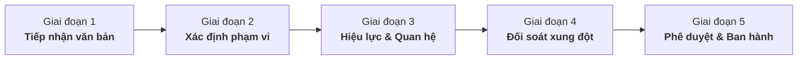
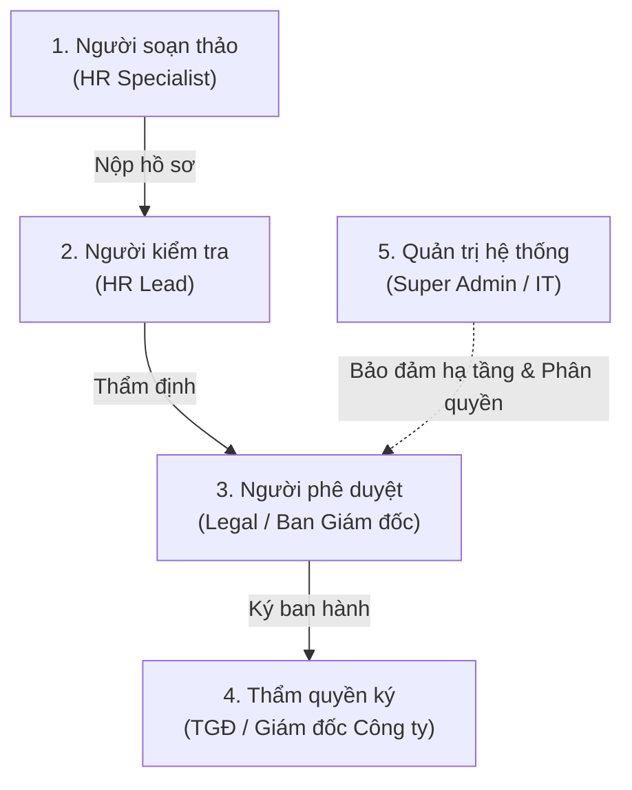
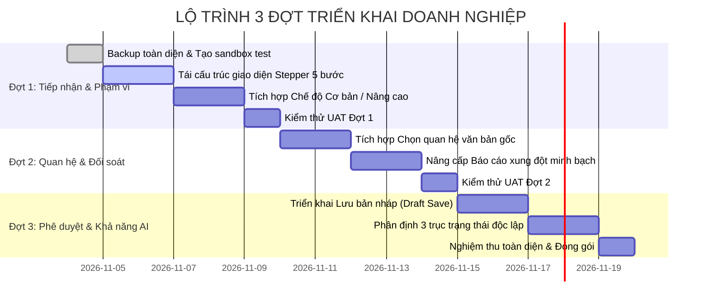

# SOTRANS HUB — BẢN THIẾT KẾ TRẢI NGHIỆM NGHIỆP VỤ DOANH NGHIỆP (PHIÊN BẢN V2)
## CHUẨN HÓA TOÀN DIỆN NGHIỆP VỤ QUẢN LÝ VĂN BẢN, HIỆU LỰC & QUAN HỆ CHÍNH SÁCH

**Dự án:** SOTRANS Hub — Logistics AI Platform  
**Tài liệu:** `docs/BUSINESS_FIRST_UX_DESIGN.md` (Phiên bản V2 — Cập nhật sau rà soát nghiệp vụ)  
**Chế độ:** `READ-ONLY DESIGN REVIEW` (Không can thiệp code/DB/workflow trong giai đoạn này)  
**Thời điểm phê duyệt:** 04/11/2026  
**Chủ trì biên soạn:** Senior AI Engineer, Enterprise Backend Architect & Solution UX/UI Specialist  

---

## I. MỤC TIÊU & NGUYÊN TẮC NGHIỆP VỤ CỐT LÕI (CORE PRINCIPLES)

Bản thiết kế V2 kế thừa cấu trúc đã được định hình ở V1, đồng thời rà soát và khắc phục triệt để các rủi ro pháp lý, ranh giới quyền hạn và tính minh bạch của hệ thống:

```
┌─────────────────────────────────────────────────────────────────────────────┐
│                    6 NGUYÊN TẮC DOANH NGHIỆP BẮT BUỘC                       │
├─────────────────────────────────────────────────────────────────────────────┤
│ 1. Ngôn ngữ thuần nghiệp vụ: Xóa bỏ 100% tên biến, chuỗi code kỹ thuật.     │
│ 2. AI hỗ trợ, Con người quyết định: AI chỉ phát hiện & đề xuất; không tự    │
│    quyết định hiệu lực pháp lý hoặc tự động phê duyệt quan hệ.              │
│ 3. Giới hạn Tenant Boundary tuyệt đối: Phân quyền đa đơn vị từ backend;    │
│    Admin chi nhánh không thể ban hành hoặc duyệt quan hệ vượt cấp.          │
│ 4. Tách biệt 3 trục trạng thái: Phê duyệt, Hiệu lực và Khả năng truy xuất   │
│    RAG độc lập hoàn toàn, không gộp thành một trường duy nhất.              │
│ 5. Minh bạch đối soát xung đột: Báo cáo đầy đủ điều khoản, trích lục minh   │
│    chứng; không dùng khái niệm "Hợp lệ tuyệt đối" để che lấp rủi ro.        │
│ 6. Quy trình 5 giai đoạn có hướng dẫn, kiểm tra tức thì & thông báo dễ hiểu. │
└─────────────────────────────────────────────────────────────────────────────┘
```

---

## II. QUY TRÌNH NGHIỆP VỤ HOÀN CHỈNH (5 GIAI ĐOẠN)



---

### GIAI ĐOẠN 1: TIẾP NHẬN VĂN BẢN (DOCUMENT INTAKE)
- **Mục tiêu:** Tiếp nhận tệp văn bản chính thức, nhận diện thông tin ban đầu bằng OCR/Heuristic và phân loại hồ sơ.
- **Trường bắt buộc (*):**
  1. *Tệp tài liệu gốc:* Định dạng `.pdf` (có chữ), `.docx`, `.txt` hoặc `.md` (Tối đa 50MB).
  2. *Hình thức / Phân loại văn bản:* Quyết định, Quy chế, Quy trình, Nội quy, Hướng dẫn, Thỏa thuận pháp lý.
  3. *Tên văn bản chính thức:* Tiêu đề đầy đủ có giá trị pháp lý.
- **Trường tùy chọn:**
  - *Mã hiệu văn bản:* Không bắt buộc người dùng phải có mã hiệu chính xác. Nếu người dùng để trống hoặc không nhập, hệ thống tự động sinh mã hiệu gợi ý thông minh (Ví dụ: `QC-DXCD-2026`) dựa trên thể loại, từ khóa tiêu đề và năm ban hành.
  - *Trích yếu nội dung:* Tóm tắt mục tiêu văn bản (1 - 3 câu).
  - *Dòng văn bản (Family):* Nhóm quy định cùng dòng (Chế độ nâng cao).
- **Nguyên tắc hỗ trợ AI:**
  - AI đọc file và đề xuất tiêu đề, mã hiệu. Người dùng **phải bấm xác nhận hoặc chỉnh sửa** trước khi qua bước tiếp theo.
  - Tuyệt đối không tự động gán dữ liệu nếu AI không tự tin (độ tin cậy < 85%).
- **Kiểm tra dữ liệu (Validation):**
  - Tệp tải lên được tính mã băm nội dung (SHA-256 Content Hash) để ngăn trùng lặp hoàn toàn.
  - Mã hiệu được kiểm tra tức thời trong CSDL đơn vị: cảnh báo nếu trùng lặp với văn bản đang áp dụng khác dòng.
- **Thông báo lỗi dễ hiểu:**
  - ❌ *"Tệp tài liệu không đọc được nội dung chữ. Vui lòng chọn bản scan có OCR hoặc tệp Word/PDF gốc."*
  - ❌ *"Mã hiệu văn bản này đang được áp dụng cho một quy định khác. Vui lòng kiểm tra lại số hiệu hoặc chọn cập nhật phiên bản."*

---

### GIAI ĐOẠN 2: XÁC ĐỊNH PHẠM VI ÁP DỤNG (SCOPE SPECIFICATION)
- **Mục tiêu:** Xác định chính xác đơn vị thành viên, phòng ban và nhóm nhân sự chịu sự điều chỉnh.
- **Quy tắc cốt lõi về Phạm vi:**
  - **Không tự động mở rộng phạm vi:** Tuyệt đối không tự động mặc định văn bản áp dụng cho toàn bộ nhân sự tập đoàn nếu chưa có sự xác nhận của người dùng có thẩm quyền.
  - **Phân định rõ 3 tầng phạm vi:**
    1. *Tầng 1 — Toàn tập đoàn (Corporate-wide):* Áp dụng cho SOTRANS Group và toàn bộ các công ty con (Chỉ tài khoản cấp Tập đoàn được thiết lập).
    2. *Tầng 2 — Toàn công ty con (Company-wide):* Áp dụng cho toàn thể CBNV của riêng STL, VTX hoặc SWC.
    3. *Tầng 3 — Phạm vi hẹp / Chuyên biệt (Sub-unit):* Áp dụng cho một hoặc nhiều Phòng ban, Khối nghiệp vụ, Địa bàn hoặc Nhóm chức danh cụ thể.
- **Trường bắt buộc (*):**
  1. *Đơn vị thành viên:* Bị khóa cứng theo Tenant tài khoản (Admin STL chỉ được chọn STL; Admin VTX chỉ được chọn VTX; Admin SWC chỉ được chọn SWC; SuperAdmin được chọn Toàn tập đoàn hoặc chọn đơn vị cụ thể).
  2. *Hình thức áp dụng:* Bắt buộc người dùng chủ động chọn 1 trong 2:
     - ( ) **Áp dụng cho toàn thể nhân sự của đơn vị** (Toàn công ty).
     - ( ) **Áp dụng cho bộ phận / nhóm nhân sự đặc thù** (Mở bảng chọn chi tiết).
- **Trường điều kiện (Khi chọn Áp dụng đặc thù):**
  - *Phòng ban áp dụng:* Chọn từ danh mục (Khối Văn phòng, Kế toán, Nhân sự, Khai thác Kho bãi, Đội Xe Vận tải...).
  - *Khối nghiệp vụ / Địa bàn:* Trụ sở chính, Chi nhánh Cảng, Trung tâm Chuyển đổi số...
  - *Nhóm nhân sự:* Cán bộ văn phòng, Lái xe container, Thủ kho, Kỹ sư công nghệ...
- **Kiểm tra dữ liệu (Validation):**
  - Thiếu thông tin phạm vi: Hệ thống cảnh báo đỏ và chặn chuyển bước; không tự ý điền chuỗi `all`.
  - Backend xác thực `req.user.company_id` ngăn chặn mọi hành vi chỉnh sửa request body để chọn công ty khác.
- **Thông báo lỗi dễ hiểu:**
  - ❌ *"Bạn chưa chọn hình thức áp dụng cho văn bản. Vui lòng xác định phạm vi toàn thể đơn vị hoặc chọn bộ phận cụ thể."*
  - ❌ *"Bạn không có quyền ban hành văn bản ngoài phạm vi công ty được phân công."*

---

### GIAI ĐOẠN 3: XÁC ĐỊNH HIỆU LỰC & QUAN HỆ VĂN BẢN (RELATIONSHIPS & EFFECTIVENESS)
- **Mục tiêu:** Xác định mốc thời gian pháp lý và mối quan hệ với các văn bản hiện hành.
- **Trường bắt buộc (*):**
  1. *Ngày ký ban hành:* Ngày người có thẩm quyền ký quyết định.
  2. *Ngày bắt đầu có hiệu lực:* Ngày văn bản chính thức phát sinh giá trị pháp lý thi hành.
  3. *Tính chất quan hệ pháp lý:* Bắt buộc chọn 1 trong 5 loại:
     - (1) **Văn bản độc lập:** Ban hành mới hoàn toàn, không thay thế hay sửa đổi quy chế nào.
     - (2) **Thay thế văn bản cũ (`supersedes`):** Bãi bỏ và thay thế một văn bản hiện có.
     - (3) **Sửa đổi điều khoản (`amends`):** Điều chỉnh một số điều khoản của quy định đang áp dụng.
     - (4) **Bổ sung chế độ (`supplements`):** Bổ sung quyền lợi/quy trình cho quy định chung.
     - (5) **Quy định ngoại lệ (`exception_to`):** Áp dụng chế độ đặc thù cho phạm vi hẹp.
- **Trường điều kiện (Bắt buộc khi chọn tính chất 2, 3, 4, 5):**
  - *Văn bản gốc liên quan:* Chọn từ danh mục văn bản đang áp dụng.
  - *Ngày chấm dứt hiệu lực của văn bản cũ (Nếu là Thay thế):* Nhập ngày bãi bỏ chính thức theo quyết định ban hành. **Hệ thống không tự suy đoán `ngày hiệu lực mới - 1 ngày` nếu văn bản không nêu rõ.**
  - *Tóm tắt nội dung thay đổi / căn cứ ngoại lệ:* Mô tả điểm mới hoặc lý do áp dụng chế độ riêng.
- **Trường tùy chọn:**
  - *Ngày hết hiệu lực dự kiến:* (Áp dụng cho văn bản thử nghiệm, có thời hạn thi hành).
- **Kiểm tra dữ liệu (Validation):**
  - Quy tắc thời gian: `Ngày ký <= Ngày bắt đầu có hiệu lực`. Nếu có ngày hết hiệu lực: `Ngày bắt đầu có hiệu lực <= Ngày hết hiệu lực`.
  - Bỏ giới hạn cứng 5 năm quá khứ / 1 năm tương lai. Nếu ngày ký cách hiện tại trên 10 năm hoặc ngày hiệu lực ở tương lai trên 2 năm: Hệ thống hiển thị cảnh báo xác nhận màu vàng nhưng không chặn cứng (để phục vụ số hóa hồ sơ lịch sử hoặc quy hoạch dài hạn).
- **Thông báo lỗi dễ hiểu:**
  - ❌ *"Ngày bắt đầu có hiệu lực không thể trước ngày ký ban hành. Vui lòng kiểm tra lại."*
  - ❌ *"Vui lòng chọn văn bản gốc bị thay thế và xác định ngày bãi bỏ hiệu lực theo quyết định ban hành."*

---

### GIAI ĐOẠN 4: ĐỐI SOÁT XUNG ĐỘT CHÍNH SÁCH (ACTIVE CONFLICT AUDIT)
- **Mục tiêu:** Hệ thống tự động quét đối soát đa tầng, đưa ra bằng chứng minh bạch để con người thẩm định.
- **Cơ chế xác định tập văn bản đối soát (Dynamic Scoping):**
  - Hệ thống **tự động xác định danh sách văn bản cần đối chiếu** dựa trên:
    `Đơn vị (Tenant) + Văn bản chung toàn tập đoàn + Trạng thái đang áp dụng (Active) + Khoảng thời gian hiệu lực giao thoa`.
  - **Tuyệt đối không hardcode con số 22 văn bản.** Giao diện hiển thị: *"Đã đối soát với [N] văn bản đang có hiệu lực trong phạm vi quản lý"*.
- **Phân loại kết quả đối soát minh bạch:**
  - 🟢 **Chưa phát hiện xung đột:** Phạm vi và chủ đề độc lập, hoặc quan hệ pháp lý đã được khai báo khớp hoàn toàn.
  - 🟡 **Nội dung tương tự cần lưu ý:** Cùng chủ đề (ví dụ: thời giờ làm việc, công tác phí) nhưng phạm vi áp dụng hẹp hơn. Hệ thống hiển thị trích lục đoạn văn bản của 2 bên và gợi ý thiết lập quan hệ Ngoại lệ (`exception_to`) hoặc Bổ sung (`supplements`).
  - 🔴 **Xung đột chính sách trực tiếp:** Trùng cả chủ đề lẫn phạm vi điều chỉnh với một văn bản đang áp dụng mà chưa chọn quan hệ Thay thế (`supersedes`).
  - ⚪ **Chưa đủ dữ liệu kết luận:** Văn bản quá ngắn hoặc thiếu trích yếu nội dung.
- **Minh chứng hiển thị bắt buộc trong báo cáo xung đột:**
  - Tên và mã hiệu văn bản đối chiếu.
  - Trích lục điều khoản liên quan của văn bản đối chiếu (Evidence Quote).
  - So sánh trực quan điểm khác biệt giữa văn bản mới và văn bản hiện hành.
  - Phạm vi áp dụng của 2 văn bản.
- **Quy tắc giải trình:**
  - Không cho phép giải trình tùy tiện để bỏ qua xung đột nghiêm trọng (🔴). Xung đột trực tiếp bắt buộc phải được giải quyết bằng việc chọn Thay thế/Sửa đổi hoặc phải có chữ ký xác nhận của Người có thẩm quyền phê duyệt.

---

### GIAI ĐOẠN 5: PHÊ DUYỆT & BAN HÀNH (APPROVAL & PUBLISHING)
- **Mục tiêu:** Trình hồ sơ lên cấp có thẩm quyền, lưu vết kiểm toán và đưa vào vận hành theo đúng quy trình.
- **Hành động khả dụng theo vai trò:**
  - `[💾 Lưu bản nháp]`: Lưu hồ sơ ở trạng thái `draft`. Không kích hoạt RAG, cho phép sửa đổi tiếp.
  - `[📤 Gửi kiểm tra / Phê duyệt]`: Chuyển hồ sơ sang trạng thái Chờ duyệt (`pending_approval`).
  - `[✅ Phê duyệt & Ban hành]`: Chỉ hiển thị cho người có quyền phê duyệt (HR Lead / Giám đốc đơn vị).
- **Quy tắc quan hệ đi kèm:**
  - Các quan hệ văn bản tạo kèm theo hồ sơ tự động mang trạng thái `pending_review`.
  - Khi văn bản được duyệt chính thức: Người phê duyệt đồng thời xác nhận phê duyệt các quan hệ đi kèm.
- **Thông báo thành công:**
  - ✅ *"Hồ sơ văn bản đã được gửi phê duyệt thành công! Mã theo dõi: DOC-2026-..."*

---

## III. MA TRẬN PHÂN QUYỀN THỐNG NHẤT (UNIFIED RBAC MATRIX)

Phân định rạch ròi giữa thẩm quyền pháp lý hành chính và thẩm quyền quản trị kỹ thuật:



| Vai trò người dùng | Người soạn thảo (Drafter) | Người kiểm tra (Reviewer) | Người phê duyệt (Approver) | Người có thẩm quyền ký (Signer) | Quản trị viên kỹ thuật (SysAdmin) |
|---|:---:|:---:|:---:|:---:|:---:|
| **HR Specialist (Chuyên viên Nhân sự)** | ✅ Soạn thảo, nạp tệp, tạo nháp (`draft`) | ❌ Không có quyền | ❌ Không có quyền | ❌ Không có quyền | ❌ Không có quyền |
| **HR Lead (Trưởng phòng Nhân sự Đơn vị)** | ✅ Toàn quyền soạn thảo | ✅ Rà soát xung đột, kiểm tra nghiệp vụ | ❌ Không có quyền phê duyệt thay Giám đốc | ❌ Không có thẩm quyền ký | ❌ Không can thiệp hạ tầng |
| **Company Admin (Lãnh đạo đơn vị STL/VTX/SWC)** | ✅ Toàn quyền đơn vị | ✅ Toàn quyền kiểm tra đơn vị | ✅ **Phê duyệt văn bản & quan hệ nội bộ công ty** | ✅ **Ký ban hành quy định nội bộ công ty** | ❌ Không can thiệp đơn vị khác |
| **Pháp chế Tập đoàn (Legal Team)** | ✅ Soạn thảo văn bản chung | ✅ Thẩm định xung đột pháp lý toàn tập đoàn | ✅ **Xác nhận tính pháp lý của quan hệ văn bản** | ❌ Trình Tổng Giám đốc ký | ❌ Không can thiệp hạ tầng |
| **Tổng Giám đốc Tập đoàn (CEO / Board)** | ❌ Ban Thư ký soạn | ❌ Phòng chức năng kiểm tra | ✅ **Phê duyệt tối cao** | ✅ **Ký ban hành quy chế toàn Tập đoàn** | ❌ Không quản trị kỹ thuật |
| **Super Admin (Quản trị viên Hệ thống IT)** | ❌ Không tự ý soạn văn bản thay HR | ❌ Không kiểm tra nghiệp vụ thay HR | ❌ **KHÔNG CÓ THẨM QUYỀN PHÁP LÝ TỰ DUYỆT VĂN BẢN** | ❌ **KHÔNG CÓ QUYỀN TỰ KÝ BAN HÀNH** | ✅ **Toàn quyền hạ tầng kỹ thuật, backup, Qdrant, DB, phân quyền tài khoản** |

> **Nguyên tắc an toàn:** Super Admin là vai trò quản trị hệ thống công nghệ, **tuyệt đối không được xem là người ký duyệt pháp lý** để thay thế Ban Giám đốc hay Ban Nhân sự.

---

## IV. MA TRẬN 3 TRỤC TRẠNG THÁI ĐỘC LẬP (STATE MATRIX)

```
                              ┌────────────────────────────────────────┐
                              │ TRỤC 1: TRẠNG THÁI PHÊ DUYỆT (Approval)│
                              │ • Bản nháp (draft)                     │
                              │ • Chờ duyệt (pending_approval)         │
                              │ • Đã phê duyệt (approved)              │
                              │ • Bị từ chối (rejected)                │
                              └──────────────────┬─────────────────────┘
                                                 │
                              ┌──────────────────▼─────────────────────┐
                              │ TRỤC 2: TRẠNG THÁI HIỆU LỰC (Validity) │
                              │ • Chưa hiệu lực (inactive / draft)     │
                              │ • Chờ hiệu lực (scheduled)             │
                              │ • Đang có hiệu lực (active)            │
                              │ • Đang thử nghiệm (pilot)              │
                              │ • Hết hiệu lực (expired)               │
                              │ • Bị thay thế (superseded)             │
                              └──────────────────┬─────────────────────┘
                                                 │
                              ┌──────────────────▼─────────────────────┐
                              │ TRỤC 3: TRỢ LÝ AI & RAG (Retrieval)    │
                              │ • Không sử dụng (disabled)             │
                              │ • Chỉ kiểm thử Sandbox (testing_only)  │
                              │ • Thí điểm có cảnh báo (pilot_warning) │
                              │ • Phục vụ chính thức (official_rag)    │
                              └────────────────────────────────────────┘
```

### Bảng ánh xạ kết hợp các tình huống thực tế:

| Tình huống nghiệp vụ | Trạng thái Phê duyệt | Trạng thái Hiệu lực | Khả năng trong Trợ lý AI | Kênh Chat Nhân viên | Sandbox Kiểm thử Admin |
|---|---|---|---|:---:|:---:|
| **1. Bản nháp đang soạn** | `draft` | Chưa hiệu lực | `disabled` | ❌ Bị chặn 100% | ❌ Bị chặn |
| **2. Đang chờ Ban Giám đốc duyệt** | `pending_approval` | Chưa hiệu lực | `testing_only` | ❌ Bị chặn 100% | ✅ Được hỏi thử |
| **3. Đã duyệt nhưng hiệu lực tương lai** | `approved` | `scheduled` | `testing_only` | ❌ Bị chặn 100% | ✅ Được hỏi thử |
| **4. Đang có hiệu lực chính thức** | `approved` | `active` | `official_rag` | ✅ **Trả lời chính thức** | ✅ Tra cứu chuẩn |
| **5. Văn bản dự thảo thử nghiệm (Pilot)** | `approved` (hoặc cấp phép thí điểm) | `pilot` | `pilot_warning` | ⚠️ **Chỉ trả lời kèm cảnh báo bắt buộc** | ✅ Tra cứu thử nghiệm |
| **6. Văn bản bị lãnh đạo từ chối** | `rejected` | Vô hiệu | `disabled` | ❌ Bị chặn 100% | ❌ Bị chặn |
| **7. Đã bị văn bản mới thay thế** | `approved` | `superseded` | `disabled` | ❌ Không dùng cho câu hỏi hiện hành | ⚠️ Chỉ khi tra cứu lịch sử |
| **8. Đã hết hạn thi hành** | `approved` | `expired` | `disabled` | ❌ Không dùng cho câu hỏi hiện hành | ⚠️ Chỉ khi tra cứu lịch sử |

> **Phân lập Sandbox:** Môi trường hỏi thử tại Mục 2 Admin sử dụng token quản trị riêng, có cờ `include_testing = true`, **tuyệt đối không làm nhiễm dữ liệu sang kênh Chatbot của nhân viên**.

---

## V. QUY TẮC QUAN HỆ VĂN BẢN & XỬ LÝ THAY THẾ CHẶT CHẼ

### 1. Phân loại 5 quan hệ nghiệp vụ:
1. `independent` (**Văn bản độc lập**): Không làm thay đổi hay phụ thuộc vào văn bản nào.
2. `supersedes` (**Thay thế hoàn toàn**): Bãi bỏ văn bản cũ.
3. `amends` (**Sửa đổi điều khoản**): Thay đổi nội dung một số điều của văn bản đang áp dụng.
4. `supplements` (**Bổ sung chế độ**): Bổ sung quy định mới cho quy chế khung của Tập đoàn.
5. `exception_to` (**Quy định ngoại lệ**): Quy định riêng biệt cho một đơn vị hoặc khối nhân sự đặc thù.

### 2. Quy trình xử lý khi có quan hệ Thay thế (`supersedes`):
```
[BƯỚC 1: KHAI BÁO]  -> Người dùng chọn văn bản bị thay thế và NHẬP NGÀY BÃI BỎ THEO QUYẾT ĐỊNH.
                       (Không tự động trừ 1 ngày nếu văn bản không nêu).
                       Văn bản mới mang trạng thái `pending_approval`.
                       Văn bản cũ VẪN GIỮ NGUYÊN TRẠNG THÁI `active`.
                       Quan hệ mang trạng thái `pending_review`.
[BƯỚC 2: PHÊ DUYỆT] -> Người có thẩm quyền ký duyệt văn bản mới VÀ phê duyệt quan hệ `supersedes`.
[BƯỚC 3: ĐỒNG BỘ]  -> Hệ thống thực hiện đồng bộ trong Transaction:
                       - Chuyển văn bản mới thành `active` (hoặc `scheduled` nếu ngày hiệu lực ở tương lai).
                       - ĐÚNG VÀO NGÀY BÃI BỎ: Chuyển văn bản cũ thành `superseded`, gán `expiry_date`.
                       - Cập nhật payload Qdrant của văn bản cũ: `status = 'superseded'`.
```

### 3. Xử lý khi quan hệ bị từ chối (`rejected`) hoặc thu hồi (`revoked`):
- Nếu quan hệ `supersedes` bị từ chối: Văn bản mới không thể kích hoạt thay thế; văn bản cũ **giữ nguyên trạng thái `active`**, không bị gián đoạn hiệu lực.
- Nếu một quan hệ đã duyệt nhưng sau đó bị thu hồi (Revoke): Hệ thống hoàn nguyên trạng thái văn bản cũ về `active`, đồng bộ tức thời sang Qdrant và workflow n8n.

---

## VI. QUY TẮC PHẠM VI ÁP DỤNG & GIỚI HẠN TENANT BOUNDARY

1. **Khóa cứng đơn vị từ Backend:**
   - Khi `admin_stl` gửi yêu cầu tạo/sửa văn bản: Backend kiểm tra JWT và gán `branch_scope = ['sotrans_logistics']`.
   - Khi `admin_vtx` gửi yêu cầu: `branch_scope = ['vietranstimex']`.
   - Khi `admin_swc` gửi yêu cầu: `branch_scope = ['sowatco']`.
   - Mọi giá trị `branch_scope` gửi lên trong request body từ non-superadmin trái với JWT đều bị loại bỏ hoặc trả về lỗi HTTP 403.
2. **Quy định dùng chung Toàn tập đoàn (`branch_scope = ['all']`):**
   - Chỉ tài khoản cấp Tập đoàn (SuperAdmin / Legal Tập đoàn) mới có quyền ban hành quy định áp dụng chung toàn tập đoàn.
   - Khi một công ty con ban hành văn bản bổ sung cho quy chế tập đoàn: Văn bản của công ty con mang scope của công ty con đó (ví dụ: `45/2024/QĐ-VTX` mang scope `vietranstimex`, bổ sung cho `18/2023/QC-SOTRANS` mang scope `all`).

---

## VII. ĐỐI SOÁT XUNG ĐỘT: BẰNG CHỨNG, MINH BẠCH & TRÁCH NHIỆM

1. **Giao diện không dùng từ "Hợp lệ tuyệt đối":**
   - Đổi trạng thái hiển thị màu xanh thành: **`🟢 Chưa phát hiện xung đột`** kèm ghi chú: *"Dựa trên dữ liệu hiện có trong hệ thống, chưa tìm thấy điểm mâu thuẫn trực tiếp với các quy chế đang áp dụng."*
2. **Cấu trúc Báo cáo Xung đột Minh bạch:**
   - Báo cáo phải hiển thị đầy đủ 5 thành phần:
     1. Tên và mã số văn bản đang đối chiếu.
     2. Trích lục nội dung điều khoản đối chiếu (Evidence Quote).
     3. Phạm vi áp dụng của văn bản đối chiếu (Đơn vị, phòng ban, nhóm nhân sự).
     4. Mốc thời gian hiệu lực và ngày hết hạn.
     5. Trạng thái quan hệ văn bản giữa 2 tài liệu (Đã xác nhận / Chưa có liên kết).
3. **Phân cấp xử lý xung đột nghiêm ngặt:**
   - 🔴 **Xung đột trực tiếp:** Khóa nút gửi duyệt cho đến khi chọn Thay thế / Sửa đổi hoặc có ý kiến chỉ đạo bằng văn bản của Lãnh đạo.
   - 🟡 **Nội dung tương tự:** Yêu cầu xác nhận kiểm tra và gợi ý tạo quan hệ Ngoại lệ hoặc Bổ sung.
   - ⚪ **Chưa đủ dữ liệu:** Yêu cầu rà soát thủ công.

---

## VIII. QUY TẮC HIỆU LỰC THỜI GIAN & XỬ LÝ NGÀY THÁNG

1. **Bỏ giới hạn cứng 5 năm quá khứ / 1 năm tương lai:**
   - Cho phép nhập ngày ký và ngày hiệu lực của các văn bản lịch sử đã ban hành nhiều năm trước để phục vụ số hóa toàn diện hồ sơ tập đoàn.
   - Chỉ hiển thị cảnh báo xác nhận màu vàng nếu ngày ký cách hiện tại trên 10 năm hoặc ngày hiệu lực ở tương lai trên 2 năm.
2. **Kiểm tra mối quan hệ logic giữa các mốc ngày:**
   `Ngày ký <= Ngày bắt đầu có hiệu lực`  
   `Ngày bắt đầu có hiệu lực <= Ngày hết hiệu lực (nếu có)`
3. **Không tự suy đoán từ OCR:**
   - Trợ lý AI có thể gợi ý ngày trích xuất được từ góc phải văn bản, nhưng **ô nhập liệu bắt buộc phải được người dùng xác nhận**.
4. **Hỗ trợ Lưu bản nháp khi thiếu thông tin:**
   - Nếu văn bản đang soạn thảo chưa có ngày ký hoặc ngày hiệu lực chính thức, người dùng được phép bấm **"Lưu bản nháp"** để bổ sung sau mà không bị chặn lỗi.

---

## IX. THIẾT KẾ HAI CHẾ ĐỘ SỬ DỤNG (STANDARD VS ADVANCED MODE)

```
┌───────────────────────────────────────┬───────────────────────────────────────┐
│        CHẾ ĐỘ CƠ BẢN (STANDARD)       │        CHẾ ĐỘ NÂNG CAO (ADVANCED)     │
├───────────────────────────────────────┼───────────────────────────────────────┤
│ • Đối tượng: Cán bộ HR, Thư ký văn    │ • Đối tượng: Lãnh đạo HR, Pháp chế,   │
│   phòng làm nghiệp vụ thường xuyên    │   Quản trị viên hệ thống              │
│ • Giao diện: Tối giản, chỉ hiển thị   │ • Giao diện: Hiển thị đầy đủ phiên bản│
│   thông tin thiết yếu                 │   Dòng văn bản, scope chi tiết        │
│ • Dòng văn bản: Hệ thống tự kế thừa   │ • Dòng văn bản: Cho phép can thiệp và │
│   mã hiệu, ẩn mã kỹ thuật             │   chọn dòng văn bản có sẵn            │
│ • Phạm vi: Chọn đơn vị và checkbox    │ • Phạm vi: Tag-Input chi tiết Phòng   │
│   toàn thể CBNV                       │   ban, Khối nghiệp vụ, Chức danh      │
│ • Quan hệ: Chọn 1 văn bản liên quan   │ • Quan hệ: Cho phép liên kết đồng thời│
│   dạng dropdown thân thiện            │   nhiều văn bản, xem diff log         │
│ • RAG AI: Tự động kế thừa theo quy    │ • RAG AI: Xem trạng thái retrieval    │
│   định an toàn                        │   (Không hiển thị tham số kỹ thuật)   │
└───────────────────────────────────────┴───────────────────────────────────────┘
```

> **Nguyên tắc bảo toàn dữ liệu khi chuyển chế độ:**
> Người dùng có thể bấm nút chuyển `[ Chế độ Cơ bản | Chế độ Nâng cao ]` bất kỳ lúc nào. Dữ liệu đã nhập tại Chế độ Cơ bản được **giữ nguyên vẹn 100%**, không bị xóa hay reset.

---

## X. MA TRẬN TÌNH HUỐNG NGOẠI LỆ & XỬ LÝ BIÊN (EDGE CASES)

| Tình huống ngoại lệ | Nguy cơ / Vấn đề | Quy tắc xử lý nghiệp vụ chuẩn hóa |
|---|---|---|
| **1. Tải lại cùng một file** | Trùng lặp dữ liệu và vector chunk | Tính mã băm SHA-256 tệp: Cảnh báo *"Tệp này đã được tải lên trước đó (Mã: ...)"*, yêu cầu xác nhận nếu muốn tạo phiên bản mới. |
| **2. Trùng mã hiệu nhưng khác phiên bản** | Ghi đè văn bản cũ | Tự động nhận diện đây là bản cập nhật của dòng văn bản hiện tại $\rightarrow$ Tăng số phiên bản: `v1` $\rightarrow$ `v2`. |
| **3. Một văn bản sửa đổi NHIỀU văn bản cũ** | Quan hệ 1 - N | Cho phép thêm nhiều văn bản bị sửa đổi tại Chế độ Nâng cao; tạo đồng thời N quan hệ `amends` ở trạng thái `pending_review`. |
| **4. Một văn bản được NHIỀU văn bản khác bổ sung** | Quan hệ N - 1 | Màn hình chi tiết văn bản gốc hiển thị danh sách toàn bộ các văn bản bổ sung kèm trạng thái hiệu lực của từng văn bản. |
| **5. Văn bản bị từ chối phê duyệt** | Dữ liệu rác lọt vào RAG | Chuyển trạng thái sang `rejected`, ghi rõ lý do từ chối vào nhật ký kiểm toán, khóa quyền truy xuất RAG của văn bản này. |
| **6. Văn bản bị thu hồi sau khi ban hành** | RAG tiếp tục trích dẫn văn bản sai | Kích hoạt chức năng "Thu hồi văn bản": chuyển trạng thái sang `revoked`, lập tức gỡ bỏ quyền truy xuất của Trợ lý AI và ghi audit log. |
| **7. Tra cứu lịch sử văn bản đã hết hạn** | Nhân viên hỏi chính sách năm cũ | Trợ lý AI trả lời rõ: *"Quy định này đã hết hiệu lực từ ngày dd/mm/yyyy. Quy định hiện hành thay thế là văn bản..."*. |
| **8. Xung đột giữa Quy chế Tập đoàn và Chi nhánh** | Trợ lý AI ưu tiên sai | Quy định chi nhánh có hiệu lực áp dụng ưu tiên cho nhân viên chi nhánh đó (nếu có quan hệ `exception_to`/`supplements` hợp lệ); quy chế Tập đoàn áp dụng cho các đơn vị còn lại. |
| **9. Văn bản thử nghiệm (Pilot / Sandbox)** | Biến thành quy định chung | Bắt buộc gắn cờ `pilot_restricted`: luôn đính kèm nhãn cảnh báo *"Dự thảo thử nghiệm, chưa ban hành chính thức toàn tập đoàn"*. |
| **10. Lỗi đồng bộ giữa DB, Qdrant và n8n** | Dữ liệu không nhất quán | Cơ chế Reconcile tự động kiểm tra mỗi 60 phút: nếu phát hiện vector thiếu hoặc sai trạng thái, tự động đồng bộ lại từ PostgreSQL gốc. |

---

## XI. DANH SÁCH THAY ĐỔI DỰ KIẾN (DATABASE, API & WORKFLOW)

Tất cả các thay đổi dự kiến đều theo nguyên tắc **bổ sung mở rộng, không phá vỡ cấu trúc hiện tại (Non-breaking Enhancements)**:

### 1. Database (PostgreSQL):
- Tận dụng nguyên vẹn bảng `documents`, `document_relationships`, `document_retrieval_controls`, `document_audit_logs`.
- Bổ sung giá trị cho enum/check constraint nếu cần: hỗ trợ trạng thái phê duyệt `pending_approval`, trạng thái hiệu lực `pilot`.
- Thêm cột `file_hash` (varchar 64) trong `documents` để ngăn trùng file.

### 2. Backend API (`auth-service/routes/documents.js`):
- Bổ sung `GET /api/documents/scopes`: Trả về danh mục chuẩn hóa phòng ban, khối nghiệp vụ, chức danh để làm dropdown autocomplete.
- Bổ sung `GET /api/documents/families`: Trả về danh sách các dòng văn bản đang lưu hành.
- Nâng cấp `POST /api/documents/detect-conflicts`: Trả về thống kê số lượng văn bản đối soát động và danh sách evidence quote.
- Bổ sung `POST /api/documents/:id/draft`: Lưu bản nháp mà không kích hoạt chunking/embedding.

### 3. Workflow n8n (`wbGnHNQ7oGkpQFEW`):
- Giữ nguyên kiến trúc RAG hiện tại.
- Cập nhật node `Prep` và `Build Search` để tôn trọng các cờ trạng thái độc lập (chỉ truy xuất văn bản `approved` + `active` cho kênh chat nhân viên).

---

## XII. KẾ HOẠCH TRIỂN KHAI THEO 3 ĐỢT & PHƯƠNG ÁN AN TOÀN



### Kế hoạch Rollback an toàn:
- Áp dụng Runbook chuẩn hóa tại [docs/DOC_GOVERNANCE_SAFE_ROLLBACK_RUNBOOK.md](file:///d:/hoso-chat/docs/DOC_GOVERNANCE_SAFE_ROLLBACK_RUNBOOK.md).
- Trước mỗi đợt đều tạo Snapshot độc lập (PostgreSQL dump, Qdrant points, Workflow JSON, Source code).
- Nếu phát sinh lỗi: thực hiện hoàn nguyên cấp A (Feature Rollback) bằng cách khôi phục code và workflow, **không DROP bảng, không xóa quan hệ, không tạo phê duyệt giả**.

---

## XIII. BẢNG TỔNG HỢP VẤN ĐỀ TRÌNH CÁC CẤP QUYẾT ĐỊNH

| Nội dung đã thống nhất hoàn toàn | Nội dung cần HR / Legal xác nhận | Nội dung cần Ban Lãnh đạo quyết định | Nội dung cần đội Kỹ thuật đánh giá |
|---|---|---|---|
| **1.** Quy trình tiếp nhận 5 giai đoạn tuần tự, có hướng dẫn và kiểm tra dữ liệu tức thì. | **1.** Danh mục chuẩn hóa các Phòng ban, Khối nghiệp vụ và Nhóm chức danh của từng công ty con. | **1.** Phân cấp thẩm quyền ký ban hành quy chế: văn bản nào thuộc thẩm quyền TGĐ, văn bản nào thuộc Giám đốc công ty con. | **1.** Tốc độ xử lý của OCR khi người dùng tải tệp PDF dung lượng lớn (15 - 50MB) tại Giai đoạn 1. |
| **2.** Xóa bỏ 100% thuật ngữ kỹ thuật (`all`, `branch_scope`, `family_id`...) trên giao diện. | **2.** Quy định về thời hạn hiệu lực mặc định cho các quy chế thử nghiệm (thời hạn thí điểm tối đa là bao lâu). | **2.** Quy trình xử lý đối với các văn bản lịch sử đã ban hành từ lâu nhưng chưa có bản số hóa có chữ ký số. | **2.** Hiệu năng truy vấn của thuật toán đối soát xung đột chính sách khi số lượng văn bản tăng lên trên 100 tài liệu. |
| **3.** Hai chế độ sử dụng Cơ bản & Nâng cao dùng chung 1 mô hình dữ liệu, không mất dữ liệu khi chuyển đổi. | **3.** Quy tắc giải quyết khi có xung đột trực tiếp giữa văn bản mới và văn bản cũ: văn bản mới có bắt buộc phải dẫn chiếu số quyết định bãi bỏ hay không. | **3.** Phê duyệt chính sách thí điểm mô hình làm việc linh hoạt (Flexitime) của Khối Chuyển đổi số có được mở rộng hay không. | **3.** Cơ chế tự động đối soát định kỳ (Reconciliation Cron) giữa Qdrant và PostgreSQL để phát hiện vector lệch pha. |
| **4.** Khóa cứng Tenant Boundary từ backend; Admin chi nhánh chỉ được thao tác trong đơn vị mình. | **4.** Mẫu trích yếu và cấu trúc tóm tắt điểm mới tiêu chuẩn để cán bộ soạn thảo điền đồng nhất. | **4.** Quy định trách nhiệm pháp lý nếu cán bộ nhân sự cố tình bỏ qua cảnh báo xung đột chính sách nghiêm trọng. | **4.** Tối ưu hóa dung lượng lưu trữ tệp đính kèm và cơ chế mã băm SHA-256 để chống tải trùng file. |
| **5.** Tách độc lập 3 trục: Phê duyệt, Hiệu lực và Khả năng truy xuất của Trợ lý AI. | **5.** Tiêu chí phân biệt giữa văn bản Sửa đổi điều khoản (`amends`) và Bổ sung chế độ (`supplements`). | **5.** Phê duyệt chính thức lộ trình triển khai 3 đợt trước khi đội kỹ thuật bắt đầu can thiệp code. | **5.** Đảm bảo tính sẵn sàng cao của n8n webhook và worker đồng bộ ngầm khi nhiều HR thao tác đồng thời. |
| **6.** Không bao giờ đưa văn bản Bản nháp, Chờ duyệt, Bị từ chối hoặc Chưa đến ngày hiệu lực vào trả lời chính thức cho nhân viên. | | | |

---

*Tài liệu Đặc tả Nghiệp vụ V2 này là căn cứ chuẩn hóa duy nhất cho các đợt phát triển tiếp theo của phân hệ Quản lý Quy định & Tài liệu SOTRANS Hub. Tuân thủ tuyệt đối chỉ đạo: **Chưa sửa code, chưa chạy migration và không thay đổi bất kỳ trạng thái dữ liệu nào** cho đến khi có phê duyệt chính thức.*
