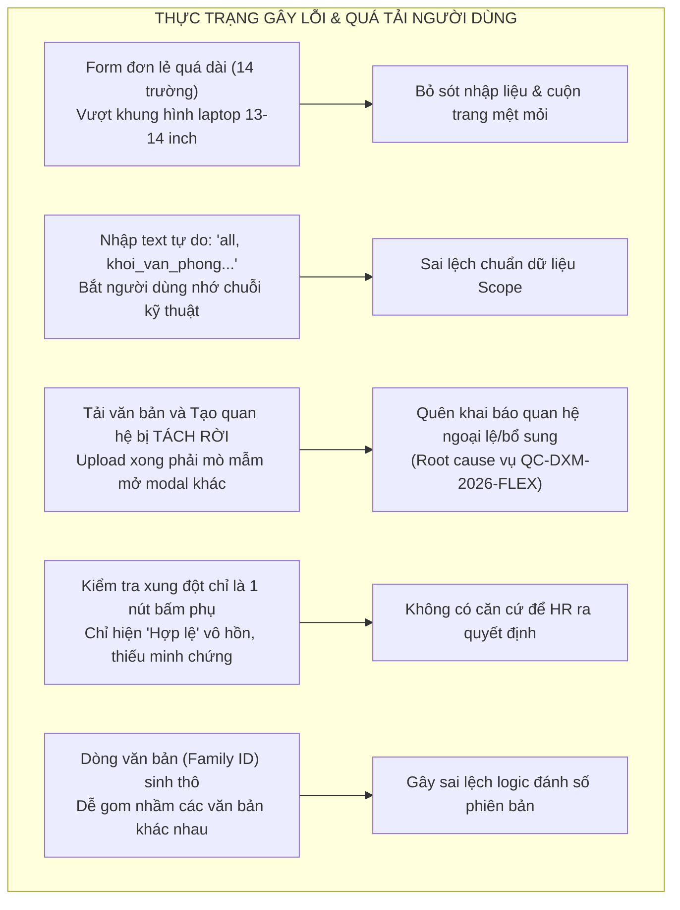
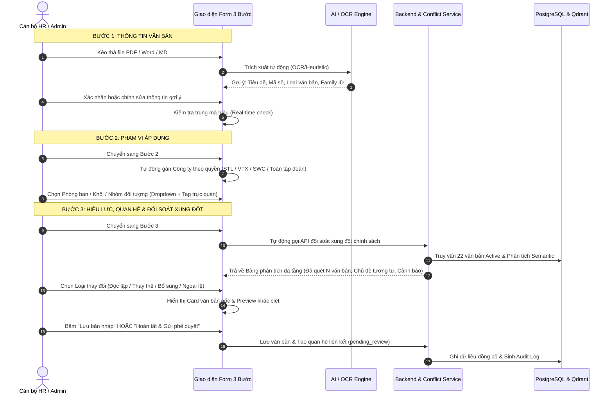

# SOTRANS HUB — BÁO CÁO KHẢO SÁT & THIẾT KẾ TỐI ƯU UX/UI
## QUẢN LÝ QUY ĐỊNH, TÀI LIỆU & THIẾT LẬP QUAN HỆ CHÍNH SÁCH

**Dự án:** SOTRANS Hub — Logistics AI Platform  
**Tài liệu:** `docs/UX_AUDIT_DOCUMENT_GOVERNANCE.md`  
**Giai đoạn:** `READ-ONLY UX AUDIT & REDESIGN SPECIFICATION` (Không can thiệp code trong giai đoạn này)  
**Đối tượng sử dụng chính:** Super Admin (Tập đoàn), Company Admin (STL, VTX, SWC), Cán bộ Nhân sự (HR Specialist / Legal)  
**Thời điểm lập:** 04/11/2026  
**Tác giả:** Senior AI Engineer, UX/UI Architect & RAG System Engineer  

---

## I. ĐÁNH GIÁ GIAO DIỆN VÀ QUY TRÌNH HIỆN TẠI

Khảo sát mã nguồn thực tế tại [chat/hr-admin.html](file:///d:/hoso-chat/chat/hr-admin.html), các API tại [auth-service/routes/documents.js](file:///d:/hoso-chat/auth-service/routes/documents.js) và bộ máy phân tích tại [auth-service/services/policyConflictDetector.js](file:///d:/hoso-chat/auth-service/services/policyConflictDetector.js):

### 1. Thành phần giao diện hiện có
1. **Trang Quản lý Quy định & Tài liệu (`#tabViewDocs`):**
   - Header thống kê 5 hộp trạng thái: Đang áp dụng, Đang thử, Chờ hiệu lực, Thùng rác, Tổng số bản.
   - Thanh công cụ: Ô tìm kiếm từ khóa, nút "🔄 Đồng bộ Qdrant", nút "Làm mới", nút "+ Tải văn bản quy định mới".
   - Danh sách thẻ văn bản (Document Cards) hiển thị danh mục, phiên bản, trạng thái, ngày hiệu lực và các nút thao tác: *Xem nội dung, Hỏi trên Chat, Sửa thông tin, Nhật ký, Xóa*.
2. **Modal Tải văn bản mới (`#upDlg`):**
   - Một Form dọc đơn nhất dài 14 trường nhập liệu.
   - Vùng kéo thả tệp (`#drop`), phân loại danh mục (`#upDocCategory`), mã hiệu (`#upDocCode`), dòng văn bản tự sinh (`#upDocFamily`), tiêu đề (`#upTitle`).
   - 3 trường nhập liệu phạm vi dạng chuỗi tự do: `#upDeptScope`, `#upBuScope`, `#upEgScope`.
   - Chọn ngày hiệu lực (`#upEffDate`), chọn đơn vị (`#upBranch`), chọn loại thay đổi (`#upChangeType`).
   - Nút kiểm tra xung đột rời rạc (`#btnCheckConflict`) và ô tóm tắt nội dung (`#upSummary`).
3. **Modal Quản lý Quan hệ chính sách (`#relDlg`):**
   - Tách biệt hoàn toàn khỏi Form tải văn bản.
   - Danh sách quan hệ hiện có của một văn bản kèm các nút "Duyệt", "Từ chối", "Xóa".
   - Khối thiết lập quan hệ mới chọn văn bản đích (`#relTargetDoc`), loại quan hệ (`#relType`), ghi chú (`#relNotes`).

---

## II. CÁC ĐIỂM NGHẼN & VẤN ĐỀ UX/UI CỐT LÕI (PAIN POINTS)



### 1. Form quá tải nhận thức (Cognitive Overload)
- Người dùng mở modal tải văn bản phải đối mặt cùng lúc với 14 trường thông tin từ kỹ thuật đến nghiệp vụ. Trên màn hình laptop phổ thông (1366x768 hoặc 1080p tỉ lệ hiển thị 125%-150%), modal bị tràn màn hình, nút "Tải lên hệ thống" bị đẩy xuống khuất tầm nhìn.

### 2. Nhập liệu kỹ thuật thủ công gây lỗi dữ liệu
- Các trường `Phòng ban áp dụng`, `Khối nghiệp vụ áp dụng`, `Nhóm nhân sự áp dụng` hiện là thẻ `<input type="text">` thô sơ.
- Người dùng nghiệp vụ HR bị buộc phải gõ chuỗi kỹ thuật như `all, khoi_van_phong, kho_bai`. Nếu người dùng gõ tiếng Việt có dấu (`Khối văn phòng`) hoặc gõ sai chính tả, hệ thống không cảnh báo, dẫn đến việc chatbot RAG đối soát phạm vi bị sai lệch hoặc bỏ sót.

### 3. Quy trình bị đứt gãy (Disconnected Workflow)
- Khi một văn bản mới có tính chất "Bổ sung" (`supplements`) hoặc "Ngoại lệ" (`exception_to`), form tải lên chỉ cho chọn `replace` (thay thế) hoặc `amend` (sửa đổi), không cho phép chọn văn bản gốc cần liên kết.
- Người dùng phải tải lên xong, tìm lại văn bản trong danh sách hàng chục tài liệu, bấm nút mở modal thứ hai (`#relDlg`), tìm tiếp văn bản gốc trong danh sách dropdown thô để kết nối. **Đây chính là nguyên nhân gốc rễ khiến văn bản `QC-DXM-2026-FLEX` trước đây bị thiếu quan hệ ngoại lệ chính thức với `01/QC-SOTRANS`!**

### 4. Kiểm tra xung đột thiếu tính giải trình (Lack of Explainability)
- Hiện tại, nút kiểm tra xung đột chỉ phản hồi một câu ngắn: `"✅ HỢP LỆ: Không phát hiện xung đột chính sách nào"`.
- Người dùng HR/Legal không biết hệ thống đã đối soát với những văn bản nào, có văn bản nào cùng chủ đề (ví dụ: cùng quy định về thời giờ làm việc, nghỉ ngơi) nhưng khác phạm vi hay không, dẫn đến sự thiếu tin tưởng vào AI.

### 5. Thiếu tính năng "Lưu bản nháp" (Drafting Support)
- Hiện tại, chỉ có duy nhất một nút "Tải lên hệ thống". Nếu văn bản đang trong giai đoạn soạn thảo, lấy ý kiến nội bộ, chưa muốn nạp vào luồng kiểm thử RAG hoặc phê duyệt, người dùng không có cách nào lưu trữ an toàn.

---

## III. SƠ ĐỒ QUY TRÌNH THAO TÁC MỚI (3-STEP WIZARD ARCHITECTURE)

Thiết kế lại luồng nghiệp vụ thành **Quy trình 3 bước tuần tự có hỗ trợ AI**, giúp phân tách nhận thức rõ ràng, từng bước xác thực dữ liệu và liên kết quan hệ tự động:



---

## IV. THIẾT KẾ BỐ CỤC TỪNG BƯỚC (STEP-BY-STEP WIREFRAMES)

Modal được thiết kế với kích thước chuẩn **`width: min(840px, 95vw)`**, chiều cao tối đa **`max-height: 88vh`**, chia thành 3 phần cố định:
1. **Header:** Tiêu đề modal & Thanh tiến trình 3 bước (Stepper Bar trực quan).
2. **Body:** Vùng nội dung cuộn mượt theo từng bước (Scrollable Body).
3. **Footer:** Thanh thao tác cố định đáy (Fixed Sticky Action Bar) chứa nút *Đóng, Lưu bản nháp, Quay lại, Tiếp tục*.

---

### BƯỚC 1: THÔNG TIN VĂN BẢN & TRÍCH XUẤT THÔNG MINH

```
+----------------------------------------------------------------------------------+
|  TẢI VĂN BẢN QUY ĐỊNH MỚI                                                    [✕] |
|  [ (1) Thông tin văn bản ] ------ (2) Phạm vi áp dụng ------ (3) Hiệu lực & Kiểm tra |
+----------------------------------------------------------------------------------+
|                                                                                  |
|  1. Tệp tài liệu ban hành (*)                                                    |
|  +----------------------------------------------------------------------------+  |
|  |   📄 [Kéo thả tệp PDF có chữ, Word .docx, .md vào đây hoặc Bấm để duyệt]    |  |
|  |   Hỗ trợ trích xuất tự động Tiêu đề, Mã hiệu và Ngày ban hành bằng AI      |  |
|  +----------------------------------------------------------------------------+  |
|  [Đã chọn: Quy_che_lam_viec_so_2026.pdf (142 KB)]  ⚡ [AI đang đọc văn bản...]    |
|                                                                                  |
|  2. Phân loại danh mục (*)                    3. Loại văn bản                    |
|  [ Quy chế và quy trình vận hành       [v] ]   [ Quyết định ban hành       [v] ]  |
|                                                                                  |
|  4. Mã hiệu văn bản (*)                       5. Dòng văn bản (Family ID)        |
|  [ QC-DXM-2026-FLEX                     ]   [ FAM-CHUYEN-DOI-SO         [v] ]  |
|  ℹ️ Mã hiệu hợp lệ, chưa từng sử dụng        (o) Kế thừa dòng đã có  ( ) Tạo dòng mới |
|                                                                                  |
|  6. Tiêu đề chính thức của quy định (*)                                          |
|  [ Quy chế Làm việc và Vận hành Nội bộ Mô hình Số & Linh hoạt 2026             ]  |
|  💡 Gợi ý tự động từ tệp tài liệu tải lên. Bạn có thể chỉnh sửa lại.            |
|                                                                                  |
+----------------------------------------------------------------------------------+
|  [Hủy bỏ]                    [💾 Lưu bản nháp]               [Tiếp tục: Bước 2 →] |
+----------------------------------------------------------------------------------+
```

#### Quy tắc thiết kế Bước 1:
- **Tự động nhận diện (AI-Assisted Extraction):** Khi người dùng nạp file, hệ thống quét tiêu đề và số hiệu văn bản ở phần đầu file để tự điền `upTitle` và `upDocCode`.
- **Family ID thông minh:**
  - Không tự sinh bừa bãi mã hash kỹ thuật.
  - Cung cấp 2 lựa chọn: *Kế thừa dòng văn bản đã có* (chọn từ dropdown danh sách các dòng hiện hành, ví dụ: `Sổ tay Chính sách`, `An toàn Lao động`, `Thời giờ làm việc`) hoặc *Tạo dòng văn bản độc lập mới*.
- **Kiểm tra trùng mã thời gian thực (Real-time duplicate check):**
  - Nếu mã hiệu đã tồn tại: Hiển thị ngay badge vàng: `⚠️ Đã tồn tại phiên bản v1 trong hệ thống. Tải tiếp sẽ tạo phiên bản v2 kế thừa.`
  - Nếu mã hiệu mới: Hiển thị badge xanh: `✅ Mã hiệu mới hợp lệ`.

---

### BƯỚC 2: PHẠM VI ÁP DỤNG & PHÂN CẤP ĐƠN VỊ THÀNH VIÊN

```
+----------------------------------------------------------------------------------+
|  TẢI VĂN BẢN QUY ĐỊNH MỚI                                                    [✕] |
|  [✓] Thông tin văn bản ------ [ (2) Phạm vi áp dụng ] ------ (3) Hiệu lực & Kiểm tra |
+----------------------------------------------------------------------------------+
|                                                                                  |
|  1. Đơn vị / Công ty áp dụng (*)                                                 |
|  [ 🚚 CTCP Vận tải Đa phương thức Vietranstimex (VTX)                       [v] ]  |
|  🔒 Quyền hạn của bạn (Admin VTX): Chỉ ban hành quy định nội bộ Vietranstimex    |
|                                                                                  |
|  2. Đối tượng thụ hưởng cốt lõi                                                  |
|  [x] Áp dụng cho toàn bộ cán bộ công nhân viên của đơn vị                        |
|  (Tự động bao gồm tất cả các phòng ban, chi nhánh và chức danh trực thuộc)       |
|                                                                                  |
|  ▼ Tùy chọn phạm vi nâng cao (Chỉ thiết lập nếu văn bản áp dụng đặc thù)         |
|  +----------------------------------------------------------------------------+  |
|  | 3. Khối phòng ban áp dụng (Mặc định: Tất cả phòng ban)                   |  |
|  | [ Khối Văn phòng Trụ sở x ] [ Phòng Công nghệ & Chuyển đổi số x ] [Tìm...v]|  |
|  |                                                                            |  |
|  | 4. Khối đơn vị / Địa điểm hoạt động (Mặc định: Toàn bộ địa bàn)            |  |
|  | [ Trung tâm Đổi mới Sáng tạo x ]                                 [Tìm...v]|  |
|  |                                                                            |  |
|  | 5. Nhóm chức danh / Nhóm nhân sự (Mặc định: Toàn bộ chức danh)             |  |
|  | [ Chuyên viên Chuyển đổi số x ] [ Kỹ sư CNTT x ]                 [Tìm...v]|  |
|  +----------------------------------------------------------------------------+  |
|                                                                                  |
+----------------------------------------------------------------------------------+
|  [← Quay lại]                [💾 Lưu bản nháp]               [Tiếp tục: Bước 3 →] |
+----------------------------------------------------------------------------------+
```

#### Quy tắc thiết kế Bước 2:
- **Tôn trọng tuyệt đối Tenant Boundary:**
  - Nếu là Admin STL: Khóa cứng chọn `SOTRANS Logistics (STL)`.
  - Nếu là Admin VTX: Khóa cứng chọn `Vietranstimex (VTX)`.
  - Nếu là Admin SWC: Khóa cứng chọn `Sowatco (SWC)`.
  - Chỉ SuperAdmin toàn hệ thống mới có quyền chọn `Toàn tập đoàn SOTRANS (Tất cả công ty con)`.
- **Xóa bỏ nhập liệu chuỗi kỹ thuật `all`:**
  - Người dùng không bao giờ phải gõ chữ `all`. Checkbox *"Áp dụng cho toàn bộ cán bộ công nhân viên của đơn vị"* được tích sẵn mặc định.
  - Khối "Tùy chọn phạm vi nâng cao" được thu gọn trong Accordion, chỉ mở ra khi quy định là chính sách đặc thù cho một bộ phận hẹp (như lái xe, kho bãi, nhân viên số).
- **Tag-Input trực quan:** Sử dụng các pill/chip có nút `✕` để thêm/bớt phòng ban, đơn vị trực quan.

---

### BƯỚC 3: HIỆU LỰC, QUAN HỆ CHÍNH SÁCH & ĐỐI SOÁT XUNG ĐỘT TỰ ĐỘNG

```
+----------------------------------------------------------------------------------+
|  TẢI VĂN BẢN QUY ĐỊNH MỚI                                                    [✕] |
|  [✓] Thông tin văn bản ------ [✓] Phạm vi áp dụng ------ [ (3) Hiệu lực & Kiểm tra ] |
+----------------------------------------------------------------------------------+
|                                                                                  |
|  1. Ngày ban hành              2. Ngày bắt đầu có hiệu lực (*)                   |
|  [ 01/11/2026           [📅] ]  [ 15/11/2026                          [📅] ]     |
|                                 [Hôm nay] [Đầu tháng tới] [Kể từ ngày ký]       |
|                                                                                  |
|  3. Tính chất quan hệ với hệ thống chính sách hiện hành (*)                      |
|  ( ) Văn bản độc lập (Không thay thế hoặc bổ sung cho văn bản nào)               |
|  ( ) Thay thế toàn bộ văn bản cũ (Supersedes)                                    |
|  ( ) Bổ sung điều khoản cho quy định hiện hành (Supplements)                     |
|  (•) Quy định ngoại lệ cho phạm vi đặc thù (Exception To)                        |
|                                                                                  |
|  4. Chọn văn bản gốc áp dụng ngoại lệ (*)                                        |
|  [ [01/QC-SOTRANS] Bộ Quy chế Lao động & Thời giờ làm việc Tập đoàn        [v] ]  |
|  +----------------------------------------------------------------------------+  |
|  | ℹ️ Văn bản gốc: 01/QC-SOTRANS • Phiên bản: v1 • Trạng thái: Đang áp dụng   |  |
|  | Nội dung gốc: Giờ làm việc chuẩn 08:00 - 17:00 (Thứ 2 đến Thứ 6)          |  |
|  | Phạm vi ngoại lệ: Cho phép Khối Chuyển đổi số check-in linh hoạt 08:00-09:30|  |
|  +----------------------------------------------------------------------------+  |
|                                                                                  |
|  5. BÁO CÁO PHÂN TÍCH XUNG ĐỘT CHÍNH SÁCH TỰ ĐỘNG (AI Conflict Intelligence)      |
|  +----------------------------------------------------------------------------+  |
|  | 🔍 Đã đối soát với 22 văn bản đang có hiệu lực trong toàn hệ thống        |  |
|  |                                                                            |  |
|  | 🟡 LƯU Ý LIÊN KẾT PHẠM VI (1 điểm cần xác nhận):                           |  |
|  | • Trùng chủ đề: "thoi_gio_lam_viec" với quy chế chung [01/QC-SOTRANS].     |  |
|  | • Khác biệt: Văn bản mới có giờ check-in 09:30, văn bản gốc chuẩn là 08:00.|  |
|  | • Trạng thái xử lý: Đã cấu hình quan hệ "exception_to" hợp lệ.             |  |
|  |   Hệ thống sẽ giữ quan hệ ở trạng thái [Chờ HR/Legal duyệt chính thức].    |  |
|  +----------------------------------------------------------------------------+  |
|                                                                                  |
|  6. Tóm tắt điểm mới / Căn cứ ban hành                                           |
|  [ Áp dụng mô hình làm việc linh hoạt (Flexitime) thí điểm cho Khối CĐS...    ]  |
|                                                                                  |
+----------------------------------------------------------------------------------+
|  [← Quay lại]           [💾 Lưu bản nháp]           [🚀 Hoàn tất & Gửi phê duyệt] |
+----------------------------------------------------------------------------------+
```

#### Quy tắc thiết kế Bước 3:
- **Tích hợp quan hệ văn bản ngay trong luồng tạo:**
  - Không còn tình trạng tạo xong văn bản rồi mới đi tìm cách tạo quan hệ.
  - Khi chọn `Thay thế`, `Bổ sung` hoặc `Ngoại lệ`, giao diện lập tức yêu cầu chọn văn bản gốc và hiển thị tóm tắt thông tin văn bản gốc để đối chiếu.
- **Tự động kích hoạt đối soát xung đột (Active Intelligence):**
  - Ngay khi người dùng chuyển sang Bước 3, hệ thống tự động gửi payload tới `/api/documents/detect-conflicts`.
  - Hiển thị rõ số lượng văn bản đã quét (ví dụ: `22 văn bản`).
  - Phân loại rõ ràng 4 mức độ:
    1. 🟢 **Hợp lệ:** Không trùng chủ đề hoặc quan hệ pháp lý đã khớp hoàn toàn.
    2. 🟡 **Có nội dung tương tự cần lưu ý:** Cùng chủ đề nhưng khác phạm vi hẹp/rộng $\rightarrow$ Hệ thống tự điền sẵn nút "Áp dụng quan hệ Ngoại lệ/Bổ sung".
    3. 🔴 **Xung đột trực tiếp nghiêm trọng:** Trùng cả chủ đề lẫn phạm vi với văn bản đang áp dụng mà không khai báo thay thế $\rightarrow$ Cảnh báo đỏ và chặn gửi duyệt nếu chưa giải trình.
    4. ⚪ **Không đủ dữ liệu kết luận:** Văn bản ngắn hoặc thiếu trích yếu.
- **Minh bạch trạng thái phê duyệt:**
  - Thông báo rõ: Mọi quan hệ thiết lập mới đều sẽ mang trạng thái `pending_review` và cần sự xác nhận của người có thẩm quyền trước khi chatbot RAG sử dụng làm căn cứ giải đáp.

---

## V. DANH SÁCH TRƯỜNG DỮ LIỆU: GIỮ, ẨN, TỰ ĐỘNG HÓA HOẶC THAY ĐỔI

| Tên trường dữ liệu | Trạng thái hiện tại | Thiết kế mới | Lý do tối ưu |
|---|---|---|---|
| `file` (Tệp tài liệu) | Input file đơn giản | Giữ nguyên + Thêm AI Auto-Reader | Tiết kiệm 80% thời gian gõ lại tên và mã hiệu văn bản. |
| `category` (Danh mục) | Dropdown 5 mục | Giữ nguyên + Thêm icon trực quan | Chuẩn hóa phân loại hồ sơ. |
| `doc_code` (Mã hiệu) | Text input tự do | Thêm Real-time Check trùng lặp | Ngăn chặn việc vô tình đặt trùng mã hiệu với văn bản khác. |
| `document_family_id` | Input readonly sinh thô | **Tự động hóa + Dropdown kế thừa** | Cho phép chọn dòng văn bản có sẵn để gom nhóm phiên bản v1, v2, v3 chuẩn xác. |
| `title` (Tiêu đề) | Text input | Giữ nguyên + Gợi ý từ tên file/OCR | Đảm bảo tính chính xác và dễ chỉnh sửa. |
| `branch_scope` (Công ty) | Dropdown tự chọn | **Khóa cứng theo Tenant tài khoản** | Ngăn Admin chi nhánh chọn nhầm phạm vi toàn tập đoàn hoặc công ty khác. |
| `department_scope` | Text input (`all, ...`) | **Chuyển thành Multi-select Tag Input** | Xóa bỏ chuỗi kỹ thuật `all`, người dùng chọn tên phòng ban có sẵn. |
| `business_unit_scope` | Text input (`all, ...`) | **Chuyển thành Multi-select Tag Input** | Trực quan hóa khối nghiệp vụ, đưa vào nhóm tùy chọn nâng cao. |
| `employee_group_scope`| Text input (`all, ...`) | **Chuyển thành Multi-select Tag Input** | Dễ dàng chọn các nhóm chức danh như Tài xế, Kho bãi, Văn phòng. |
| `effective_date` | Date input | Date Picker + Phím tắt nhanh | Tiện ích chọn "Hôm nay", "Đầu tháng tới". |
| `relation_type` | Nằm ở modal khác | **Tích hợp trực tiếp vào Bước 3** | Khắc phục triệt để tình trạng quên tạo quan hệ văn bản. |
| `target_doc_version_id`| Nằm ở modal khác | **Tích hợp trực tiếp vào Bước 3** | Xem được preview văn bản gốc ngay khi tạo liên kết. |
| `conflict_check` | Nút bấm thủ công rời rạc| **Tự động kích hoạt khi vào Bước 3** | Đảm bảo 100% văn bản trước khi gửi duyệt đều được quét xung đột. |
| `status` (Trạng thái) | Mặc định `testing` | **Hỗ trợ `draft` & `pending_approval`**| Cho phép lưu nháp trước khi chính thức nạp vào hệ thống. |

---

## VI. BẢN ĐỒ QUY TRÌNH PHÊ DUYỆT & 7 TRẠNG THÁI VÒNG ĐỜI VĂN BẢN

Để chuẩn hóa Document Governance, hệ thống cần phân biệt rõ ràng giữa **Trạng thái phê duyệt (Approval)**, **Hiệu lực thời gian (Legal Validity)** và **Khả năng truy xuất RAG (Retrieval Eligibility)**:

```mermaid
stateDiagram-v2
    [*] --> draft: HR tạo mới / Lưu nháp
    draft --> pending_approval: Gửi phê duyệt (Đã kiểm tra xung đột)
    pending_approval --> rejected: Cấp thẩm quyền từ chối
    pending_approval --> approved: HR Lead / Legal duyệt
    rejected --> draft: Sửa đổi và nộp lại
    
    state approved {
        [*] --> scheduled: effective_date > Hôm nay (Chờ hiệu lực)
        [*] --> active: effective_date <= Hôm nay (Đang áp dụng)
        scheduled --> active: Tự động kích hoạt khi đến ngày
    }
    
    active --> superseded: Có văn bản mới thay thế (quan hệ supersedes)
    active --> expired: Quá ngày expiry_date (Hết hiệu lực)
    superseded --> [*]
    expired --> [*]
```



### Chi tiết 7 trạng thái vòng đời:
1. **Bản nháp (`draft`):** Tài liệu đang soạn thảo, lưu tạm bởi tác giả. Không hiển thị trên RAG, không tham gia kiểm thử.
2. **Chờ phê duyệt (`pending_approval`):** Đã nộp lên hệ thống, đã có báo cáo xung đột chính sách. Đang chờ cấp thẩm quyền xem xét.
3. **Đã phê duyệt (`approved`):** Đã được HR Lead / Legal ký duyệt về mặt nghiệp vụ và quan hệ văn bản.
4. **Chờ hiệu lực (`scheduled`):** Đã duyệt nhưng ngày hiệu lực ở tương lai. Được phép hỏi thử trong Sandbox Admin (Mục 2), nhưng nhân viên chưa nhìn thấy.
5. **Đang áp dụng (`active`):** Đã đến ngày hiệu lực, văn bản chính thức tham gia vào cơ sở tri thức RAG cho toàn bộ nhân sự.
6. **Bị thay thế (`superseded`):** Đã có văn bản mới thay thế thông qua quan hệ `supersedes`. Tự động thu hồi quyền ưu tiên của chatbot.
7. **Bị từ chối (`rejected`):** Bị từ chối trong quá trình phê duyệt (có ghi rõ lý do trong audit log).

---

## VII. ĐIỀU CHỈNH BACKEND & API CẦN THIẾT (MINIMAL NON-BREAKING ENHANCEMENTS)

Tất cả các đề xuất tối ưu UX/UI đều tương thích ngược hoàn toàn với cơ sở dữ liệu và workflow hiện hành:

1. **Bổ sung endpoint danh mục Scope chuẩn (`GET /api/documents/scopes`):**
   - Trả về danh sách chuẩn hóa các phòng ban, khối nghiệp vụ và nhóm nhân sự để phục vụ autocomplete trên giao diện, thay vì để người dùng tự gõ text.
2. **Nâng cấp endpoint kiểm tra xung đột (`POST /api/documents/detect-conflicts`):**
   - Bổ sung thông tin thống kê: `total_scanned_docs` (ví dụ: `22`), `analyzed_topics` để hiển thị thẻ minh bạch trên giao diện.
3. **Hỗ trợ tạo kèm quan hệ văn bản trong `POST /api/documents`:**
   - Cho phép gửi kèm `initial_relationship: { target_doc_version_id, relation_type, notes }` ngay trong payload tạo văn bản, tạo atomic transaction trong một lần gọi duy nhất.

---

## VIII. ĐÁNH GIÁ RỦI RO ĐỐI VỚI DỮ LIỆU VÀ HỆ THỐNG RAG

| Thành phần | Nguy cơ tiềm ẩn | Biện pháp bảo vệ & Kiểm soát |
|---|---|---|
| **22 văn bản hiện có** | Nguy cơ bị ghi đè hoặc thay đổi trạng thái | Form mới chỉ tác động tới việc tạo mới hoặc chỉnh sửa văn bản được chọn. Không chạy bất kỳ script update hàng loạt nào. |
| **3 quan hệ đang `pending_review`** | Nguy cơ bị tự động chuyển thành approved | Giữ nguyên nguyên tắc cốt lõi: Mọi quan hệ tạo mới từ Form đều đặt mặc định là `pending_review`, yêu cầu thao tác duyệt riêng biệt. |
| **Collection Qdrant `hr_docs`** | Lệch pha vector hoặc mất điểm | Vector chunk chỉ được tạo khi văn bản được lưu thành công. Không reset collection. |
| **Tenant Isolation (STL/VTX/SWC)** | Người dùng chọn vượt quyền công ty khác | Dropdown công ty tại Bước 2 được khóa cứng theo JWT server-side, không thể bị override từ client. |

---

## IX. KẾ HOẠCH TRIỂN KHAI CHIA THÀNH TỪNG GIAI ĐOẠN

```
[GIAI ĐOẠN 1: Bố cục 3 bước & Form Upload] ──> [GIAI ĐOẠN 2: Tích hợp Quan hệ & Đối soát] ──> [GIAI ĐOẠN 3: UAT & Nghiệm thu]
- Cấu trúc lại HTML/CSS Modal (#upDlg)        - Tích hợp kiểm tra xung đột tự động          - Kiểm thử 10 kịch bản người dùng
- Thêm Stepper navigation                    - Thêm Card đối chiếu văn bản gốc             - Xác minh tính toàn vẹn RAG
- Thay ô text scope bằng Tag-Input            - Cơ chế Lưu bản nháp (Draft Save)            - Hướng dẫn vận hành người dùng
```

- **Giai đoạn 1 (Giao diện & Phạm vi):** Tái cấu trúc giao diện modal thành Stepper 3 bước; chuyển đổi các ô nhập text scope sang Tag Input trực quan; khóa cứng phạm vi tenant.
- **Giai đoạn 2 (Quan hệ & Phân tích xung đột):** Tích hợp việc chọn văn bản liên quan trực tiếp vào Bước 3; tự động kích hoạt bộ máy phân tích xung đột; bổ sung tính năng Lưu bản nháp.
- **Giai đoạn 3 (Kiểm thử & Bàn giao):** Chạy bộ kiểm thử UAT 10 trường hợp nghiệp vụ, đối soát tính toàn vẹn của Qdrant và PostgreSQL.

---

## X. TIÊU CHÍ KIỂM THỬ NGHIỆM THU UX/UI (UAT TEST CASES)

| Mã Test | Kịch bản kiểm thử | Hành vi người dùng | Kết quả nghiệm thu bắt buộc |
|:---:|---|---|---|
| **UAT-01** | Trực quan hóa quy trình | Bấm "+ Tải văn bản quy định mới" | Modal mở ra ở Bước 1, hiển thị Stepper rõ ràng, vừa vặn màn hình laptop không bị tràn |
| **UAT-02** | Khóa cứng Tenant STL | Đăng nhập tài khoản Admin STL, mở form | Bước 2 tự động chọn và khóa cứng "SOTRANS Logistics (STL)", không thể chọn Toàn tập đoàn |
| **UAT-03** | Quyền SuperAdmin | Đăng nhập SuperAdmin, mở form | Bước 2 cho phép chọn Toàn tập đoàn hoặc chọn công ty con tùy ý |
| **UAT-04** | Xóa bỏ nhập chuỗi `all` | Xem các trường phòng ban, khối, chức danh | Checkbox "Toàn bộ cán bộ nhân viên" tích sẵn; không có ô nhập chữ `all` |
| **UAT-05** | Thiết lập văn bản Thay thế | Tại Bước 3 chọn "Thay thế văn bản cũ" | Form bắt buộc chọn văn bản gốc, hiển thị Card tóm tắt văn bản cũ và phiên bản tiếp theo |
| **UAT-06** | Thiết lập văn bản Ngoại lệ | Tại Bước 3 chọn "Quy định ngoại lệ" | Cho phép chọn quy chế chung gốc, quan hệ tạo ra ở trạng thái `pending_review` |
| **UAT-07** | Đối soát xung đột tự động | Chuyển sang Bước 3 của văn bản giờ làm việc | Hệ thống tự động quét và báo cáo: Đã quét 22 văn bản, hiển thị điểm tương tự với 01/QC-SOTRANS |
| **UAT-08** | Cảnh báo trùng mã hiệu | Nhập mã hiệu `QC-VPC-2024-V1` | Hiển thị cảnh báo vàng trực quan ngay dưới ô nhập: Đã có phiên bản v1 trong hệ thống |
| **UAT-09** | Chức năng Lưu bản nháp | Bấm "Lưu bản nháp" | Tài liệu lưu ở trạng thái `draft`, không kích hoạt kiểm thử RAG, có thể sửa lại sau |
| **UAT-10** | Tính toàn vẹn dữ liệu | Hoàn thành tải 1 văn bản mới | Số lượng văn bản tăng đúng 1, 22 văn bản cũ giữ nguyên, Qdrant đồng bộ chuẩn xác |

---

## XI. KẾT LUẬN KHẢO SÁT

Báo cáo khảo sát này xác lập đầy đủ căn cứ kiến trúc và trải nghiệm người dùng để nâng cấp toàn diện module **Quản lý Quy định & Tài liệu SOTRANS**. 

Phương án thiết kế mới giải quyết triệt để 5 bất cập lớn nhất hiện nay:
1. Đập tan form dài quá tải bằng **Quy trình 3 bước trực quan**.
2. Loại bỏ hoàn toàn việc bắt người dùng gõ chuỗi kỹ thuật `all` bằng **Dropdown & Tag-Input**.
3. Khắc phục triệt để lỗi "quên khai báo quan hệ" bằng cách **tích hợp thiết lập liên kết ngay trong luồng tạo**.
4. Biến việc kiểm tra xung đột thành **tính năng chủ động, minh bạch, có số liệu giải trình rõ ràng**.
5. Bảo toàn 100% dữ liệu hiện có và tính tôn nghiêm của cơ chế phân quyền đa đơn vị (Tenant Boundary).

*Toàn bộ khảo sát tuân thủ nghiêm ngặt nguyên tắc READ-ONLY. Hệ thống sẵn sàng chuyển sang giai đoạn thực thi khi có chỉ đạo chính thức.*
