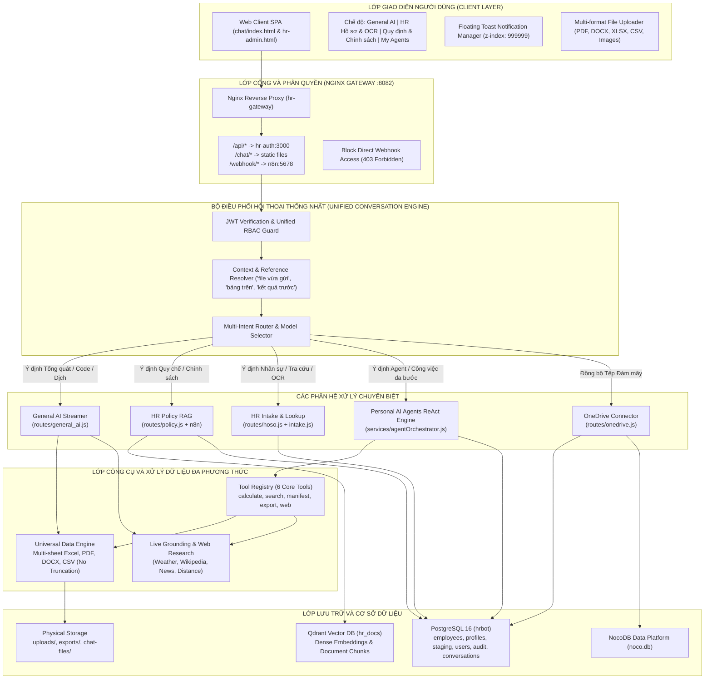

# SOTRANS HUB — KIẾN TRÚC TỔNG THỂ HỆ THỐNG AI CHATBOT PLATFORM
## UNIFIED AI CHATBOT PLATFORM ARCHITECTURE SPECIFICATION
**Mã công việc:** `SOTRANS-AI-PLATFORM-OVERHAUL-13`  
**Dự án:** `D:\hoso-chat`  
**Phiên bản nền tảng:** `v2.5 Enterprise Unified Engine`

---

## 1. SƠ ĐỒ KIẾN TRÚC TỔNG THỂ (SYSTEM ARCHITECTURE DIAGRAM)

---

## 2. QUY TRÌNH XỬ LÝ HỘI THOẠI XUYÊN SUỐT (END-TO-END DATA FLOW)

1. **Tiếp nhận & Xác thực (Ingestion & Authentication):**
   - Người dùng gửi yêu cầu văn bản hoặc đính kèm tệp qua Web Client.
   - Nginx Gateway (`hr-gateway`) tiếp nhận tại cổng 8082 và định tuyến qua Express API (`hr-auth:3000`).
   - Middleware `verifyToken` trích xuất `user_id`, `role`, `company_id` từ JWT chữ ký mật mã an toàn.
   - Tài khoản khách (`USER`/`GUEST`) bị chặn tự động ở cổng tải file và cổng tra cứu quy chế nội bộ.

2. **Giải quyết Tham chiếu Ngữ cảnh (Context & Reference Resolution):**
   - Bộ phân giải `conversationReferenceResolver` phân tích lịch sử đa lượt (`conversation_id`).
   - Tự động ánh xạ các cụm từ tham chiếu ngầm ("file vừa gửi", "bảng trên", "kết quả vừa rồi", "làm tương tự cho file thứ hai", "chỉ sửa mục số 3") với ID tệp (`attachment_id`), định danh bảng (`sheet_name`) hoặc kết quả tính toán trước đó.

3. **Phân loại Ý định & Điều phối (Intent Routing):**
   - Bộ định tuyến `smartRouter` kết hợp từ khóa ngữ nghĩa và rule-based guards phân loại câu hỏi vào đúng module chuyên trách.
   - Không chuyển mọi câu hỏi vào RAG một cách mù quáng.

4. **Thực thi Công cụ & Bóc tách Dữ liệu (Tool Execution & Universal Data Engine):**
   - Nếu là dữ liệu bảng tính (Excel/CSV): `universalDataEngine` lập `Workbook Manifest`, duyệt qua toàn bộ các sheet, kiểm soát hàng/cột ẩn, tính toán số liệu chính xác bằng mã toán học xác định, không phụ thuộc vào suy luận ngôn ngữ của LLM.
   - Nếu là tài liệu văn bản (PDF/DOCX): Lọc mã độc Prompt Injection (`sanitizeDocumentText`), trích xuất cấu trúc đề mục và đoạn văn có đánh số.
   - Nếu là câu hỏi nghiệp vụ hoặc công việc phức tạp: `agentOrchestrator` thực thi chu trình ReAct (Thought -> Action -> Tool -> Observation -> Final Answer).

5. **Lựa chọn Mô hình AI & Cơ chế Dự phòng (Model Routing & Fallbacks):**
   - Tự động ưu tiên mô hình hoạt động tối ưu: `gemini-flash-lite-latest` (tốc độ cao, độ trễ ~500ms).
   - Nếu gặp sự cố (HTTP 429, timeout, network error): Tự động chuyển tuần tự sang `gemini-3.5-flash-lite` và `gemini-3.1-flash-lite`.

6. **Kiểm chứng & Xuất bản (Verification & Output Formatting):**
   - Trả lời đúng trọng tâm, tách bạch dữ liệu thực tế và phân tích suy luận.
   - Trích dẫn văn bản chính sách cụ thể (Số điều, văn bản, đơn vị ban hành).
   - Ghi nhật ký kiểm toán có cấu trúc (không ghi mật khẩu, CCCD, dữ liệu nhạy cảm vào log).

---

## 3. RÀN BUỘC PHÂN VÙNG VÀ BẢO MẬT DỮ LIỆU (TENANT ISOLATION)

* **Phân vùng Đơn vị thành viên (Company / Tenant Boundary):**
  - Người dùng thuộc đơn vị nào (`STL`, `SWC`, `VTX`) chỉ được phép xem và tra cứu dữ liệu thuộc đơn vị đó.
  - Quản trị viên (`ADMIN`) có quyền xem dữ liệu tổng hợp nhưng dữ liệu lương nhạy cảm liên công ty tiếp tục bị khóa cứng (Fail-Closed) theo đúng quyết định phát hành `PRODUCTION_GOLIVE_EXECUTION_09`.
* **Phân vùng Cá nhân (Personal Isolation):**
  - Personal AI Agents và tệp đính kèm được gắn chặt với `user_id`. Người dùng này tuyệt đối không thể truy cập, xem hoặc thực thi Agent của người dùng khác.
  - Nhân viên thông thường (`EMPLOYEE`) chỉ được sử dụng chức năng Self-Service để xem hồ sơ của chính mình qua số CCCD/Mã NV gắn với tài khoản.
* **Phân vùng Khách (Guest Quarantine):**
  - Người dùng chưa đăng nhập hoặc vai trò `USER`/`GUEST` bị cấm tải file lên máy chủ và không được tra cứu tài liệu quy chế nội bộ.
