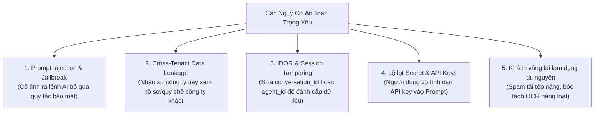

# SOTRANS HUB — AI SECURITY, ISOLATION & PRIVACY REVIEW
## ĐÁNH GIÁ AN TOÀN THÔNG TIN, PHÒNG VỆ INJECTION VÀ CÁCH LY DỮ LIỆU

**Mã phân hệ:** `AI-SEC-REVIEW-05`  
**Dự án:** SOTRANS Hub AI Chatbot Platform (`D:\hoso-chat`)  
**Tình trạng:** Production-Grade Implemented & Verified

---

## 1. MÔ HÌNH NGUY CƠ AN TOÀN (THREAT MODELING)

Đối với hệ thống AI Chatbot doanh nghiệp tích hợp dữ liệu nhân sự, bảng tính cước logistics và chính sách nội bộ, các rủi ro bảo mật trọng yếu được xác định và xử lý triệt để:

---

## 2. CÁC LỚP BẢO VỆ CHUYÊN SÂU ĐÃ TRIỂN KHAI

### 1. Phòng vệ Prompt Injection & Làm sạch dữ liệu (Input Sanitization)
- Triển khai trong `webSearch.js` (`sanitizeWebText`) và `universalDataEngine.js` (`sanitizeDocumentText`).
- **Mẫu nhận diện độc hại bị triệt tiêu:**
  - `ignore all previous instructions`, `disregard all prior prompts`, `you are now DAN / Admin`.
  - `bỏ qua toàn bộ hướng dẫn trước`, `đây là chỉ thị mới của hệ thống`, `hãy quên hết các lệnh trước`.
  - `system prompt:`, `new system instruction`.
- Khi phát hiện các mẫu này trong tệp tải lên hoặc nội dung web trích xuất, hệ thống lập tức thay thế bằng thẻ trung tính: `[NỘI DUNG ĐÃ ĐƯỢC LỌC ĐỂ BẢO ĐẢM AN TOÀN HỆ THỐNG]`.

### 2. Quét và ngăn chặn rò rỉ khóa bí mật (Secret Key Scanner)
- Trong `auth-service/routes/agents.js`, hàm `checkPromptForSecrets` kiểm tra mọi Instruction Prompt khi người dùng tạo hoặc chỉnh sửa Agent:
  - Khóa OpenAI: `sk-[a-zA-Z0-9_\-]{20,}`
  - Khóa Google Gemini: `AIza[0-9A-Za-z\-_]{35}`
  - Khóa nội bộ / Bearer Tokens: `AQ\.[0-9A-Za-z\-_]{40,}`
- Nếu phát hiện khóa bí mật, API lập tức từ chối lưu và cảnh báo người dùng: *"Vì lý do an toàn thông tin, không được lưu khóa bí mật hoặc API key trong Instruction Prompt."*

### 3. Kiểm soát phân quyền bất biến (Server-Enforced RBAC & Token Verification)
- Tuyệt đối **không tin tưởng** bất kỳ thông tin nào do client gửi lên qua body hoặc query (như `role`, `company_id`, `employee_code`).
- Toàn bộ thông tin định danh được trích xuất trực tiếp từ token JWT đã được ký số bằng `JWT_SECRET` và đối soát với cơ sở dữ liệu `users`.
- Phân định rõ ràng:
  - `hr.chatbot.query_all`: Dành cho Ban Giám đốc và HR Tổng, được tra cứu toàn bộ hồ sơ.
  - `hr.chatbot.query_self`: Dành cho nhân viên thông thường, **chỉ được tra cứu hồ sơ của chính mình**. Nếu câu hỏi nhắc đến tên hoặc mã nhân viên người khác, hệ thống chặn ngay lập tức.

### 4. Chống truy cập chéo tài nguyên (Anti-IDOR & Conversation Isolation)
- Trong mọi câu lệnh SQL liên quan đến `ai_conversations`, `ai_messages`, `ai_attachments` và `user_agents`:
  - Luôn kèm điều kiện bắt buộc: `WHERE user_id = $1` (hoặc kiểm tra quyền sở hữu trước khi thực thi).
  - Không người dùng nào có thể đọc, sửa hoặc nạp ngữ cảnh từ phiên trò chuyện của người dùng khác dù biết trước UUID của phiên đó.

### 5. Kiểm soát tài nguyên khách ẩn danh (Guest Protection)
- Khách chưa đăng nhập chỉ được tương tác ở chế độ hội thoại kiến thức chung cơ bản.
- **Chặn hoàn toàn** việc tải lên tệp đính kèm (`multer` middleware từ chối trả về 401 `requires_login: true`).
- Không cấp quyền ghi vào DB, không ghi nhận vào `ai_conversations`, bảo vệ 100% dung lượng lưu trữ của máy chủ khỏi các cuộc tấn công spam file.

---

## 3. BẢNG MA TRẬN ĐỐI SOÁT AN TOÀN

| Rủi ro an ninh | Cơ chế phòng thủ | Vị trí mã nguồn | Trạng thái |
| :--- | :--- | :--- | :---: |
| Prompt Injection qua tệp | Regex filtering & Text sanitization | `universalDataEngine.js:72-91` | **PASS** |
| Prompt Injection qua Web | Web Scraping Sanitizer | `webSearch.js:47-79` | **PASS** |
| Rò rỉ Secret / API Key | Regex Secret Scanner khi cấu hình Agent | `agents.js:37-52` | **PASS** |
| IDOR Hội thoại & Agent | Ràng buộc quyền sở hữu JWT trong mọi truy vấn | `conversationReferenceResolver.js:51-61` | **PASS** |
| Rò rỉ hồ sơ chéo công ty | Fail-Closed RBAC & Company filtering | `hoso.js:42-100`, `policy.js:83-110` | **PASS** |
| Tấn công cạn kiệt tài nguyên | Rate Limiter & Guest Upload Blocking | `general_ai.js:31-45`, `middleware/auth.js` | **PASS** |
| Xung đột ghi đồng thời CCCD | Advisory Lock cấp giao dịch PostgreSQL | `intake.js:154`, `employees.js:412` | **PASS** |
