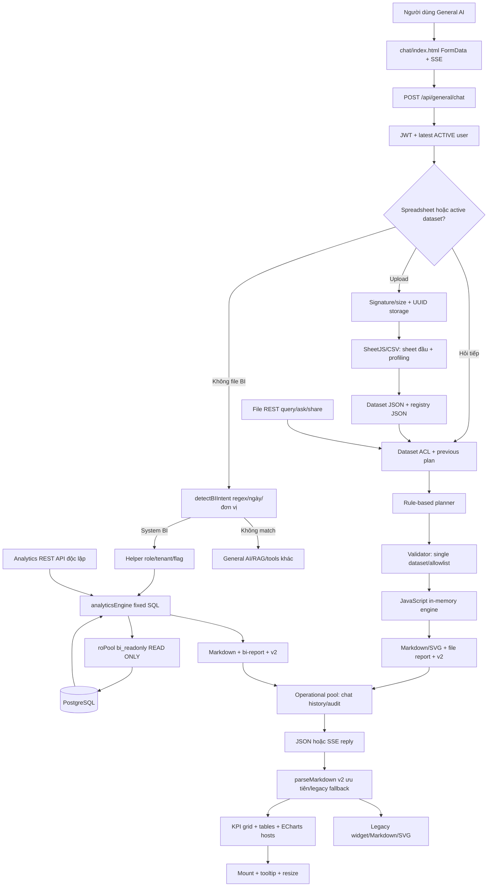

# SOTRANS HUB — BI GENERAL AI CURRENT STATE AUDIT

**Repository:** `D:\hoso-chat`  
**Ngày kiểm toán:** 16/11/2026, Asia/Bangkok (UTC+7).  
**Mốc source:** 11:18 UTC+7; `chat/index.html` có mtime 11:14:25. Kiểm tra cuối ghi tại cuối tệp.  
**Nhánh / HEAD:** `main` / `569f857` (13/11/2026).  
**Chế độ:** READ-ONLY AUDIT. Ngoại lệ duy nhất: cập nhật chính báo cáo này theo yêu cầu. Không sửa source/config, ghi DB, migration, upload, gửi chat, đăng nhập, cleanup, chạy suite, restart/rebuild container hoặc thực hiện Git mutation.  
**Final verdict:** **BI PARTIALLY COMPLETE**.

## 1. Executive Summary

Hai luồng BI đã có triển khai đáng kể và nối vào General AI: KPI SQL cố định trên PostgreSQL và phân tích một dataset Excel/CSV bằng JavaScript. Không có căn cứ công nhận toàn bộ Phase 1, Phase 2 hoặc Production BI Acceptance hoàn thành 100%.

1. **Internal BI:** catalog 17 mục nhưng chỉ14 nhánh SQL tính toán. Probe chỉ đọc trên DB Production và Staging:13 KPI `AVAILABLE`, OCR `PARTIALLY_AVAILABLE`,3 KPI `DATA_UNAVAILABLE` vì catalog khóa. Catalog thực tế **11 READY + 3 CONDITIONAL + 3 BLOCKED**, không phải12/2/3.
2. **Database security:** Production dùng `hr_app_user` tác nghiệp và `bi_readonly` cho BI; cả hai không superuser/bypass RLS. BI role có38 SELECT cột/6 bảng, không SELECT toàn employees/citizen_id, UPDATE users hoặc CREATE schema. Đây là bằng chứng quyền DB, không chứng minh toàn bộ File BI không lộ PII.
3. **File BI:** SheetJS `xlsx` + object/array JavaScript, persist `*.dataset.json`, registry JSON cache trong tiến trình. Không DuckDB/Parquet. Có parsing/profiling/validation/aggregate/sharing/retention. Chỉ xử lý sheet đầu; General AI20 MiB/file, REST25 MiB; chỉ chọn một spreadsheet mỗi lượt. Correctness và vòng đời còn vấn đề.
4. **File BI runtime:** lần đọc container đầu có19 registry entries,18 thiếu dataset JSON; lần đọc trực tiếp cùng volume sau đó có21 entries,20 thiếu JSON, chỉ1 READY có JSON (150 dòng,11 cột,1 sheet). Registry biến đổi trong thời gian audit. Chưa xác minh nguyên nhân/nguồn gốc mục thiếu; không coi toàn File BI Production khỏe mạnh từ một mục READY.
5. **Dashboard đang được cập nhật đồng thời từ tiến trình khác.** Snapshot cuối có payload v2, ECharts renderer, KPI grid, nhiều chart host, tooltip/lifecycle functions. GET `/chat/` và `/echarts.min.js`200. Nhận định cũ “chỉ SVG” đã lỗi thời. Nhưng File BI adapter chỉ sinh một visualization; slicer/cross-filter/drill-down/export chưa có; Treemap chỉ có enum, không renderer riêng.
6. **Probe thuần bộ nhớ tái hiện:** OCR `PARTIALLY_AVAILABLE` bị v2 từ chối; card AVG cộng trung bình nhóm; growth tính trước sort thời gian; dataset quá retention_expiry nhưng READY/MISSING_DATA vẫn qua ACL chủ sở hữu. Không ghi filesystem/DB khi chạy các probe này.
7. **Unified BI/WrenAI:** chưa triển khai trong repo/deployment kiểm tra. Contract chung không phải semantic layer; HYBRID bị từ chối. Không Wren container/service/package/API/model/workflow tích hợp.
8. **Giới hạn:** đã trace UI→route→planner/helper→engine→data→payload→renderer, kiểm tra engine/DB read-only và GET không đăng nhập. Không chạy phiên chat/upload/API POST có audit side effect. Engine trong subprocess riêng không phải HTTP server acceptance, cũng không phải browser Production acceptance.

### Quy ước bằng chứng và status

`VERIFIED COMPLETE`: trực tiếp chứng minh phạm vi hẹp của dòng, không suy rộng Phase. `IMPLEMENTED NOT VERIFIED`: có implementation/đường gọi, chưa đủ kiểm chứng runtime. `PARTIALLY IMPLEMENTED`: có phần thực hiện nhưng thiếu chức năng hoặc lỗi xác nhận. `NOT IMPLEMENTED`: NOT FOUND implementation trong phạm vi quét. `BLOCKED`: code khóa/thiếu điều kiện. `NOT APPLICABLE`: công nghệ hoặc chức năng ngoài cách triển khai hiện tại.

`NOT VERIFIED`/`NOT FOUND` trong Evidence mô tả giới hạn, không phải status thứ bảy. Phân loại KPI AVAILABLE/CONDITIONAL/BLOCKED ở mục6 khác status tiến độ. PASS lịch sử không phải Live Production.

## 2. Overall Progress Matrix

Phase dưới đây là nhóm kiểm toán bàn giao; không đồng nhất tên Phase OCR/HR cũ.

| Phase | Hạng mục | Status | Evidence | Environment | Remaining Gap |
|---|---|---|---|---|---|
| 1 | Internal System BI | PARTIALLY IMPLEMENTED | S01–S06; 17 catalog,14 SQL; 13 available+1 partial+3 unavailable | Working tree; Prod/Staging engine read-only | 3 KPI khóa,OCR coverage,v2,multi-turn; authenticated HTTP/browser NOT VERIFIED |
| 2 | Uploaded File BI | PARTIALLY IMPLEMENTED | S07–S15; intake→planner→validator→JSON→presenter→chat | Working tree; Staging khác version; Production registry | Multi-sheet,growth/AVG,missing JSON,expiry,PII,live acceptance |
| 3 | Power BI-style Dashboard | PARTIALLY IMPLEMENTED | S16–S20; v2/ECharts; HTML+asset200 | Frontend gateway; browser fixture test source | Slicer,cross-filter,drill-down,export; file multi-chart; real-data browser |
| 4 | Unified BI | NOT IMPLEMENTED | S10 single dataset; S16 HYBRID rejected; NOT FOUND semantic/join | Không deployment xác minh | Planner/schema/mapping/quyền/join/provenance đa nguồn |
| 5 | WrenAI | NOT IMPLEMENTED | Repo/package/compose/Docker ps -a; S25 chỉ định hướng | NOT FOUND repo/Docker host hiện tại | Service/SDK/API/model/planner/RBAC/tests/integration |
| 6 | Production BI Acceptance | PARTIALLY IMPLEMENTED | Quyền DB/engine/health đã kiểm tra; protected GET401 | Local deployment gọi Production:hr-auth/hrbot | Authenticated BI/file/browser; version release; vận hành/restore chưa xác minh lại |

## 3. Feature-by-Feature Matrix

Sxx dẫn file/function/line ở mục5. Toàn bộ17 KPI ở mục6,18 chức năng dashboard ở mục7,từng thành phần Wren ở mục8 tiếp nối ma trận này.

### 3.1 Internal engine và General AI

| Chức năng | Status | Evidence / hành vi |
|---|---|---|
| Engine/module tính KPI | VERIFIED COMPLETE | S01 computeKPI dispatch14 SQL; probe đọc DB thật |
| Catalog 17 mã | VERIFIED COMPLETE | S01 frozen metadata/source_tables/date_type; 11/3/3 |
| Logic đủ17 KPI | PARTIALLY IMPLEMENTED | 14 SQL; 3 BLOCKED trả sớm không DB |
| SQL/query allowlist/tham số | VERIFIED COMPLETE | S01 SQL cố định,bind $1…; không nhận SQL người dùng |
| ADMIN/HR tenant và RBAC | IMPLEMENTED NOT VERIFIED | S01 resolveTenantScope,S02 route guards,S04 helper; chưa HTTP đa role hiện tại |
| Chặn role khác/locked/inactive | IMPLEMENTED NOT VERIFIED | S02/S04/S22; latest user DB; chỉ ADMIN/HR Internal BI |
| Ngày/timezone/tham số | PARTIALLY IMPLEMENTED | S01 488–543,S04 55–209; UTC+7,endDate+1; JS Date/regex chưa strict-calendar acceptance |
| Timeout/transaction lifecycle | VERIFIED COMPLETE | S01 550–568 READ ONLY,3000ms,timezone,rollback/release; happy-path DB thật; timeout fault path chưa live |
| Cache kết quả KPI | NOT IMPLEMENTED | NOT FOUND S01/S04; registry cache không phải KPI cache |
| Catalog/batch API | IMPLEMENTED NOT VERIFIED | S02,max17,sequential; GET protected401; authenticated POST hiện tại NOT VERIFIED |
| Intent tiếng Việt | PARTIALLY IMPLEMENTED | S04 regex/patterns,summary6 KPI,clarification; không LLM text-to-SQL |
| BI khác RAG | PARTIALLY IMPLEMENTED | S03 file branch trước system BI,rồi General pipeline; heuristic |
| General AI gọi engine | VERIFIED COMPLETE | S03 1012–1029→S04 576–578 gọi trực tiếp,không HTTP qua analytics API; source verified |
| Query/response/chat rendering | IMPLEMENTED NOT VERIFIED | S03 JSON/SSE/persist→S04 Markdown/bi-report/v2→renderer; chưa phiên đăng nhập thật |
| Multi-turn system BI | PARTIALLY IMPLEMENTED | History tái dùng ngày/đơn vị sau khi câu mới match KPI; probe “Còn tháng trước thì sao?”→NORMAL_CHAT |
| AI Insight | IMPLEMENTED NOT VERIFIED | S03 gửi aggregate Gemini thêm nhận xét; không quyết định SQL; provider live NOT VERIFIED |
| Error handling | PARTIALLY IMPLEMENTED | S04 lỗi từng KPI→DATA_UNAVAILABLE; S02 structured error; S03 file catch warn rồi fall-through |

### 3.2 File intake và processing

| Chức năng | Status | Evidence / giới hạn |
|---|---|---|
| XLSX/XLS/CSV | IMPLEMENTED NOT VERIFIED | S07 whitelist/signatures,S09 parser; không upload lại |
| General AI size/multi-file | PARTIALLY IMPLEMENTED | S03 multer20 MiB/5 attachments,620 .find chỉ lấy spreadsheet đầu; UI25 MiB |
| REST size/single-file | IMPLEMENTED NOT VERIFIED | S08 45–51,S07 default25 MiB; runtime không override |
| Rows/columns/sheets limits | PARTIALLY IMPLEMENTED | S09 50000/100/10,truncate+alerts sau parse; không streaming cap trước allocation |
| MIME/magic bytes | PARTIALLY IMPLEMENTED | S07 MIME mismatch chỉ warn; ZIP/OLE/CSV signatures có; không AV |
| ZIP bomb guard | IMPLEMENTED NOT VERIFIED | S07 200–236 cap100 MiB,ratio25:1 nếu>5 MiB; chưa kiểm tra adversarial live |
| Antivirus/macro malware scan | NOT IMPLEMENTED | NOT FOUND quarantine/AV trong intake; signature không chứng minh file sạch |
| Formula injection sanitize | IMPLEMENTED NOT VERIFIED | S07 245–263,S09 496–518; giữ numeric +/-; không chạy fixture suite |
| File gốc/checksum/storage | IMPLEMENTED NOT VERIFIED | S07 UUID,SHA256,mode0600,expiry7 ngày; không public directory |
| Dataset persistence | PARTIALLY IMPLEMENTED | S09 JSON,S11 registry Map+JSON; live missing JSON; persistRegistry nuốt lỗi48–56 |
| Ownership | IMPLEMENTED NOT VERIFIED | S11 owner user_id/username; ADMIN toàn bộ,HR mặc định cùng công ty; không owner-only |
| Tenant isolation | IMPLEMENTED NOT VERIFIED | S11 180–218 khác tenant chỉ khi explicit share; role share có thể cross-company,cần policy duyệt |
| Chia sẻ view/query | IMPLEMENTED NOT VERIFIED | S11 226–311,user/role/company; S08 share; UI dataset share riêng NOT FOUND |
| Thu hồi | IMPLEMENTED NOT VERIFIED | S11 317–371,S08 unshare,recheck ACL mỗi query; cache process-local,chưa chứng minh nhiều worker |
| Retention/cleanup cron | PARTIALLY IMPLEMENTED | S07 expiry7 ngày; S11 cleanup; S15 timers; không chạy khi audit |
| Expiry enforcement trước query | PARTIALLY IMPLEMENTED | ACL chỉ chặn statusEXPIRED/DELETED,không so timestamp; probe quá hạn vẫn allowed |
| Dataset MISSING_DATA | PARTIALLY IMPLEMENTED | S11 không chặn ACL; S09 load JSON404; registry20 missing ở snapshot sau |
| Orphan file gốc | PARTIALLY IMPLEMENTED | S11 564–569 chỉ nhận .dataset.json/.data; file gốc .xlsx/.xls/.csv không match |
| Excel/CSV parsing | IMPLEMENTED NOT VERIFIED | S09 delimiter CSV,XLSX.read/sheet_to_json; không DuckDB/Parquet |
| Liệt kê multi-sheet | IMPLEMENTED NOT VERIFIED | S09 415–438,tối đa10 tên/kích thước |
| Chọn/query sheet khác | NOT IMPLEMENTED | Chỉ persist rows sheet đầu; target_sheet là nhãn,executor không switch sheet |
| Schema/type inference | IMPLEMENTED NOT VERIFIED | S09 STRING/BOOLEAN/DATE/INTEGER/FLOAT,header normalize/duplicate; heuristic |
| Profiling/missing values | IMPLEMENTED NOT VERIFIED | S09 null_ratio,cardinality,min/max/sum/avg/median,date span,top values; alert>50% null; không imputation |
| Preview | IMPLEMENTED NOT VERIFIED | S09 first10; S08 GET preview+view ACL; authenticated HTTP hiện tại NOT VERIFIED |
| Suggested questions | IMPLEMENTED NOT VERIFIED | S09 352–389 dựa loại cột; S12 profile Markdown |
| Ghi rows file vào HR tables | NOT APPLICABLE | Dataset rows nằm JSON; nhưng auth/chat/audit vẫn dùng/ghi PostgreSQL trong luồng thường ngày |

### 3.3 Planner/operations/report File BI

| Chức năng | Status | Evidence / giới hạn |
|---|---|---|
| Natural-language planner | PARTIALLY IMPLEMENTED | S10 normalize/synonyms/entity DISTINCT_COUNT/metric/clarification; rule-based |
| Query validation | IMPLEMENTED NOT VERIFIED | S10 cột/type/hàm/operator/date_trunc; 8 aggregations,3 groupBy,single dataset |
| Dataset authorization | IMPLEMENTED NOT VERIFIED | S08/S03 ACL→validator; S09 executor tự nó không nhận userContext |
| SUM | IMPLEMENTED NOT VERIFIED | S09 724–725; fixture arithmetic tests có,không query file live lần này |
| AVG | PARTIALLY IMPLEMENTED | Aggregate có; S12 card cộng các AVG nhóm; probe10+20→30 |
| COUNT | IMPLEMENTED NOT VERIFIED | S09 712–713 đếm row nhóm,không COUNT(column) bỏ null |
| MIN/MAX | IMPLEMENTED NOT VERIFIED | S09 728–731; nums rỗng trả0,cần chốt semantics |
| MEDIAN | IMPLEMENTED NOT VERIFIED | S09 732–736; median nhóm không cộng thành median toàn tập |
| DISTINCT_COUNT | IMPLEMENTED NOT VERIFIED | S09 Set bỏ null/empty; S10 ID matching; test P0.5 fixture |
| Percentage | PARTIALLY IMPLEMENTED | S09 752–756 trước limit,denominator phải>0; negative/filter scope cần chốt |
| Growth | PARTIALLY IMPLEMENTED | S09 758–767 theo insertion trước sort798; probe thời gian đảo thứ tự sai |
| Period comparison | PARTIALLY IMPLEMENTED | S09 775–794 lấy2 nhóm cuối trước sort; không date-spine/kỳ thiếu |
| Date aggregation day/month/quarter/year | IMPLEMENTED NOT VERIFIED | S09 118–135/group,S10 whitelist; chưa file live |
| File multi-turn | PARTIALLY IMPLEMENTED | S03 metadata/query_plan→recheck ACL→S10 followup filter/top/chart/metric/dimension |
| Conversation ownership file follow-up | PARTIALLY IMPLEMENTED | S03 812–816,914 chỉ id; thiếu owner predicate như system1075–1078; dataset ACL vẫn có; chưa khai thác live |
| Resource/timeout | PARTIALLY IMPLEMENTED | S09 concurrent10,cooperative3s,max1000 groups; S10 max500 rows; parse/read/sort không hard cancel |
| File KPI cards | PARTIALLY IMPLEMENTED | Legacy bullet; v2 một KPI primary aggregation; AVG/MAX/MEDIAN/distinct group totals không bảo toàn |
| Tables | IMPLEMENTED NOT VERIFIED | S12 Markdown20/hidden50,v2 data table; S18 UI15; không pagination/sort control |
| SVG charts | IMPLEMENTED NOT VERIFIED | S12 bar/line/donut→S20 SVG rendering; live real-data browser NOT VERIFIED |
| Multiple charts/file report | PARTIALLY IMPLEMENTED | S12 chartSvg duy nhất,adapter chỉ push viz_file_main một lần |
| Dataset report payload | VERIFIED COMPLETE | S12 bi-file-report/bi-dataset-widget và v2; source+pure serialization kiểm tra |
| Rendering General AI | IMPLEMENTED NOT VERIFIED | S03→S12→S20/S21; served HTML/asset thật; browser fixture không xác minh upload→real data |

### 3.4 Unified BI

| Chức năng | Status | Evidence |
|---|---|---|
| Unified query planner | NOT IMPLEMENTED | NOT FOUND; S03 các nhánh độc lập,S10 single-dataset |
| Unified schema/semantic layer | NOT IMPLEMENTED | NOT FOUND; catalog+inferred schema+dashboard JSON không semantic model chung |
| Mapping nguồn | NOT IMPLEMENTED | NOT FOUND keys/grain/units mapping DB-file |
| System-file/file-file join/correlation | NOT IMPLEMENTED | S10 datasets.length>1 bị chặn; không executor join |
| Quyền riêng từng nguồn trong unified query | NOT IMPLEMENTED | Hai ACL độc lập có; không multi-source planner thực thi quyền |
| Dashboard nhiều nguồn | NOT IMPLEMENTED | S16 chỉ INTERNAL_SYSTEM/FILE_DATASET; HYBRID rejected |
| Provenance từng chỉ số đa nguồn | NOT IMPLEMENTED | Có source_tables/file_id/checksum cục bộ; không lineage join/transformation/version từng measure |

### 3.5 Frontend và trải nghiệm

| Chức năng | Status | Evidence |
|---|---|---|
| BI trong General AI chat | IMPLEMENTED NOT VERIFIED | S21 fetch /api/general/chat,S20 parse assistant message; không BI workspace riêng |
| Renderer BI riêng trong chat | VERIFIED COMPLETE | S17 legacy,S18–S20 v2; hàm nằm monolithic index.html |
| Payload khác Markdown thường | VERIFIED COMPLETE | bi-report fence,file/profile/v2 comments; Markdown fallback |
| Hàm/component tái sử dụng | IMPLEMENTED NOT VERIFIED | renderInteractiveBIDashboard/renderEChartInstance/mount/dispose dùng chung source types; chưa module component riêng |
| Thay đổi giao diện chat | IMPLEMENTED NOT VERIFIED | Cards/grid/chart hosts/active dataset banner/delete; source đã serve gateway |
| Tab BI độc lập | NOT IMPLEMENTED | NOT FOUND,phù hợp General AI là UI yêu cầu/xem BI duy nhất |
| Refresh/stream/history/regenerate | PARTIALLY IMPLEMENTED | S03 persisted reply,S20 parse trong lifecycle; test cũ chưa browser real pipeline; chưa nghiệm thu đa dashboard |

### 3.6 Security và Production scope

| Chức năng | Status | Evidence / gap |
|---|---|---|
| Operational/BI pools tách | VERIFIED COMPLETE | S05; live Production2 account; Staging operational superuser |
| bi_readonly privileges | VERIFIED COMPLETE | Live38 SELECT columns/6 tables; không superuser/createdb/createrole/bypassrls,PII/UPDATE/CREATE checks bị từ chối |
| DB read-only defense | VERIFIED COMPLETE | S01 READ ONLY; probe session read_only=on; không thử DML/DDL |
| SQL injection Internal | IMPLEMENTED NOT VERIFIED | Frozen SQL+bind,identity/tenant whitelist; không có cơ sở claim100% toàn hệ thống |
| File allowlist | IMPLEMENTED NOT VERIFIED | S10 cột/hàm/operator/SQL keywords; engine JS,không SQL động |
| Tenant/RBAC toàn pipeline | PARTIALLY IMPLEMENTED | Shared DB role/WHERE guards; không thấy BI RLS policy; S16 HR scope ALL được bỏ qua trong guard |
| PII Internal | PARTIALLY IMPLEMENTED | Column grants tốt; INTAKE_BY_USER vẫn username/technical IDs; 38 cột không đồng nghĩa zero identifiability |
| PII File BI | PARTIALLY IMPLEMENTED | V2 mask vài key; preview/API/legacy Markdown/bi-file-report không cùng mask; probe synthetic raw còn tồn tại |
| File access control | IMPLEMENTED NOT VERIFIED | S08 verifyToken+ACL; storage không public; chưa auth HTTP live |
| Ownership/sharing policy | IMPLEMENTED NOT VERIFIED | S11; HR company-wide,ADMIN cross-company cần policy duyệt; chưa live đa role |
| Audit logging | PARTIALLY IMPLEMENTED | S14 sanitized structure,file+DB; API query/ask có log; General AI trực tiếp không thấy DATASET_QUERY/ASK tương ứng mỗi lượt; actor/filename vẫn lưu |
| Resource protection | PARTIALLY IMPLEMENTED | S01/S09/S10 limits; General AI limiter có; REST BI routes không limiter riêng; sync parse/RAM |
| Error handling | PARTIALLY IMPLEMENTED | Structured errors có; raw err.message vài route; registry/chat swallow; v2 fail→warning/fallback |
| Secrets/config fail-closed | PARTIALLY IMPLEMENTED | S05 default credential/RO fallback,S22 JWT fallback có trong code; không chép giá trị; claim zero hardcoded defaults không đúng |
| Production BI API | IMPLEMENTED NOT VERIFIED | Mounted,flagtrue,GET401/health200,engine DB thật; authenticated POST chưa kiểm tra |
| Production File BI | PARTIALLY IMPLEMENTED | Mounted,registry thật,many missing JSON; upload/query/browser acceptance chưa làm |
| Staging tương đương Production | PARTIALLY IMPLEMENTED | Volume khác,hash route/helper/presenter khác; validatorv2 không có disk staging lúc probe; operational superuser |

## 4. Architecture As-Is

General AI gọi helper/engine cùng process, không HTTP vòng qua analytics API. Rows file không vào HR tables nhưng chat/audit vẫn ghi DB trong sử dụng thường ngày. Gemini chỉ bổ sung nhận xét aggregate. Hai nhánh chưa join; cùng renderer/contract không tạo Unified BI. `interactions.selectable/filterable` là metadata, chưa có handler cross-filter/slicer.

## 5. Source Code Evidence

Line range theo snapshot audit; function/symbol là định danh chính khi concurrent edit. Link là đường dẫn tuyệt đối.

| ID | File, function, line range | Endpoint/phạm vi |
|---|---|---|
| S01 | [analyticsEngine.js](D:/hoso-chat/auth-service/services/analyticsEngine.js:30): catalog30–153; SQL172–372; resolveTenantScope414–482; parseDateRange488–543; transaction550–568; executeKPIQuery575–875; computeKPI890–952 | 17 KPI,14 SQL,scope/date/status |
| S02 | [analytics.js](D:/hoso-chat/auth-service/routes/analytics.js:49): flag49–58; catalog88–107; POST113–309; identity/tenant123–225; compute274–278 | GET /api/analytics/catalog; POST /api/analytics/kpis |
| S03 | [general_ai.js](D:/hoso-chat/auth-service/routes/general_ai.js:582): multer31–36; optional auth82–121; intake620–800; followup806–1004; internal1012–1183 | POST /api/general/chat; direct integration,persistence,SSE |
| S04 | [biReportingHelper.js](D:/hoso-chat/auth-service/services/biReportingHelper.js:411): date55–209; patterns246–409; detect411–494; execute500–602; legacy641–808; v2 adapter818–1105 | Intent/format/payload |
| S05 | [db.js](D:/hoso-chat/auth-service/db.js:7): primary7–22; RO25–42; exports44–54 | Pool20/10,fallback config |
| S06 | [server.js](D:/hoso-chat/auth-service/server.js:43):health43–46; general54; file63–64; analytics65; retention require22 | Routes/cron/health |
| S07 | [biFileSecurityService.js](D:/hoso-chat/auth-service/services/biFileSecurityService.js:20):limits20–27; signature121–193; ZIP200–236; formula245–263; intake272–360 | Types/size/UUID/checksum/storage/expiry |
| S08 | [bi_files.js](D:/hoso-chat/auth-service/routes/bi_files.js:45):upload45–142; list148; metadata185; preview235; query280; ask341; share428; unshare442; audit460; delete488 | Prefix /api/analytics/files,alias /api/bi/files |
| S09 | [biSpreadsheetEngine.js](D:/hoso-chat/auth-service/services/biSpreadsheetEngine.js:19):limits19–22; CSV137–230; profile232–346; suggestions352–389; intake392–572; execute581–839; load846–857 | SheetJS/JSON/aggregate/growth/limits |
| S10 | [biQueryPlanner.js](D:/hoso-chat/auth-service/services/biQueryPlanner.js:239):normalize21; synonyms45; profile66; plan239–781; followup785–927; [biQueryValidator.js](D:/hoso-chat/auth-service/services/biQueryValidator.js:69):enums17–51; ACL69–82; join109–114; group129–180; aggregate190–280; output334–376 | NL→validated plan,single dataset |
| S11 | [biDatasetRegistry.js](D:/hoso-chat/auth-service/services/biDatasetRegistry.js:28):cache/persist28–56; register62–94; ACL132–218; share226–311; revoke317–371; delete408; expiry474–516; orphan525–601 | Ownership/sharing/retention/storage health |
| S12 | [biDatasetPresenter.js](D:/hoso-chat/auth-service/services/biDatasetPresenter.js:35):SVG35–181; profile188–305; result311–464; v2 adapter476–609 | Single visual/primary KPI,PII mask v2 only |
| S14 | [biAuditLogger.js](D:/hoso-chat/auth-service/services/biAuditLogger.js:30):sanitize30–83; log97–155; read161–188 | File log+DB,safe query structure |
| S15 | [retentionService.js](D:/hoso-chat/auth-service/services/retentionService.js:532):daily532–558; BI546–550; timers561–570 | Scheduled cleanup,không chạy audit |
| S16 | [biDashboardSchemaValidator.js](D:/hoso-chat/auth-service/services/biDashboardSchemaValidator.js:18):limits18–30; validate82–375; KPI197–219; tenant353–365; assert380–391 | v2,HYBRID rejected,thiếu partial enum |
| S17 | [index.html](D:/hoso-chat/chat/index.html:13528):renderBIReportWidget13528–13770 | Legacy cards/multiple fixed visuals |
| S18 | [index.html](D:/hoso-chat/chat/index.html:13784):parse13784; validate13802; renderInteractiveBIDashboard13834–13979; table13922–13950 | V2 grids,table first15 |
| S19 | [index.html](D:/hoso-chat/chat/index.html:13985):renderEChartInstance13985–14220; branches14012–14202; mount14225–14250; dispose14255–14267 | BAR/LINE/PIE/DONUT/STACKED_BAR/AREA; không Treemap branch |
| S20 | [index.html](D:/hoso-chat/chat/index.html:14280):parseMarkdown v2 extraction14285–14301; legacy suppression14327–14335; restore/mount14732–14744 | Message→dashboard→mount/fallback |
| S21 | [index.html](D:/hoso-chat/chat/index.html:11876):active_dataset_id11876; fetch11894; setActive12068; clear12082; delete12089; bind12114; size12772; styles5763–5940; script16–23 | Chat UX/context/assets |
| S22 | [auth.js](D:/hoso-chat/auth-service/middleware/auth.js:6):verifyToken6–57; requireRoles60–75; [rateLimiter.js](D:/hoso-chat/auth-service/middleware/rateLimiter.js:73) | Latest ACTIVE user,GeneralAI limiter; secret values omitted |
| S23 | [BI readonly SQL](D:/hoso-chat/deploy/sql/02_production_bi_readonly_user.sql:49):defaults49–51; revoke62–71; grants76–138; [operational SQL](D:/hoso-chat/deploy/sql/01_production_operational_user.sql:1) | SQL chỉ đọc,không execute; quyền live kiểm tra riêng |
| S24 | [compose](D:/hoso-chat/docker-compose.yml:85):roles/flags85–90,bind96–103; [staging](D:/hoso-chat/docker-compose.staging.yml:53):roles53–60,bind69–73; [prod template](D:/hoso-chat/deploy/docker-compose.prod.yml:108); [nginx](D:/hoso-chat/nginx/default.conf:121) | Working tree bind; template không chứng minh deploy |
| S25 | [handover](D:/hoso-chat/docs/BI_REPORTING_PHASE_1_4_HANDOVER.md:288) | WrenAI POC định hướng |
| S26 | [conversations.js](D:/hoso-chat/auth-service/routes/conversations.js:111) | Read API có owner predicate,khác file-followup S03 |

## 6. Database & KPI Status

### 6.1 Nguồn dữ liệu và quyền đã đọc trực tiếp

Probe chạy trong subprocess riêng của `hr-auth` và `sotrans-auth-staging`, dùng connection config hiện hữu nhưng chỉ in tên service role/cờ an toàn/số lượng. SELECT metadata/count nằm trong `BEGIN READ ONLY`, timeout3s, kết thúc ROLLBACK. `computeKPI` dùng transaction READ ONLY riêng của engine. Không chạy DML/DDL, không in token/password/user rows.

| Nguồn | Production row count | Staging row count | Vai trò với BI |
|---|---|---|---|
| documents | 9 | 9 | Document counts/status/type/effective date/OCR |
| hr_intake_batches | 114 | 15 | Upload/user/trend/conversion; count không chứng minh đủ error/timing telemetry |
| hr_employee_staging | 111 | 18 | Duplicate/approval/missing fields/conversion |
| auth_audit_logs | 4591 | 4142 | Login/refresh activity; count là snapshot có thể tăng |
| users | 14 | 14 | Role/company/status join,không đọc PII vào báo cáo |
| chat_log | 3499 | 3450 | RAG eligible485/482; similarity481/478 trong probe |

`bi_readonly` Production và `staging_readonly` có số cột SELECT: documents9,intake6,staging10,audit4,users4,chat_log5 = **38**. Production operational `hr_app_user`:superuser/createdb/createrole/bypassrls đều false,CREATE public false. Staging operational `staging_admin`:cả bốn thuộc tính true,CREATE public true. Không dùng Staging PASS để chứng minh Production operational privileges hoặc ngược lại.

DB role là dùng chung cho các tenant. Tenant boundary Internal BI nằm ở WHERE/engine guards; chưa có bằng chứng RLS độc lập bảo vệ từng tenant nếu bỏ qua engine. Vì vậy quyền role hẹp và tenant isolation ứng dụng là hai lớp khác nhau.

### 6.2 Đủ 17 KPI: catalog, SQL, dữ liệu và kết quả engine

Phân loại sử dụng: AVAILABLE tương ứng catalog READY; CONDITIONAL giữ nguyên caveat nghiệp vụ; BLOCKED là khóa thực thi. Cột runtime là giá trị trả thật, không tự thay bằng classification. Tất cả17 mã đều có catalog; không có mục NOT IMPLEMENTED trong catalog nhưng3 mục không có SQL tính toán.

| KPI | Catalog→phân loại audit | SQL/logic S01 | Dữ liệu nguồn hiện có | Production / Staging engine | Ghi chú |
|---|---|---|---|---|---|
| DOC_TOTAL | READY→AVAILABLE | SQL174–185; case580–596 | documents,có rows | AVAILABLE / AVAILABLE | DISTINCT doc_version_id,active theo effective/expiry |
| DOC_BY_EFFECTIVE_DATE | READY→AVAILABLE | SQL188–198; case599–614 | documents,effective_date | AVAILABLE / AVAILABLE | 1 period mỗi môi trường; gom tháng,không generic day/quarter |
| DOC_BY_TYPE | READY→AVAILABLE | SQL201–211; case616–631 | documents,doc_type/category | AVAILABLE / AVAILABLE | 1 nhóm trong snapshot; groupBy cả type/category |
| DOC_STATUS | READY→AVAILABLE | SQL214–224; case633–647 | documents,status | AVAILABLE / AVAILABLE | 4 nhóm; ratio_percent |
| INTAKE_UPLOADS | READY→AVAILABLE | SQL227–235; case649–666 | hr_intake_batches | AVAILABLE / AVAILABLE | Count batches/sum files |
| INTAKE_BY_USER | READY→AVAILABLE | SQL238–249; case668–683 | hr_intake_batches.uploaded_by | AVAILABLE / AVAILABLE | 6/1 nhóm; username là dữ liệu định danh,không chép vào report |
| INTAKE_TRENDS | READY→AVAILABLE | SQL252–262; case685–700 | hr_intake_batches.created_at | AVAILABLE / AVAILABLE | 2 periods; fixed month aggregation |
| INTAKE_SUCCESS | CONDITIONAL | SQL265–296; case702–727 | batches+staging | AVAILABLE / AVAILABLE | Catalog vẫn conditional; batch completed khác conversion thành công,cross-company attribution có cảnh báo |
| INTAKE_FAILURE | BLOCKED | catalog87–94; return904–927,không SQL | Batch table có; telemetry đầy đủ NOT VERIFIED | DATA_UNAVAILABLE / DATA_UNAVAILABLE | blocked_reason là tuyên bố catalog,cần tái kiểm pipeline trước mở khóa |
| INTAKE_DURATION | BLOCKED | catalog95–102; return904–927,không SQL | Batch table có; timing đầy đủ NOT VERIFIED | DATA_UNAVAILABLE / DATA_UNAVAILABLE | Claim “100 batch timestamps bằng nhau” là lý do hardcoded,chưa tái đo100 batch trong audit |
| DUPLICATE_RATE | READY→AVAILABLE | SQL299–308; case730–745 | hr_employee_staging | AVAILABLE / AVAILABLE | Tỷ lệ suspected flag,không thuật toán phát hiện duplicate mới |
| POLICY_CONFLICT | BLOCKED | catalog110–117; return904–927,không SQL | Relationship table khai báo; persisted conflict metric NOT VERIFIED | DATA_UNAVAILABLE / DATA_UNAVAILABLE | Dynamic conflict detector không được engine gọi; role không được quyền table này |
| APPROVAL_QUEUE | READY→AVAILABLE | SQL311–316; case748–766 | hr_employee_staging | AVAILABLE / AVAILABLE | Queue hiện tại không bị date filter; activity theo approved_at/reviewed_at |
| OCR_QUALITY | CONDITIONAL | SQL319–328; case768–807 | documents.parse_quality | PARTIALLY_AVAILABLE / PARTIALLY_AVAILABLE | 5/9 văn bản có sample; HR OCR confidence submetric unavailable |
| DATA_INTEGRITY | READY→AVAILABLE | SQL331–340; case809–825 | missing_fields/uncertain_fields | AVAILABLE / AVAILABLE | Quality flag aggregate,không full data-governance audit |
| ACTIVE_USERS | READY→AVAILABLE | SQL343–357; case827–844 | audit+users | AVAILABLE / AVAILABLE | 11 role/company groups; LOGIN_SUCCESS/TOKEN_REFRESH,không realtime concurrent users |
| RAG_ANSWERABLE | CONDITIONAL | SQL360–371; case846–870 | chat_log.answerable,best_sim | AVAILABLE / AVAILABLE | Eligible485/482; latency submetric thiếu cột; General AI chat không nằm denominator |

Kết quả: **13 AVAILABLE + 1 PARTIALLY_AVAILABLE + 3 DATA_UNAVAILABLE** trên cả hai DB tại probe. Không có nghĩa14 KPI đều hoàn thiện nghiệp vụ:3 CONDITIONAL vẫn còn caveat. Không lấy AVAILABLE từ engine để ghi đè catalog.

### 6.3 API, General AI, frontend, chart và test cho từng KPI

**Quy ước:** `API NV` = authenticated HTTP thành công hiện tại NOT VERIFIED cho KPI đó. Tất cả mã được generic POST kpis accept theo catalog; probe hiện tại gọi engine trực tiếp, không giả danh user/token. General AI `Có code` = có KPI_PATTERNS hoặc summary mapping→helper→engine; không khẳng định câu diễn đạt bất kỳ đều match. `UI code` = có đường payload/renderer, chưa browser thực với KPI đó. Txx là test inventory mục9.

| KPI | HTTP API thành công hiện tại | General AI gọi | Frontend có đường hiển thị | Chart tự sinh từ code | Test/bằng chứng |
|---|---|---|---|---|---|
| DOC_TOTAL | API NV | Có code,summary | Card legacy/v2 | Card scalar,không chart riêng | T01/T03/T04; read-only probe hiện tại |
| DOC_BY_EFFECTIVE_DATE | API NV | Có code pattern | Markdown table+v2 | V2 LINE | T01 date case; T04 mock; probe |
| DOC_BY_TYPE | API NV | Có code pattern | Legacy top5+table,v2 | Legacy bar/V2 BAR | T03/T04 mock,không coi dedicated live SQL test; probe |
| DOC_STATUS | API NV | Có code pattern | Legacy segmented bar,v2 | V2 PIE | T12 script có chọn mã này,không log pass độc lập; probe |
| INTAKE_UPLOADS | API NV | Có code,summary | Card | Scalar card | T01,T03/T04; probe |
| INTAKE_BY_USER | API NV | Có code pattern | Legacy top5/table,v2 | BAR | T03/T04 mock; probe; không thấy dedicated production chart test |
| INTAKE_TRENDS | API NV | Có code pattern | Legacy columns,v2 | Legacy columns/V2 LINE | T03/T04 mock; probe |
| INTAKE_SUCCESS | API NV | Có code,summary | Card/progress/caveat | Rate/progress,không chart riêng | T01 cases13–14 CTE; T12 selected; probe |
| INTAKE_FAILURE | API NV | Có code,nhưng engine khóa | Reason/unavailable/blocked card | Không có dữ liệu vẽ | T01 cases15,30 xác minh no DB call; probe |
| INTAKE_DURATION | API NV | Có code,nhưng engine khóa | Reason/unavailable/blocked card | Không có dữ liệu vẽ | T01 cases16,30; probe |
| DUPLICATE_RATE | API NV | Có code pattern | Rate card | Không chart riêng | T03/T04 mock; probe; dedicated live SQL assertion NOT FOUND |
| POLICY_CONFLICT | API NV | Có code,nhưng engine khóa | Reason/unavailable/blocked card | Không có dữ liệu vẽ | T01 cases17,30; probe |
| APPROVAL_QUEUE | API NV | Có code,summary | Card pending/approved/rejected | Không chart riêng | T01 case18,T03/T04; probe |
| OCR_QUALITY | API NV | Có code pattern | Legacy hỗ trợ partial; v2 bị validator từ chối | Card nếu legacy; v2 report fallback | T01 case19 chỉ backend; pure probe xác nhận v2 lỗi |
| DATA_INTEGRITY | API NV | Có code pattern | Legacy generic card/table Markdown; v2 scalar | Không chart riêng | T03/T04 mock; probe; dedicated live chart NOT FOUND |
| ACTIVE_USERS | API NV | Có code,summary | Card; breakdown không map visualization v2 | Không chart riêng | T12 selected,T03/T04; probe |
| RAG_ANSWERABLE | API NV | Có code,summary | Rate card/progress | Không chart riêng | T01 case20,T12 selected; probe |

S01 không export generic SQL executor. Luồng17 KPI có thể trả unavailable theo thiết kế; điều này là trả response hợp lệ, không phải KPI nghiệp vụ đã có số liệu.

## 7. Dashboard Capability Assessment

### 7.1 Bốn cấp độ phải tách riêng

| Cấp độ | Status | Kết luận |
|---|---|---|
| 1. Render một chart | IMPLEMENTED NOT VERIFIED | SVG và ECharts code nối frontend có thật; asset200; test source browser dùng fixture. Phiên chat có dữ liệu thật chưa tái nghiệm thu |
| 2. Render nhiều chart cùng report | PARTIALLY IMPLEMENTED | Legacy loop nhiều KPI/v2 loop visualizations có; Internal adapter có5 loại KPI tạo charts. File adapter chỉ1 visual; không thể suy từ generic renderer sang multi-chart File BI |
| 3. Dashboard tổng hợp hoàn chỉnh | PARTIALLY IMPLEMENTED | KPI+charts+tables+layout có; thiếu generic dashboard composition/nhiều metric file/đúng summary và correctness. “Báo cáo tổng quan” mặc định chỉ6 scalar KPIs,không tự tạo5 breakdown charts |
| 4. Dashboard tương tác kiểu Power BI | PARTIALLY IMPLEMENTED | ECharts tooltip/legend/resize có code; không slicer/cross-filter/drill-down/export/table interactions. Tên “Interactive Dashboard v2.0” không chứng minh đầy đủ chức năng |

**Dữ liệu:** Production Internal BI đọc PostgreSQL thật; File BI đọc JSON persist thật. Không tìm thấy mock fallback sinh số liệu trong hai engines. Điều đó không xác nhận dữ liệu đã được chủ nghiệp vụ duyệt. Browser test mới dựng payload giả ngay trong page.evaluate; không nối DB/file API.

### 7.2 Từng chức năng Power BI-style

| Chức năng | Status | Source/function | Có nối dữ liệu thật? / mức thực hiện | Test xác nhận và gap |
|---|---|---|---|---|
| KPI Cards nhiều KPI | IMPLEMENTED NOT VERIFIED | S17 legacy; S18 renderInteractiveBIDashboard; S04 kpi_strip | Internal nhiều card; File adapter1 card; sum/AVG semantics còn lỗi | T14 SC04 fixture8 cards; không live business dashboard |
| Line Chart | IMPLEMENTED NOT VERIFIED | S12 generateLineChartSvg; S19 LINE branch; S04 trends/effective mapping | Internal/file có producer; live browser NV | T14 SC07 synthetic; T06 presenter fixtures |
| Bar/Column Chart | IMPLEMENTED NOT VERIFIED | S12 bar; S19 defaultBAR; S04 type/by-user | Có producer số liệu thật; ECharts hiện vertical,không thấy generic orientation selector | T14 SC03/07 fixture |
| Pie/Donut | IMPLEMENTED NOT VERIFIED | S12 generatePieChartSvg thực chất donut; S19 PIE/DONUT; S04 DOC_STATUS PIE | PIE có producer; DONUT renderer có nhưngfile adapter chỉ map PIE/BAR/LINE | T14 SC07 fixture; producer DONUT thật NV |
| Stacked Chart | PARTIALLY IMPLEMENTED | S17 status segmented bar; S19 STACKED_BAR mapping.value array | Generic multi-series renderer có; adapter thật chưa phát stacked multi-series; legacy segmented ratio không phải đầy đủ stacked categorical analysis | T14 chỉ một val field trong stacked fixture,không chứng minh nhiều series thực |
| Area Chart | PARTIALLY IMPLEMENTED | S19 LINE/AREA branch14060; S16 enum | Renderer areaStyle có; S12 adapter không chọn AREA,normal request không tạo area v2 | T14 SC07 không gồm AREA; live NV |
| Treemap | NOT IMPLEMENTED | S16 enumTREEMAP; S19 không branch | Pure probe TREEMAP→series.type bar; không hierarchy producer | Dedicated test NOT FOUND |
| Data Table | PARTIALLY IMPLEMENTED | S12 table20 rows; S18 table13922–13950 | Có data thật nếu payload tới; v2 UI cắt15,không paging widget dù payload có pagination | T14 chỉ render fixture; không sort/paging acceptance |
| Date Slicer | NOT IMPLEMENTED | S04 date intent,S18 không render slicers | NL date filter có; không date picker/day/month/quarter UI | Test slicer NOT FOUND |
| Category Slicer | NOT IMPLEMENTED | S04 filters.slicers metadata; S18 không controls | Backend company options có; không dropdown/checkbox điều khiển dashboard | Test control NOT FOUND |
| Cross-filtering | NOT IMPLEMENTED | S19 không chart.on/state-bus/query update | selectable/filterable flags không có hành vi | Test cross-filter NOT FOUND |
| Drill-down | NOT IMPLEMENTED | Adapter interactions.drilldown=false; S19 không drill handler | Không year→month/day hoặc company→department hierarchy | Test drill NOT FOUND |
| Tooltip | IMPLEMENTED NOT VERIFIED | S19 tooltip axis/item; S17 title tooltip | Có dynamic formatter,escape một số branches; stacked dùng default ECharts formatter; chưa hover production hiện tại | T14 XSS SC13 synthetic,không all chart tooltip real data |
| Sorting/Filtering | PARTIALLY IMPLEMENTED | S10 query order/filter; S09 engine sort; S18 table tĩnh | Có qua câu hỏi/API; không bấm header/filter trong table; không dashboard-wide controls | T06/T07 data ops; UI sorting tests NOT FOUND |
| Export PDF/Excel | NOT IMPLEMENTED | NOT FOUND trong S18–S20 và BI routes | Export conversation/file services chung không tương đương export dashboard BI | Test BI export NOT FOUND |
| Multiple Visualizations | PARTIALLY IMPLEMENTED | S04 adapter5 KPI types,S18 loop,S19 mount; S12 single viz_file_main | Internal nếu yêu cầu đúng các breakdown; File chỉ1; summary mặc định không chart | T14 SC06 synthetic3 charts; full live pipeline NOT VERIFIED |
| Responsive Layout | IMPLEMENTED NOT VERIFIED | S21 auto-fit/media CSS; S19 ResizeObserver/window resize | Code co giãn; chưa kiểm tra mobile/tablet với real report dài | T14 viewport1280x800; SC17 chủ yếu assert map dispose,không multi-viewport |
| Conversational Updates | PARTIALLY IMPLEMENTED | S03 followup,S10 planFollowUpQuery | Tạo report/message mới theo previous plan; không cập nhật state dashboard cũ bằng dashboard_id; system contextual query hạn chế | T11 fixtures33; chưa browser E2E thay đổi dashboard thật |

### 7.3 Contract v2 và lifecycle chưa đủ nghiệm thu

- Backend validator giới hạn1MiB,24 KPIs,12 visualizations,6 tables,500 rows/dataset; client validator chỉ kiểm tra shape cơ bản,không đầy đủ các invariant backend.
- Khi OCR trả PARTIALLY_AVAILABLE,adapter giữ nguyên status và không chọn primaryValue ở nhánh AVAILABLE/CONDITIONAL. Validator từ chối toàn v2 report; formatBIReportMarkdown bắt lỗi,vẫn còn legacy. Đây là fallback hợp lệ nhưng v2 không hoàn thiện cho dữ liệu hiện có.
- mount/dispose có implementation; không thấy caller disposeBIDashboard trong các flow thay hội thoại/stream ngoài definition ở snapshot. ResizeObserver được lưu trên DOM nhưngdispose function không disconnect. Chưa chứng minh lifecycle không leak.
- Nếu library không tải được,mount retry150ms không có ngưỡng; v2 hợp lệ làm ẩn legacy bi-report trước khi biết ECharts mount thành công. Nên kiểm chứng tình huống asset/CDN lỗi khi nghiệm thu sau này.
- Trong audit,URL cũ `/chat/echarts.min.js` trả404; source cuối đã chuyển `/echarts.min.js`,GET cuối trả200/1,029,203 bytes. Thay đổi này do tiến trình khác; không liệt kê lỗi404 cũ như lỗi asset còn tồn tại ở snapshot cuối.

## 8. WrenAI Status

Đã quét tên WrenAI/Wren-engine/Wren SDK/model trong repo kể cả file ignored liên quan,bỏ qua secrets/dependency blobs/binaries; đọc package/compose/routes/services; Docker ps -a liệt kê11 container,không Wren. Không kết luận về máy chủ/dịch vụ ngoài Docker host hoặc tài khoản cloud không được cung cấp.

| Thành phần | Status | Bằng chứng |
|---|---|---|
| Cài đặt WrenAI trong repo | NOT IMPLEMENTED | NOT FOUND implementation; chỉ S25 định hướng POC và audit cũ nhắc lại |
| Container/service | NOT IMPLEMENTED | NOT FOUND compose hoặc Docker ps -a hiện tại |
| Package/SDK | NOT IMPLEMENTED | package.json không Wren dependency; không import Wren |
| API integration/client/config | NOT IMPLEMENTED | NOT FOUND trong routes/services/server |
| Semantic model/MDL | NOT IMPLEMENTED | NOT FOUND model Wren; KPI catalog không thay thế MDL |
| Metadata/data model Wren | NOT IMPLEMENTED | NOT FOUND datasource binding/schema deployment cho Wren |
| Query planning qua Wren | NOT IMPLEMENTED | Hai planners hiện tại là fixed KPI/rule-based file |
| General AI integration | NOT IMPLEMENTED | Không branch gọi Wren |
| Wren RBAC/tenant | NOT IMPLEMENTED | NOT FOUND adapter chuyển verified context/row permissions |
| Tests/tài liệu tích hợp thực | NOT IMPLEMENTED | Chỉ POC direction,S25 288–293; không integration tests/run evidence |

**Khả năng tích hợp,đánh giá từ code hiện hữu:** có thể nghiên cứu một nhánh ad-hoc/semantic bổ sung phía sau General AI,giữ nguyên17 KPI SQL cố định và roPool. Đây chỉ là khả năng kiến trúc,không phải readiness đã chứng minh. Phải giải quyết schema/grain/metric semantics,tenant authorization nguồn riêng,read-only execution/timeout/allowlist,audit/provenance và contract v2 trước khi cho một planner khác truy cập dữ liệu. Không thay engine KPI hoặc cấp operational credentials cho Wren. Chưa kiểm tra version/API/hạ tầng Wren bên ngoài; không khẳng định tương thích cụ thể. Không cần và không đề xuất tab BI frontend riêng.

## 9. Test & Environment Evidence

### 9.1 Danh mục tests và sức nặng bằng chứng

Không chạy lại các suite dưới đây. Số lượng là số scenario trong source đã đọc hoặc claim của tài liệu được chỉ rõ; không phải kết quả chạy mới của audit.

| ID / loại | Source/vị trí | Xác nhận được thiết kế để kiểm tra | Môi trường thực chất và giới hạn |
|---|---|---|---|
| T01 Unit engine | [test_analytics_engine_foundation.js](D:/hoso-chat/tests/test_analytics_engine_foundation.js:58),30 scenarios | Tenant/date,read-only lifecycle,normalization,CTE conversion,3 blocked,queue/OCR/RAG | db.getClient mock,107 gán getReadOnlyClient=mock; không DB live. Claim30/30 ở handover,không rerun |
| T02 API/security | [test_analytics_api.js](D:/hoso-chat/tests/test_analytics_api.js:36),30 | Feature flag,auth/RBAC,identity spoofing,kpi/date/tenant params,response/errors | Express/HTTP isolated với auth+engine mock; không Production API |
| T03 Integration helper | [test_general_ai_bi_integration.js](D:/hoso-chat/tests/test_general_ai_bi_integration.js:23),35 | Intent/BI-vs-chat,dates,tenant/helper formatting/failure | Engine monkeypatch/mock; không gateway/backend E2E. Tài liệu P1.1 gọi nhóm này “End-to-End API & Gateway Integration” là sai mức bằng chứng |
| T04 Có tên E2E | [test_phase_1_4_e2e_verification.js](D:/hoso-chat/tests/test_phase_1_4_e2e_verification.js:43),53 | Helpers/contracts/security cases,Markdown/SSE string | Hermetic mocked compute. Cases46–53 dòng591–660 không browser/HTTP:case47 tự dựng SSE string,case48/49 kiểm object,case53 chỉ assert hai user IDs khác nhau. Không chứng minh conversation isolation live |
| T05 File intake/profile | [test_phase_2_file_intake_and_profiling.js](D:/hoso-chat/tests/test_phase_2_file_intake_and_profiling.js:99),38 | Real SheetJS fixture,magic/CSV/size/profiling/preview/access/formula | Dùng actual storage modules,ghi file/register/cleanup; BI_STORAGE_DIR isolation không thấy trong script. Không chạy vì read-only; không suy “unit” là không side effect |
| T06 File analysis integration | [test_phase_2_3_ai_query_and_analysis.js](D:/hoso-chat/tests/test_phase_2_3_ai_query_and_analysis.js:112),19 | Aggregations,groups,date,percentage/growth,planner/followup,presenter/SVG | Fixture workbook + file storage/registry,không browser/user live. Sorted fixtures không bao phủ lỗi insertion growth đã tái hiện |
| T07 Governance/security UAT | [test_phase_2_4_uat_and_governance.js](D:/hoso-chat/tests/test_phase_2_4_uat_and_governance.js:92),35 | Sharing/revoke/expiry/orphan,limits/audit/file cases | Gọi storage/registry/cleanup thật với user contexts mock. Không phải safe suite cho live storage; không thực thi trong audit |
| T08 Staging API E2E | [test_staging_phase_2_3_live_e2e.js](D:/hoso-chat/tests/test_staging_phase_2_3_live_e2e.js:130),11 | Login/upload/query/followup/IDOR; HTTP3001 | Có live Staging script,ghi upload/chat/audit. Không tìm raw run artifact gắn hash current; không chạy lại |
| T09 Staging live UAT | [test_staging_phase_2_4_live_uat.js](D:/hoso-chat/tests/test_staging_phase_2_4_live_uat.js:167),15 | Multi-role upload/query/share/revoke/preview/security3001 | Claim15/15 tại docs PHASE_2_4; script có HTTP thật nhưng không tái xác minh run/hash hiện tại; khác source Production |
| T10 Contract unit/security | [test_bi_dashboard_contract.js](D:/hoso-chat/tests/test_bi_dashboard_contract.js:72),25 | v2 producers/schema,refs,size/status/XSS/tenant/legacy serialization,HYBRID reject | Fixture unit; source hiện25 (thêm F01–F04),báo cáo P1.0 cũ21/21 không bao phủ bản cuối. Không chứng minh partial OCR hiện có đi qua contract |
| T11 NLP/multi-turn | [test_p0_5_query_understanding.js](D:/hoso-chat/tests/test_p0_5_query_understanding.js:177),33 | Entity count/salary/dimension/typo/followup/validation | Fixture/in-memory; claim33/33 ở reports; không full chat/auth/storage/browser |
| T12 Production live script | [test_live_least_privilege_production.js](D:/hoso-chat/tests/test_live_least_privilege_production.js:68) | Login,4 KPI DOC_STATUS/INTAKE_SUCCESS/RAG_ANSWERABLE/ACTIVE_USERS,catalog,key-name PII check | HTTP3000,login có audit ghi. Script in verdict100% vô điều kiện ở93; không assert mọi HTTP/status/PII và không fail rõ theo mọi check. Script tồn tại không chứng minh PASS hiện tại; không File BI live acceptance |
| T13 Rehearsal/deployment | [test_production_rehearsal_isolated.js](D:/hoso-chat/tests/test_production_rehearsal_isolated.js:148),[backup restore](D:/hoso-chat/tests/test_production_backup_restore_rehearsal.js:1),[Qdrant rehearsal](D:/hoso-chat/tests/test_qdrant_backup_restore_rehearsal.js:1),[smoke](D:/hoso-chat/deploy/scripts/smoke_test_production.js:1) | Role/PII/DML denial,backup/checksum/restore,health | Rehearsal DB/files có thao tác ghi/TRUNCATE attempts; template/mock storage có .parquet placeholder không chứng minh Parquet BI engine. Không chạy audit. docs claim36/36,15/15 không suy live current |
| T14 Frontend browser rendering | [test_p1_1_echarts_renderer.js](D:/hoso-chat/tests/test_p1_1_echarts_renderer.js:53),20 | Edge+Playwright,page.goto8082,fixture DOM/cards/charts,XSS/fallback/resize/dispose | Browser thật nhưng payload tự dựng page.evaluate,không login/chat/DB. SC02 tên17 canonical KPIs nhưng thực tế2 cards; SC07 stacked1 value field; SC17 assert Map removal,không observer disconnect/memory. Screenshot chỉ login |
| Performance benchmark | [benchmark_bi_engine.js](D:/hoso-chat/tests/benchmark_bi_engine.js:1) | Synthetic scale/time/memory/concurrency boundaries | Không chạy; docs benchmark là lịch sử,không current SLO hoặc production load proof |

Không tìm thấy BI-specific end-to-end acceptance vừa có authenticated user+upload/internal query+real data+persisted history+browser interactions+artifact gắn source/deploy hash. Những test ở hệ HR/OCR/agent khác không tự chuyển thành bằng chứng BI.

### 9.2 Kết quả kiểm tra mới trong audit

| Probe | Cách làm không mutation | Kết quả / mức kết luận |
|---|---|---|
| Docker inventory | docker ps và ps -a,inspect selected mounts | 11 containers; không Wren,không restart/rebuild |
| Config whitelist | Chỉ in BI flags/role separation boolean,không secret | Production BI_REPORTING_ENABLED=true,FEATURE_BI_REPORTING=true; Staging chỉ BI_REPORTING_ENABLED=true |
| DB roles/grants | SELECT pg_roles,column privileges,has_* trong READ ONLY | Production role separation/38 columns/deny checks verified; Staging operational superuser |
| Source counts | COUNT(*)/eligible metadata,không row content | Mục6.1; dữ liệu source có,không chứng minh business correctness |
| 17 computeKPI mỗi DB | require engine trong subprocess riêng,valid synthetic ADMIN context,company ALL; không JWT giả,không endpoint mutation | 13 AVAILABLE,1 partial,3 unavailable; không authenticated server API acceptance |
| Health/protected GET | GET3000/3001 health,catalog/files thiếu token | Health200; catalog và 2 file-prefix401. GET /api/analytics/kpis404 vì endpoint thực là POST; không coi404 đó là regression |
| Frontend asset | GET8082/chat/ và asset cuối /echarts.min.js | HTML200,có parserv2/ECharts; asset200,1,029,203 bytes; không thực thi browser auth |
| Dataset inventory | Read registry/JSON shape,không in filenames/IDs/values | Production19→21 entries,18→20 missing JSON; 1 READY150x11; Staging7 READY/0missing ở lần probe container |
| OCR contract | VM đọc source,mock dependency chặn I/O,tạo PARTIALLY_AVAILABLE synthetic | formatBIDashboardPayload throw INVALID_KPI_STATUS; fallback legacy còn tồn tại |
| AVG card | Pure presenter,2 group averages10/20 | card primary_value30; không phải AVG toàn dataset,đặc biệt khi group size khác nhau |
| Growth ordering | Pure engine; input Feb200 trước Jan100,sort ASC | Jan growth=-50%,Feb=null; đúng theo thời gian phải Jan=null,Feb=100%. Lỗi tái hiện không phụ thuộc DB |
| Expiry/status ACL | Pure canUserAccessDataset,synthetic owner,expiry2020 | READY và MISSING_DATA đều allowed; chứng minh guard thiếu timestamp/status check,không khai thác real user |
| Legacy PII path | Synthetic string nonpersonal ở cột CCCD qua presenter | Legacy Markdown vẫn chứa raw synthetic value,v2 mask không bao phủ toàn transport |
| System follow-up | Pure detectBIIntent,câu “Còn tháng trước thì sao?” sau BI STL | NORMAL_CHAT,kpiCodes[]; không đủ multi-turn context reuse |
| Treemap | Extract renderEChartInstance,stub ECharts chỉ capture option | chart_typeTREEMAP tạo series.type=bar; không renderer treemap |

Pure VM probes chỉ đọc source text và tính synthetic objects. Không load server/retention,file-security initialization hoặc actual registry filesystem module trong harness; không chạy suite; không tạo test file. Chúng chứng minh các case cụ thể,không phải broad regression pass.

### 9.3 Development, Staging, Production

**Development/working tree:** main/569f857 là committed base. Toàn bộ BI services/routes/tests mới và ECharts asset chưa commit; frontend/db/server/compose là modified. Source có thể mới hơn process Node đã nạp. Không có build/release ID xác nhận memory module version.

**Staging:** container `sotrans-auth-staging`3001→3000,mount `D:\hoso-chat-staging\auth-service`→`/app`; DB `sotrans_staging`,role `staging_readonly`. Không phải mount repo audit. Disk hash analyticsEngine/db trùng Production,nhưng general_ai/analytics/helper/presenter khác; không có biDashboardSchemaValidator trên disk ở thời điểm probe.7 READY dataset JSON; operational `staging_admin` superuser. Vì vậy không xác nhận UAT staging hiện tại bao phủ v2 mới.

**Production trong phạm vi audit:** container `hr-auth`3000→3000,mount `D:\hoso-chat\auth-service`→`/app`; gateway8082 mount repo `chat`→`/usr/share/nginx/chat`; DB `hrbot`,roles như mục6. Đây là local deployment được cấu hình gọi Production. Hostname public/TLS/external server,remote acceptance,backup hiện tại/RPO/RTO không được kiểm chứng trong audit BI này. `hr-web`8085 mount một thư mục khác (`C:\Users\Admin\hrbot\web`),không dùng nó làm bằng chứng frontend General AI8082.

**Source-on-disk vs process đang phục vụ:**7 file db/general_ai/analytics/engine/helper/presenter/validator có hash đọc trong hr-auth trùng working tree. Điều này chứng minh bind-mounted disk,không chứng minh Node require cache đã nạp bản sửa11:07–11:09. Không restart để kiểm tra. Frontend GET HTML mới xác nhận Nginx phục vụ source mới; backend v2 authenticated response vẫn NOT VERIFIED.

### 9.4 Đối chiếu Git và provenance release

- Branch `main`; HEAD `569f857`; commit gần nhất13/11/2026. Không stage/commit/push/checkout/reset.
- Modified trước audit: `auth-service/db.js`, `auth-service/routes/general_ai.js`, `auth-service/server.js`, `auth-service/services/retentionService.js`, `chat/index.html`, `docker-compose.staging.yml`, `docker-compose.yml`.
- New/untracked BI runtime: `routes/analytics.js`, `routes/bi_files.js`, `services/analyticsEngine.js`, `services/biAuditLogger.js`, `biDashboardSchemaValidator.js`, `biDatasetPresenter.js`, `biDatasetRegistry.js`, `biFileSecurityService.js`, `biQueryPlanner.js`, `biQueryValidator.js`, `biReportingHelper.js`, `biSpreadsheetEngine.js`, `chat/echarts.min.js`.
- New/untracked BI tests: T01–T12,T14 và benchmark/rehearsal scripts,như git status; deploy directory,BI handover/UAT/readiness docs cũng untracked. Có backup_phase_2_3/backup_phase_2_4/backup_readiness_review,không coi code backup là active implementation.
- `reports/` bị `.gitignore` loại. Audit cũ,báo cáo P0.5/P1.0/P1.1 và báo cáo này là **ignored report artifacts**,không phải tracked release evidence. Không gán chúng trạng thái committed chỉ vì không xuất hiện git status.
- Giữa audit có frontend/ECharts/test/report mới xuất hiện từ tiến trình khác. Chỉ ghi nhận,không stage/reset/xóa/copy sang Staging. File testP1.1 và hai report P1.1 đọc thêm khi chúng xuất hiện.
- Committed HEAD không chứa các BI services/routes mới; Production bind working tree nên “đã nằm trên disk Production” và “đã nằm trong branch commit” là hai kết luận khác nhau.

### 9.5 Mâu thuẫn/khẳng định quá mức trong báo cáo cũ

| Tài liệu/claim | Bằng chứng kiểm toán | Điều chỉnh kết luận |
|---|---|---|
| Audit cũ tại chính đường dẫn này,mtime10:03:14:Phase1/2 hoàn thành100%,Phase6 VERIFIED COMPLETE | KPI3 khóa,OCR partial,API/browser current NV; missing dataset/growth/AVG/expiry defects | Hạ phạm vi toàn Phase1/2/6 thành PARTIALLY IMPLEMENTED,không phủ nhận phần engine/grants đã xác minh |
| Audit cũ:12 AVAILABLE,2 CONDITIONAL,3 BLOCKED | Catalog S01:11 READY,3 CONDITIONAL gồm INTAKE_SUCCESS | Tách catalog classification khỏi runtime13 available/1partial/3unavailable |
| Audit cũ:chỉ SVG,không tooltip động/ECharts | Source mới11:14 có ECharts tooltip/renderer,mount; asset200 | Claim đã lỗi thời do concurrent implementation; core ECharts có code,không đồng nghĩa full Power BI |
| Audit cũ:25MB trong General AI | S03 multer20 MiB; UI/S07 REST25 MiB | Nêu rõ hai đường upload và mismatch |
| Handover148/148 và UAT255/255 như “E2E Staging” | T01–T04 hermetic; T04 có assertions object/string thay vì browser/session | Chỉ evidence unit/mock; không Staging/Production E2E |
| File BI “ZERO PostgreSQL mutations” cho full workflow | S03 INSERT chat messages/conversations; S14 DB audit | Dataset rows không vào HR tables,nhưng whole chat workflow vẫn DB writes |
| P1.0 report21/21 và fully dynamic multi-metric adapter | Source T10 hiện25; S12 adapter1 card/1 visual,AVG sum; partial OCR rejected | Contract nền tảng có,coverage/semantics chưa đủ; count cũ không áp cho source mới |
| P1.0 mô tả engine columnar | S09 rows array objects+JSON; không columnar storage | Gọi đúng JSON/row-object in-memory engine |
| P1.1 acceptance report mới167/167 ZERO REGRESSION; T03 “End-to-End API & Gateway” | T03 mock35,T14 fixture page.evaluate; không server query E2E; pure probes vẫn tái hiện lỗi | Giữ đây là claimed historical run,không broad regression/live acceptance |
| P1.1 screenshot là “real browser evidence” cho dashboard | [P1_1_BROWSER_RENDERING_EVIDENCE.png](D:/hoso-chat/reports/P1_1_BROWSER_RENDERING_EVIDENCE.png) đã xem:login panel,không dashboard | Không dùng ảnh đó chứng minh chart trong chat hoặc số liệu thật; không phủ nhận test DOM fixture có thể chạy ngoài màn nhìn thấy |
| P1.1 report gọi hr-auth/hr-gateway là Dev/Staging,zero Production touch | Runtime mounts chỉ đúng repo audit,DB hrbot/bi_readonly; staging là container/mount khác | Cần định danh env bằng mount/DB/role,không theo nhãn report |
| Live script in FINAL100% khi hoàn tất | T12 lines85–94 chỉ console PII/status,verdict vô điều kiện | Không coi script tồn tại hoặcconsole verdict là evidence assert pass |
| Production readiness:zero hardcoded secrets/defaults | db.js/middleware auth có default credential/JWT fallback; không in literal | Claim broad không đúng với source hiện tại; không đánh giá secret đang deploy thực từ literal |
| Production acceptance bao phủ Uploaded File BI | T12 chỉ4 Internal KPIs+catalog; registry cómissing JSON | File BI Production live acceptance vẫn NOT VERIFIED |

Không quy kết nguyên nhân missing JSON cho test/cleanup cụ thể khi chưa có timeline/log chứng minh. Báo cáo Phase3 go-live khác trong reports nói OCR Document Pipeline,không phải dashboard Phase3 của ma trận này.

## 10. Missing Features

Danh mục theo dependency; bao gồm thiếu triển khai và thiếu nghiệm thu/đúng dữ liệu,không tự thiết kế thay trạng thái thực tế.

1. **Version/provenance và nền correctness:** chưa có release BI được commit gắn artifact+deploy hash; Staging v2 không đồng nhất; missing JSON cần điều tra; growth/period ordering và KPI rollup AVG/MEDIAN/MAX/distinct sai; partial OCR contract mismatch; strict calendar edge cases chưa đủ proof.
2. **Quản trị/bảo mật dữ liệu:** expiry timestamp/MISSING_DATA enforcement; conversation owner check file followup; nhất quán PII mask trên API/profile/legacy/v2/AI insight; fail-closed pool config; per-query audit qua GeneralAI; orphan file gốc và registry persistence/durability/multiworker coherence; quyết định HR/role cross-company sharing.
3. **Dữ liệu KPI còn khóa:** Intake failure telemetry đầy đủ,completed/timing telemetry đo duration,persisted conflict facts hoặc nguồn được duyệt; numeric HR OCR confidence/RAG latency submetrics; OCR parse_quality coverage.
4. **File query/composition:** chọn sheet thực,parse/store/query nhiều sheet; kế hoạch nhiều measures/charts cùng file report; hạn mức end-to-end/worker isolation/cancellation; metric labels/denominator/grain chính xác; stable dataset/version/checksum provenance.
5. **Dashboard tổng hợp và tương tác:** date/category slicers,state của dashboard,cross-filter,drill hierarchy,sorting/filtering/pagination table,export PDF/Excel,Treemap,producer cho stacked/area/donut,nhiều file visuals,multi-turn cập nhật dashboard có định danh,lifecycle cleanup/full offline failure fallback.
6. **Unified BI:** semantic schema,mapping identifiers/grain/time/currency,unified planner,multi-source authorization,join/correlation,combined dashboard,lineage từng measure. Chưa triển khai.
7. **WrenAI:** toàn bộ service/package/API/model/workflow/security/integration/test còn thiếu; không thể ghi ready chỉ vì có renderer/contract.
8. **Acceptance artifacts:** unit/integration regression cho cases lỗi,browser fixture có ảnh đúng dashboard,multi-role authenticated E2E Staging→Production real-data,bằng chứng refresh/stream/regenerate/revoke/export/limits gắn source version; operational recovery/SLO được xác nhận bởi DBA/DevOps.

Không xem cache KPI,DuckDB/Parquet hoặcWrenAI là bắt buộc để tính các14 KPI đang có. Việc chúng chưa có không tự làm engine fixed-SQL ngừng hoạt động; chỉ chuyển công nghệ khi workload/requirements xác nhận.

## 11. Recommended Next Steps

Đây là thứ tự đề xuất sau audit; **chưa thực thi bước nào**. General AI tiếp tục là giao diện yêu cầu/xem BI duy nhất.

| Ưu tiên/việc | Phụ thuộc | Có thể song song | Xác nhận cần có |
|---|---|---|---|
| 1. Chốt source/deploy baseline,gắn commit/artifact hash và đồng bộ staging đúng bản | Không; điều kiện cho mọi nghiệm thu tiếp | Thu thập business definitions | Chủ repo/DevOps phê duyệt release procedure; không commit từ audit |
| 2. Sửa correctness:time sort trước growth/comparison,rollup metric đúng,partial OCR status mapping | Baseline1 | Mục3 security; mục4 source-quality investigation | BI/business owner chốt AVG weighted,COUNT/null,distinct grain,negative percentage,kỳ thiếu |
| 3. Hoàn thiện ACL/lifecycle/PII/audit/fail-closed | Baseline1 | Correctness2 | Security/business duyệt HR sharing/cross-company; DBA/DevOps duyệt roles/defaults/storage changes |
| 4. Điều tra registry20 missing,retention/orphan và nguồn3 blocked KPIs | Baseline1; không cleanup trước inventory/backup | Mục2/3 | Data owner xác định real vs fixture; DBA duyệt truy vấn sâu/schema/telemetry/migration nếu cần; DevOps storage/backups |
| 5. Tạo acceptance Staging có browser thật+auth+real fixture pipeline,gắn source hash và ảnh dashboard | 2/3; staging1 | Thiết kế nghiệp vụ/dashboard requirements | QA/UAT owner; không chạy destructive test trên Prod; phê duyệt dữ liệu dùng thử |
| 6. Mở rộng dashboard composition và multi-sheet thật | 2/3/5,metric semantics | Frontend producer/renderer làm song song trên contract đã chốt | Business owner chọn KPI/charts/filters/hierarchy/export; không mở tab BI riêng |
| 7. Slicers/cross-filter/drill/table/export + lifecycle/cancellation | 6; quyền và query policy3 | UI và backend query tests theo contract | Security duyệt filter scope; business duyệt drill/export/PII; DevOps resource limits |
| 8. Production BI/File BI acceptance và vận hành | Staging5 + release/missing-data giải quyết; 7 nếu phạm vi nhận dashboard tương tác | Restore rehearsal/sizing riêng | DBA/DevOps phê duyệt rollout/backup/restore; business ký metric correctness; multi-role authenticated evidence |
| 9. Unified BI discovery/implementation | Stable foundation2–5,semantics/source rights | Có thể khảo sát schema/business mapping sớm,chưa enable query | Data owners chốt join keys/grain/units/tenancy; DBA/Security duyệt read paths |
| 10. WrenAI sandbox feasibility POC | Semantic/security/source contract9 hoặcscope ad-hoc hẹp được duyệt | Khảo sát sản phẩm/hạ tầng riêng,không chạm KPI SQL | DBA/DevOps/Security duyệt sandbox/read-only credentials/data scope; đo accuracy trước tích hợp General AI |

Các việc có thể làm song song là đề xuất tổ chức công việc,không phải đã giao hoặc chạy agent song song trong audit này.

## 12. Final Verdict

**BI PARTIALLY COMPLETE**

Đã chứng minh được nền engine fixed-SQL,catalog/14 SQL paths,dữ liệu nguồn/quyền DB,hai nhánh tích hợp General AI và source frontend v2 được phục vụ. Chưa chứng minh toàn Phase1/2/Production acceptance hoàn tất; đã tái hiện một số lỗi correctness/contract/lifecycle và có nhiều registry entries thiếu dataset. ECharts core mới không thay thế các chức năng tương tác Power BI còn thiếu. Unified BI/WrenAI chưa triển khai.

Điều kiện để nâng kết luận ở lần kiểm kê sau:baseline source/deploy tái lập được; correctness và authorization gaps có kiểm thử phù hợp; source3 KPI bị khóa được quyết định rõ; File BI storage khỏe mạnh; Staging/Production authenticated E2E và browser evidence với dữ liệu thật được nghiệm thu. Không thực hiện sửa lỗi/triển khai các bước đó trong audit này.

### Appendix — Snapshot hashes và phương pháp chốt

Production container disk đọc7 file sau trùng working tree; hash **không** chứng minh version module đã nạp trong server process:

| File | SHA-256 |
|---|---|
| auth-service/db.js | 5432b45ef327a8a9ced7e413e32437b891d3351e3927330e44f5ebdc72669ff1 |
| auth-service/routes/general_ai.js | cf6c5324a3b041115ef34a8e14ab8faf5ea102899db5f8bbb1ce8f9cf3b00273 |
| auth-service/routes/analytics.js | b198f4ceb65883d1a43b24dcc9dd33caa6a297dc41fe546a0500701accafe9d3 |
| auth-service/services/analyticsEngine.js | 316792faeabf5498323014fd6f8ccddf021df341190c695bdc566794094fded4 |
| auth-service/services/biReportingHelper.js | d00f74b3deb9248be38c588d9a0027d4997c5684f30fbd58ae6f0ced73728793 |
| auth-service/services/biDatasetPresenter.js | 9df7bbadbd2b2a6ec1821342bf8b15432d3cd0324593ff196add1ddce1e5dfe7 |
| auth-service/services/biDashboardSchemaValidator.js | 1eb8522189dbcf893383d74075dd51d4353aa0231d687c059ab76797200e3ed8 |
| chat/index.html — local final frontend snapshot | 13216aa7f4d20b331eff56b61b1553f312f57d7e930f3f07bbd9efedcea88df5 |

Lệnh/loại truy cập đã dùng:rg/Get-Content/Get-Item/Get-FileHash; git --no-optional-locks status/diff/log/ls-files/check-ignore; docker ps/inspect; docker exec node probes chỉ đọc; GET public/protected chưa token; VM pure probes với dữ liệu synthetic. Các GET có thể sinh access log hạ tầng thông thường; không có application mutation endpoint được gọi. Không dùng/tạo auth token,không truy cập secrets trong báo cáo,không xuất dữ liệu cá nhân.

**Kiểm tra bàn giao cuối — 16/11/2026 11:31 UTC+7:** Đủ 12 mục bắt buộc; 50 liên kết tệp tuyệt đối đều tồn tại, line bắt đầu nằm trong file; UTF-8 không có ký tự thay thế; Mermaid code fence cân bằng. Hash 19 tệp source/config chính không đổi so với snapshot 11:18. Tác vụ audit chỉ cập nhật báo cáo này; không chạy lại suite và không sửa/triển khai các lỗi đã phát hiện. Số liệu runtime là các snapshot đọc trong audit, không phải giám sát liên tục.
