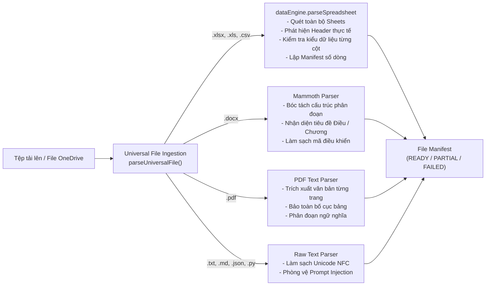

# SOTRANS HUB — FILE INTELLIGENCE & SPREADSHEET UNDERSTANDING
## TÀI LIỆU KỸ THUẬT XỬ LÝ TỆP ĐA PHƯƠNG THỨC & BẢNG TÍNH LOGISTICS

**Mã phân hệ:** `AI-FILE-INTEL-04`  
**Dự án:** SOTRANS Hub AI Chatbot Platform (`D:\hoso-chat`)  
**Tình trạng:** Production-Grade Implemented & Verified

---

## 1. TỔNG QUAN PHÂN HỆ FILE INTELLIGENCE

Phân hệ **File Intelligence** được xây dựng trên hai động cơ cốt lõi:
- `universalDataEngine.js`: Động cơ tiếp nhận, xác thực, lập manifest và bóc tách cấu trúc cho mọi định dạng tệp (Excel, CSV, Word, PDF, Code, Text).
- `dataEngine.js`: Động cơ phân tích dữ liệu bảng tính chuyên sâu, phục vụ tìm kiếm biểu cước logistics và tính toán số học xác định 100%.

Mục tiêu cốt lõi: **Không làm mất mát dữ liệu (Zero Silent Truncation), phân biệt rõ chiều đi/về trong vận tải, và đảm bảo mọi số liệu báo cáo đều có căn cứ từ bảng tính thực tế.**

---

## 2. QUY CHUẨN XỬ LÝ CÁC ĐỊNH DẠNG TÀI LIỆU



### Chi tiết các định dạng:

### 1. Bảng tính Excel & CSV (`.xlsx`, `.xls`, `.csv`)
- **Phát hiện Header thông minh:** Tự động quét 10 dòng đầu tiên để tìm dòng tiêu đề thực sự, loại bỏ các dòng ghi chú hoặc ô hợp nhất (`merged cells`) ở đầu file.
- **Quản lý đa sheet (Multi-Sheet Handling):** Nhận diện tất cả các sheet trong file (ví dụ: "Miền Nam", "Miền Bắc", "Báo giá Cont", "Phụ phí"). Hỗ trợ tìm kiếm trên từng sheet hoặc đồng thời trên toàn bộ workbook.
- **Không cắt ngắn âm thầm (Zero Silent Truncation):** Hệ thống ghi nhận chính xác `totalRawRows` và `validDataRows`. Với bảng tính lớn, dữ liệu được lập chỉ mục trên RAM và hỗ trợ phân trang (`limit / offset`), tuyệt đối không tự ý cắt bỏ dữ liệu mà không báo trước cho người dùng.

### 2. Tài liệu văn bản Word (`.docx`)
- Sử dụng thư viện `mammoth` trích xuất nội dung văn bản thuần túy.
- Phân đoạn logic dựa trên tiêu đề các chương, điều khoản (ví dụ: "Điều 1", "Chương II", "Mục 3.1").
- Giới hạn an toàn 80,000 ký tự cho mỗi tài liệu, nếu vượt quá sẽ tự động kích hoạt chế độ tra cứu phân đoạn (`search_document_sections`).

### 3. Tệp PDF (`.pdf`)
- Trích xuất văn bản kết hợp phân trang, giữ nguyên dấu trang (`Page X of Y`).
- Lọc bỏ các phần tử đồ họa rác và ký tự mã hóa lỗi.

---

## 3. CẤU TRÚC FILE MANIFEST CHUẨN HÓA

Mỗi tệp sau khi tiếp nhận đều được gắn một đối tượng `manifest` theo quy chuẩn:

```json
{
  "fileId": "file_1730278900123",
  "fileName": "Bang_Gia_Van_Tai_Q4_2026.xlsx",
  "fileType": "spreadsheet",
  "parser": "xlsx_dataEngine",
  "parseStatus": "READY",
  "totalUnits": 1250,
  "validUnits": 1242,
  "blankOrIgnoredUnits": 8,
  "sheets": ["Tuyen_Duong_Bo", "Tuyen_Duong_Thuy", "Phu_Phi_Ha_Tang"],
  "warnings": [],
  "errors": [],
  "readyForQuery": true,
  "parsedAt": "2026-10-30T09:00:00.000Z"
}
```

Trạng thái `parseStatus` được phân định rõ:
- `READY`: Tệp hợp lệ 100%, sẵn sàng cho các công cụ tra cứu và tính toán.
- `PARTIAL`: Tệp được tiếp nhận một phần (có sheet lỗi hoặc tài liệu quá dài).
- `PROCESSING_FAILED`: Tệp bị lỗi định dạng hoặc hỏng dữ liệu, hệ thống thông báo lỗi chi tiết cho người dùng và từ chối xử lý sai lệch.

---

## 4. TỪ ĐIỂN ĐỊA DANH & ĐẶC THÙ LOGISTICS SOTRANS

### 1. Từ điển biến thể địa danh (Location Aliases)
Hệ thống tích hợp sẵn bảng ánh xạ địa danh logistics chuyên dụng:
- Dĩ An: `di an`, `kcn tan binh`, `alley 64`, `truong van vinh`, `tp di an, binh duong`.
- Cát Lái: `cat lai`, `cang cat lai`, `icd cat lai`, `kho sotrans cat lai`, `cl`.
- Hải Phòng: `hai phong`, `cang hai phong`, `hph`, `lach huyen`.
- Đồng Nai: `dong nai`, `kho sotrans td - dong nai`, `bien hoa`, `kcn bien hoa`.
- Nghệ An: `wha`, `wha industrial zone 1`, `kcn wha nghe an`.

### 2. Nhận diện tính định hướng tuyến đường (A -> B khác B -> A)
Trong vận tải hàng hóa, cước chiều đi và chiều về thường khác biệt lớn do luồng xe rỗng và phí cầu đường.
- Nếu người dùng hỏi cước từ **Hà Nội đến TP.HCM**, nhưng dữ liệu chỉ có chiều từ **TP.HCM đến Hà Nội**:
- Hệ thống phát hiện cờ `hasReversedRouteOnly = true`.
- Orchestrator lập tức kích hoạt chỉ thị: **Thông báo rõ ràng chưa có báo giá cho chiều yêu cầu, chỉ hiển thị giá chiều ngược lại để tham khảo; tuyệt đối không ngầm định 2 chiều bằng giá nhau.**

---

## 5. DỊCH VỤ XUẤT BÁO CÁO EXCEL CHUẨN HÓA (`excelExportService.js`)

Khi người dùng yêu cầu xuất file hoặc tổng hợp số liệu:
1. Công cụ `export_excel_report` tiếp nhận danh sách cột (`columns`) và các hàng dữ liệu (`rows`).
2. Tự động áp dụng template nhận diện thương hiệu SOTRANS (Header màu xanh đậm `#0284c7`, chữ trắng in đậm, đường viền mỏng `#cbd5e1`, xen kẽ màu nền dòng chẵn/lẻ).
3. Tự động căn chỉnh độ rộng cột (`auto-width`) phù hợp với nội dung.
4. Lưu tệp an toàn và trả về đường dẫn tải về trực tiếp có giới hạn thời gian (`expiresAt`).
