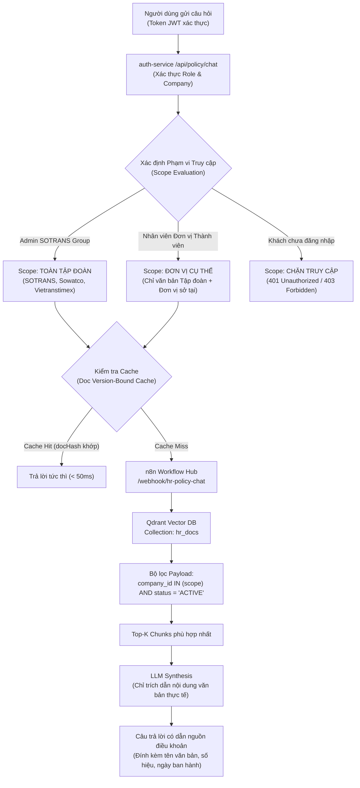

# SOTRANS HUB — HR POLICY RAG & QUALITY RETRIEVAL ENGINE
## TÀI LIỆU KỸ THUẬT RAG QUY ĐỊNH, CHÍNH SÁCH VÀ TIÊU CHUẨN TRÍCH XUẤT

**Mã phân hệ:** `AI-HR-RAG-03`  
**Dự án:** SOTRANS Hub AI Chatbot Platform (`D:\hoso-chat`)  
**Tình trạng:** Production-Grade Implemented & Verified

---

## 1. TỔNG QUAN HỆ THỐNG RAG QUY ĐỊNH & NỘI QUY

Phân hệ **Trợ lý Quy định & Chính sách** là cổng tri thức số hóa toàn bộ văn bản nội bộ của SOTRANS Group (SOTRANS Logistics, Sowatco, Vietranstimex), bao gồm:
- Nội quy lao động, quy chế làm việc, thời giờ làm việc và nghỉ ngơi.
- Quy chế tiền lương, thưởng hiệu quả kinh doanh, phụ cấp và công tác phí.
- Chính sách bảo hiểm y tế bổ sung, chế độ ốm đau, thai sản, khám sức khỏe định kỳ.
- Quy định trang bị bảo hộ lao động, quy trình kiểm soát an toàn - an ninh kho bãi.

Hệ thống hoạt động dựa trên kiến trúc **Hybrid Semantic-Keyword RAG** kết hợp cơ sở dữ liệu vector chuyên dụng **Qdrant** và bộ điều phối nghiệp vụ tích hợp kiểm soát phân quyền nhiều đơn vị thành viên.

---

## 2. KIẾN TRÚC TRUY VẤN & BẢO MẬT PHÂN QUYỀN ĐA ĐƠN VỊ (CROSS-TENANT RBAC)

Khác với các hệ thống RAG thông thường tra cứu mở toàn bộ tài liệu, SOTRANS Hub áp dụng nguyên tắc **RBAC-Enforced Retrieval Scope**:

### Các lớp bảo vệ danh tính và phân quyền:
1. **Chặn khách chưa đăng nhập:** Người dùng không có JWT hợp lệ hoàn toàn bị từ chối truy cập API `/api/policy/chat`.
2. **Cách ly đơn vị (Company Isolation):**
   - Nhân viên trực thuộc công ty nào chỉ được tra cứu văn bản áp dụng cho công ty đó và văn bản chung của Tập đoàn.
   - Tuyệt đối không để rò rỉ quy chế lương thưởng hay chính sách đặc thù của công ty thành viên này sang nhân sự công ty thành viên khác.

---

## 3. CƠ CHẾ CACHE RÀNG BUỘC PHIÊN BẢN TÀI LIỆU (DOC VERSION-BOUND CACHE)

Để đảm bảo tốc độ phản hồi cực nhanh nhưng không bao giờ trả về thông tin lỗi thời khi chính sách có thay đổi, SOTRANS Hub sử dụng cơ chế **Doc Version-Bound In-Memory Cache**:

1. **Tính toán Document Version Hash:**
   - Mỗi lần truy vấn, hệ thống tính toán một mã băm MD5 dựa trên danh sách tài liệu đang có hiệu lực (`docHash` từ bảng `hr_policy_documents` với các trường: `id`, `updated_at`, `status`).
2. **Khóa Cache độc lập:**
   - `cacheKey = MD5(normalizedQuery + historyKey + company + role + scope + docHash)`.
3. **Tự động vô hiệu hóa tức thời (Instant Invalidation):**
   - Ngay khi Chuyên viên Nhân sự tải lên một quy định mới hoặc sửa đổi nội dung một điều khoản, `docHash` lập tức thay đổi.
   - Toàn bộ kết quả cache cũ tự động mất hiệu lực, đảm bảo người dùng luôn nhận được chính sách mới nhất mà không cần khởi động lại dịch vụ.

---

## 4. TIÊU CHUẨN CHỐNG SUY ĐOÁN & CHỈ DẪN TRÍCH XUẤT (ANTI-HALLUCINATION)

Quy trình RAG tuân thủ bộ quy tắc nghiêm ngặt:
- **Nguyên tắc "Chỉ trả lời khi có căn cứ" (`answerable: true / false`):**
  - Nếu câu hỏi của người dùng không nằm trong bất kỳ văn bản nội bộ nào được lưu trữ, hệ thống trả về `answerable: false` kèm lời thông báo lịch sự: *"Quy định hiện hành chưa có hướng dẫn cụ thể về vấn đề này, vui lòng liên hệ trực tiếp Bộ phận Nhân sự để được hướng dẫn."*
  - Tuyệt đối cấm LLM tự suy diễn hoặc dùng kiến thức bên ngoài xã hội để trả lời thay thế cho quy chế nội bộ doanh nghiệp.
- **Tiêu chuẩn dẫn nguồn bắt buộc:**
  - Mọi câu trả lời thành công đều phải nêu rõ: Tên quy định/quy chế, số quyết định ban hành, ngày có hiệu lực, số điều khoản và trích dẫn tóm tắt nội dung quy định.
