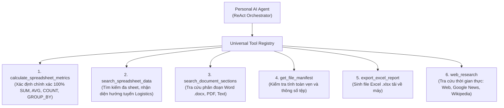

# SOTRANS HUB — PERSONAL AI AGENTS & TOOL REGISTRY PLATFORM
## TÀI LIỆU KỸ THUẬT QUẢN TRỊ TRỢ LÝ CÁ NHÂN & CÔNG CỤ TỰ ĐỘNG HÓA

**Mã phân hệ:** `AI-PERSONAL-AGENTS-02`  
**Dự án:** SOTRANS Hub AI Chatbot Platform (`D:\hoso-chat`)  
**Tình trạng:** Production-Grade Implemented & Verified

---

## 1. TỔNG QUAN KIẾN TRÚC PERSONAL AI AGENTS

Phân hệ Personal AI Agents cho phép từng người dùng trong doanh nghiệp tự cấu hình, huấn luyện và sở hữu các trợ lý chuyên biệt phục vụ công việc hàng ngày mà không cần lập trình.

### Các thuộc tính cốt lõi của Agent (`user_agents`):
- `id` (UUIDv4): Định danh duy nhất toàn hệ thống.
- `user_id`: Định danh chủ sở hữu (Strict Tenant Isolation).
- `name` & `description`: Tên và mô tả nhiệm vụ (hỗ trợ Unicode tiếng Việt đầy đủ).
- `instruction_prompt`: Hệ chỉ dẫn hành vi, văn phong, chuyên môn do người dùng thiết lập.
- `agent_type`: Chủng loại trợ lý (`GENERAL_ASSISTANT`, `DATA_ANALYST`, `DOC_WRITER`, `RESEARCHER`, `CUSTOM`).
- `model_name`: Mô hình xử lý chính (Mặc định: `gemini-flash-lite-latest` hoặc `gemini-3.5-flash-lite`).
- `temperature`: Biên độ sáng tạo (0.0 - 1.0, tự động tối ưu 0.15 cho tính toán và 0.45 cho soạn thảo văn bản).
- `enabled_tools`: Mảng công cụ được cấp phép.
- `current_version`: Phiên bản cấu hình hiện tại (hỗ trợ lưu lịch sử và Rollback).

---

## 2. UNIVERSAL TOOL REGISTRY — 6 CÔNG CỤ TIÊU CHUẨN

Hệ thống tích hợp Registry 6 công cụ chuẩn hóa theo Native Gemini Function Declarations Schema:

### Chi tiết 6 công cụ:

### 1. `calculate_spreadsheet_metrics`
- **Mục đích:** Thực thi tính toán xác định 100% không qua suy đoán xác suất của LLM.
- **Tham số:** `sheetName`, `operations` (mảng các phép toán: `SUM`, `AVERAGE`, `COUNT`, `GROUP_BY`, `column`, `sumCol`, `filterCol`, `filterVal`).
- **Nguyên tắc:** Dữ liệu số được tính toán trực tiếp trên RAM bằng JavaScript thuần túy (`dataEngine.calculateAggregates`), đảm bảo độ chính xác tuyệt đối.

### 2. `search_spreadsheet_data`
- **Mục đích:** Tìm kiếm, lọc và trích xuất chi tiết bản ghi theo tuyến đường, nhà cung cấp, mã REF, loại cont/xe.
- **Đặc tính thông minh:**
  - **Quét toàn bộ các sheet:** Tự động tìm kiếm trên toàn bộ workbook mà không cần chỉ định sheet.
  - **Tìm kiếm không dấu & biến thể địa danh:** Nhận diện từ điển bí danh logistics (ví dụ: "Dĩ An" = "KCN Tân Bình", "CL" = "Cát Lái").
  - **Nhận diện tính định hướng tuyến đường (A -> B khác B -> A):** Nếu người dùng hỏi cước chiều B -> A nhưng bảng tính chỉ có chiều ngược lại A -> B, công cụ tự động cảnh báo: *tuyệt đối không lấy giá chiều đi áp dụng cho chiều về*.

### 3. `search_document_sections`
- **Mục đích:** Tra cứu các điều khoản, quy trình, phân đoạn trong tệp Word (.docx) hoặc PDF (.pdf).
- **Cơ chế:** Phân đoạn tài liệu theo tiêu đề logic và tìm kiếm kết hợp (BM25 + Entity Matching).

### 4. `get_file_manifest`
- **Mục đích:** Cung cấp thông tin tổng quan về toàn bộ tệp đính kèm trong phiên (số trang, số dòng, trạng thái `READY / PARTIAL / FAILED`).

### 5. `export_excel_report`
- **Mục đích:** Khi người dùng yêu cầu xuất báo cáo hoặc tạo file Excel, công cụ tạo tệp `.xlsx` chuẩn hóa kèm định dạng tiêu đề, tự động căn chỉnh độ rộng cột và trả về liên kết tải về an toàn (`downloadUrl`).

### 6. `web_research`
- **Mục đích:** Tìm kiếm thông tin thời gian thực ngoài hệ thống nội bộ (thời sự, tỷ giá, giá cả thị trường, bách khoa Wikipedia).
- **Phòng vệ bảo mật:** Toàn bộ nội dung trích xuất từ web được lọc qua `sanitizeWebText` để vô hiệu hóa mã độc và các đòn tấn công Prompt Injection trước khi đưa vào ngữ cảnh mô hình.

---

## 3. CƠ CHẾ REACT LOOP & KIỂM SOÁT VÒNG LẶP (ORCHESTRATOR)

Trình điều phối `agentOrchestrator.js` kiểm soát vòng lặp ReAct (Reason + Act) theo quy trình nghiêm ngặt:

1. **Giới hạn số bước:** Mặc định tối đa 5 bước, giới hạn cứng không vượt quá 8 bước (`maxSteps`).
2. **Bộ ngắt vòng lặp vô tận (Loop Breaker):**
   - Lưu trữ dấu vân tay mỗi lần gọi công cụ: `callSignature = toolName + JSON.stringify(args)`.
   - Nếu phát hiện gọi cùng một công cụ với tham số giống hệt nhau quá 2 lần liên tiếp, hệ thống lập tức ngắt vòng lặp (`loop_broken`) để bảo vệ tài nguyên và ngăn treo tiến trình.
3. **Chặn thiên kiến lịch sử (Memory Grounding Interception):**
   - Khi bảng tính được tải lên hoặc đồng bộ từ OneDrive, người dùng có thể đã sửa đổi hoặc xóa bớt dòng.
   - Nếu ở bước 1 mô hình vội vã đưa ra câu trả lời dựa trên trí nhớ của các lượt trò chuyện cũ mà chưa gọi `search_spreadsheet_data`, Orchestrator lập tức chặn lại và bắt buộc mô hình phải gọi công cụ để kiểm tra thực tế.
4. **Hậu kiểm và chuẩn hóa câu trả lời (Answer Quality Enhancer):**
   - Tự động làm sạch các thẻ suy luận thô, kiểm tra liên kết tải về của Artifacts, và đảm bảo các cảnh báo nghiệp vụ (ví dụ: cảnh báo một chiều logistics) được truyền đạt nguyên vẹn đến người dùng.

---

## 4. TÍCH HỢP ONEDRIVE THỜI GIAN THỰC & CHẾ ĐỘ NGOẠI TUYẾN

Personal AI Agents hỗ trợ kết nối trực tiếp với Microsoft OneDrive cá nhân của nhân viên:
- **Query-Time Freshness Guard:** Trước mỗi câu hỏi, hệ thống kiểm tra và cập nhật phiên bản mới nhất của file trên OneDrive.
- **Khả năng phục hồi ngoại tuyến (Offline Snapshot Resilience):** Khi tài khoản OneDrive bị ngắt kết nối hoặc hết hạn token, hệ thống tự động chuyển sang sử dụng bản sao lưu nội bộ (`Local Snapshot`) và hiển thị thông báo cảnh báo rõ ràng để người dùng không bị gián đoạn công việc.
