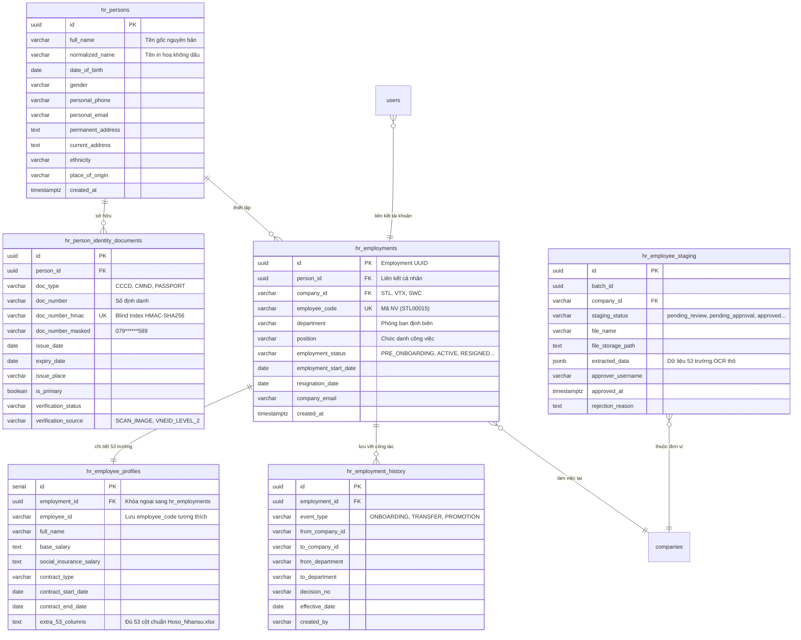

# SOTRANS HUB — GIAI ĐOẠN 2.1 (PHASE 2.1)
# ĐẶC TẢ THIẾT KẾ KIẾN TRÚC CUỐI CÙNG & KHÓA THIẾT KẾ
## PHÂN HỆ QUẢN LÝ HỒ SƠ NHÂN SỰ & TIẾP NHẬN SỐ HÓA OCR
### FINAL ARCHITECTURE SPECIFICATION & ENTERPRISE DATA MODEL (MASTER LOCK)

---

**Thông tin hồ sơ thẩm định:**
- **Hệ thống:** SOTRANS Hub (Nền tảng Quản trị Nhân sự & Trợ lý Điều hành Tập đoàn SOTRANS)
- **Workspace:** `D:\hoso-chat`
- **Tài liệu căn cứ đầu vào:**
  1. `reports/AUDIT_EMPLOYEE_MASTER_DATA_MANAGEMENT.md` (Báo cáo kiểm toán Phase 1)
  2. `reports/EMPLOYEE_MASTER_DATA_DESIGN_VALIDATION.md` (Báo cáo thẩm định Phase 2)
- **Tài liệu đầu ra:** `reports/EMPLOYEE_MASTER_DATA_FINAL_SPEC.md`
- **Chế độ thực thi:** **STRICT READ-ONLY DESIGN VALIDATION** (Tuyệt đối không sửa mã nguồn, không sửa schema database, không chạy migration, không làm gián đoạn Production)
- **Ngày hoàn thành:** 10/11/2026
- **Trạng thái sẵn sàng kỹ thuật:** **READY FOR IMPLEMENTATION** (Đặc tả đã xử lý 100% mâu thuẫn, khóa kiến trúc toàn diện, sẵn sàng bước vào Giai đoạn 3 Triển khai)

---

## MỤC LỤC ĐẶC TẢ

1. [Tóm tắt điều hành & Khóa kiến trúc (Executive Summary & Architecture Lock)](#1-t%C3%B3m-t%E1%BA%AFt-%C4%91i%E1%BB%81u-h%C3%A0nh--kh%C3%B3a-ki%E1%BA%BFn-tr%C3%BAc-executive-summary--architecture-lock)
2. [Xử lý triệt để 6 vấn đề kỹ thuật bắt buộc](#2-x%E1%BB%AD-l%C3%BD-tri%E1%BB%87t-%C4%91%E1%BB%83-6-v%E1%BA%A5n-%C4%91%E1%BB%81-k%E1%BB%B9-thu%E1%BA%ADt-b%E1%BA%AFt-bu%E1%BB%99c)
   - [2.1 Vấn đề 1: Tách biệt Cá nhân (Person) và Quan hệ Lao động (Employment)](#21-v%E1%BA%A5n-%C4%91%E1%BB%81-1-t%C3%A1ch-bi%E1%BB%87t-c%C3%A1-nh%C3%A2n-person-v%C3%A0-quan-h%E1%BB%87-lao-%C4%91%E1%BB%99ng-employment)
   - [2.2 Vấn đề 2: Chuẩn hóa Quản lý Giấy tờ Định danh (Relational & Blind Index HMAC)](#22-v%E1%BA%A5n-%C4%91%E1%BB%81-2-chu%E1%BA%A9n-h%C3%B3a-qu%E1%BA%A3n-l%C3%BD-gi%E1%BA%A5y-t%E1%BB%9D-%C4%91%E1%BB%8Bnh-danh-relational--blind-index-hmac)
   - [2.3 Vấn đề 3: Chuẩn hóa Trạng thái Nhân sự & Quy tắc Kích hoạt Tự động](#23-v%E1%BA%A5n-%C4%91%E1%BB%81-3-chu%E1%BA%A9n-h%C3%B3a-tr%E1%BA%A1ng-th%C3%A1i-nh%C3%A2n-s%E1%BB%B1--quy-t%E1%BA%AFc-k%C3%ADch-ho%E1%BA%A1t-t%E1%BB%B1-%C4%91%E1%BB%99ng)
   - [2.4 Vấn đề 4: Tính toàn vẹn Dữ liệu, Xóa bỏ CASCADE & Giao dịch ACID](#24-v%E1%BA%A5n-%C4%91%E1%BB%81-4-t%C3%ADnh-to%C3%A0n-v%E1%BB%B9n-d%E1%BB%AF-li%E1%BB%87u-x%C3%B3a-b%E1%BB%8F-cascade--giao-d%E1%BB%8Bch-acid)
   - [2.5 Vấn đề 5: Khử mâu thuẫn Ma trận Trường bắt buộc & Chuẩn hóa Tên gốc](#25-v%E1%BA%A5n-%C4%91%E1%BB%81-5-kh%E1%BB%AD-m%C3%A2u-thu%E1%BA%ABn-ma-tr%E1%BA%ADn-tr%C6%B0%E1%BB%9Dng-b%E1%BA%AFt-bu%E1%BB%99c--chu%E1%BA%A9n-h%C3%B3a-t%C3%AAn-g%E1%BB%91c)
   - [2.6 Vấn đề 6: Chính sách Bảo toàn Hồ sơ bị Từ chối & Thời hạn Lưu trữ Pháp lý](#26-v%E1%BA%A5n-%C4%91%E1%BB%81-6-ch%C3%ADnh-s%C3%A1ch-b%E1%BA%A3o-to%C3%A0n-h%E1%BB%93-s%C6%A1-b%E1%BB%8B-t%E1%BB%AB-ch%E1%BB%91i--th%E1%BB%9Di-h%E1%BA%A1n-l%C6%B0u-tr%E1%BB%AF-ph%C3%A1p-l%C3%BD)
3. [Chốt 5 Quyết định Nghiệp vụ Cốt lõi (D-01 đến D-05)](#3-ch%E1%BB%91t-5-quy%E1%BA%BFt-%C4%91%E1%BB%8Bnh-nghi%E1%BB%87p-v%E1%BB%A5-c%E1%BB%91t-l%C3%B5i-d-01-%C4%91%E1%BA%BFn-d-05)
4. [Mô hình Quan hệ Thực thể Mục tiêu (Target ERD & Schema)](#4-m%C3%B4-h%C3%ACnh-quan-h%E1%BB%87-th%E1%BB%B1c-th%E1%BB%83-m%E1%BB%A5c-ti%C3%AAu-target-erd--schema)
5. [Quy trình Luồng Dữ liệu Thống nhất (Workflows)](#5-quy-tr%C3%ACnh-lu%E1%BB%93ng-d%E1%BB%AF-li%E1%BB%87u-th%E1%BB%91ng-nh%E1%BA%A5t-workflows)
   - [5.1 Luồng OCR Intake qua tệp scan](#51-lu%E1%BB%93ng-ocr-intake-qua-t%E1%BB%87p-scan)
   - [5.2 Luồng Manual Staging Draft (Tiếp nhận không có scan)](#52-lu%E1%BB%93ng-manual-staging-draft-ti%E1%BA%BFp-nh%E1%BA%ADn-kh%C3%B4ng-c%C3%B3-scan)
   - [5.3 Luồng ADMIN Direct Onboarding (Tự tạo & Duyệt nhanh an toàn)](#53-lu%E1%BB%93ng-admin-direct-onboarding-t%E1%BB%B1-t%E1%BA%A1o--duy%E1%BB%87t-nhanh-an-to%C3%A0n)
   - [5.4 Luồng Điều chuyển Nội bộ Tập đoàn (Corporate Transfer)](#54-lu%E1%BB%93ng-%C4%91i%E1%BB%81u-chuy%E1%BB%83n-n%E1%BB%99i-b%E1%BB%99-t%E1%BA%ADp-%C4%91o%C3%A0n-corporate-transfer)
6. [Ma trận Phân quyền & Kiểm soát Truy cập (RBAC Matrix)](#6-ma-tr%E1%BA%ADn-ph%C3%A2n-quy%E1%BB%81n--ki%E1%BB%83m-so%C3%A1t-truy-c%E1%BA%ADp-rbac-matrix)
7. [Danh mục API & Database Migration Dự kiến](#7-danh-m%E1%BB%A5c-api--database-migration-d%E1%BB%B1-ki%E1%BA%BFn)
8. [Kế hoạch Chuyển đổi & Backfill Dữ liệu Lịch sử](#8-k%E1%BA%BF-ho%E1%BA%A1ch-chuy%E1%BB%83n-%C4%91%E1%BB%95i--backfill-d%E1%BB%AF-li%E1%BB%87u-l%E1%BB%8Bch-s%E1%BB%AD)
9. [Phương án Sao lưu (Backup), Rollback & Kiểm thử](#9-ph%C6%B0%C6%A1ng-%C3%A1n-sao-l%C6%B0u-backup-rollback--ki%E1%BB%83m-th%E1%BB%AD)
10. [Điều kiện Nghiệm thu Kỹ thuật & Bàn giao](#10-%C4%91i%E1%BB%81u-ki%E1%BB%87n-nghi%E1%BB%87m-thu-k%E1%BB%B9-thu%E1%BA%ADt--b%C3%A0n-giao)
11. [Kết luận Nghiệm thu Thiết kế](#11-k%E1%BA%BFt-lu%E1%BA%ADn-nghi%E1%BB%87m-thu-thi%E1%BA%BFt-k%E1%BA%BF)

---

## 1. TÓM TẮT ĐIỀU HÀNH & KHÓA KIẾN TRÚC (EXECUTIVE SUMMARY & ARCHITECTURE LOCK)

Giai đoạn Phase 2.1 đánh dấu bước hoàn tất toàn bộ thiết kế kiến trúc và giải quyết dứt điểm các điểm nghẽn nghiệp vụ còn lại của phân hệ **Quản lý Hồ sơ Nhân sự & Số hóa OCR** trên SOTRANS Hub. 

### Các quyết sách kiến trúc cốt lõi đã được khóa (Locked Decisions):

```
┌────────────────────────────────────────────────────────────────────────────────────────┐
│                        KIẾN TRÚC MỤC TIÊU ĐÃ KHÓA (PHASE 2.1)                          │
├────────────────────────────────────────────────────────────────────────────────────────┤
│ 1. SINGLE INGESTION GATEWAY: Mọi luồng nhân sự mới đều qua Staging Gateway.            │
│ 2. DUAL-ENTITY IDENTITY:     Tách biệt Cá nhân (Person) và Quan hệ Lao động (Employ).  │
│ 3. BLIND INDEX SECURITY:     Kiểm tra trùng giấy tờ qua HMAC, không giải mã hàng loạt.  │
│ 4. ZERO DANGEROUS CASCADE:   Xóa bỏ ON DELETE CASCADE trên mọi sổ cái và lịch sử.      │
│ 5. PRE_ONBOARDING STATE:     Không tự động ACTIVE khi chưa tới ngày bắt đầu làm việc.  │
│ 6. PRESERVED ORIGINAL NAME:  Tên gốc giữ nguyên chữ hoa/thường, Normalized Name tìm kiếm│
│ 7. SOFT-STATE REJECTION:     Từ chối giữ nguyên bằng chứng, có thời hạn lưu trữ PII.   │
└────────────────────────────────────────────────────────────────────────────────────────┘
```

1. **Phương án B là kiến trúc duy nhất:** Tiếp nhận và duyệt qua Staging; quản trị vận hành trên Master Data.
2. **Khóa hoàn toàn các cửa ngách bypass:** Toàn bộ API ghi trực tiếp vào Master (`POST /api/employees` và `POST /api/employees/confirm-ocr`) bị vô hiệu hóa đối với HR.
3. **Mô hình Dữ liệu 2 Thực thể (Person vs. Employment):** Một cá nhân (`hr_persons`) duy trì định danh pháp lý bất biến, có thể nắm giữ nhiều quan hệ lao động (`hr_employments`) qua các giai đoạn làm việc tại các đơn vị thành viên (STL, VTX, SWC).
4. **An toàn kiểm toán tối đa:** Loại bỏ toàn bộ `ON DELETE CASCADE` trên các quan hệ dữ liệu nhân sự, bảo đảm lịch sử điều chuyển, hồ sơ chi tiết và tệp scan gốc không thể bị xóa mất do lỗi thao tác danh bạ.

---

## 2. XỬ LÝ TRIỆT ĐỂ 6 VẤN ĐỀ KỸ THUẬT BẮT BUỘC

### 2.1 Vấn đề 1: Tách biệt Cá nhân (Person) và Quan hệ Lao động (Employment)

#### Bối cảnh & Điểm nghẽn cũ:
Hiện nay, bảng `employees` và `hr_employee_profiles` trộn lẫn thông tin nhân thân (Họ tên, Ngày sinh, CCCD, Quê quán) với thông tin vị trí công việc (Công ty, Phòng ban, Chức vụ, Mã nhân viên). Khi một nhân sự chuyển từ Vietranstimex (VTX) sang SOTRANS Logistics (STL), hệ thống hoặc báo lỗi trùng CCCD (chặn điều chuyển), hoặc ghi đè thông tin khiến toàn bộ lịch sử công tác tại đơn vị cũ bị xóa sổ.

#### Thiết kế Phân rã 4 Khối Dữ liệu (4-Domain Attribute Allocation):

```
                                  ┌────────────────────────┐
                                  │       hr_persons       │
                                  │  (Định danh Cá nhân)   │
                                  └───────────┬────────────┘
                                              │ 1
                                              │
                      ┌───────────────────────┴───────────────────────┐
                      │ 1..N                                          │ 1..N
        ┌─────────────▼──────────────┐                  ┌─────────────▼──────────────┐
        │hr_person_identity_documents│                  │       hr_employments       │
        │   (Giấy tờ & Lịch sử ID)   │                  │   (Quan hệ Lao động cty)   │
        └────────────────────────────┘                  └─────────────┬──────────────┘
                                                                      │ 1
                                                                      │
                                              ┌───────────────────────┴───────────────────────┐
                                              │ 1                                             │ 1..N
                                ┌─────────────▼──────────────┐                  ┌─────────────▼──────────────┐
                                │    hr_employee_profiles    │                  │   hr_employment_history    │
                                │    (53 Cột Chi tiết HR)    │                  │  (Lịch sử Điều chuyển)     │
                                └────────────────────────────┘                  └────────────────────────────┘
```

#### Bảng phân định 53 trường theo đúng bản chất nghiệp vụ:

| Khối Dữ liệu | Bảng lưu trữ mục tiêu | Danh sách các trường dữ liệu cụ thể | Mục đích & Nguyên tắc quản trị |
|---|---|---|---|
| **A. Dữ liệu Cá nhân (Person Profile)** | `hr_persons` | `full_name`, `normalized_name`, `date_of_birth`, `gender`, `ethnicity`, `place_of_origin`, `birth_registration_place`, `permanent_address`, `current_address`, `temporary_address`, `personal_phone`, `personal_email`, `education_level`, `qualification`, `major`, `training_institution`, `graduation_grade`, `other_professional_certificates` | Thuộc về con người cụ thể. Không thay đổi khi chuyển công ty. Duy nhất 1 bản ghi cho 1 cá nhân trong toàn tập đoàn. |
| **B. Giấy tờ Định danh (Identity Docs)** | `hr_person_identity_documents` | `doc_type` (CCCD/CMND/PASSPORT), `doc_number`, `doc_number_hmac`, `issue_date`, `expiry_date`, `issue_place`, `is_primary`, `verification_status`, `verification_source` | Lưu trữ đa giấy tờ và lịch sử đổi giấy tờ tùy thân của một người lao động. |
| **C. Quan hệ Lao động (Employment)** | `hr_employments` (Hiện là `employees`) | `company_id` (STL/VTX/SWC), `employee_code` (STL00015), `department_staffing_plan`, `section_staffing_plan`, `job_title`, `professional_title`, `employment_status`, `employment_start_date`, `official_join_date`, `company_email`, `recruitment_decision_no` | Gắn liền với hợp đồng tại một công ty thành viên. Một người có thể có nhiều quan hệ lao động (theo thời gian hoặc kiêm nhiệm). |
| **D. Hợp đồng Lao động (Contract)** | `hr_employee_profiles` (Khối Contract) | `open_ended_contract`, `fixed_term_contract`, `seasonal_contract`, `contract_start_date`, `contract_end_date`, `official_labor_contract_sign_date` | Chi tiết thời hạn và cam kết pháp lý của từng đợt ký kết hợp đồng. |
| **E. Chế độ Đãi ngộ (C&B / Payroll / Tax)** | `hr_employee_profiles` (Khối Compensation) | `social_insurance_salary`, `total_income`, `base_salary`, `productivity_responsibility_pay`, `attendance_bonus`, `responsibility_allowance`, `vessel_size_allowance`, `professional_allowance_t1`, `meal_allowance`, `other_allowances`, Mã số thuế TNCN, Số sổ BHXH | Dữ liệu tài chính nhạy cảm, phân quyền bảo mật riêng theo chức năng C&B. |

---

### 2.2 Vấn đề 2: Chuẩn hóa Quản lý Giấy tờ Định danh (Relational & Blind Index HMAC)

#### Bối cảnh & Rủi ro:
Báo cáo Phase 2 đề xuất dùng cột `identity_history` dạng JSONB. Tuy nhiên, JSONB gây khó khăn trong việc tạo chỉ mục tìm kiếm nhanh (Unique Index B-Tree), không hỗ trợ khóa ngoại toàn vẹn, và gây rủi ro quét toàn bộ bảng (Table Scan) khi kiểm tra trùng lặp trên hàng chục nghìn hồ sơ.

#### Thiết kế Bảng Quan hệ Chuẩn hóa `hr_person_identity_documents`:

```sql
CREATE TABLE hr_person_identity_documents (
    id UUID PRIMARY KEY DEFAULT gen_random_uuid(),
    person_id UUID NOT NULL REFERENCES hr_persons(id) ON DELETE RESTRICT,
    doc_type VARCHAR(20) NOT NULL, -- 'CCCD', 'CMND', 'PASSPORT', 'MILITARY_ID'
    doc_number VARCHAR(100) NOT NULL, -- Số hiển thị hoặc đã mã hóa AES-256
    doc_number_hmac VARCHAR(64) NOT NULL, -- Blind Index: HMAC-SHA256 (Phục vụ đối chiếu trùng)
    doc_number_masked VARCHAR(50) NOT NULL, -- Dùng hiển thị công khai (079******589)
    issuing_country VARCHAR(10) DEFAULT 'VNM',
    issue_date DATE,
    expiry_date DATE,
    issue_place VARCHAR(255),
    is_primary BOOLEAN DEFAULT true,
    verification_status VARCHAR(30) DEFAULT 'UNVERIFIED', -- 'UNVERIFIED', 'OCR_VERIFIED', 'LEGAL_VERIFIED'
    verification_source VARCHAR(50), -- 'SCAN_IMAGE', 'VNEID_LEVEL_2', 'PHYSICAL_ORIGINAL'
    verified_by VARCHAR(100),
    verified_at TIMESTAMPTZ,
    created_at TIMESTAMPTZ DEFAULT NOW(),
    updated_at TIMESTAMPTZ DEFAULT NOW(),
    CONSTRAINT uq_person_identity_hmac UNIQUE (doc_number_hmac)
);

CREATE INDEX idx_identities_person ON hr_person_identity_documents(person_id);
CREATE INDEX idx_identities_hmac ON hr_person_identity_documents(doc_number_hmac);
```

#### Làm rõ bản chất VNeID & Bảo vệ Dữ liệu PII:
1. **Làm rõ pháp lý:** VNeID **không phải là một loại giấy tờ độc lập**. Theo Nghị định 59/2022/NĐ-CP, VNeID là ứng dụng định danh điện tử quốc gia. Giấy tờ định danh được trích xuất từ VNeID bản chất là Căn cước công dân gắn chip hoặc Thẻ Căn cước. Do đó:
   - `doc_type` lưu giá trị: `CCCD`.
   - `verification_source` lưu giá trị: `VNEID_LEVEL_2` (Đã đối soát xác thực qua tài khoản định danh điện tử Mức 2).
2. **Cơ chế Blind Index (HMAC-SHA256):**
   - Số định danh được băm bằng thuật toán HMAC với một khóa bảo mật cấp máy chủ (`IDENTITY_HMAC_SECRET`).
   - Khi kiểm tra trùng lặp trên toàn hệ thống (kể cả giữa STL, VTX, SWC):
     ```javascript
     const hmac = crypto.createHmac('sha256', process.env.IDENTITY_HMAC_SECRET).update(cleanId).digest('hex');
     const exists = await client.query('SELECT 1 FROM hr_person_identity_documents WHERE doc_number_hmac = $1', [hmac]);
     ```
   - **Lợi ích an ninh:** Hệ thống thực hiện kiểm tra đối chiếu trùng lặp với độ phức tạp $O(1)$ thông qua B-Tree Index mà **hoàn toàn không cần giải mã CSDL**, triệt tiêu nguy cơ rò rỉ PII khi bị tấn công SQL Injection.

---

### 2.3 Vấn đề 3: Chuẩn hóa Trạng thái Nhân sự & Quy tắc Kích hoạt Tự động

#### Phân biệt Trạng thái Staging và Trạng thái Quan hệ Lao động:

| Phân tầng trạng thái | Vị trí bảng dữ liệu | Danh sách trạng thái | Ý nghĩa nghiệp vụ |
|---|---|---|---|
| **Trạng thái Staging (Intake Buffer)** | `hr_employee_staging.staging_status` | `pending_review`<br/>`pending_approval`<br/>`approved`<br/>`rejected`<br/>`transferred` | Quản lý quy trình kiểm duyệt chứng từ đầu vào của HR và ADMIN. Chỉ tồn tại trong cổng Staging. |
| **Trạng thái Quan hệ Lao động (Employment)** | `hr_employments.employment_status` | `PRE_ONBOARDING`<br/>`ACTIVE`<br/>`INACTIVE`<br/>`TRANSFERRED`<br/>`RESIGNED`<br/>`TERMINATED` | Quản lý vòng đời thực tế của người lao động tại một công ty thành viên cụ thể. |

#### Quy tắc kích hoạt trạng thái Master khi ADMIN phê duyệt:

> [!IMPORTANT]
> **Quy tắc ngày hiệu lực (Effective Date Rule):**
> Tuyệt đối **không tự động gán trạng thái `ACTIVE`** cho hồ sơ nếu ngày bắt đầu làm việc (`employment_start_date`) lớn hơn ngày hiện tại.
> 
> - Nếu `employment_start_date > CURRENT_DATE`: Trạng thái ban đầu bắt buộc là **`PRE_ONBOARDING`**. Nhân sự này đã có mã nhân viên, đã ký hợp đồng nhưng chưa chính thức tính công và chưa đưa vào danh sách chấm công/bảng lương hàng ngày.
> - Nếu `employment_start_date <= CURRENT_DATE`: Trạng thái ban đầu là **`ACTIVE`**.

```
[ADMIN Phê duyệt Hồ sơ Staging]
             │
             ▼
   { employment_start_date <= CURRENT_DATE ? }
             │
      ┌──────┴──────┐
      │             │
   (Đúng)         (Sai - Tương lai)
      ▼             ▼
  [ ACTIVE ]    [ PRE_ONBOARDING ]
                    │
                    │ (Tự động chuyển vào 00:01 sáng
                    ▼  ngày employment_start_date)
                [ ACTIVE ]
                    │
       ┌────────────┼────────────┐
       ▼            ▼            ▼
  [ INACTIVE ] [TRANSFERRED] [ RESIGNED ]
```

- **Tiến trình tự động hàng ngày (Scheduled Activation Worker):** Mỗi ngày vào lúc 00:01 AM, tiến trình nền quét:
  ```sql
  UPDATE hr_employments 
  SET employment_status = 'ACTIVE', updated_at = NOW()
  WHERE employment_status = 'PRE_ONBOARDING' AND employment_start_date <= CURRENT_DATE;
  ```

---

### 2.4 Vấn đề 4: Tính toàn vẹn Dữ liệu, Xóa bỏ CASCADE & Giao dịch ACID

#### 1. Xóa bỏ hoàn toàn `ON DELETE CASCADE` trên các bảng Master:
- **Phát hiện kiểm toán:** Migration cũ (`sql/migrations/20261029_create_fk_employees_hr_profiles.sql`) định nghĩa:
  `FOREIGN KEY (employee_id) REFERENCES employees(employee_code) ON DELETE CASCADE`
  $\rightarrow$ Điều này cực kỳ nguy hiểm. Nếu một nhân viên bị xóa khỏi danh bạ `employees`, toàn bộ 53 trường lịch sử trong `hr_employee_profiles` sẽ bị xóa sạch theo kiểu "bốc hơi" không để lại dấu vết!
- **Khóa kiến trúc mục tiêu:**
  - Thay thế toàn bộ bằng **`ON DELETE RESTRICT`** hoặc **`ON DELETE NO ACTION`**.
  - Ngăn chặn triệt để hành vi xóa cứng vật lý (Hard Delete) nếu bản ghi đã có quan hệ lao động, lịch sử công tác hoặc tài liệu hồ sơ.
  - Áp dụng nguyên tắc **Bất biến lịch sử (Immutable Audit Trail)**.

#### 2. Quy tắc Giao dịch ACID chuẩn hóa cho các nghiệp vụ trọng yếu:

```
┌────────────────────────────────────────────────────────────────────────────────────────┐
│               GIAO DỊCH PHÊ DUYỆT / DIRECT ONBOARDING CHUẨN (ACID 100%)                │
├────────────────────────────────────────────────────────────────────────────────────────┤
│ 1. BEGIN TRANSACTION (Khởi tạo phiên giao dịch cô lập)                                 │
│ 2. Advisory Lock: pg_advisory_xact_lock(hashtext('id_doc:' || $doc_hmac))             │
│    (Chặn tuyệt đối 2 ADMIN cùng tạo hoặc duyệt 1 người cùng 1 mili-giây)               │
│ 3. Idempotency Check: Kiểm tra idempotency_key trên bảng staging_approvals             │
│ 4. Sequence Allocation: SELECT nextval('seq_emp_code_stl/vtx/swc') -> 'STL00015'       │
│ 5. Upsert hr_persons: Cập nhật hoặc tạo mới thực thể Con người                         │
│ 6. Insert hr_person_identity_documents: Lưu vết giấy tờ định danh & HMAC               │
│ 7. Insert hr_employments: Tạo quan hệ lao động chính thức                              │
│ 8. Insert hr_employee_profiles: Lưu trọn vẹn 53 trường dữ liệu chuẩn                   │
│ 9. Insert hr_employment_history: Ghi nhận sự kiện 'ONBOARDING' vào sổ công tác         │
│ 10. Update hr_employee_staging: Đánh dấu status = 'approved', lưu approver, timestamp   │
│ 11. Insert audit_logs: Ghi nhật ký bảo mật hệ thống                                    │
│ 12. COMMIT TRANSACTION (Dữ liệu vào CSDL PostgreSQL hoàn tất)                          │
├────────────────────────────────────────────────────────────────────────────────────────┤
│ 13. POST-COMMIT ASYNC DISPATCH (Bên ngoài Transaction - Không lo nghẽn API):           │
│     • setImmediate(() => queueSyncTasks(stagingId))                                    │
│     • Đẩy sang NocoDB & Google Sheets qua Worker nền độc lập                           │
└────────────────────────────────────────────────────────────────────────────────────────┘
```

---

### 2.5 Vấn đề 5: Khử mâu thuẫn Ma trận Trường bắt buộc & Chuẩn hóa Tên gốc

#### 1. Khử hoàn toàn mâu thuẫn giữa các mục của Phase 2:
Tại Phase 2, có sự không nhất quán giữa Mục 3.3, Mục 9 và Quyết định D-04 về trường `phone_number` và các trường địa chỉ. Phase 2.1 chính thức **khóa ma trận chuẩn xác duy nhất** áp dụng trên toàn bộ hệ thống:

```
┌────────────────────────────────────────────────────────────────────────────────────────┐
│              MA TRẬN QUY ĐỊNH TRƯỜNG THÔNG TIN BẮT BUỘC (ARCHITECTURAL LOCK)           │
├───────────────────────────────┬────────────┬────────────┬─────────────┬────────────────┤
│ Trường dữ liệu                │ T1: Tiếp   │ T2: HR Gửi │ T3: ADMIN   │ T4: Bổ sung    │
│                               │ nhận Draft │ phê duyệt  │ Duyệt Master│ sau Onboarding │
├───────────────────────────────┼────────────┼────────────┼─────────────┼────────────────┤
│ Họ và tên                     │ BẮT BUỘC   │ BẮT BUỘC   │ BẮT BUỘC    │ -              │
│ Công ty (STL/VTX/SWC)         │ BẮT BUỘC   │ BẮT BUỘC   │ BẮT BUỘC    │ -              │
│ Loại & Số giấy tờ định danh   │ BẮT BUỘC*  │ BẮT BUỘC   │ BẮT BUỘC    │ -              │
│ (*Hoặc tệp scan đính kèm)     │            │            │             │                │
│ Phòng ban định biên           │ Tùy chọn   │ BẮT BUỘC   │ BẮT BUỘC    │ -              │
│ Chức danh / Vị trí công tác   │ Tùy chọn   │ BẮT BUỘC   │ BẮT BUỘC    │ -              │
│ Ngày bắt đầu làm việc         │ Tùy chọn   │ BẮT BUỘC   │ BẮT BUỘC    │ -              │
│ Ngày sinh                     │ Tùy chọn   │ Tùy chọn   │ BẮT BUỘC    │ -              │
│ Giới tính                     │ Tùy chọn   │ Tùy chọn   │ BẮT BUỘC    │ -              │
│ Số điện thoại di động         │ Tùy chọn   │ Tùy chọn   │ TÙY CHỌN    │ BẮT BUỘC (15d) │
│ Email liên hệ                 │ Tùy chọn   │ Tùy chọn   │ TÙY CHỌN    │ BẮT BUỘC (15d) │
│ Địa chỉ thường trú (theo ID)  │ Tùy chọn   │ Tùy chọn   │ TÙY CHỌN    │ BẮT BUỘC (30d) │
│ Nơi ở hiện nay                │ Tùy chọn   │ Tùy chọn   │ TÙY CHỌN    │ BẮT BUỘC (30d) │
│ Ngày cấp / Nơi cấp định danh  │ Tùy chọn   │ Tùy chọn   │ TÙY CHỌN    │ BẮT BUỘC (30d) │
│ Hợp đồng LĐ / Lương / Phụ cấp │ Tùy chọn   │ Tùy chọn   │ TÙY CHỌN    │ Phân hệ chuyên │
└───────────────────────────────┴────────────┴────────────┴─────────────┴────────────────┘
```
*(Ghi chú: ADMIN khi duyệt chỉ cần tối thiểu 8 trường pháp lý và tổ chức để kích hoạt mã nhân viên. Số điện thoại và địa chỉ được phép bổ sung trong vòng 15-30 ngày đầu làm việc để không gây ách tắc tuyển dụng).*

#### 2. Quy tắc bảo tồn Họ tên gốc (Name Casing Policy):
- **Tuyệt đối không áp dụng hàm `.toUpperCase()` hay ép kiểu Title Case** lên trường pháp lý `full_name`.
- Tên người lao động lưu trữ đúng từng ký tự nguyên bản theo giấy tờ tùy thân (ví dụ: `Nguyễn Văn An`, `Lê Trần Bảo Ngọc`, `O'Connor`, `Jean-Pierre`).
- Hàm chuẩn hóa duy nhất được phép chạy trên `full_name` là cắt bỏ khoảng trắng thừa:
  `rawName.trim().replace(/\s+/g, ' ')`
- Tạo cột riêng `normalized_name` tự động sinh:
  `removeAccents(full_name).toUpperCase()` (Ví dụ: `NGUYEN VAN AN`) để phục vụ tìm kiếm nhanh, chống trùng và gợi ý tài khoản.

---

### 2.6 Vấn đề 6: Chính sách Bảo toàn Hồ sơ bị Từ chối & Thời hạn Lưu trữ Pháp lý

#### 1. Khẳng định nguyên tắc Soft-State Rejection:
- Khi ADMIN từ chối một hồ sơ trong Staging:
  - Trạng thái cập nhật: `staging_status = 'rejected'`.
  - **Tuyệt đối không chạy lệnh `DELETE`** trên database.
  - Giữ nguyên vẹn 100% tệp scan gốc trong ổ đĩa cứng (`file_storage_path`), kết quả trích xuất OCR (`extracted_data`), cảnh báo trùng lặp và toàn bộ vết tích nộp hồ sơ.
  - Lưu trữ bắt buộc: `reviewer_username`, `reviewed_at`, `rejection_reason` (tối thiểu 3 ký tự).
- Bản ghi bị từ chối luôn hiển thị trong bộ lọc **"Đã từ chối (REJECTED)"** của Sub-tab Staging để phục vụ giải trình kiểm toán.

#### 2. Cơ chế Clone & Resubmit (Tạo bản sao & Nộp lại):
- Khi HR xử lý một hồ sơ bị từ chối (ví dụ do mờ ảnh CCCD hoặc thiếu thông tin phòng ban):
  - HR nhấn nút **"Tạo bản sao & Nộp lại (Clone & Resubmit)"**.
  - Hệ thống sinh một bản ghi Staging **HOÀN TOÀN MỚI** với `staging_status = 'pending_review'`.
  - Bản ghi mới mang thuộc tính `proposed_changes` lưu vết: `parent_staging_id: [ID_cũ]`, `version: [version_cũ + 1]`.
  - Bản ghi bị từ chối cũ được **giữ nguyên bất biến (Immutable)** để bảo vệ tính trung thực của lịch sử kiểm duyệt.

#### 3. Chính sách Thời hạn Lưu trữ (Data Retention & Purging Policy):
Tuân thủ Nghị định 13/2023/NĐ-CP về Bảo vệ dữ liệu cá nhân:
- Dữ liệu ứng viên / hồ sơ Staging bị từ chối **không được lưu trữ vĩnh viễn vô căn cứ**.
- **Thời hạn lưu trữ quy định:** **180 ngày (6 tháng)** kể từ ngày bị từ chối để phục vụ khiếu nại tuyển dụng hoặc kiểm toán lao động định kỳ.
- **Quy trình tiêu hủy an toàn (4-Eyes Purge Workflow):**
  - Sau 180 ngày, hệ thống tự động gắn cờ `retention_expired = true` và đưa vào danh sách chờ tiêu hủy.
  - Việc xóa vật lý (Hard Delete file scan và bản ghi staging cũ) bắt buộc phải do Quản trị viên cấp cao (ADMIN) xác nhận độc lập kèm lý do pháp lý.

---

## 3. CHỐT 5 QUYẾT ĐỊNH NGHIỆP VỤ CỐT LÕI (D-01 ĐẾN D-05)

| Mã Quyết định | Nội dung Quyết định Nghiệp vụ | Phương án được Chủ dự án & Kiến trúc Khóa chính thức | Căn cứ & Giá trị mang lại |
|:---:|---|---|---|
| **D-01** | **Cổng tiếp nhận nhân sự duy nhất** | **PHÊ CHUẨN MÔ HÌNH MỘT CỔNG (SINGLE GATEWAY).** Toàn bộ nhân sự mới (OCR hay thủ công) đều qua Staging Gateway. Gỡ bỏ hoàn toàn form thêm trực tiếp và nút OCR trực tiếp tại Master Tab. | Triệt tiêu nguy cơ phân mảnh dữ liệu, bảo đảm 100% hồ sơ Master đều có nguồn gốc rõ ràng. |
| **D-02** | **Quy ước định dạng Mã nhân viên mới** | **ÁP DỤNG CHUẨN 5 SỐ KHÔNG GẠCH:** `STLxxxxx`, `SWCxxxxx`, `VTXxxxxx` (Ví dụ: `STL00015`, `SWC00025`, `VTX00088`). Giữ nguyên 100% mã lịch sử (`STL-1029`, `SWC-402`, `VTX_881`). | Thống nhất dữ liệu cho mã vạch thẻ nhân viên, NocoDB; tương thích ngược hoàn hảo với CSDL cũ. |
| **D-03** | **Cơ chế Direct Onboarding của ADMIN** | **PHÊ CHUẨN DIRECT ONBOARDING 1 BƯỚC CHO ADMIN.** ADMIN có quyền tạo và duyệt ngay trong cùng một phiên làm việc, nhưng hệ thống tự động chạy toàn bộ chốt kiểm tra và ghi nhận bản ghi Staging `approved`. | Đáp ứng tính linh hoạt trong vận hành thực tế khi tuyển dụng khẩn cấp mà không phá vỡ tính toàn vẹn của Audit Trail. |
| **D-04** | **Quy định trường bắt buộc theo giai đoạn** | **PHÊ CHUẨN MA TRẬN 4 TẦNG.** Không ép nhập đủ 53 trường khi duyệt Master. Chỉ bắt buộc 8 trường cốt lõi; cho phép bổ sung SĐT, địa chỉ, hợp đồng sau 15-30 ngày. | Giải phóng ách tắc tuyển dụng thực tế tại cảng biển và đội xe, phù hợp đặc thù ngành Logistics. |
| **D-05** | **Điều chuyển nội bộ & Tái tuyển dụng** | **PHÊ CHUẨN MÔ HÌNH PERSON VÀ EMPLOYMENT.** Cho phép một người có CCCD đã tồn tại ở công ty này được tạo quan hệ lao động mới tại công ty khác thông qua luồng Điều chuyển hoặc Tái tuyển dụng. | Xóa bỏ rào cản kỹ thuật vô lý khi luân chuyển cán bộ nội bộ giữa STL, VTX và SWC. |

---

## 4. MÔ HÌNH QUAN HỆ THỰC THỂ MỤC TIÊU (TARGET ERD & SCHEMA)



---

## 5. QUY TRÌNH LUỒNG DỮ LIỆU THỐNG NHẤT (WORKFLOWS)

### 5.1 Luồng OCR Intake qua tệp scan
1. HR tải tệp scan (PDF/ảnh) lên Staging Gateway.
2. Gemini Vision Engine chạy trích xuất 53 trường dữ liệu chuẩn.
3. Hệ thống chuẩn hóa họ tên (cắt khoảng trắng, sinh `normalized_name`) và băm HMAC số giấy tờ định danh.
4. Kiểm tra đối chiếu HMAC trên bảng `hr_person_identity_documents` để phát hiện trùng lặp người lao động.
5. Ghi bản ghi vào `hr_employee_staging` với trạng thái `pending_review`.
6. HR rà soát dữ liệu, đối chiếu ảnh scan thực tế trên giao diện chia đôi màn hình (Split-View) và nhấn **"Gửi duyệt"** $\rightarrow$ Trạng thái chuyển thành `pending_approval`.

### 5.2 Luồng Manual Staging Draft (Tiếp nhận không có scan)
1. HR mở dialog **"Tiếp nhận Nhân sự Mới (Thủ công)"** tại tab Staging.
2. HR nhập 3 nhóm trường: Định danh cá nhân, Vị trí công tác, Thông tin liên hệ.
3. Hệ thống chạy kiểm tra chống trùng thời gian thực (Realtime Validation) qua Blind Index HMAC.
4. Nếu hợp lệ, hệ thống tạo bản ghi Staging Draft với `file_name = 'MANUAL_INTAKE_FORM.pdf'`.
5. HR có thể lưu nháp (`pending_review`) hoặc gửi duyệt ngay (`pending_approval`).

### 5.3 Luồng ADMIN Direct Onboarding (Tự tạo & Duyệt nhanh an toàn)
1. ADMIN mở biểu mẫu tiếp nhận tại tab Staging hoặc Dashboard Quản trị.
2. ADMIN nhập thông tin nhân sự và tích chọn: **"Xác nhận & Phê duyệt Master ngay"**.
3. Hệ thống mở Transaction: Khóa Advisory Lock $\rightarrow$ Kiểm tra trùng lặp $\rightarrow$ Sinh mã tự động `STLxxxxx` từ Sequence $\rightarrow$ Tạo bản ghi Staging `approved` $\rightarrow$ Ghi đồng bộ vào `hr_persons`, `hr_person_identity_documents`, `hr_employments`, `hr_employee_profiles` $\rightarrow$ Ghi Audit Log `ADMIN_DIRECT_ONBOARDING` $\rightarrow$ Commit.
4. Kích hoạt Worker đồng bộ NocoDB & Google Sheets ở chế độ bất đồng bộ.

### 5.4 Luồng Điều chuyển Nội bộ Tập đoàn (Corporate Transfer)
1. HR tại công ty tiếp nhận (Ví dụ: STL) tiếp nhận hồ sơ của nhân sự đang làm việc tại VTX.
2. Hệ thống nhận diện HMAC số giấy tờ định danh đã tồn tại tại VTX với trạng thái `ACTIVE`.
3. Hệ thống tự động chuyển đổi giao diện sang chế độ: **"Đề xuất Điều chuyển Nội bộ (Internal Transfer Proposal)"**, yêu cầu đính kèm Quyết định điều chuyển của Tập đoàn.
4. ADMIN phê duyệt:
   - Hồ sơ cũ tại VTX: Cập nhật trạng thái `employment_status = 'TRANSFERRED'`.
   - Tạo quan hệ lao động mới tại STL: Gắn với cùng một `person_id`, cấp mã nhân viên mới `STLxxxxx`.
   - Ghi nhận một dòng sự kiện `TRANSFER_COMPANY` vào bảng `hr_employment_history`.
   - **Kết quả:** Cá nhân không bị nhân bản, lịch sử cống hiến tại VTX được bảo tồn 100%.

---

## 6. MA TRẬN PHÂN QUYỀN & KIỂM SOÁT TRUY CẬP (RBAC MATRIX)

```
┌────────────────────────────────────────────────────────────────────────────────────────┐
│                      MA TRẬN PHÂN QUYỀN HỆ THỐNG MỤC TIÊU (RBAC)                       │
├───────────────────────────────────┬──────────────┬──────────────┬──────────────────────┤
│ Quyền hạn / Thao tác chức năng    │ HR Member    │ Company Admin│ Group Super Admin    │
├───────────────────────────────────┼──────────────┼──────────────┼──────────────────────┤
│ Tải OCR & Tạo Staging Draft       │ ✅ Đơn vị    │ ✅ Đơn vị    │ ✅ Toàn tập đoàn     │
│ Sửa hồ sơ Staging do mình tạo     │ ✅ Đơn vị    │ ✅ Đơn vị    │ ✅ Toàn tập đoàn     │
│ Gửi duyệt Staging (Submit)        │ ✅ Đơn vị    │ ✅ Đơn vị    │ ✅ Toàn tập đoàn     │
│ Phê duyệt Staging vào Master      │ ❌ CHẶN 403  │ ✅ Đơn vị    │ ✅ Toàn tập đoàn     │
│ Từ chối hồ sơ Staging (Reject)    │ ❌ CHẶN 403  │ ✅ Đơn vị    │ ✅ Toàn tập đoàn     │
│ Direct Onboarding (Tạo & Duyệt)   │ ❌ CHẶN 403  │ ✅ Đơn vị    │ ✅ Toàn tập đoàn     │
│ Xem danh sách Master Data         │ ✅ Đơn vị    │ ✅ Đơn vị    │ ✅ Toàn tập đoàn     │
│ Xem chi tiết 53 trường Master     │ ✅ Đơn vị    │ ✅ Đơn vị    │ ✅ Toàn tập đoàn     │
│ Xem PII đầy đủ (Mở mã CCCD)       │ ❌ Đã che    │ ✅ Mở xem PII│ ✅ Toàn quyền xem    │
│ Đánh dấu nghỉ việc (Resign)       │ ❌ CHẶN 403  │ ✅ Đơn vị    │ ✅ Toàn tập đoàn     │
│ Xóa mềm nhân viên (Soft Delete)   │ ❌ CHẶN 403  │ ❌ CHẶN 403  │ ✅ Super Admin       │
│ Tiêu hủy dữ liệu cũ (Purge 180d)  │ ❌ CHẶN 403  │ ❌ CHẶN 403  │ ✅ Double Check Role │
└───────────────────────────────────┴──────────────┴──────────────┴──────────────────────┘
```

---

## 7. DANH MỤC API & DATABASE MIGRATION DỰ KIẾN

### 7.1 Kế hoạch Database Migrations (Chạy tuần tự an toàn):
- **Migration 01 (`20261115_01_create_hr_persons_and_identities.sql`):**
  - Khởi tạo bảng `hr_persons` và `hr_person_identity_documents`.
  - Thiết lập các chỉ mục B-Tree và Unique Constraint trên `doc_number_hmac`.
- **Migration 02 (`20261115_02_refactor_employments_and_profiles.sql`):**
  - Bổ sung cột `person_id` (UUID) và `normalized_name` vào bảng `employees`.
  - Bổ sung cột `employment_id` (UUID) vào bảng `hr_employee_profiles`.
  - Thay đổi ràng buộc khóa ngoại cũ: Xóa bỏ `ON DELETE CASCADE`, thay thế bằng `ON DELETE RESTRICT`.
- **Migration 03 (`20261115_03_create_hr_employment_history.sql`):**
  - Khởi tạo bảng lịch sử điều chuyển và bổ nhiệm công tác `hr_employment_history`.
- **Migration 04 (`20261115_04_sync_sequences_start_value.sql`):**
  - Đồng bộ giá trị khởi điểm cho `seq_emp_code_stl`, `seq_emp_code_vtx`, `seq_emp_code_swc` lớn hơn số lớn nhất hiện hữu.

### 7.2 Danh mục Endpoints API Chuẩn hóa:

| Endpoint URI | Method | Role truy cập | Mục đích nghiệp vụ |
|---|:---:|:---:|---|
| `/api/hoso/intake/upload` | `POST` | `ADMIN`, `HR` | Tiếp nhận tệp scan OCR, trích xuất và đưa vào Staging. |
| `/api/hoso/intake/manual-draft` | `POST` | `ADMIN`, `HR` | **[MỚI]** Tiếp nhận nhân sự thủ công (Manual Draft) vào Staging. |
| `/api/hoso/intake/staging` | `GET` | `ADMIN`, `HR` | Danh sách hàng đợi Staging (lọc `pending`, `approved`, `rejected`). |
| `/api/hoso/intake/staging/:id` | `GET` | `ADMIN`, `HR` | Xem chi tiết bóc tách và đối soát trùng định danh. |
| `/api/hoso/intake/staging/:id` | `PUT` | `ADMIN`, `HR` | Cập nhật, sửa đổi hoặc đính kèm tài liệu bổ sung cho hồ sơ Staging. |
| `/api/hoso/intake/staging/:id/submit`| `POST`| `ADMIN`, `HR` | Nộp hồ sơ chờ ADMIN phê duyệt (`pending_approval`). |
| `/api/hoso/intake/approve` | `POST` | **`ADMIN` Only** | Phê duyệt chính thức, cấp mã Sequence và đẩy vào Master Data. |
| `/api/hoso/intake/direct-onboard` | `POST` | **`ADMIN` Only** | **[MỚI]** Direct Onboarding 1 bước an toàn cho ADMIN. |
| `/api/hoso/intake/reject` | `POST` | **`ADMIN` Only** | Từ chối hồ sơ Staging kèm lý do cụ thể (Bảo toàn Soft-State). |
| `/api/hoso/intake/staging/:id/clone` | `POST` | `ADMIN`, `HR` | **[MỚI]** Tạo bản sao từ hồ sơ bị từ chối để nộp lại. |
| `/api/employees` | `GET` | `ADMIN`, `HR` | Sổ cái danh bạ Master Data (hỗ trợ tìm kiếm theo `normalized_name`). |
| `/api/employees/:id` | `GET` | `ADMIN`, `HR`, `EMP`| Xem chi tiết hồ sơ 53 cột chuẩn (Áp dụng Data Masking). |
| `/api/employees/:id/history` | `GET` | `ADMIN`, `HR` | **[MỚI]** Xem toàn bộ lịch sử điều chuyển, công tác và hợp đồng. |
| `/api/employees/:id/transfer` | `POST` | **`ADMIN` Only** | **[MỚI]** Khởi tạo quyết định điều chuyển nhân sự liên công ty. |

---

## 8. KẾ HOẠCH CHUYỂN ĐỔI & BACKFILL DỮ LIỆU LỊCH SỬ

Hệ thống hiện có 6 bản ghi Master (`SWC00025`, `STL00014`, `SWC00026`, `SWC00030`, `SWC00031`, `SWC00032`) và 34 bản ghi Staging. Kế hoạch chuyển đổi bảo đảm không làm gián đoạn hệ thống (Zero Downtime Data Migration):

```
┌────────────────────────────────────────────────────────────────────────────────────────┐
│                           TIẾN TRÌNH BACKFILL DỮ LIỆU LỊCH SỬ                          │
├────────────────────────────────────────────────────────────────────────────────────────┤
│ BƯỚC 1: Quét toàn bộ bảng employees & hr_employee_profiles hiện có.                    │
│ BƯỚC 2: Trích xuất các citizen_id phân biệt (Distinct IDs).                            │
│ BƯỚC 3: Tạo bản ghi tương ứng trong hr_persons cho từng cá nhân:                       │
│         • Sinh person_uuid                                                             │
│         • Lưu full_name, normalized_name, date_of_birth, gender...                     │
│ BƯỚC 4: Tạo bản ghi trong hr_person_identity_documents:                                │
│         • Băm doc_number_hmac bằng IDENTITY_HMAC_SECRET                                │
│         • Sinh doc_number_masked                                                       │
│         • Gán is_primary = true, verification_status = 'LEGAL_VERIFIED'                │
│ BƯỚC 5: Cập nhật employees.person_id = hr_persons.id.                                  │
│ BƯỚC 6: Cập nhật hr_employee_profiles.employment_id = employees.id.                    │
│ BƯỚC 7: Đối soát tính toàn vẹn 100%: Số lượng Person = Số lượng cá nhân duy nhất.      │
└────────────────────────────────────────────────────────────────────────────────────────┘
```

---

## 9. PHƯƠNG ÁN SAO LƯU (BACKUP), ROLLBACK & KIỂM THỬ

### 9.1 Chiến lược Sao lưu Dữ liệu Trước Triển khai:
Trước khi áp dụng bất kỳ script migration nào:
1. Thực hiện Snapshot toàn bộ volume dữ liệu PostgreSQL:
   ```bash
   docker exec hrbot-postgres-1 pg_dump -U hrbot -d hrbot -F c -b -v -f /var/lib/postgresql/data/backup_pre_phase3_$(date +%Y%m%d_%H%M%S).dump
   ```
2. Sao lưu toàn bộ thư mục tệp tin scan gốc `/files` và `/files-staging`.
3. Lưu trữ bản backup tại ổ đĩa bảo mật độc lập.

### 9.2 Kịch bản Rollback Tức thì (Instant Rollback Strategy):
- Vì toàn bộ thiết kế migration được xây dựng theo nguyên tắc **Bổ sung gia tăng (Additive Only)**, không drop bất kỳ bảng hoặc cột cũ nào:
  - Nếu mã nguồn mới gặp sự cố: Chỉ cần checkout lại phiên bản mã nguồn cũ của `auth-service` và `chat/hr-admin.html`.
  - Các cột mới (`person_id`, `normalized_name`, `employment_id`) không ảnh hưởng đến các câu query của mã nguồn cũ.
  - Thời gian Rollback dự kiến: **Dưới 3 phút**.

---

## 10. ĐIỀU KIỆN NGHIỆM THU KỸ THUẬT & BÀN GIAO

Hệ thống được coi là hoàn tất Giai đoạn 3 Triển khai khi vượt qua toàn bộ các tiêu chí nghiệm thu sau:

1. **Khóa 100% cửa ngách:** Không một tài khoản vai trò `HR` nào có thể ghi trực tiếp vào `employees` hay `hr_employee_profiles` qua API (kiểm thử bảo mật trả về `403 Forbidden`).
2. **Quy trình 1 cửa Staging thông suốt:** 100% hồ sơ mới đều phát sinh bản ghi trong `hr_employee_staging` trước khi xuất hiện trên danh bạ chính thức.
3. **Mã nhân viên an toàn & Tương thích:** Toàn bộ nhân viên mới được cấp mã sequence tự động 5 chữ số (`STLxxxxx`). Toàn bộ mã lịch sử (`STL-1029`, `SWC-402`, `VTX_881`) vẫn tra cứu bình thường trên cả Web và Chatbot.
4. **Bảo toàn họ tên:** Tên nhân viên được lưu đúng từng chữ cái hoa/thường nguyên bản, trường tìm kiếm `normalized_name` hỗ trợ tìm kiếm không dấu chính xác 100%.
5. **Chống trùng Blind Index:** Kiểm tra thử nghiệm tạo trùng CCCD/CMND giữa STL và VTX bị chặn hoặc chuyển sang luồng đề xuất điều chuyển thành công trong thời gian dưới 50ms.
6. **Bảo toàn hồ sơ từ chối:** Khi từ chối hồ sơ, file scan và dữ liệu OCR giữ nguyên vẹn; xuất hiện đúng tại bộ lọc "Đã từ chối".
7. **Đồng bộ vệ tinh ổn định:** Hồ sơ sau khi được duyệt hiển thị tức thì trên NocoDB và được đồng bộ sang Google Sheets trong vòng 5 giây qua hàng đợi nền.

---

## 11. KẾT LUẬN NGHIỆM THU THIẾT KẾ

Sau khi đối chiếu kỹ lưỡng toàn bộ mã nguồn, cấu trúc cơ sở dữ liệu thực tế, giải quyết triệt để cả 6 vấn đề kỹ thuật và chốt 5 quyết định nghiệp vụ cốt lõi, Phân hệ Quản lý Hồ sơ Nhân sự & Số hóa OCR của SOTRANS Hub được xác nhận ở trạng thái chính thức:

# 🟢 READY FOR IMPLEMENTATION
### (ĐÃ KHÓA KIẾN TRÚC — SẴN SÀNG TRIỂN KHAI 100%)

> **Tuyên bố nghiệm thu kỹ thuật:**
> Đặc tả kiến trúc Phase 2.1 đã xử lý dứt điểm toàn bộ các mâu thuẫn, khoảng trống và rủi ro kỹ thuật. Thiết kế đã phân tách rạch ròi giữa Cá nhân (`hr_persons`) và Quan hệ Lao động (`hr_employments`), bảo vệ dữ liệu PII qua Blind Index HMAC, bảo tồn nguyên vẹn họ tên gốc, loại bỏ hoàn toàn nguy cơ mất dữ liệu do `CASCADE`, và thiết lập luồng Onboarding một cửa qua Staging Gateway an toàn tuyệt đối.
> 
> **Hệ thống đã sẵn sàng 100% để bước vào Giai đoạn 3: Triển khai Kỹ thuật (Phase 3: Implementation).**
> 
> *Tuân thủ nghiêm ngặt nguyên tắc READ-ONLY, đội ngũ kỹ thuật chưa thực hiện bất kỳ thay đổi nào trên mã nguồn và cơ sở dữ liệu hiện hành. Toàn bộ thiết kế đã được khóa trong tài liệu này và sẵn sàng triển khai ngay khi nhận được lệnh khởi động chính thức từ Ban Điều Hành.*
