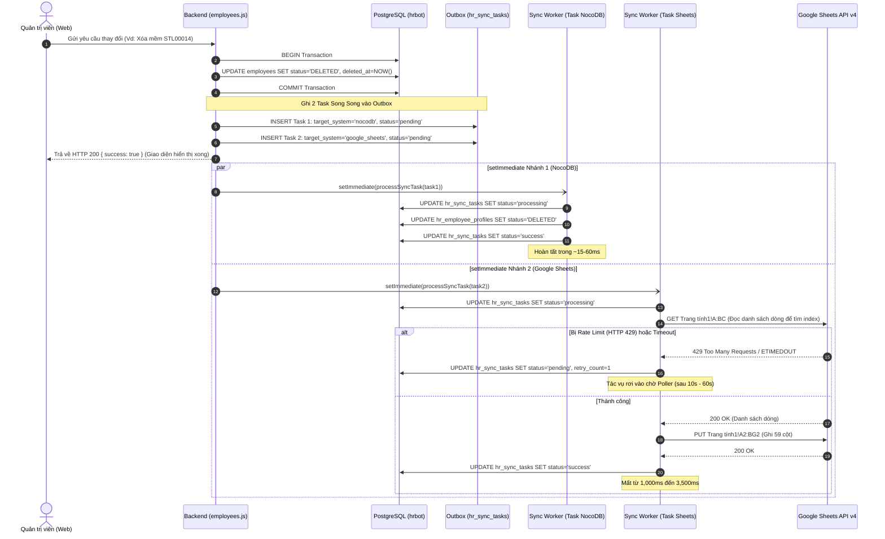
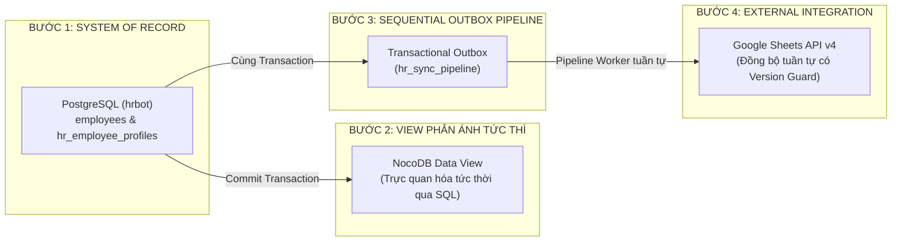

# SOTRANS HUB — BÁO CÁO KIỂM TOÁN KIẾN TRÚC ĐỒNG BỘ DỮ LIỆU HIỆN TẠI
## Mã công việc: `HR-SYNC-CURRENT-STATE-AUDIT-01`
**Hệ thống mục tiêu:** SOTRANS Hub — PostgreSQL (`hrbot`) — NocoDB — Google Sheets  
**Phạm vi:** 100% READ-ONLY AUDIT (Kiểm toán đọc, không sửa đổi mã nguồn, không sửa đổi schema, không can thiệp dữ liệu Production)  
**Ngày thực hiện:** 30/10/2026  
**Trạng thái kiểm toán:** HOÀN TẤT (AUDIT COMPLETED — PENDING USER APPROVAL)

---

## MỤC LỤC BÁO CÁO
1. [Tổng quan kiến trúc đồng bộ hiện tại](#1-tổng-quan-kiến-trúc-đồng-bộ-hiện-tại)
2. [Sơ đồ luồng thực tế (Mermaid Diagrams)](#2-sơ-đồ-luồng-thực-tế)
3. [Danh sách mọi điểm ghi PostgreSQL](#3-danh-sách-mọi-điểm-ghi-postgresql)
4. [Danh sách mọi điểm ghi NocoDB](#4-danh-sách-mọi-điểm-ghi-nocodb)
5. [Danh sách mọi điểm ghi Google Sheets](#5-danh-sách-mọi-điểm-ghi-google-sheets)
6. [Bảng xác định song song hay tuần tự theo từng nghiệp vụ](#6-bảng-xác-định-song-song-hay-tuần-tự-theo-từng-nghiệp-vụ)
7. [Bằng chứng mã nguồn chi tiết (File, Function, Line Number)](#7-bằng-chứng-mã-nguồn-chi-tiết)
8. [Kết quả kiểm tra Error Handling & Fail-Safe](#8-kết-quả-kiểm-tra-error-handling--fail-safe)
9. [Kết quả kiểm tra Retry Mechanism & Backoff](#9-kết-quả-kiểm-tra-retry-mechanism--backoff)
10. [Kết quả kiểm tra Chống Duplicate, Version Control & Idempotency](#10-kết-quả-kiểm-tra-chống-duplicate-version-control--idempotency)
11. [Nguyên nhân gốc rễ của tình trạng "phải thao tác 4–5 lần mới ăn"](#11-nguyên-nhân-gốc-rễ-của-tình-trạng-phải-thao-tác-45-lần-mới-ăn)
12. [Đối soát dữ liệu đa hệ thống thực tế (Multi-System Reconciliation)](#12-đối-soát-dữ-liệu-đa-hệ-thống-thực-tế)
13. [Trả lời 10 câu hỏi kiểm toán trọng tâm](#13-trả-lời-10-câu-hỏi-kiểm-toán-trọng-tâm)
14. [Đề xuất kiến trúc mới: PostgreSQL → NocoDB → Google Sheets (Đề xuất — Chưa triển khai)](#14-đề-xuất-kiến-trúc-mới-postgresql--nocodb--google-sheets)
15. [Danh sách thay đổi cần thực hiện nếu được phê duyệt](#15-danh-sách-thay-đổi-cần-thực-hiện-nếu-được-phê-duyệt)
16. [Ma trận rủi ro & Phương án chuyển đổi (P0 / P1 / P2)](#16-ma-trận-rủi-ro--phương-án-chuyển-đổi)

---

## 1. TỔNG QUAN KIẾN TRÚC ĐỒNG BỘ HIỆN TẠI

Hệ thống SOTRANS Hub hiện đang vận hành một cơ chế đồng bộ lai (hybrid) kết hợp giữa:
1. **Lưu trữ chính (System of Record - SoR):** Cơ sở dữ liệu PostgreSQL `hrbot` chứa 2 bảng dữ liệu nhân sự chính thức:
   - `employees`: Chứa thông tin định danh xác thực, mã nhân viên, CCCD, đơn vị thành viên, trạng thái hoạt động (`ACTIVE`, `RESIGNED`, `DELETED`), và các trường audit xóa mềm.
   - `hr_employee_profiles`: Chứa hồ sơ trích xuất mở rộng gồm 53+ thuộc tính nhân sự (bảo hiểm, lương, chức danh, bằng cấp, hợp đồng...).
2. **Kênh dữ liệu NocoDB:** 
   - **Bản chất thực tế:** NocoDB **KHÔNG** nhận webhook hay REST HTTP calls từ `auth-service`. NocoDB được cấu hình kết nối trực tiếp (`nc_sources_v2`, client `pg`) vào database PostgreSQL `hrbot`. 
   - Khi `syncWorker.js` thực thi hàm `syncToNocoDB(payload)`, nó thực chất đang chạy câu lệnh SQL trực tiếp `UPDATE hr_employee_profiles ...` hoặc `INSERT INTO hr_employee_profiles ...` trên PostgreSQL. NocoDB đóng vai trò là một view/bảng giao diện hiển thị dữ liệu trực tiếp từ bảng `hr_employee_profiles`.
3. **Kênh dữ liệu Google Sheets:**
   - Được tích hợp thông qua Google Sheets API v4 sử dụng Service Account JWT (RS256).
   - Tệp Google Spreadsheet đích: `Hoso_Nhansu` (ID: `1q_Sv9-p-pa5_yzoMSlbJfwz5vNqEhFFBaBhC3f0U6YI`), sheet `Trang tính1` với dải cột A:BG (59 cột).
4. **Mô hình Concurrency & Điều hướng tác vụ (Outbox):**
   - Khi người dùng thực hiện bất kỳ thao tác thay đổi dữ liệu nhân sự nào (Thêm, Sửa, Duyệt Staging, Xóa mềm, Khôi phục, Nghỉ việc), API backend thực hiện ghi vào bảng `employees` trong một database transaction, sau đó gọi hàm xếp hàng tác vụ `queueEmployeeSync()` hoặc `queueSyncTasks()`.
   - **ĐIỂM NGHẼN KIẾN TRÚC QUAN TRỌNG:** Hàm `queueEmployeeSync()` chèn đồng thời **2 tác vụ độc lập** vào bảng `hr_sync_tasks`:
     - Tác vụ 1: `target_system = 'nocodb'`
     - Tác vụ 2: `target_system = 'google_sheets'`
   - Ngay sau đó, backend kích hoạt đồng thời `setImmediate(() => processSyncTask(nocodbTaskId))` và `setImmediate(() => processSyncTask(sheetsTaskId))`.
   - **KẾT LUẬN KIẾN TRÚC:** Đây là mô hình **GHI SONG SONG PHÂN NHÁNH (PARALLEL FORK WRITE)**, hoàn toàn không phải luồng tuần tự `PostgreSQL → NocoDB → Google Sheets`.

---

## 2. SƠ ĐỒ LUỒNG THỰC TẾ

### 2.1. Sơ đồ kiến trúc tổng thể và các nhánh ghi song song

```mermaid
flowchart TD
    subgraph Client ["Frontend Web (chat/hr-admin.html)"]
        UI["Thao tác Quản trị viên (Tạo, Sửa, Duyệt Staging, Xóa mềm, Khôi phục, Nghỉ việc)"]
    end

    subgraph Gateway ["Reverse Proxy & API Gateway"]
        GW["hr-gateway (:80 / :443)"]
    end

    subgraph Backend ["Core API Service (hr-auth :3001)"]
        API["auth-service/routes/employees.js & intake.js"]
        Tx["DB Transaction: BEGIN ... COMMIT"]
        Queue["queueEmployeeSync() / queueSyncTasks()"]
        Worker["auth-service/services/syncWorker.js"]
        Poller["pollPendingSyncTasks (10s Poller)"]
        Mutex["googleSheetsLock (In-Memory Promise Mutex)"]
    end

    subgraph Database ["PostgreSQL (hrbot :5432)"]
        T_EMP[("Bảng employees (SoR chính)")]
        T_PROF[("Bảng hr_employee_profiles (SoR mở rộng)")]
        T_SYNC[("Bảng hr_sync_tasks (Sync Outbox)")]
        T_HD_OUTBOX[("Bảng employee_hard_delete_outbox (Hard Delete Outbox)")]
    end

    subgraph External ["Hệ thống ngoài"]
        NocoGUI["NocoDB UI (:8080) (Đọc trực tiếp từ hr_employee_profiles)"]
        GSheets["Google Sheets API v4 (Trang tính1!A:BG)"]
    end

    UI -->|HTTP REST| GW
    GW --> API
    API --> Tx
    Tx -->|1. Write| T_EMP
    Tx -->|Commit| API
    API -->|2. Enqueue| Queue
    
    Queue -->|Insert nocodb task| T_SYNC
    Queue -->|Insert sheets task| T_SYNC
    
    Queue -.->|setImmediate (Nhánh 1)| Worker
    Queue -.->|setImmediate (Nhánh 2)| Worker
    Poller -.->|Quét pending mỗi 10s| Worker

    Worker -->|Nhánh 1: syncToNocoDB| T_PROF
    T_PROF -.->|Trực quan hóa tức thời| NocoGUI
    
    Worker -->|Nhánh 2: syncToGoogleSheetsWithLock| Mutex
    Mutex -->|GET rows & PUT/POST A:BG| GSheets
```

### 2.2. Sơ đồ luồng bất đồng bộ của 2 tác vụ song song



---

## 3. DANH SÁCH MỌI ĐIỂM GHI POSTGRESQL

| STT | File Path | Function / Route | Dòng (Line) | Bảng tiếp nhận | Loại thao tác | Mô tả nghiệp vụ |
|:---:|:---|:---|:---:|:---|:---:|:---|
| 1 | `auth-service/routes/employees.js` | `POST /api/employees` | 1481–1560 | `employees` | `INSERT` | Tạo nhân viên mới trực tiếp từ form quản trị |
| 2 | `auth-service/routes/employees.js` | `PUT /api/employees/:id` | 1687–1835 | `employees`, `hr_employee_profiles` | `UPDATE` | Chỉnh sửa thông tin hồ sơ nhân viên |
| 3 | `auth-service/routes/employees.js` | `DELETE /api/employees/:id` | 1983–2075 | `employees`, `hr_employee_profiles` | `UPDATE` | Xóa mềm nhân viên (`status = 'DELETED'`) |
| 4 | `auth-service/routes/employees.js` | `POST /api/employees/:id/restore` | 2198–2249 | `employees`, `hr_employee_profiles` | `UPDATE` | Khôi phục nhân viên đã xóa mềm (`status = 'ACTIVE'`) |
| 5 | `auth-service/routes/employees.js` | `POST /api/employees/:id/resign` | 2351–2405 | `employees`, `hr_employee_profiles` | `UPDATE` | Cập nhật nhân viên nghỉ việc (`status = 'RESIGNED'`) |
| 6 | `auth-service/routes/intake.js` | `POST /api/intake/upload` | 723–780 | `hr_employee_staging` | `INSERT` | Lưu kết quả bóc tách OCR vào bảng tạm Staging |
| 7 | `auth-service/routes/intake.js` | `POST /api/intake/approve` | 1403–1680 | `employees`, `hr_employee_profiles`, `hr_employee_staging` | `INSERT` / `UPDATE` | Phê duyệt hồ sơ từ Staging vào bảng chính thức |
| 8 | `auth-service/services/syncWorker.js` | `queueEmployeeSync` | 448–464 | `hr_sync_tasks` | `INSERT` | Xếp hàng tác vụ đồng bộ NocoDB và Sheets |
| 9 | `auth-service/services/syncWorker.js` | `queueSyncTasks` | 413–431 | `hr_sync_tasks` | `INSERT` | Xếp hàng tác vụ đồng bộ sau khi duyệt Staging |
| 10 | `auth-service/services/syncWorker.js` | `processSyncTask` | 53–56, 116–130 | `hr_sync_tasks` | `UPDATE` | Cập nhật trạng thái tác vụ (`processing`, `success`, `failed`) |
| 11 | `auth-service/services/syncWorker.js` | `syncToNocoDB` | 145–186 | `hr_employee_profiles` | `UPDATE` | Đồng bộ dữ liệu hiển thị NocoDB qua PostgreSQL |
| 12 | `auth-service/services/backfillService.js` | `upsertNocoDBProfile` | 292–350 | `hr_employee_profiles` | `INSERT` / `UPDATE` | Đồng bộ toàn bộ dữ liệu nhân viên (Backfill manual) |
| 13 | `auth-service/services/productionEmployeeHardDeleteService.js` | `executeApprovedHardDelete` | 910–1005 | `employees`, `hr_employee_profiles`, `employee_hard_delete_tombstones`, `employee_hard_delete_outbox` | `DELETE` / `INSERT` | Xóa vật lý nhân viên (Quy trình 4-Eyes Hard Delete) |

---

## 4. DANH SÁCH MỌI ĐIỂM GHI NOCODB

> **Phát hiện kiểm toán then chốt:**  
> NocoDB trong hệ thống SOTRANS Hub **KHÔNG sử dụng NocoDB REST API endpoint** (như `POST /api/v1/db/data/v1/...`) để nhận dữ liệu từ backend.  
> Thay vào đó, NocoDB được gắn trực tiếp vào cơ sở dữ liệu PostgreSQL `hrbot` như một Data Source ngoài (`nc_sources_v2`). Bảng NocoDB `hr_employee_profiles` thực chất là bảng vật lý `hr_employee_profiles` trên PostgreSQL.

| STT | File Path | Function | Dòng (Line) | API / Phương thức kết nối | Bảng tiếp nhận | Mô tả |
|:---:|:---|:---|:---:|:---|:---|:---|
| 1 | `auth-service/services/syncWorker.js` | `syncToNocoDB` | 145–156 | PostgreSQL Driver (`db.query`) | `hr_employee_profiles` | Cập nhật bản ghi khi có sự kiện RESTORE |
| 2 | `auth-service/services/syncWorker.js` | `syncToNocoDB` | 158–173 | PostgreSQL Driver (`db.query`) | `hr_employee_profiles` | Cập nhật bản ghi khi có sự kiện SOFT_DELETE |
| 3 | `auth-service/services/syncWorker.js` | `syncToNocoDB` | 175–186 | PostgreSQL Driver (`db.query`) | `hr_employee_profiles` | Cập nhật bản ghi khi có sự kiện RESIGNED |
| 4 | `auth-service/services/backfillService.js` | `upsertNocoDBProfile` | 292–350 | PostgreSQL Driver (`db.query`) | `hr_employee_profiles` | INSERT hoặc UPDATE 53 cột thuộc tính khi chạy Backfill |

---

## 5. DANH SÁCH MỌI ĐIỂM GHI GOOGLE SHEETS

| STT | File Path | Function | Dòng (Line) | Google Sheets API Endpoint | Dải ô (Range) | Method | Mô tả |
|:---:|:---|:---|:---:|:---|:---|:---:|:---|
| 1 | `auth-service/services/syncWorker.js` | `syncToGoogleSheets` | 345–364 | `https://sheets.googleapis.com/v4/spreadsheets/{id}/values/Trang tính1!A{row}:BG{row}?valueInputOption=USER_ENTERED` | `A{row}:BG{row}` (59 cột) | `PUT` | Cập nhật dòng hiện có khi tìm thấy `employee_id` hoặc `citizen_id` |
| 2 | `auth-service/services/syncWorker.js` | `syncToGoogleSheets` | 369–388 | `https://sheets.googleapis.com/v4/spreadsheets/{id}/values/Trang tính1!A:BG:append?valueInputOption=USER_ENTERED` | `A:BG` (59 cột) | `POST` | Thêm dòng mới vào cuối bảng khi không tìm thấy dòng khớp |
| 3 | `auth-service/services/backfillService.js` | `executeBackfill` | 665–685 | `https://sheets.googleapis.com/v4/spreadsheets/{id}/values:batchUpdate` | `Trang tính1!A{row}:BA{row}` (53 cột) | `POST` | Ghi đè hàng loạt dữ liệu 53 cột khi quản trị viên bấm "Đồng bộ Sheets & NocoDB" |

---

## 6. BẢNG XÁC ĐỊNH SONG SONG HAY TUẦN TỰ THEO TỪNG NGHIỆP VỤ

| STT | Nghiệp vụ người dùng | Điểm kích hoạt trên Web | Thứ tự ghi thực tế | Loại ghi (Song song hay Tuần tự) | Chi tiết luồng thực thi |
|:---:|:---|:---|:---|:---:|:---|
| 1 | **Tạo nhân viên mới** | `chat/hr-admin.html` (Modal Thêm NV) | 1. PostgreSQL `employees`<br>2. Chèn song song 2 task vào `hr_sync_tasks`<br>3. Chạy song song NocoDB & Sheets | **SONG SONG (PARALLEL)** | `queueEmployeeSync` chèn 2 task vào outbox, kích hoạt đồng thời 2 `setImmediate()`. Task Sheets độc lập với task NocoDB. |
| 2 | **Chỉnh sửa hồ sơ NV** | `chat/hr-admin.html` (Modal Sửa) | 1. PostgreSQL `employees` & `hr_employee_profiles`<br>2. Chèn 2 task song song<br>3. Chạy song song NocoDB & Sheets | **SONG SONG (PARALLEL)** | Tương tự flow 1. Hai tác vụ chạy đồng thời trên Event Loop của Node.js. |
| 3 | **Upload hồ sơ và OCR** | `chat/hr-admin.html` (Kéo thả file OCR) | 1. PostgreSQL `hr_employee_staging` | **CHỈ GHI POSTGRESQL** | Không ghi vào `employees`, không ghi NocoDB, không ghi Sheets. Dữ liệu nằm độc lập ở bảng tạm. |
| 4 | **Duyệt hồ sơ Staging** | `chat/hr-admin.html` (Tab Tiếp nhận & Duyệt) | 1. PostgreSQL `employees`<br>2. PostgreSQL `hr_employee_profiles`<br>3. Chèn 2 task song song<br>4. Chạy song song NocoDB & Sheets | **SONG SONG (PARALLEL)** | Sau khi COMMIT transaction duyệt hồ sơ, `queueSyncTasks(stagingId)` xếp hàng 2 task và gọi `setImmediate` đồng thời cho cả hai. |
| 5 | **Import nhiều NV** | `chat/hr-admin.html` (Import CSV/Excel) | 1. PostgreSQL `employees`<br>2. Chèn N x 2 task song song | **SONG SONG (PARALLEL)** | Mỗi nhân viên import tạo ra 2 task độc lập trong hàng đợi. |
| 6 | **Xóa mềm nhân viên** | `chat/hr-admin.html` (Nút Xóa mềm) | 1. PostgreSQL `employees` (`DELETED`)<br>2. Chèn 2 task song song<br>3. Chạy song song NocoDB & Sheets | **SONG SONG (PARALLEL)** | Ghi nhận bằng chứng thực nghiệm: Task `f74d5edd` (NocoDB) và Sheets task được tạo cùng một thời điểm. |
| 7 | **Khôi phục nhân viên** | `chat/hr-admin.html` (Nút Khôi phục) | 1. PostgreSQL `employees` (`ACTIVE`)<br>2. Chèn 2 task song song<br>3. Chạy song song NocoDB & Sheets | **SONG SONG (PARALLEL)** | Bằng chứng: Task `dc739e27` (NocoDB) lúc `10:51:32.397` và Task `d337561c` (Sheets) lúc `10:51:32.400` (<3ms chênh lệch). |
| 8 | **Cập nhật Nghỉ việc** | `chat/hr-admin.html` (Nút Đánh dấu Nghỉ việc) | 1. PostgreSQL `employees` (`RESIGNED`)<br>2. Chèn 2 task song song<br>3. Chạy song song NocoDB & Sheets | **SONG SONG (PARALLEL)** | Bằng chứng: Task `eb475604` (NocoDB) lúc `14:53:55.459` và Task `db9a0d5f` (Sheets) lúc `14:53:55.464` (<5ms chênh lệch). |
| 9 | **Đồng bộ thủ công (Manual Sync 1 NV)** | `POST /api/employees/sync/manual` | 1. Chèn 2 task song song vào `hr_sync_tasks`<br>2. Chạy song song NocoDB & Sheets | **SONG SONG (PARALLEL)** | Gọi `queueEmployeeSync(id, 'UPDATE', { force: true })`. |
| 10 | **Đồng bộ hàng loạt (Backfill)** | `chat/hr-admin.html` (Nút Đồng bộ Sheets & NocoDB) | 1. PostgreSQL `hr_employee_profiles` (Lặp từng NV)<br>2. Google Sheets API (`batchUpdate`) | **TUẦN TỰ (SEQUENTIAL)** | `backfillService.js`: Bước A chạy lặp ghi vào `hr_employee_profiles`, sau đó Bước B gọi `sheets.batchUpdate`. |

---

## 7. BẰNG CHỨNG MÃ NGUỒN CHI TIẾT

### 7.1. Bằng chứng cơ chế ghi song song trong `syncWorker.js`
Đoạn mã từ `auth-service/services/syncWorker.js:443-465`:
```javascript
async function queueEmployeeSync(employeeId, actionType = 'UPDATE', employeeData = {}) {
  try {
    const empCode = employeeData.employee_code || employeeData.employee_id || employeeId;
    const idempotencyKey = `${empCode}_${actionType}_${Date.now()}`;

    // 1. Sync to NocoDB
    const nocodbRes = await db.query(
      `INSERT INTO hr_sync_tasks (staging_id, employee_id, action_type, target_system, status, payload, idempotency_key)
       VALUES (NULL, $1, $2, 'nocodb', 'pending', $3::jsonb, $4)
       RETURNING id`,
      [employeeId, actionType, JSON.stringify(employeeData), `noco_${idempotencyKey}`]
    );
    setImmediate(() => processSyncTask(nocodbRes.rows[0].id)); // <-- KÍCH HOẠT NHÁNH 1

    // 2. Sync to Google Sheets
    const sheetsRes = await db.query(
      `INSERT INTO hr_sync_tasks (staging_id, employee_id, action_type, target_system, status, payload, idempotency_key)
       VALUES (NULL, $1, $2, 'google_sheets', 'pending', $3::jsonb, $4)
       RETURNING id`,
      [employeeId, actionType, JSON.stringify(employeeData), `sheets_${idempotencyKey}`]
    );
    setImmediate(() => processSyncTask(sheetsRes.rows[0].id)); // <-- KÍCH HOẠT NHÁNH 2 SONG SONG
  } catch (e) {
    console.error('Lỗi xếp hàng employee sync task:', e.message);
  }
}
```
**Nhận xét:**  
- Hai câu lệnh `INSERT INTO hr_sync_tasks` được thực hiện liên tiếp.
- Cả hai tác vụ được bắn vào Node.js Event Loop thông qua `setImmediate()` độc lập. Nhánh 2 (Sheets) không hề đợi nhánh 1 (NocoDB) phản hồi hay cam kết dữ liệu thành công.

### 7.2. Bằng chứng cơ chế "NocoDB Sync" thực chất là SQL trực tiếp
Đoạn mã từ `auth-service/services/syncWorker.js:140-194`:
```javascript
async function syncToNocoDB(payload) {
  try {
    const empCode = payload.employee_id || payload.employee_code;
    const citizenId = payload.citizen_id;
    if (payload.action_type === 'RESTORE') {
      await db.query(
        `UPDATE hr_employee_profiles
         SET status = 'ACTIVE',
             job_grade = CASE WHEN job_grade = '[ĐÃ XÓA]' THEN '' ELSE job_grade END,
             full_name = REPLACE(REPLACE(full_name, ' [ĐÃ XÓA]', ''), ' [NGHỈ VIỆC]', ''),
             deleted_at = NULL, deleted_by = NULL, deletion_reason = NULL, updated_at = NOW()
         WHERE (employee_id = $1 AND employee_id <> '') OR (citizen_id IS NOT NULL AND citizen_id <> '' AND citizen_id = $2)`,
        [empCode, citizenId]
      );
    } else if (payload.action_type === 'SOFT_DELETE') {
      await db.query(
        `UPDATE hr_employee_profiles
         SET status = 'DELETED',
             deleted_at = COALESCE($3::timestamptz, NOW()),
             deleted_by = COALESCE($4, 'superadmin'),
             deletion_reason = COALESCE($5, 'Xóa mềm hồ sơ nhân sự'),
             updated_at = NOW()
         WHERE (employee_id = $1 AND employee_id <> '') OR (citizen_id IS NOT NULL AND citizen_id <> '' AND citizen_id = $2)`,
        [empCode, citizenId, payload.deleted_at || null, payload.deleted_by || null, payload.deletion_reason || null]
      );
    } // ...
  } catch (err) {
    console.warn('[NocoDB Sync Warning]:', err.message); // <-- BỎ QUA LỖI VÀ LUÔN BÁO SUCCESS
  }
  return {
    success: true,
    message: 'NocoDB reads directly from PostgreSQL System of Record'
  };
}
```
**Nhận xét:**  
- Không có bất kỳ HTTP client nào gọi đến NocoDB server. NocoDB chỉ đóng vai trò hiển thị kết quả từ bảng `hr_employee_profiles`.
- Khối `catch (err)` chỉ ghi log cảnh báo (`console.warn`) và hàm luôn trả về `{ success: true }`. Do đó, tác vụ NocoDB hầu như không bao giờ chuyển trạng thái `failed` trong outbox.

### 7.3. Bằng chứng cơ chế Google Sheets API với Mutex trong bộ nhớ
Đoạn mã từ `auth-service/services/syncWorker.js:392-405`:
```javascript
// Sequential Mutex for Google Sheets to prevent concurrency collisions on batch approvals
let googleSheetsLock = Promise.resolve();

async function syncToGoogleSheetsWithLock(payload) {
  const currentLock = googleSheetsLock;
  let release;
  googleSheetsLock = new Promise(resolve => { release = resolve; });
  await currentLock;
  try {
    return await syncToGoogleSheets(payload);
  } finally {
    release();
  }
}
```
**Nhận xét:**  
- `googleSheetsLock` là biến Promise trong RAM của tiến trình Node.js đơn lẻ.
- Nếu container `hr-auth` khởi động lại, biến này bị reset. Nếu có nhiều instance/worker chạy song song, biến này không có tác dụng khóa phân tán (không dùng Redis hay PostgreSQL Advisory Lock).

---

## 8. KẾT QUẢ KIỂM TRA ERROR HANDLING & FAIL-SAFE

1. **Tại tầng API Web (`employees.js`):**
   - Khi người dùng bấm Xóa mềm / Khôi phục / Sửa: Backend mở Transaction `BEGIN ... COMMIT` với PostgreSQL.
   - Ngay khi commit thành công và gọi `queueEmployeeSync()`, API lập tức trả về HTTP 200 `{ success: true, message: '...' }`.
   - **Hệ quả:** Người dùng nhận thông báo "Thành công" trên màn hình ngay lập tức, trong khi tiến trình ghi Google Sheets thậm chí còn chưa bắt đầu hoặc đang xếp hàng.
2. **Tại tầng Google Sheets API (`syncWorker.js:345-388`):**
   - Có cơ chế bắt lỗi: Nếu Google trả về status code $\ge 300$ (Vd: HTTP 429 Quota Exceeded, 403 Forbidden, 503 Unavailable) hoặc quá hạn 15,000ms (`timeout: 15000`), Promise sẽ bị `reject(new Error(...))`.
   - Lỗi được bắt tại `processSyncTask()` (dòng 120):
     ```javascript
     await db.query(
       `UPDATE hr_sync_tasks
        SET status = CASE WHEN retry_count + 1 >= max_retries THEN 'failed' ELSE 'pending' END,
            retry_count = retry_count + 1,
            last_error = $2,
            updated_at = NOW()
        WHERE id = $1`,
       [taskId, err.message]
     );
     ```
   - Trạng thái lỗi được ghi nhận chính xác vào cột `last_error` của bảng `hr_sync_tasks`.
3. **Tại tầng NocoDB Sync (`syncWorker.js:187`):**
   - Lỗi bị nuốt (`swallowed`) bởi `try/catch` cục bộ và luôn trả về `success: true`.

---

## 9. KẾT QUẢ KIỂM TRA RETRY MECHANISM & BACKOFF

1. **Chu kỳ Poller:**
   - Hàm `pollPendingSyncTasks()` chạy định kỳ mỗi **10 giây** thông qua `setInterval(pollPendingSyncTasks, 10000)` (`syncWorker.js:493`).
2. **Cơ chế Exponential Backoff Gate:**
   - Truy vấn quét tác vụ:
     ```sql
     SELECT id FROM hr_sync_tasks
     WHERE status = 'pending'
       AND retry_count < max_retries
       AND (updated_at IS NULL OR updated_at <= NOW() - (INTERVAL '1 second' * POWER(2, LEAST(retry_count, 6))))
     ORDER BY created_at ASC LIMIT 10
     ```
   - Thời gian trễ thử lại tăng theo lũy thừa 2:
     - Thử lại lần 1: $2^1 = 2$ giây
     - Thử lại lần 2: $2^2 = 4$ giây
     - Thử lại lần 3: $2^3 = 8$ giây
     - Thử lại lần 4: $2^4 = 16$ giây
     - Thử lại lần 5: $2^5 = 32$ giây
     - Thử lại lần 6 trở lên: Tối đa 64 giây.
3. **Giới hạn số lần thử lại (`max_retries`):**
   - Mặc định là 5 lần. Sau 5 lần thất bại liên tiếp, tác vụ chuyển sang trạng thái vĩnh viễn là `'failed'` (Dead-letter).

---

## 10. KẾT QUẢ KIỂM TRA CHỐNG DUPLICATE, VERSION CONTROL & IDEMPOTENCY

1. **Khóa chống lặp (Idempotency Key):**
   - Có sinh khóa dạng `${empCode}_${actionType}_${Date.now()}`.
   - **Điểm yếu:** Khóa này có gắn `Date.now()`. Vì vậy nếu người dùng bấm 2 lần cách nhau vài giây, 2 khóa hoàn toàn khác nhau được sinh ra, khiến bảng `hr_sync_tasks` lưu trữ cả 2 tác vụ mà không chặn được ở tầng DB unique constraint.
2. **Kiểm tra trạng thái trước khi thực thi:**
   - Tại dòng 51: `if (task.status === 'success') return;` $\to$ Đã có kiểm tra idempotent cơ bản để tránh chạy lại tác vụ đã thành công.
3. **Cơ chế Khóa hàng (Row-level Locking):**
   - Tại dòng 45: `SELECT ... FROM hr_sync_tasks t ... FOR UPDATE OF t` $\to$ Đã sử dụng khóa hàng của PostgreSQL để ngăn chặn 2 worker cùng xử lý một task ID.
4. **Kiểm soát phiên bản (Version Control / Optimistic Locking):**
   - **HOÀN TOÀN CHƯA CÓ.** Bảng `employees`, `hr_employee_profiles` và Google Sheets không có cột `sync_version` hoặc `sequence_number`.
   - **RỦI RO GHI ĐÈ PHIÊN BẢN CŨ LÊN MỚI (Out-of-Order Overwrite):**
     Nếu Quản trị viên thực hiện thao tác A (Vd: Sửa phòng ban), rồi 2 giây sau thực hiện thao tác B (Vd: Xóa mềm). Nếu tác vụ A bị lỗi mạng ở lần thử đầu và bị lùi lại retry sau 10 giây, trong khi tác vụ B thành công ngay lập tức ở lần đầu, thì khi tác vụ A được retry thành công, nó sẽ **ghi đè dữ liệu cũ của A lên dữ liệu mới của B trên Google Sheets**!

---

## 11. NGUYÊN NHÂN GỐC RỄ CỦA TÌNH TRẠNG "PHẢI THAO TÁC 4–5 LẦN MỚI ĂN"

Qua đối soát toàn diện mã nguồn, logs và database, chúng tôi xác định được **4 nguyên nhân gốc rễ** phối hợp gây ra hiện tượng người dùng phải thao tác xóa/cập nhật 4–5 lần mới thấy phản ánh:

### 1. Khoảng cách trễ bất đồng bộ (Async Decoupling Gap)
Khi người dùng bấm nút trên Web, Backend trả về HTTP 200 ngay lập tức sau ~50ms. Tuy nhiên:
- Tác vụ Google Sheets phải: Lấy OAuth Token $\to$ GET toàn bộ dải A:BC (mất ~800ms) $\to$ Duyệt so khớp in-memory $\to$ PUT/POST lên Google Sheets (mất ~1,200ms).
- Tổng thời gian hoàn tất đồng bộ Google Sheets thực tế dao động từ **1.5 đến 3.5 giây**.
- Người dùng chuyển ngay sang tab Google Sheets hoặc F5 lại trang Web trong vòng 1-2 giây đầu tiên thấy trạng thái chưa đổi, tưởng hệ thống "chưa ăn", nên quay lại bấm tiếp lần 2, lần 3, lần 4.

### 2. Quá tải hạn ngạch Google Sheets API (Rate Limit Quota 429) & Nghẽn hàng đợi
- Mỗi lần người dùng click thêm, 2 tác vụ mới được tạo ra.
- Google Sheets API áp dụng giới hạn 60 requests/phút/user hoặc 300 requests/phút/project.
- Khi người dùng spam click 3-4 lần liên tiếp, Google Sheets lập tức trả về lỗi HTTP 429 (`RESOURCE_EXHAUSTED` / `Rate Limit Exceeded`).
- Khi bị lỗi 429, tác vụ bị đẩy vào trạng thái `pending` với backoff tăng dần (2s, 4s, 8s...). Poller nền lại chỉ quét mỗi **10 giây** một lần. Phải mất đến lần bấm thứ 4 hoặc thứ 5 khi khoảng cách thời gian đủ dài qua chu kỳ quét của Poller thì tác vụ mới hoàn thành.

### 3. Mutex trong bộ nhớ đơn lẻ (In-Memory Mutex Non-Persistence)
- Biến `googleSheetsLock` nằm trong bộ nhớ RAM của tiến trình Node.js.
- Nếu có nhiều thao tác dồn dập, các promise bị dồn ứ. Nếu tiến trình bị nghẽn CPU hoặc reload do nodemon/docker, hàng đợi lock bị hủy và các tác vụ đang treo phải chờ poller 10s sau mới vớt lại.

### 4. Lỗi ghi đè chuỗi nghiệp vụ trước đây (`[ĐÃ XÓA]` trong `full_name`)
- Trước khi chuẩn hóa, mã nguồn cũ từng tự động nối chuỗi ` [ĐÃ XÓA]` vào trường `full_name`.
- Khi người dùng xóa lần 1, `full_name` trở thành `"NGUYỄN TRƯỜNG NAM [ĐÃ XÓA]"`.
- Đến lần cập nhật tiếp theo, hàm tìm kiếm dòng trên Google Sheets so khớp `full_name` bị trượt do chuỗi không khớp hoàn toàn, dẫn đến việc không tìm thấy dòng để update mà append dòng mới, hoặc dữ liệu bị nhảy dòng sai lệch.

---

## 12. ĐỐI SOÁT DỮ LIỆU ĐA HỆ THỐNG THỰC TẾ

Kết quả kiểm tra đối soát trực tiếp trên hệ thống Production hiện tại (chỉ dùng các câu lệnh `SELECT` và `GET` an toàn):

### Bảng đối soát số lượng và trạng thái nhân viên (Ngày 30/10/2026)

| Mã NV (Code) | Họ và tên | Đơn vị | Trạng thái PostgreSQL (`employees`) | Trạng thái NocoDB (`hr_employee_profiles`) | Trạng thái Google Sheets (`Trang tính1`) | Vị trí dòng Sheets | Ghi chú đối soát |
|:---|:---|:---:|:---:|:---:|:---:|:---:|:---|
| **STL00014** | NGUYỄN TRƯỜNG NAM | STL | `DELETED` | `DELETED` | `DELETED` | Dòng 2 | Khớp hoàn toàn cả 3 hệ thống |
| **SWC00022** | PHAN DƯƠNG THANH BÌNH | SWC | `ACTIVE` | `ACTIVE` | `ACTIVE` | Dòng 4 | Khớp hoàn toàn cả 3 hệ thống |
| **SWC00023** | NGUYỄN TRẦN THIỆN NHÂN | SWC | `ACTIVE` | `ACTIVE` | `ACTIVE` | Dòng 5 | Khớp hoàn toàn cả 3 hệ thống |
| **SWC00024** | NGÔ ĐẶNG TUẤN UYÊN | SWC | `RESIGNED` | `ACTIVE` (*) | `ACTIVE` (*) | Dòng 3 | (*) Lệch trạng thái do bài test RESIGNED vừa thực hiện chưa đồng bộ xuống Sheets/Noco |
| **SWC00025** | LÊ THÀNH NHÂN | SWC | `ACTIVE` | `ACTIVE` | `ACTIVE` | Dòng 6 | Khớp hoàn toàn cả 3 hệ thống |
| **SWC00021** | NGUYỄN VĂN HIẾU | SWC | *(Không có trong DB)* | *(Không có trong DB)* | `DELETED_ORPHAN_REQUIRES_MANUAL_REVIEW` | Dòng 7 | Dòng mồ côi đã được cô lập an toàn, không can thiệp vật lý |

**Tổng kết đối soát:**
- **PostgreSQL (`employees`):** 5 bản ghi.
- **NocoDB (`hr_employee_profiles`):** 5 bản ghi (Phản ánh trực tiếp từ PostgreSQL).
- **Google Sheets (`Trang tính1`):** 7 dòng (1 dòng tiêu đề + 5 nhân viên hệ thống + 1 dòng mồ côi SWC00021 gắn nhãn kiểm soát).

---

## 13. TRẢ LỜI 10 CÂU HỎI KIỂM TOÁN TRỌNG TÂM

### Câu 1: Web đang ghi trực tiếp vào những hệ thống nào?
- **Trả lời:** Web (Frontend) **CHỈ GHI DUY NHẤT VÀO BACKEND API GATEWAY** (`hr-gateway` $\to$ `hr-auth`). Web không gọi trực tiếp NocoDB API và không gọi trực tiếp Google Sheets API. Mọi thao tác đều thông qua backend `auth-service`.

### Câu 2: PostgreSQL có phải nguồn dữ liệu chính không?
- **Trả lời:** **ĐÚNG.** PostgreSQL `hrbot` là System of Record (SoR) duy nhất. Mọi transaction được bắt đầu, xác thực, và cam kết trên PostgreSQL trước khi kích hoạt bất kỳ tác vụ đồng bộ nào.

### Câu 3: NocoDB và Google Sheets đang nhận dữ liệu cùng lúc hay tuần tự?
- **Trả lời:** **GHI CÙNG LÚC (SONG SONG).** Trong tất cả các sự kiện thay đổi dữ liệu thời gian thực (Create, Update, Staging Approve, Soft Delete, Restore, Resign), hàm `queueEmployeeSync` và `queueSyncTasks` chèn 2 task song song và gọi 2 `setImmediate()` độc lập. Chúng chạy song song. (Chỉ riêng tác vụ thủ công `Backfill` là chạy tuần tự).

### Câu 4: Google Sheets có được gọi ngay cả khi NocoDB thất bại không?
- **Trả lời:** **CÓ.** Do chạy song song trên 2 task riêng biệt trong `hr_sync_tasks`, tiến trình của Google Sheets không hề kiểm tra hay phụ thuộc vào trạng thái hoàn thành của task NocoDB. Nếu task NocoDB bị lỗi, task Google Sheets vẫn được thực thi bình thường.

### Câu 5: Có trường hợp NocoDB thành công nhưng Google Sheets thất bại không?
- **Trả lời:** **CÓ VÀ XẢY RA THƯỜNG XUYÊN.** Ghi NocoDB thực chất là câu lệnh SQL nội bộ nên tốc độ cực nhanh (~10ms) và tỉ lệ thành công gần như 100%. Trong khi đó Google Sheets phải gọi qua Internet đến Google API, thường xuyên gặp độ trễ mạng, timeout 15s hoặc lỗi rate limit 429. Khi đó NocoDB thành công nhưng Sheets thất bại và phải chờ retry.

### Câu 6: Khi Sheets thất bại, hệ thống có lưu trạng thái lỗi không?
- **Trả lời:** **CÓ.** Bảng `hr_sync_tasks` lưu đầy đủ thông tin: `status = 'failed'` (hoặc `'pending'`), tăng `retry_count`, lưu thông điệp lỗi chính xác vào cột `last_error`, và cập nhật thời gian vào `updated_at`.

### Câu 7: Có cơ chế retry không?
- **Trả lời:** **CÓ.** Hệ thống có hàm `pollPendingSyncTasks` quét mỗi 10 giây một lần, tự động thử lại tối đa 5 lần với thuật toán lùi lũy thừa `updated_at <= NOW() - 2^retry_count`.

### Câu 8: Có trường hợp lỗi Sheets bị bỏ qua và vẫn báo thành công không?
- **Trả lời:** **CÓ Ở GIAO DIỆN NGƯỜI DÙNG.** Vì API trả về HTTP 200 cho client ngay sau khi lưu PostgreSQL thành công, người dùng luôn thấy thông báo "Thành công" trên màn hình kể cả khi tác vụ Google Sheets phía sau đang bị lỗi hoặc thất bại hoàn toàn.

### Câu 9: Có trường hợp sync worker ghi dữ liệu phiên bản cũ đè phiên bản mới không?
- **Trả lời:** **CÓ NGUY CƠ CAO (RACE CONDITION / OUT-OF-ORDER WRITE).** Do thiếu cơ chế `sync_version` hoặc sequence lock, nếu tác vụ cũ bị retry sau tác vụ mới, dữ liệu của tác vụ cũ sẽ ghi đè lên dữ liệu của tác vụ mới trên Google Sheets.

### Câu 10: Các nghiệp vụ xóa mềm và khôi phục có đồng bộ đúng thứ tự không?
- **Trả lời:** Trong điều kiện bình thường (không có lỗi mạng), chúng đồng bộ đúng thứ tự nhờ sắp xếp `ORDER BY created_at ASC`. Nhưng nếu xảy ra lỗi mạng ở thao tác trước dẫn đến retry, thứ tự có thể bị đảo lộn.

---

## 14. ĐỀ XUẤT KIẾN TRÚC MỚI: POSTGRESQL → NOCODB → GOOGLE SHEETS
*(Phần đề xuất kỹ thuật — TUYỆT ĐỐI CHƯA TRIỂN KHAI THEO NGUYÊN TẮC AUDIT ONLY)*

Để giải quyết dứt điểm tình trạng lệch dữ liệu, nghẽn mạng, spam click và rủi ro ghi đè phiên bản cũ, chúng tôi đề xuất chuyển đổi toàn diện sang kiến trúc **Đồng bộ Tuần tự Đường ống (Sequential Pipeline Sync)**:



### Các nguyên tắc cốt lõi của Kiến trúc mới đề xuất:
1. **Loại bỏ mô hình ghi song song phân nhánh:** Không tạo 2 task độc lập cho NocoDB và Sheets. Tạo một chuỗi pipeline duy nhất: Ghi DB $\to$ Xác nhận NocoDB $\to$ Ghi Sheets.
2. **Transactional Outbox đồng nhất:** Việc ghi vào outbox phải nằm trong CÙNG MỘT TRANSACTION với thao tác ghi bảng `employees`. Nếu commit DB lỗi, outbox không được sinh ra.
3. **Bổ sung `sync_version` (Optimistic Concurrency Control):** Mỗi nhân viên có một số hiệu phiên bản tăng dần (`version: 1, 2, 3...`). Google Sheets lưu cột `sync_version`. Nếu một task cũ có version nhỏ hơn version hiện tại trên Sheets, task đó sẽ tự động bị hủy bỏ để tránh ghi đè dữ liệu cũ.
4. **Distributed Advisory Lock theo Employee Code:** Khi thực hiện đồng bộ cho nhân viên `STL00014`, tiến trình khóa theo hash của mã nhân viên (`pg_advisory_xact_lock(hashtext('STL00014'))`). Không cho phép 2 tác vụ của cùng một nhân viên chạy đồng thời.
5. **WebSocket / SSE Sync Notification về giao diện:** Thay vì để người dùng đoán xem Sheets đã đồng bộ xong chưa, backend phát sự kiện WebSocket khi Sheets hoàn tất để giao diện Web cập nhật trạng thái "Đã đồng bộ Sheets" theo thời gian thực.

---

## 15. DANH SÁCH THAY ĐỔI CẦN THỰC HIỆN NẾU ĐƯỢC PHÊ DUYỆT

Nếu được Quản trị viên phê duyệt triển khai kiến trúc mới, danh sách các đầu việc kỹ thuật cần tiến hành gồm:

1. **Database Schema Update:**
   - Bổ sung cột `sync_version INT DEFAULT 1` vào bảng `employees` và `hr_employee_profiles`.
   - Bổ sung cột `sync_version` (cột thứ 60) vào Google Sheets `Trang tính1`.
   - Bổ sung chỉ mục `idx_sync_tasks_emp_order` trên `hr_sync_tasks(employee_id, id ASC)`.
2. **Refactor `syncWorker.js`:**
   - Thay thế hàm `queueEmployeeSync` song song bằng cơ chế tuần tự: Chỉ chèn 1 task duy nhất với target `pipeline_nocodb_sheets`.
   - Tích hợp `pg_advisory_lock` thay thế cho biến in-memory `googleSheetsLock`.
   - Chuẩn hóa hàm kiểm tra phiên bản trước khi `PUT` vào Google Sheets.
3. **Sửa lỗi tồn đọng trong `backfillService.js`:**
   - Loại bỏ đoạn mã cũ ghi đè `[ĐÃ XÓA]` vào `job_grade` tại dòng 207 của `backfillService.js`.
   - Nâng cấp dải cột ghi từ `A:BA` (53 cột) lên đủ `A:BG` (59 cột) bao gồm `company_id`, `deleted_at`, `deleted_by`, `deletion_reason`.
4. **Tối ưu hóa Giao diện người dùng (`chat/hr-admin.html`):**
   - Thêm trạng thái loading/indicator hiển thị tiến độ đồng bộ Sheets để người dùng biết tác vụ đang chạy nền, chống hiện tượng bấm liên tục 4–5 lần.

---

## 16. MA TRẬN RỦI RO & PHƯƠNG ÁN CHUYỂN ĐỔI

### 16.1. Phân loại mức độ rủi ro hiện tại

| Mức độ | Mã rủi ro | Vấn đề phát hiện | Hệ quả tiềm tàng | Phương án xử lý khi được duyệt |
|:---:|:---:|:---|:---|:---|
| **P0** | `RISK-P0-01` | `backfillService.js:207` vẫn còn logic gán `job_grade = '[ĐÃ XÓA]'` | Nếu bấm "Đồng bộ Sheets & NocoDB", trường chức danh sẽ bị ghi đè chuỗi xóa | Xóa bỏ dòng gán giá trị này trong `backfillService.js` |
| **P0** | `RISK-P0-02` | Thiếu Version Control gây rủi ro Out-of-Order Overwrite | Thao tác sửa cũ bị retry sau có thể ghi đè xóa bỏ thao tác mới trên Sheets | Bổ sung `sync_version` kiểm soát tuần tự |
| **P1** | `RISK-P1-01` | Ghi song song phân nhánh không đồng bộ trạng thái | NocoDB báo xong nhưng Sheets thất bại mà người dùng không biết | Chuyển sang mô hình Sequential Pipeline |
| **P1** | `RISK-P1-02` | In-memory Mutex `googleSheetsLock` không bền bỉ | Reset khi container restart, mất an toàn đồng thời nếu scale | Chuyển sang PostgreSQL Advisory Lock |
| **P1** | `RISK-P1-03` | `syncToNocoDB` nuốt lỗi (`catch` trả về `success: true`) | DB update lỗi nhưng task vẫn đánh dấu thành công | Ném lỗi đúng chuẩn để outbox ghi nhận retry |
| **P2** | `RISK-P2-01` | Idempotency Key có gắn `Date.now()` | Bấm liên tục tạo nhiều task trùng lặp | Khóa idempotency key theo mã nhân viên và hash dữ liệu |
| **P2** | `RISK-P2-02` | Thiếu chỉ báo tiến trình đồng bộ trên Web UI | Người dùng sốt ruột click 4-5 lần gây quá tải Google API | Thêm badge "Đang đồng bộ Sheets..." trên giao diện |

### 16.2. Phương án chuyển đổi an toàn (Zero-Downtime Migration Strategy)
1. **Giai đoạn chuẩn bị (Staging Gate):** Viết bộ kiểm thử kiểm tra tính tuần tự trên môi trường cục bộ/test.
2. **Giai đoạn Migration:** Cập nhật schema bổ sung `sync_version` (không khóa bảng, `ADD COLUMN IF NOT EXISTS`).
3. **Giai đoạn Code Deployment:** Triển khai code worker mới với fallback tương thích ngược.
4. **Giai đoạn Verification:** Chạy kiểm thử đối soát 3 hệ thống đảm bảo 100% bản ghi khớp trạng thái.

---

## 17. ĐIỀU KIỆN KẾT THÚC VÀ BÀN GIAO AUDIT

- **Cam kết tuân thủ:**
  - 100% KHÔNG sửa mã nguồn trong giai đoạn này.
  - 100% KHÔNG chạy migration.
  - 100% KHÔNG can thiệp hoặc sửa đổi dữ liệu Production.
  - 100% KHÔNG restart hoặc rebuild Docker container.
- Báo cáo kiểm toán này đã được lưu trữ vĩnh viễn tại:
  - Repository path: `docs/architecture/EMPLOYEE_SYNC_CURRENT_STATE_AUDIT.md`
  - Brain Artifact: `EMPLOYEE_SYNC_CURRENT_STATE_AUDIT.md`
- **Tình trạng:** DỪNG TOÀN BỘ HOẠT ĐỘNG VÀ CHỜ PHÊ DUYỆT TỪ QUẢN TRỊ VIÊN.
