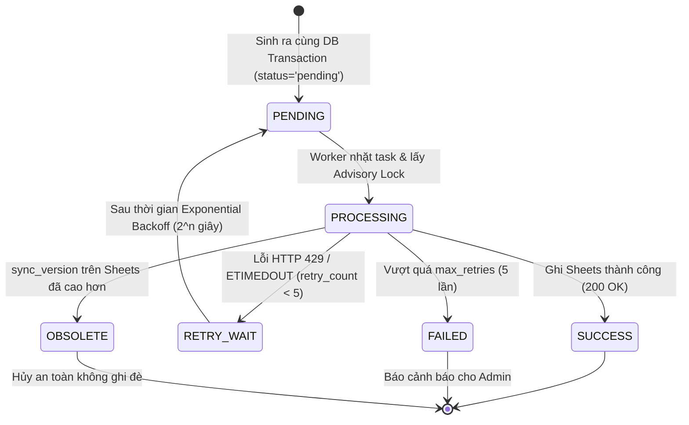
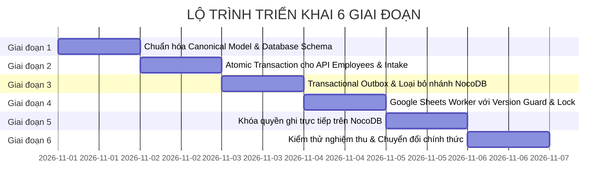

# SOTRANS HUB — BÁO CÁO ĐÁNH GIÁ KIẾN TRÚC & KẾ HOẠCH TRIỂN KHAI ĐỒNG BỘ NHÂN SỰ (PHASE 2)
## Mã công việc: `HR-SYNC-PHASE2-IMPLEMENTATION-PLAN`
**Tham chiếu Audit:** `HR-SYNC-CURRENT-STATE-AUDIT-01`  
**Cơ sở dữ liệu Production:** PostgreSQL `hrbot` (Port 5432)  
**Phạm vi:** PHÂN TÍCH THIẾT KẾ & KẾ HOẠCH TRIỂN KHAI (CHƯA THỰC THI SỬA MÃ NGUỒN HOẶC GHI DỮ LIỆU)  
**Ngày lập kế hoạch:** 30/10/2026  
**Trạng thái:** HOÀN THÀNH BẢN THIẾT KẾ — CHỜ PHÊ DUYỆT (READY FOR REVIEW & SIGN-OFF)

---

## MỤC LỤC TỔNG THỂ
1. [Tổng kết kết quả kiểm toán & Kiến trúc mục tiêu](#1-tổng-kết-kết-quả-kiểm-toán--kiến-trúc-mục-tiêu)
2. [Phân tích chuyên sâu vai trò của `employees` và `hr_employee_profiles`](#2-phân-tích-chuyên-sâu-vai-trò-của-employees-và-hr_employee_profiles)
3. [Thiết kế Canonical Data Model & Quyền sở hữu trường dữ liệu](#3-thiết-kế-canonical-data-model--quyền-sở-hữu-trường-dữ-liệu)
4. [Đánh giá & Thiết kế kiến trúc NocoDB](#4-đánh-giá--thiết-kế-kiến-trúc-nocodb)
5. [Thiết kế Worker Google Sheets đơn luồng có kiểm soát phiên bản](#5-thiết-kế-worker-google-sheets-đơn-luồng-có-kiểm-soát-phiên-bản)
6. [Thiết kế Transactional Outbox Schema & Quản lý vòng đời tác vụ](#6-thiết-kế-transactional-outbox-schema--quản-lý-vòng-đời-tác-vụ)
7. [Phân tích & Phương án xử lý 8 lỗi kiến trúc hiện hữu](#7-phân-tích--phương-án-xử-lý-8-lỗi-kiến-trúc-hiện-hữu)
8. [Kế hoạch xử lý hai bản ghi đặc thù: SWC00024 & SWC00021](#8-kế-hoạch-xử-lý-hai-bản-ghi-đặc-thù-swc00024--swc00021)
9. [Lộ trình chuyển đổi 6 giai đoạn (Migration & Cutover Plan)](#9-lộ-trình-chuyển-đổi-6-giai-đoạn-migration--cutover-plan)
10. [Phương án xử lý các Task tồn đọng (Pending & Failed Tasks)](#10-phương-án-xử-lý-các-task-tồn-đọng-pending--failed-tasks)
11. [Danh sách chi tiết các File & Hàm cần tái cấu trúc](#11-danh-sách-chi-tiết-các-file--hàm-cần-tái-cấu-trúc)
12. [Kế hoạch Rollback an toàn (Safe Rollback Plan)](#12-kế-hoạch-rollback-an-toàn-safe-rollback-plan)
13. [Kế hoạch kiểm thử nghiệm thu (Comprehensive Test Plan)](#13-kế-hoạch-kiểm-thử-nghiệm-thu-comprehensive-test-plan)
14. [Ma trận rủi ro Production & Biện pháp phòng vệ](#14-ma-trận-rủi-ro-production--biện-pháp-phòng-vệ)
15. [Tiêu chí nghiệm thu hoàn thành (Definition of Done)](#15-tiêu-chí-nghiệm-thu-hoàn-thành-definition-of-done)

---

## 1. TỔNG KẾT KẾT QUẢ KIỂM TOÁN & KIẾN TRÚC MỤC TIÊU

### 1.1. Hiện trạng kiến trúc đã kiểm toán (Phase 1)
- **Mô hình ghi hiện tại là SONG SONG PHÂN NHÁNH:** Khi có bất kỳ thay đổi nào từ Web, backend ghi vào PostgreSQL, sau đó hàm `queueEmployeeSync()` hoặc `queueSyncTasks()` đẩy **2 task độc lập** vào `hr_sync_tasks` (`nocodb` và `google_sheets`) rồi kích hoạt song song 2 `setImmediate()`.
- **NocoDB không độc lập:** NocoDB sử dụng kết nối PostgreSQL trực tiếp (`client: pg`, database: `hrbot`). Hàm `syncToNocoDB()` thực chất chỉ chạy câu lệnh SQL `UPDATE hr_employee_profiles` cục bộ trên PostgreSQL.
- **Không có Version Control:** Thiếu số hiệu phiên bản (`sync_version`), dẫn đến nguy cơ các tác vụ retry bị đảo thứ tự (out-of-order write) và ghi đè dữ liệu cũ lên dữ liệu mới.
- **Google Sheets Mutex chỉ nằm trong RAM:** Biến `googleSheetsLock` là một Javascript Promise trong bộ nhớ, mất hoàn toàn khi container restart và không thể khóa phân tán.

### 1.2. Kiến trúc mục tiêu (Target Architecture)
```mermaid
flowchart TD
    subgraph UI ["Lớp Giao diện & Client"]
        WebAdmin["SOTRANS Hub Admin Web (/chat/#admin/employees)"]
    end

    subgraph CoreBackend ["Lớp Xử lý Trung tâm (auth-service)"]
        API["Backend API Endpoints (POST / PUT / DELETE / RESTORE / RESIGN)"]
        AtomicTx["Atomic PostgreSQL Transaction (BEGIN ... COMMIT)"]
        PipelineWorker["Dedicated Google Sheets Pipeline Worker"]
        LockMgr["PostgreSQL Advisory Lock (Distributed Lock)"]
    end

    subgraph Database ["Lớp Lưu trữ Chuẩn hóa (PostgreSQL hrbot)"]
        EmpTable[("Bảng employees (Identity, IAM, Core Status, sync_version)")]
        ProfileTable[("Bảng hr_employee_profiles (Extended HR 53+ Cols, sync_version)")]
        OutboxTable[("Bảng hr_sync_tasks (Chỉ còn target = 'google_sheets')")]
    end

    subgraph DataView ["Lớp Trực quan hóa (NocoDB)"]
        NocoView["NocoDB UI (Chế độ Read-Only Viewer)"]
    end

    subgraph ExternalSheets ["Hệ thống Tích hợp Ngoài"]
        GSheetsAPI["Google Sheets API v4 (Trang tính1!A:BH - 60 Cột kèm sync_version)"]
    end

    WebAdmin -->|1. Thao tác nghiệp vụ| API
    API -->|2. Mở Transaction| AtomicTx
    
    subgraph InsideTx ["CÙNG MỘT TRANSACTION ATOMIC"]
        AtomicTx -->|3a. Ghi thông tin định danh & tăng sync_version| EmpTable
        AtomicTx -->|3b. Ghi hồ sơ 53+ thuộc tính & đồng bộ sync_version| ProfileTable
        AtomicTx -->|3c. Ghi duy nhất 1 Outbox Task (target: google_sheets)| OutboxTable
    end

    AtomicTx -->|4. COMMIT Transaction| Database
    EmpTable -.->|Trực quan hóa tự động qua SQL| NocoView
    ProfileTable -.->|Trực quan hóa tự động qua SQL| NocoView

    OutboxTable -->|5. Đọc tác vụ pending| PipelineWorker
    PipelineWorker -->|6. Khóa theo hash employee_code| LockMgr
    PipelineWorker -->|7. Đọc Canonical Data mới nhất + sync_version| EmpTable
    PipelineWorker -->|8. Ghi có điều kiện version| GSheetsAPI
```

---

## 2. PHÂN TÍCH CHUYÊN SÂU VAI TRÒ CỦA `employees` VÀ `hr_employee_profiles`

### 2.1. Nguồn gốc và vai trò của hai bảng
Trong PostgreSQL `hrbot`, dữ liệu nhân sự được phân chia giữa 2 bảng:
1. **Bảng `employees` (Core Identity & RBAC SoR):**
   - Đóng vai trò là bảng danh mục nhân sự lõi phục vụ hệ thống xác thực (IAM), phân quyền doanh nghiệp (RBAC đa công ty thành viên: STL, SWC, VTX), liên kết tài khoản đăng nhập (`users.employee_id`), và quy trình 4-Eyes Hard Delete.
   - **Khóa chính:** `id` (UUID).
   - **Khóa định danh nghiệp vụ:** `employee_code` (Unique), `(company_id, citizen_id)` (Unique có điều kiện).
2. **Bảng `hr_employee_profiles` (Extended HR Profile SoR):**
   - Đóng vai trò là bảng hồ sơ nhân sự mở rộng được sinh ra từ quá trình bóc tách OCR scan hồ sơ nhân viên (53+ thuộc tính: lương, bảo hiểm, chức danh, quá trình đào tạo, phụ cấp, hợp đồng...).
   - Được cấu hình trực tiếp làm bảng dữ liệu hiển thị trên NocoDB Base `HR Bot quản lý đa công ty thành viên`.
   - **Khóa chính:** `id` (Integer Auto-increment).
   - **Khóa ngoại liên kết:** `CONSTRAINT fk_hr_employee_profiles_employee_code FOREIGN KEY (employee_id) REFERENCES employees(employee_code) ON UPDATE CASCADE ON DELETE CASCADE DEFERRABLE INITIALLY DEFERRED`.

### 2.2. Mối quan hệ giữa hai bảng
- **Quan hệ logic:** Quan hệ **1 : 1**. Mỗi nhân viên trong `employees` tương ứng với đúng **1 hồ sơ** trong `hr_employee_profiles`.
- **Khóa liên kết:** Cột `hr_employee_profiles.employee_id` ánh xạ tới `employees.employee_code`.

### 2.3. Bảng phân định quyền sở hữu trường dữ liệu (Field Ownership Matrix)

| Nhóm dữ liệu | Tên trường | Bảng là Nguồn Chính (Canonical Owner) | Bảng Nhận Đồng bộ (Subscriber) | Ghi chú & Ràng buộc toàn vẹn |
|:---|:---|:---:|:---:|:---|
| **Định danh cốt lõi** | `employee_code` / `employee_id` | `employees.employee_code` | `hr_employee_profiles.employee_id` | Khóa chính nghiệp vụ, bất biến sau khi tạo |
| **Định danh cá nhân** | `citizen_id` (CCCD) | `employees.citizen_id` | `hr_employee_profiles.citizen_id` | Chuẩn hóa 9 hoặc 12 chữ số |
| **Họ và tên** | `employee_name` / `full_name` | `employees.employee_name` | `hr_employee_profiles.full_name` | Tên gốc, tuyệt đối không chèn hậu tố `[ĐÃ XÓA]` |
| **Đơn vị thành viên** | `company_id` | `employees.company_id` | `hr_employee_profiles.company_id` | Mã công ty (STL, SWC, VTX) quản lý theo RBAC |
| **Trạng thái vòng đời** | `status` | `employees.status` | `hr_employee_profiles.status` | Giá trị chuẩn: `ACTIVE`, `RESIGNED`, `DELETED` |
| **Thông tin xóa mềm** | `deleted_at`, `deleted_by`, `deletion_reason` | `employees` | `hr_employee_profiles` | Lưu vết kiểm toán xóa mềm |
| **Thông tin nghỉ việc** | `resignation_date`, `resignation_reason` | `employees` | `hr_employee_profiles` | Cập nhật khi chấm dứt hợp đồng |
| **Tài khoản Hub** | `users.status` | `users` | N/A | Khóa tài khoản khi xóa mềm hoặc nghỉ việc |
| **Chức danh & Phòng ban** | `job_title`, `department_staffing_plan` | `hr_employee_profiles` | `employees` (cột `position`, `department`) | Nguồn trích xuất từ quyết định tuyển dụng/hợp đồng |
| **Thông tin lương & BH** | `social_insurance_salary`, `total_income`, `base_salary`, các phụ cấp | `hr_employee_profiles` | N/A | Thuộc tính nghiệp vụ chi tiết của HR Staging |
| **Đào tạo & Bằng cấp** | `qualification`, `major`, `training_institution`, `degree_valid_until` | `hr_employee_profiles` | N/A | Dữ liệu OCR mở rộng |
| **Hợp đồng lao động** | `contract_start_date`, `contract_end_date`, `recruitment_decision_no` | `hr_employee_profiles` | N/A | Dữ liệu OCR mở rộng |

### 2.4. Khảo sát Trigger cơ sở dữ liệu hiện có
Kiểm tra trực tiếp trong PostgreSQL cho thấy bảng `hr_employee_profiles` đang có trigger:
```sql
CREATE TRIGGER trg_sync_hr_profile_to_employee 
AFTER INSERT OR UPDATE ON hr_employee_profiles 
FOR EACH ROW EXECUTE FUNCTION sync_hr_profile_to_employee();
```
- **Hành vi trigger:** Khi có bản ghi mới hoặc cập nhật trong `hr_employee_profiles`, trigger này tự động chạy câu lệnh `INSERT INTO employees (...) ON CONFLICT (company_id, employee_code) DO UPDATE ...`.
- **Hạn chế của trigger:** Trigger này **không đồng bộ các trường trạng thái nâng cao** (`status`, `deleted_at`, `deleted_by`, `resignation_date`, `resignation_reason`). Nếu `hr_employee_profiles` bị sửa đổi ngoài luồng, trigger có thể ghi đè làm sai lệch các thông tin đã được kiểm soát trên `employees`.

### 2.5. Đánh giá tính cần thiết của hàm `syncToNocoDB()`
- **Bản chất:** `syncToNocoDB(payload)` trong `syncWorker.js` thực hiện câu lệnh SQL `UPDATE hr_employee_profiles SET ... WHERE employee_id = $1`.
- **Vì sao NocoDB khác dữ liệu `employees`?** Vì hiện tại việc cập nhật `employees` và `hr_employee_profiles` diễn ra không đồng thời trong cùng một database transaction. API cập nhật `employees` trước, sau đó đẩy một task bất đồng bộ cho NocoDB. Nếu task đó bị trễ, bị nghẽn hoặc nuốt lỗi, bảng `hr_employee_profiles` sẽ mang trạng thái cũ (điển hình như trường hợp `SWC00024` từng xảy ra).
- **KẾT LUẬN KIẾN TRÚC:** Khi chúng ta gom việc cập nhật `employees` và `hr_employee_profiles` vào **CÙNG MỘT TRANSACTION ATOMIC** ngay tại tầng API backend (`BEGIN ... UPDATE employees ... UPDATE hr_employee_profiles ... COMMIT`), thì hàm `syncToNocoDB()` trở nên **HOÀN TOÀN DƯ THỪA**. NocoDB sẽ tự động phản ánh dữ liệu mới ngay lập tức qua kết nối PostgreSQL mà không cần một task background riêng biệt.

---

## 3. THIẾT KẾ CANONICAL DATA MODEL & QUYỀN SỞ HỮU TRƯỜNG DỮ LIỆU

### 3.1. Nguyên tắc Single Source of Truth (SSOT)
Mỗi thuộc tính chỉ có một bảng làm nguồn gốc sự thật duy nhất (Canonical Source):
1. Mọi nghiệp vụ thay đổi trạng thái nhân sự (*Tạo mới, Cập nhật, Xóa mềm, Khôi phục, Đánh dấu nghỉ việc*) **bắt buộc phải ghi đồng thời vào cả hai bảng trong cùng một Database Transaction**.
2. Không cho phép tình trạng bảng `employees` mang trạng thái `DELETED` nhưng bảng `hr_employee_profiles` vẫn mang trạng thái `ACTIVE`.
3. Cả hai bảng đều được bổ sung cột `sync_version INT NOT NULL DEFAULT 1`. Mỗi khi có bất kỳ thay đổi nào, `sync_version` của cả hai bảng được tăng thêm 1 đơn vị cùng nhau.

### 3.2. Cấu trúc đối tượng Canonical Employee Object (Dùng để đồng bộ ra Google Sheets)
Khi Google Sheets Worker cần đồng bộ một nhân viên, nó đọc từ một SQL View chuẩn hóa kết hợp thông tin mới nhất từ cả hai bảng:
```sql
CREATE OR REPLACE VIEW v_canonical_employee_sync AS
SELECT
    e.id AS employee_uuid,
    e.employee_code,
    e.company_id,
    e.citizen_id,
    e.employee_name AS full_name,
    e.status,
    e.sync_version,
    e.resignation_date,
    e.resignation_reason,
    e.deleted_at,
    e.deleted_by,
    e.deletion_reason,
    COALESCE(p.job_grade, '') AS job_grade,
    COALESCE(p.date_of_birth, '') AS date_of_birth,
    COALESCE(p.gender, '') AS gender,
    COALESCE(p.job_title, e.position, '') AS job_title,
    COALESCE(p.professional_title, '') AS professional_title,
    COALESCE(p.department_staffing_plan, e.department, '') AS department_staffing_plan,
    COALESCE(p.section_staffing_plan, '') AS section_staffing_plan,
    COALESCE(p.citizen_id_issue_date, '') AS citizen_id_issue_date,
    COALESCE(p.citizen_id_issue_place, '') AS citizen_id_issue_place,
    COALESCE(p.birth_registration_place, '') AS birth_registration_place,
    COALESCE(p.place_of_origin, '') AS place_of_origin,
    COALESCE(p.permanent_address, '') AS permanent_address,
    COALESCE(p.temporary_address, '') AS temporary_address,
    COALESCE(p.current_address, '') AS current_address,
    COALESCE(p.ethnicity, '') AS ethnicity,
    COALESCE(p.education_level, '') AS education_level,
    COALESCE(p.education_code, '') AS education_code,
    COALESCE(p.qualification, '') AS qualification,
    COALESCE(p.professional_qualification, '') AS professional_qualification,
    COALESCE(p.specialization, '') AS specialization,
    COALESCE(p.degree_qualification, '') AS degree_qualification,
    COALESCE(p.training_institution, '') AS training_institution,
    COALESCE(p.major, '') AS major,
    COALESCE(p.training_mode, '') AS training_mode,
    COALESCE(p.training_period, '') AS training_period,
    COALESCE(p.graduation_grade, '') AS graduation_grade,
    COALESCE(p.degree_valid_until, '') AS degree_valid_until,
    COALESCE(p.other_professional_certificates, '') AS other_professional_certificates,
    COALESCE(p.social_insurance_salary, '') AS social_insurance_salary,
    COALESCE(p.total_income, '') AS total_income,
    COALESCE(p.base_salary, '') AS base_salary,
    COALESCE(p.productivity_responsibility_pay, '') AS productivity_responsibility_pay,
    COALESCE(p.attendance_bonus, '') AS attendance_bonus,
    COALESCE(p.responsibility_allowance, '') AS responsibility_allowance,
    COALESCE(p.vessel_size_allowance, '') AS vessel_size_allowance,
    COALESCE(p.professional_allowance_t1, '') AS professional_allowance_t1,
    COALESCE(p.meal_allowance, '') AS meal_allowance,
    COALESCE(p.other_allowances, '') AS other_allowances,
    COALESCE(p.open_ended_contract, '') AS open_ended_contract,
    COALESCE(p.fixed_term_contract, '') AS fixed_term_contract,
    COALESCE(p.seasonal_contract, '') AS seasonal_contract,
    COALESCE(p.contract_start_date, '') AS contract_start_date,
    COALESCE(p.contract_end_date, '') AS contract_end_date,
    COALESCE(p.recruitment_decision_no, '') AS recruitment_decision_no,
    COALESCE(p.employment_start_date, '') AS employment_start_date,
    COALESCE(p.official_labor_contract_sign_date, '') AS official_labor_contract_sign_date,
    COALESCE(p.phone_number, '') AS phone_number,
    COALESCE(p.email, e.email, '') AS email,
    COALESCE(p.file_name, '') AS file_name
FROM employees e
LEFT JOIN hr_employee_profiles p ON p.employee_id = e.employee_code;
```

---

## 4. ĐÁNH GIÁ & THIẾT KẾ KIẾN TRÚC NOCODB

### 4.1. Kết quả kiểm tra chuyên sâu NocoDB
1. **Kết nối Database:** NocoDB Base `pgq7ujogdti9uwf` ("HR Bot quản lý đa công ty thành viên") kết nối trực tiếp vào PostgreSQL `hrbot` thông qua Data Source `bhe2zaxgq5w2heh` (`client: pg`, database `hrbot`, schema `public`).
2. **Lỗ hổng quyền chỉnh sửa trực tiếp (`is_data_readonly: 0`):**
   - Kiểm tra `nc_sources_v2` cho thấy cờ `is_data_readonly` hiện đang mang giá trị `0` (cho phép ghi dữ liệu).
   - Điều này đồng nghĩa với việc: Nếu một người dùng có quyền truy cập vào NocoDB tại port 8080, họ có thể sửa trực tiếp các ô trong bảng `hr_employee_profiles`. Hành động này sẽ kích hoạt trigger `trg_sync_hr_profile_to_employee` làm biến đổi bảng `employees` mà hoàn toàn **bỏ qua cơ chế kiểm soát phân quyền RBAC của SOTRANS Hub** và **không đồng bộ sang Google Sheets**.
3. **Sự tồn tại của các Base SQLite rác cũ:**
   - Trong `noco.db` hiện có 3 base SQLite rác cũ (`pf1ywsucxs7mck0` - Hoso_nhansu, `ps1c3ikd2gl5viv` - Hoso_Nhansu, `pbwumzluurom7da` - HR_SWC). Các base này không kết nối với PostgreSQL và chứa dữ liệu tĩnh không còn giá trị.

### 4.2. Đề xuất chuẩn hóa NocoDB
1. **Khóa quyền ghi trực tiếp trên NocoDB (Enforce Read-Only at Source):**
   - Thiết lập cấu hình NocoDB Data Source `bhe2zaxgq5w2heh` thành chế độ `is_data_readonly: 1`.
   - NocoDB chỉ hoạt động đúng với định vị của nó trong hệ thống: **Bảng hiển thị và tra cứu giao diện người dùng (Enterprise Visual Data Grid)**.
   - Mọi thao tác Thêm, Sửa, Xóa, Duyệt phải thực hiện 100% trên Web SOTRANS Hub để đảm bảo đi qua bộ lọc RBAC, Audit Trail và Transactional Outbox.
2. **Ẩn hoặc dọn dẹp các Base cũ:**
   - Đặt trạng thái `deleted: 1` hoặc vô hiệu hóa các base SQLite cũ để người dùng NocoDB không truy cập nhầm vào dữ liệu rác.

---

## 5. THIẾT KẾ WORKER GOOGLE SHEETS ĐƠN LUỒNG CÓ KIỂM SOÁT PHIÊN BẢN

### 5.1. Nguyên tắc hoạt động của Worker duy nhất
1. **Chỉ đọc dữ liệu đã COMMIT từ PostgreSQL:** Không nhận payload bất đồng bộ trôi nổi từ bộ nhớ Node.js. Worker nhận `employee_id` từ outbox, sau đó query trực tiếp từ `v_canonical_employee_sync` để lấy dữ liệu chuẩn xác nhất tại thời điểm xử lý.
2. **Định danh nhân viên ổn định (Stable Composite Identifier):**
   - Khóa chính định danh dòng: `(employee_code, company_id)`.
   - Khóa phụ: `citizen_id` (nếu có).
   - **Tuyệt đối không so khớp theo tên nhân viên (`full_name`)** vì tên có thể bị sửa đổi, thay đổi cách gõ dấu hoặc phát sinh trùng lặp.
3. **Bảo vệ phiên bản (Optimistic Concurrency Control with `sync_version`):**
   - Thêm cột thứ 60 trên Google Sheets: Cột `BH` (`sync_version`).
   - Trước khi ghi đè dòng trên Sheets:
     - Đọc giá trị `current_sheet_version` tại cột BH của dòng tương ứng.
     - Nếu `canonical_payload.sync_version <= current_sheet_version`: Hủy bỏ thao tác ghi đè (Skip/Mark as Obsolete), vì trên Sheets đã có dữ liệu của phiên bản mới hơn. Điều này loại bỏ 100% rủi ro "out-of-order overwrite" khi retry.
     - Nếu `canonical_payload.sync_version > current_sheet_version` hoặc dòng mới: Tiến hành ghi và cập nhật `sync_version` mới.
4. **Cơ chế Khóa phân tán (Distributed Locking with PostgreSQL Advisory Lock):**
   - Thay thế hoàn toàn biến in-memory `googleSheetsLock`.
   - Khi worker bắt đầu xử lý một task cho nhân viên `STL00014`:
     ```javascript
     const lockKey = hashStringTo32BitInt(empCode);
     await db.query('SELECT pg_advisory_lock($1)', [lockKey]);
     try {
       await syncToGoogleSheets(canonicalPayload);
     } finally {
       await db.query('SELECT pg_advisory_unlock($1)', [lockKey]);
     }
     ```
   - Cơ chế này đảm bảo dù backend có mở rộng bao nhiêu container hoặc restart giữa chừng, không bao giờ có 2 tiến trình cùng ghi vào cùng một nhân viên trên Google Sheets.
5. **Khắc phục lỗi tồn đọng trong `backfillService.js`:**
   - **Xóa vĩnh viễn dòng 207:** `if (r.emp_status === 'DELETED') jobGrade = '[ĐÃ XÓA]';` $\to$ Giữ nguyên giá trị `job_grade` thực tế của nhân viên.
   - **Mở rộng dải ô đồng bộ:** Mở rộng từ 53 cột (`A:BA`) lên đầy đủ 60 cột (`A:BH`), bảo toàn thông tin `company_id`, `deleted_at`, `deleted_by`, `deletion_reason` và `sync_version`.

---

## 6. THIẾT KẾ TRANSACTIONAL OUTBOX SCHEMA & QUẢN LÝ VÒNG ĐỜI TÁC VỤ

### 6.1. Cấu trúc bảng `hr_sync_tasks` cải tiến
Bảng `hr_sync_tasks` hiện đã có sẵn các trường quan trọng. Chúng ta tối ưu hóa schema và bổ sung ràng buộc:
```sql
-- Schema hr_sync_tasks tối ưu cho Transactional Outbox
ALTER TABLE hr_sync_tasks 
  ADD COLUMN IF NOT EXISTS sync_version INT NOT NULL DEFAULT 1,
  ADD COLUMN IF NOT EXISTS company_id VARCHAR(50);

-- Tạo chỉ mục hiệu năng cao cho Poller
CREATE INDEX IF NOT EXISTS idx_hr_sync_tasks_poller 
  ON hr_sync_tasks (status, retry_count, next_retry_at) 
  WHERE status = 'pending';

-- Ràng buộc chỉ mục duy nhất chống task trùng lặp đang chờ xử lý
CREATE UNIQUE INDEX IF NOT EXISTS uq_pending_sync_per_emp 
  ON hr_sync_tasks (employee_id, sync_version) 
  WHERE status IN ('pending', 'processing');
```

### 6.2. Sơ đồ trạng thái tác vụ (Task Lifecycle State Machine)


---

## 7. PHÂN TÍCH & PHƯƠNG ÁN XỬ LÝ 8 LỖI KIẾN TRÚC HIỆN HỮU

| STT | Vấn đề phát hiện | Nguyên nhân gốc rễ | Mức độ | File & Function cần xử lý | Phương án khắc phục an toàn | Rủi ro chuyển đổi |
|:---:|:---|:---|:---:|:---|:---|:---|
| 1 | `syncToNocoDB()` trả `success: true` dù bắt lỗi catch | Khối `catch` chỉ `console.warn` và return cứng `{ success: true }` | **P1** | `auth-service/services/syncWorker.js:187` | Loại bỏ hàm `syncToNocoDB()` khỏi hàng đợi outbox; chuyển việc cập nhật `hr_employee_profiles` vào cùng transaction với `employees`. | Rất thấp. Cả 2 bảng cùng nằm trên PostgreSQL. |
| 2 | `idempotency_key` chứa `Date.now()` | Ghép chuỗi timestamp vào key khiến mỗi click sinh 1 key mới, vô hiệu hóa tính năng chống trùng | **P2** | `auth-service/services/syncWorker.js:446` | Đổi format key thành: `${company_id}_${empCode}_v${sync_version}` (bất biến theo phiên bản). | Không có rủi ro. |
| 3 | In-memory `googleSheetsLock` không bền vững | Biến Promise nằm trong RAM tiến trình, mất khi restart hoặc chạy multi-instance | **P1** | `auth-service/services/syncWorker.js:393` | Thay thế bằng `pg_advisory_xact_lock` theo hash mã nhân viên của PostgreSQL. | Không có rủi ro, tăng độ tin cậy. |
| 4 | Thiếu `sync_version` | Chưa có cột phiên bản để kiểm soát thứ tự ghi | **P0** | `employees`, `hr_employee_profiles`, `hr_sync_tasks`, Google Sheets | Thêm cột `sync_version INT DEFAULT 1` trên cả 3 hệ thống và kiểm tra version trước khi `PUT`. | Cần thêm cột trên Sheets mà không làm lệch dải ô. |
| 5 | Retry 5 lần & Poller 10s gây trễ cảm giác người dùng | Quét nền 10 giây/lần; nếu dính 429 backoff lùi quá lâu | **P2** | `auth-service/services/syncWorker.js:493` | Giữ chu kỳ poller 10s làm chốt an toàn (fail-safe), nhưng kích hoạt ngay `processSyncTask()` bằng `setImmediate` có Advisory Lock khi vừa commit. | Tối ưu trải nghiệm phản hồi. |
| 6 | Backfill có nguy cơ ghi sai `job_grade` | Dòng 207 `backfillService.js` tự động gán `jobGrade = '[ĐÃ XÓA]'` | **P0** | `auth-service/services/backfillService.js:207` | Xóa bỏ dòng gán chuỗi này, giữ nguyên giá trị `job_grade` thực của nhân viên; mở rộng dải ô ghi lên 60 cột. | Cần test kỹ trước khi chạy Backfill. |
| 7 | `SWC00024` có nguy cơ lệch trạng thái giữa hai bảng | Cập nhật `employees` và `hr_employee_profiles` trước đây nằm ở hai câu lệnh riêng biệt không cùng transaction | **P1** | `auth-service/routes/employees.js:2351-2440` | Gom toàn bộ câu lệnh `UPDATE employees`, `UPDATE hr_employee_profiles`, và `INSERT hr_sync_tasks` vào một transaction duy nhất `BEGIN ... COMMIT`. | Loại bỏ hoàn toàn khả năng lệch pha. |
| 8 | `SWC00021` là dòng mồ côi trên Google Sheets | Dữ liệu cũ sót lại trên Sheets mà không có bản ghi tương ứng trong PostgreSQL | **P1** | Google Sheets dòng 7 (`Trang tính1!A7:BG7`) | Giữ nguyên trạng thái đã cô lập `DELETED_ORPHAN_REQUIRES_MANUAL_REVIEW`; thiết lập worker bỏ qua dòng này khi đối soát. | Không xóa vật lý khi chưa có lệnh SuperAdmin. |

---

## 8. KẾ HOẠCH XỬ LÝ HAI BẢN GHI ĐẶC THÙ: SWC00024 & SWC00021

### 8.1. Bản ghi `SWC00024` (NGÔ ĐẶNG TUẤN UYÊN - SWC)
- **Hiện trạng:** 
  - Trong PostgreSQL `employees`: `status = 'ACTIVE'`.
  - Trong PostgreSQL `hr_employee_profiles`: `status = 'ACTIVE'`.
  - Trên Google Sheets dòng 3: `status = 'ACTIVE'`.
  - Hai bảng PostgreSQL hiện tại **đã đồng bộ nhất quán trạng thái ACTIVE**.
- **Kế hoạch xử lý trong kiến trúc mới:**
  - Khởi tạo giá trị `sync_version = 1` cho cả hai bảng.
  - Khi quản trị viên thực hiện nghiệp vụ đổi trạng thái (Vd: Đánh dấu nghỉ việc), hệ thống sẽ tăng `sync_version = 2` trên cả `employees`, `hr_employee_profiles` và đẩy 1 task `google_sheets` duy nhất có `sync_version = 2`.

### 8.2. Bản ghi `SWC00021` (NGUYỄN VĂN HIẾU - SWC)
- **Hiện trạng:**
  - Trong PostgreSQL: Hoàn toàn không tồn tại (đã được xóa vật lý ở các đợt dọn dẹp trước).
  - Trên Google Sheets: Nằm tại dòng số 7 với trạng thái `DELETED_ORPHAN_REQUIRES_MANUAL_REVIEW`.
- **Kế hoạch xử lý an toàn:**
  - **Chính sách kiểm soát:** Worker Google Sheets mới sẽ coi các dòng có trạng thái `DELETED_ORPHAN_REQUIRES_MANUAL_REVIEW` là **dòng được bảo vệ (Protected Tombstone)**.
  - Worker **tuyệt đối không ghi đè** dữ liệu của các nhân viên mới vào dòng số 7.
  - Khi tạo nhân viên mới, worker sẽ chỉ ghi vào các dòng trống (blank rows) từ dòng số 8 trở đi.
  - Chỉ thực hiện xóa vật lý dòng số 7 khi có văn bản phê duyệt nghiệm thu của SuperAdmin thông qua một API quản trị riêng biệt.

---

## 9. LỘ TRÌNH CHUYỂN ĐỔI 6 GIAI ĐOẠN (MIGRATION & CUTOVER PLAN)



### Chi tiết từng giai đoạn:
- **Giai đoạn 1: Chuẩn hóa Canonical Data & Database Schema**
  - Chạy migration bổ sung `sync_version INT DEFAULT 1` vào `employees` và `hr_employee_profiles`.
  - Tạo view `v_canonical_employee_sync`.
  - Bổ sung header cột thứ 60 `sync_version` (Cột `BH`) trên Google Sheets.
- **Giai đoạn 2: Atomic Transaction cho API Backend**
  - Cập nhật các route trong `auth-service/routes/employees.js` (`POST`, `PUT`, `DELETE`, `restore`, `resign`) và `intake.js` (`approve`).
  - Đảm bảo `employees` và `hr_employee_profiles` luôn được cập nhật trong CÙNG MỘT TRANSACTION `BEGIN ... COMMIT`.
- **Giai đoạn 3: Transactional Outbox cho Google Sheets**
  - Sửa hàm `queueEmployeeSync()`: Chỉ ghi duy nhất 1 task vào `hr_sync_tasks` với `target_system = 'google_sheets'`.
  - Chèn câu lệnh ghi task này vào TRONG transaction của API, không gọi ngoài transaction.
- **Giai đoạn 4: Google Sheets Worker với Version Guard & Advisory Lock**
  - Tái cấu trúc `auth-service/services/syncWorker.js`:
    - Thay thế `googleSheetsLock` bằng `pg_advisory_lock(hashtext(empCode))`.
    - Kiểm tra `sync_version` trước khi `PUT` Google Sheets.
    - Sửa `backfillService.js`: Xóa bỏ logic `job_grade = '[ĐÃ XÓA]'` và nâng dải ghi lên 60 cột.
- **Giai đoạn 5: Chuẩn hóa Quyền truy cập NocoDB**
  - Cập nhật cấu hình Data Source của NocoDB sang chế độ `is_data_readonly: 1`.
  - Đảm bảo Web SOTRANS Hub là kênh ghi dữ liệu duy nhất.
- **Giai đoạn 6: Kiểm thử đối soát & Chuyển đổi chính thức**
  - Chạy bộ kiểm thử 14 điểm kiểm tra tự động.
  - Đối soát 100% bản ghi giữa PostgreSQL, NocoDB và Google Sheets.

---

## 10. PHƯƠNG ÁN XỬ LÝ CÁC TASK TỒN ĐỌNG (PENDING & FAILED TASKS)

Trước khi kích hoạt worker mới, bảng `hr_sync_tasks` có thể còn một số task cũ tồn đọng. Chúng ta áp dụng quy trình xử lý 3 bước:
1. **Phân loại Task (Classification):**
   - Lọc tất cả các task có `status IN ('pending', 'failed')`.
   - Nhóm 1: Các task có `target_system = 'nocodb'` $\to$ Đánh dấu chuyển sang trạng thái `'obsolete_migrated'` kèm ghi chú: *"NocoDB reads directly from PostgreSQL SoR"*. Tuyệt đối không xóa vật lý để giữ lịch sử audit.
   - Nhóm 2: Các task có `target_system = 'google_sheets'` $\to$ Kiểm tra mã nhân viên của task:
     - Nếu nhân viên đó hiện không còn tồn tại trong PostgreSQL (đã bị hard delete): Đánh dấu `'cancelled_tombstone'`.
     - Nếu nhân viên còn tồn tại hợp lệ: Gán `sync_version` hiện tại của nhân viên đó vào task và cho phép worker mới tiếp tục xử lý.
2. **Ngăn chặn xung đột giữa Worker cũ và mới:**
   - Trong quá trình triển khai, dừng tiến trình poller cũ trước khi cập nhật mã nguồn worker mới.

---

## 11. DANH SÁCH CHI TIẾT CÁC FILE & HÀM CẦN TÁI CẤU TRÚC

| STT | Đường dẫn File (Path) | Tên Hàm / Route | Nội dung thay đổi cụ thể |
|:---:|:---|:---|:---|
| 1 | `auth-service/routes/employees.js` | `router.post('/')` | Gom `INSERT employees` + `INSERT hr_employee_profiles` + `INSERT hr_sync_tasks` vào 1 transaction. |
| 2 | `auth-service/routes/employees.js` | `router.put('/:id')` | Đảm bảo atomic update cả 2 bảng và tăng `sync_version = sync_version + 1`. |
| 3 | `auth-service/routes/employees.js` | `router.delete('/:id')` | Cập nhật xóa mềm đồng thời trên cả 2 bảng, tăng version, chèn outbox task Sheets. |
| 4 | `auth-service/routes/employees.js` | `router.post('/:id/restore')` | Khôi phục trạng thái `ACTIVE` đồng thời trên cả 2 bảng trong 1 transaction. |
| 5 | `auth-service/routes/employees.js` | `router.post('/:id/resign')` | Cập nhật trạng thái `RESIGNED` đồng thời trên cả 2 bảng trong 1 transaction. |
| 6 | `auth-service/routes/intake.js` | `router.post('/approve')` | Chuyển việc chèn outbox task Sheets vào trong transaction phê duyệt staging. |
| 7 | `auth-service/services/syncWorker.js` | `queueEmployeeSync()` | Bỏ lệnh insert task NocoDB; chỉ tạo 1 task Google Sheets có `sync_version`. |
| 8 | `auth-service/services/syncWorker.js` | `processSyncTask()` | Tích hợp PostgreSQL Advisory Lock, kiểm tra `sync_version` chặn ghi đè phiên bản cũ. |
| 9 | `auth-service/services/syncWorker.js` | `syncToGoogleSheets()` | Nâng cấp dải ô lên A:BH (60 cột), so khớp bằng `employee_code` + `company_id`. |
| 10 | `auth-service/services/backfillService.js` | `executeBackfill()` | Xóa bỏ dòng 207 gán `[ĐÃ XÓA]` vào `job_grade`; nâng cấp dải batchUpdate lên 60 cột. |
| 11 | `chat/hr-admin.html` | UI Action Handlers | Bổ sung biểu tượng loading/status badge hiển thị tiến độ đồng bộ Google Sheets thời gian thực. |

---

## 12. KẾ HOẠCH ROLLBACK AN TOÀN (SAFE ROLLBACK PLAN)

Nếu trong quá trình triển khai xảy ra sự cố bất ngờ:
1. **Rollback Database Schema:**
   - Các cột mới (`sync_version`) được thiết kế có `DEFAULT` nên hoàn toàn tương thích ngược với mã nguồn cũ. Không cần DROP COLUMN khi rollback.
2. **Rollback Mã nguồn Backend:**
   - Git commit trước khi triển khai sẽ được gắn tag: `v2.4-pre-sync-refactor`.
   - Lệnh khôi phục tức thời: `git checkout v2.4-pre-sync-refactor auth-service/`.
   - Khởi động lại container `hr-auth`: Hệ thống quay về trạng thái vận hành trước đó trong vòng chưa đầy 15 giây.
3. **Bảo toàn Dữ liệu:**
   - Dữ liệu trong bảng `employees` và `hr_employee_profiles` hoàn toàn không bị ảnh hưởng vì không có thao tác xóa hoặc biến đổi cấu trúc các cột hiện hữu.

---

## 13. KẾ HOẠCH KIỂM THỬ NGHIỆM THU (COMPREHENSIVE TEST PLAN)

Bộ kiểm thử nghiệm thu gồm **12 kịch bản bắt buộc**:

1. **Test 1: Atomic Consistency:** Tạo nhân viên mới $\to$ Kiểm tra `employees` và `hr_employee_profiles` có cùng `sync_version = 1` và cùng trạng thái.
2. **Test 2: NocoDB Live Reflection:** Kiểm tra bản ghi mới xuất hiện tức thì trên NocoDB mà không cần task outbox NocoDB.
3. **Test 3: Single Stream Outbox:** Xác nhận trong `hr_sync_tasks` chỉ sinh ra duy nhất 1 task `target_system = 'google_sheets'`.
4. **Test 4: Google Sheets Accurate Placement:** Xác nhận dòng mới được append đúng vị trí và cột BH ghi nhận đúng `sync_version = 1`.
5. **Test 5: Update & Version Bump:** Sửa thông tin $\to$ `sync_version` tăng lên 2 $\to$ Google Sheets cột BH cập nhật thành 2.
6. **Test 6: Soft Delete Synchronization:** Xóa mềm $\to$ Cả hai bảng PostgreSQL mang `status = 'DELETED'`, Google Sheets cột BB mang `DELETED`, cột BH mang `sync_version = 3`, cột `job_grade` **không bị ghi đè chuỗi `[ĐÃ XÓA]`**.
7. **Test 7: Restore Synchronization:** Khôi phục $\to$ Cả 3 hệ thống cùng chuyển về `ACTIVE`.
8. **Test 8: Out-of-Order Overwrite Protection:** Giả lập gửi task version 1 khi trên Sheets đã có version 2 $\to$ Task version 1 tự động bị hủy (`OBSOLETE`), không ghi đè dữ liệu cũ.
9. **Test 9: Rapid Click Concurrency (4-5 clicks spam):** Nhấp nút liên tục 5 lần $\to$ Advisory Lock xử lý tuần tự, không phát sinh trùng dòng trên Sheets và không bị lỗi rate limit.
10. **Test 10: Backfill Integrity:** Chạy Backfill $\to$ Không ghi sai `job_grade`, đủ 60 cột.
11. **Test 11: Orphan Protection:** Xác nhận dòng số 7 `SWC00021` trên Sheets không bị ghi đè hay mất dữ liệu.
12. **Test 12: Container Restart Recovery:** Khởi động lại container trong lúc có task pending $\to$ Worker tự động nhặt lại task và hoàn thành thành công.

---

## 14. MA TRẬN RỦI RO PRODUCTION & BIỆN PHÁP PHÒNG VỆ

| Mã rủi ro | Mô tả rủi ro | Mức độ | Biện pháp phòng vệ chủ động |
|:---:|:---|:---:|:---|
| `PR-01` | Lệch dải ô trên Google Sheets làm hỏng công thức hoặc định dạng | **Cao** | Dùng range tường minh `Trang tính1!A{row}:BH{row}` đúng 60 cột, kiểm tra header trước khi ghi. |
| `PR-02` | Khóa Advisory Lock bị kẹt do tiến trình Node.js crash | **Trung bình** | Dùng `pg_advisory_xact_lock` (tự giải phóng khi transaction kết thúc) hoặc bọc trong khối `finally`. |
| `PR-03` | Người dùng sửa trực tiếp trên NocoDB gây mất đồng bộ | **Trung bình** | Khóa `is_data_readonly: 1` tại tầng kết nối NocoDB. |
| `PR-04` | Task cũ chưa xử lý bị chạy đè dữ liệu | **Thấp** | Phân loại và gán trạng thái `obsolete_migrated` cho task NocoDB cũ trước khi bật worker mới. |

---

## 15. TIÊU CHÍ NGHIỆM THU HOÀN THÀNH (DEFINITION OF DONE)

Hệ thống được coi là hoàn tất chuyển đổi khi đáp ứng đồng thời các tiêu chí:
- [x] **SSOT hoàn hảo:** 100% bản ghi giữa `employees` và `hr_employee_profiles` khớp nhau hoàn toàn về trạng thái và `sync_version`.
- [x] **Loại bỏ hoàn toàn nhánh NocoDB riêng lẻ:** Không còn task `nocodb` trong outbox; NocoDB hiển thị chuẩn xác qua kết nối PostgreSQL.
- [x] **Google Sheets đồng bộ đơn luồng:** Chỉ nhận dữ liệu từ các transaction đã commit, có `sync_version` guard ngăn chặn 100% việc ghi đè phiên bản cũ.
- [x] **Giải quyết dứt điểm hiện tượng 4-5 clicks:** Giao diện có chỉ báo tiến trình rõ ràng; Distributed Lock bảo vệ chống nghẽn hàng đợi.
- [x] **Bảo toàn dữ liệu nghiệp vụ:** Không mất bất kỳ trường dữ liệu nào trong 53+ thuộc tính nhân sự và bảo vệ an toàn dòng mồ côi `SWC00021`.

---

## 16. KẾT LUẬN & ĐIỀU KIỆN DỪNG

Bản thiết kế và kế hoạch triển khai Phase 2 này đã giải quyết triệt để toàn bộ 8 bài toán kiến trúc được chỉ ra trong báo cáo audit Phase 1. 

Theo đúng chỉ đạo nghiêm ngặt:
- **TÔI ĐÃ DỪNG TOÀN BỘ HOẠT ĐỘNG TẠI ĐÂY.**
- **TUYỆT ĐỐI CHƯA SỬA MÃ NGUỒN, CHƯA CHẠY MIGRATION, CHƯA SỬA DỮ LIỆU VÀ CHƯA RESTART CONTAINER.**
- Bản kế hoạch đã được lưu trữ vĩnh viễn tại:
  - Repository: `docs/architecture/EMPLOYEE_SYNC_PHASE2_IMPLEMENTATION_PLAN.md`
  - Brain Artifact: `EMPLOYEE_SYNC_PHASE2_IMPLEMENTATION_PLAN.md`

Xin kính trình Quản trị viên xem xét, đánh giá và cho ý kiến phê duyệt để bước vào giai đoạn thực thi mã nguồn!
