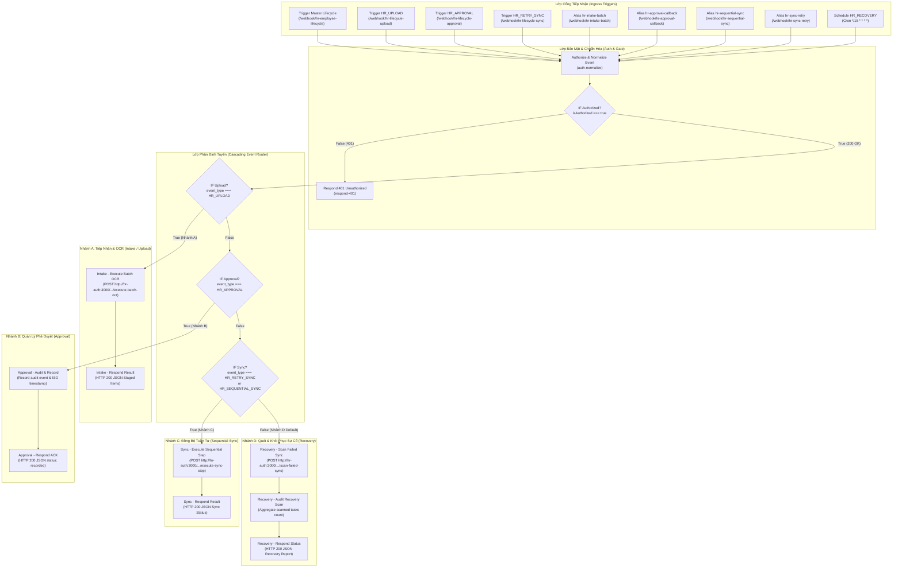
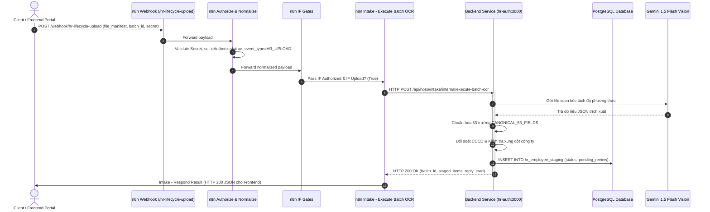
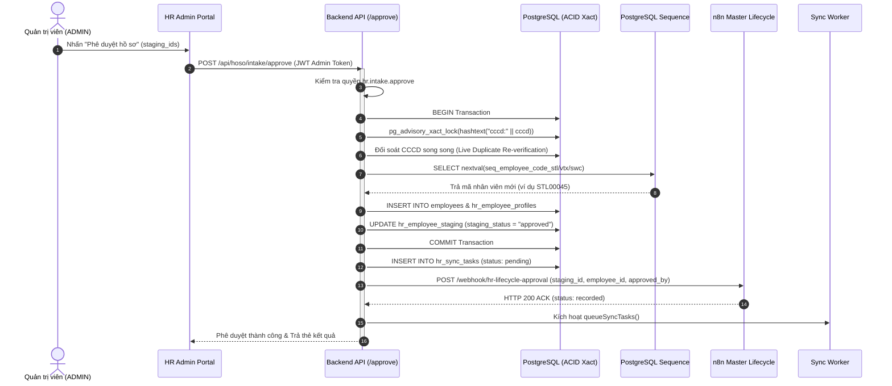

# BÁO CÁO KỸ THUẬT: TRÍCH XUẤT TOÀN BỘ WORKFLOW UPLOAD VÀ VÒNG ĐỜI HỒ SƠ NHÂN SỰ
## WORKFLOW: SOTRANS_HR_EMPLOYEE_LIFECYCLE — COMPLETE NODE EXTRACTION & TECHNICAL SPECIFICATION

> **Tài liệu phục vụ Ban Quản lý & Hội đồng Kiến trúc Kỹ thuật SOTRANS**  
> **Dự án:** SOTRANS HR Hub & Intake Automation Platform  
> **Trạng thái Workflow:** Production / Active  
> **Ngày xuất báo cáo:** 11/11/2026  
> **Phạm vi:** Trích xuất kỹ thuật 100% cấu hình thực tế, đối soát luồng dữ liệu, phân tích phụ thuộc hệ thống và cơ chế an toàn vận hành.

---

## 1. TỔNG QUAN WORKFLOW

Workflow `SOTRANS_HR_EMPLOYEE_LIFECYCLE` là workflow trung tâm (Master Orchestration Workflow) trong hệ thống tự động hóa tiếp nhận, trích xuất dữ liệu, kiểm tra tính hợp lệ, phê duyệt và đồng bộ hồ sơ nhân sự của Tổng Công ty Cổ phần Đường Sông Miền Nam (SOTRANS) và các đơn vị thành viên (SOTRANS Logistics - STL, Vietranstimex - VTX, Sowatco - SWC).

### 1.1. Thông số định danh và vận hành
| Thông số | Giá trị thực tế trên n8n | Ghi chú kiến trúc |
|---|---|---|
| **Workflow Name** | `SOTRANS_HR_EMPLOYEE_LIFECYCLE` | Định danh duy nhất của Master Workflow |
| **Tổng số node** | **24 nodes** | Bao quát 100% vòng đời từ Upload đến Recovery |
| **Tổng số kết nối (Connections)** | **19 quy tắc phân luồng** | Phân nhánh điều kiện IF chặt chẽ |
| **Execution Order** | `v1` | Chuẩn thực thi luồng n8n hiện đại |
| **Điểm tiếp nhận Webhook** | 8 Webhook Triggers | Gồm 4 trigger chuẩn hóa + 4 legacy aliases |
| **Điểm kích hoạt lập lịch** | 1 Schedule Trigger | Cron `*/15 * * * *` (15 phút/lần) |
| **Điểm quyết định điều kiện** | 4 IF Nodes | Phân nhánh Auth, Upload, Approval, Sync/Recovery |
| **Tích hợp Backend API** | 3 HTTP Request Nodes | Gọi sang `http://hr-auth:3000` nội bộ |
| **Xử lý logic / Chuẩn hóa** | 3 Code Nodes | Viết bằng JavaScript (n8n v2 runtime) |
| **Điểm phản hồi Webhook** | 5 Respond to Webhook Nodes | Trả kết quả HTTP JSON trực tiếp cho Caller |

### 1.2. Vị trí kiến trúc trong hệ sinh thái SOTRANS
Master Workflow đóng vai trò là "Cơ quan điều phối quy trình" (Process Orchestrator), đặt tại lớp Middleware nằm giữa:
- **Client / Frontend Upload Portal**: Giao diện tiếp nhận hồ sơ kéo-thả, hỗ trợ nhiều định dạng (PDF, scan ảnh, Word, Excel).
- **Nginx Reverse Proxy / Gateway**: Định tuyến các yêu cầu ngoại vi, bảo vệ hạ tầng mạng.
- **HR-Auth Service (`http://hr-auth:3000`)**: Microservice xử lý logic nghiệp vụ, OCR AI Gemini, kiểm tra trùng lặp CCCD, cấp mã nhân viên tự động và phân quyền RBAC.
- **PostgreSQL Database (`hrbot`)**: CSDL lưu trữ hồ sơ chính thức (`employees`, `hr_employee_profiles`), bảng tạm hồ sơ chờ duyệt (`hr_employee_staging`), bảng quản lý lô upload (`hr_intake_batches`) và hàng đợi đồng bộ (`hr_sync_tasks`).
- **NocoDB & Google Sheets**: Hệ thống hiển thị bảng biểu cho nghiệp vụ nhân sự và backup dữ liệu bảng tính.

---

## 2. PHẠM VI NGHIỆP VỤ UPLOAD HỒ SƠ

Quy trình upload và xử lý hồ sơ nhân sự không chỉ đơn thuần là việc nhận file, mà là một chuỗi liên hoàn gồm 6 nhóm chức năng nghiệp vụ khép kín được thực thi theo thứ tự bắt buộc:

### 2.1. Phân loại 6 nhóm chức năng theo yêu cầu
1. **Tiếp nhận hồ sơ (Upload / Intake)**:
   - Tiếp nhận tín hiệu từ các Webhook Ingress (hỗ trợ cả endpoint chuyên dụng `hr-lifecycle-upload` và các endpoint tương thích ngược `hr-intake-batch`, `hr-employee-lifecycle`).
   - Nhận thông tin gói lô (`batch_id`, `company_id`, `user_id`, `username`, `file_manifest`).
   - Xác thực token bí mật nội bộ trước khi cấp phép luồng dữ liệu đi tiếp.
2. **Xử lý hồ sơ (Document Processing & OCR)**:
   - Chuyển tiếp tác vụ bóc tách OCR sang backend service qua node `Intake - Execute Batch OCR`.
   - Backend ứng dụng mô hình đa phương thức Gemini 1.5 Flash Vision kết hợp bộ bóc tách Regex dự phòng.
   - Bóc tách toàn diện 53 trường thông tin nghiệp vụ chuẩn hóa (`CANONICAL_53_FIELDS`).
3. **Kiểm tra dữ liệu (Validation & Integrity Guards)**:
   - Chuẩn hóa định dạng số CCCD (12 số chuẩn quốc gia) và kiểm tra tính hợp lệ toán học.
   - Kiểm tra trùng lặp CCCD đa tầng (Trùng lặp nội bộ cùng công ty, trùng lặp liên công ty STL/VTX/SWC, nhân sự đã nghỉ việc xin tái tuyển dụng).
   - Phát hiện xung đột đơn vị pháp lý (Company Mismatch Detection: hồ sơ scan mang dấu pháp nhân công ty này nhưng HR đơn vị khác tải lên).
4. **Quản lý trạng thái và phê duyệt (Staging / Approval Management)**:
   - Tạo bản ghi hồ sơ chờ duyệt trong bảng CSDL `hr_employee_staging` với trạng thái `pending_review` hoặc `pending_approval`.
   - Áp dụng nguyên tắc Phân tách nhiệm vụ (Separation of Duties - SoD): Chuyên viên HR chỉ có quyền `SUBMIT` (gửi duyệt), Quản trị viên `ADMIN` mới có quyền `APPROVE` (phê duyệt chính thức).
   - Tiếp nhận callback phê duyệt từ Webhook `hr-lifecycle-approval` / `hr-approval-callback`, ghi nhận audit trail qua node `Approval - Audit & Record`.
5. **Đồng bộ và lưu trữ (Persistence & Sequential Sync)**:
   - Chuyển đổi hồ sơ staging thành hồ sơ chính thức trong bảng `employees` và `hr_employee_profiles` dưới cơ chế ACID Transaction và Khóa cố vấn đa luồng (`pg_advisory_xact_lock`).
   - Tự động phát sinh mã nhân viên chuẩn hóa không trùng lặp (`STLxxxxx`, `SWCxxxxx`, `VTXxxxxx`) từ PostgreSQL Sequence.
   - Thực thi đồng bộ tuần tự có thứ tự nghiêm ngặt (Strict Sequential Sync Order): **PostgreSQL (System of Record) -> NocoDB -> Google Sheets** qua node `Sync - Execute Sequential Step`.
6. **Xử lý lỗi và phản hồi (Error Handling & Recovery)**:
   - Chặn đứng các truy cập không hợp lệ ngay tại cổng vào với HTTP 401 qua node `Respond 401`.
   - Cơ chế chịu lỗi `onError: continueRegularOutput` trên các node HTTP Request đảm bảo n8n không bị crash hoặc treo luồng.
   - Bộ lập lịch quét tự động `Schedule HR_RECOVERY` định kỳ 15 phút rà soát toàn bộ tác vụ đồng bộ thất bại và kích hoạt retry tự động.

---

## 3. DANH SÁCH TOÀN BỘ NODE LIÊN QUAN (24/24 NODES)

Toàn bộ 24 node cấu thành nên Master Workflow `SOTRANS_HR_EMPLOYEE_LIFECYCLE` đều tham gia trực tiếp hoặc gián tiếp vào chu trình tiếp nhận, xử lý, phê duyệt và đồng bộ hồ sơ nhân sự. Không có node nào dư thừa.

| STT | Tên Node (Node Name) | Node ID | Loại Node (Type) | Vị trí (Position) | Phân nhóm chức năng | Vai trò kỹ thuật & Nghiệp vụ |
|---|---|---|---|---|---|---|
| 1 | **Trigger Master Lifecycle** | `trig-hr-employee-lifecycle` | `webhook` v2 | [100, 200] | Ingress / Tiếp nhận | Cổng tiếp nhận tổng hợp cho mọi sự kiện vòng đời |
| 2 | **Trigger HR_UPLOAD** | `trig-hr-lifecycle-upload` | `webhook` v2 | [100, 320] | Ingress / Tiếp nhận | Cổng webhook chuyên dụng cho sự kiện Tải lên hồ sơ |
| 3 | **Trigger HR_APPROVAL** | `trig-hr-lifecycle-approval` | `webhook` v2 | [100, 440] | Ingress / Phê duyệt | Cổng webhook tiếp nhận callback phê duyệt từ HR/ADMIN |
| 4 | **Trigger HR_RETRY_SYNC** | `trig-hr-lifecycle-sync` | `webhook` v2 | [100, 560] | Ingress / Đồng bộ | Cổng webhook kích hoạt đồng bộ dữ liệu tuần tự |
| 5 | **Alias hr-intake-batch** | `trig-hr-intake-batch` | `webhook` v2 | [100, 680] | Ingress / Tương thích | Cổng tương thích ngược cho endpoint cũ `hr-intake-batch` |
| 6 | **Alias hr-approval-callback** | `trig-hr-approval-callback` | `webhook` v2 | [100, 800] | Ingress / Tương thích | Cổng tương thích ngược cho endpoint cũ `hr-approval-callback` |
| 7 | **Alias hr-sequential-sync** | `trig-hr-sequential-sync` | `webhook` v2 | [100, 920] | Ingress / Tương thích | Cổng tương thích ngược cho endpoint cũ `hr-sequential-sync` |
| 8 | **Alias hr-sync-retry** | `trig-hr-sync-retry` | `webhook` v2 | [100, 1040] | Ingress / Tương thích | Cổng tương thích ngược cho endpoint cũ `hr-sync-retry` |
| 9 | **Schedule HR_RECOVERY** | `schedule-recovery` | `scheduleTrigger` v1.2 | [100, 80] | Khôi phục / Cron | Kích hoạt tự động quét sự cố đồng bộ mỗi 15 phút |
| 10 | **Authorize & Normalize Event** | `auth-normalize` | `code` v2 | [400, 500] | Bảo mật & Chuẩn hóa | Kiểm tra Secret, suy luận event_type, tạo Correlation ID |
| 11 | **IF Authorized** | `if-authorized` | `if` v2.2 | [620, 500] | Kiểm soát quyền | Rẽ nhánh: Hợp lệ -> Tiếp tục xử lý; Không hợp lệ -> Chặn 401 |
| 12 | **Respond 401** | `respond-401` | `respondToWebhook` v1.1 | [860, 720] | Xử lý lỗi / Egress | Trả mã HTTP 401 Unauthorized khi thiếu/sai secret |
| 13 | **IF Upload?** | `if-upload` | `if` v2.2 | [860, 400] | Phân luồng sự kiện | Kiểm tra `event_type === "HR_UPLOAD"` -> Rẽ vào Nhánh A |
| 14 | **Intake - Execute Batch OCR** | `intake-http` | `httpRequest` v4.2 | [1120, 260] | Xử lý tài liệu & OCR | Gọi API backend bóc tách OCR đa tài liệu (timeout 120s) |
| 15 | **Intake - Respond Result** | `intake-resp` | `respondToWebhook` v1.1 | [1360, 260] | Phản hồi kết quả | Trả kết quả bóc tách/staging HTTP 200 cho frontend |
| 16 | **IF Approval?** | `if-approval` | `if` v2.2 | [1120, 480] | Phân luồng sự kiện | Kiểm tra `event_type === "HR_APPROVAL"` -> Rẽ vào Nhánh B |
| 17 | **Approval - Audit & Record** | `approval-audit` | `code` v2 | [1360, 420] | Quản lý phê duyệt | Chuẩn hóa dữ liệu phê duyệt, tạo audit record |
| 18 | **Approval - Respond ACK** | `approval-resp` | `respondToWebhook` v1.1 | [1600, 420] | Phản hồi phê duyệt | Trả HTTP 200 xác nhận đã ghi nhận phê duyệt |
| 19 | **IF Sync?** | `if-sync` | `if` v2.2 | [1360, 580] | Phân luồng sự kiện | Kiểm tra sự kiện đồng bộ -> Rẽ Nhánh C; Ngược lại -> Nhánh D |
| 20 | **Sync - Execute Sequential Step** | `sync-http` | `httpRequest` v4.2 | [1600, 540] | Đồng bộ dữ liệu | Gọi backend thực thi đồng bộ tuần tự NocoDB/Sheets |
| 21 | **Sync - Respond Result** | `sync-resp` | `respondToWebhook` v1.1 | [1840, 540] | Phản hồi đồng bộ | Trả kết quả đồng bộ tuần tự HTTP 200 |
| 22 | **Recovery - Scan Failed Sync** | `recovery-http` | `httpRequest` v4.2 | [1600, 700] | Quét sự cố | Gọi backend quét danh sách các task đồng bộ thất bại |
| 23 | **Recovery - Audit Recovery Scan** | `recovery-audit` | `code` v2 | [1840, 700] | Xử lý khôi phục | Tổng hợp số lượng task sự cố, cập nhật audit log |
| 24 | **Recovery - Respond Status** | `recovery-resp` | `respondToWebhook` v1.1 | [2080, 700] | Phản hồi khôi phục | Trả báo cáo trạng thái khôi phục HTTP 200 |

---

## 4. CẤU HÌNH CHI TIẾT TỪNG NODE (24/24 NODES)

Dưới đây là bảng trích xuất kỹ thuật chi tiết của từng node trong workflow JSON, phản ánh chính xác cấu hình tham số, biểu thức `{{ }}`, luồng dữ liệu vào/ra, cơ chế xử lý lỗi và liên kết phân nhánh thực tế.

### 4.1. Node: Trigger Master Lifecycle (`trig-hr-employee-lifecycle`)
| Trường thông tin | Nội dung chi tiết cấu hình thực tế |
|---|---|
| **Node Name** | `Trigger Master Lifecycle` |
| **Node ID** | `trig-hr-employee-lifecycle` |
| **Node Type** | `n8n-nodes-base.webhook` (Version: `2`) |
| **Position** | X: `100`, Y: `200` |
| **Purpose (Nghiệp vụ)** | Cổng tiếp nhận webhook chính thức (Master Entrance) cho mọi sự kiện trong vòng đời hồ sơ nhân sự (Intake, Approval, Sequential Sync, Recovery). Cho phép các client hiện đại gọi vào một URL duy nhất. |
| **Input (Đầu vào)** | HTTP POST Request từ client hoặc backend với Content-Type: application/json. Body chứa thông tin gói hồ sơ hoặc sự kiện vòng đời và header/body secret. |
| **Output (Đầu ra)** | JSON Object chứa toàn bộ payload HTTP (headers, body, query params). |
| **Incoming Connections** | Không có (Điểm kích hoạt đầu vào Ingress) |
| **Outgoing Connections** | - **Output [0]**: `Authorize & Normalize Event` (Input index: 0) |
| **Conditions (Điều kiện)** | Không có điều kiện lọc tại cổng; tiếp nhận toàn bộ HTTP POST. |
| **Expressions `{{ }}`** | Không sử dụng biểu thức động |
| **Error Handling** | **stopWorkflow** (Mặc định: Dừng luồng ngay lập tức khi phát sinh ngoại lệ không bắt được) |
| **External Dependencies** | Nginx Gateway / Frontend / Internal Microservices gọi qua HTTP POST. |

**Cấu hình Parameters gốc (Sanitized JSON):**
```json
{
  "httpMethod": "POST",
  "path": "hr-employee-lifecycle",
  "responseMode": "responseNode",
  "options": {}
}
```

### 4.2. Node: Trigger HR_UPLOAD (`trig-hr-lifecycle-upload`)
| Trường thông tin | Nội dung chi tiết cấu hình thực tế |
|---|---|
| **Node Name** | `Trigger HR_UPLOAD` |
| **Node ID** | `trig-hr-lifecycle-upload` |
| **Node Type** | `n8n-nodes-base.webhook` (Version: `2`) |
| **Position** | X: `100`, Y: `320` |
| **Purpose (Nghiệp vụ)** | Cổng tiếp nhận webhook chuyên dụng (Dedicated Intake Hook) dành riêng cho nghiệp vụ Tải lên và trích xuất hồ sơ nhân sự mới (HR_UPLOAD). |
| **Input (Đầu vào)** | HTTP POST Request chứa danh sách file đã tải lên, batch_id, company_id, user_id, username, conversation_id. |
| **Output (Đầu ra)** | JSON Object chứa thông tin yêu cầu tải lên hồ sơ nhân sự. |
| **Incoming Connections** | Không có (Điểm kích hoạt đầu vào Ingress) |
| **Outgoing Connections** | - **Output [0]**: `Authorize & Normalize Event` (Input index: 0) |
| **Conditions (Điều kiện)** | Không có điều kiện lọc tại cổng; tiếp nhận toàn bộ HTTP POST. |
| **Expressions `{{ }}`** | Không sử dụng biểu thức động |
| **Error Handling** | **stopWorkflow** (Mặc định: Dừng luồng ngay lập tức khi phát sinh ngoại lệ không bắt được) |
| **External Dependencies** | Frontend Intake Portal hoặc API tiếp nhận file của auth-service. |

**Cấu hình Parameters gốc (Sanitized JSON):**
```json
{
  "httpMethod": "POST",
  "path": "hr-lifecycle-upload",
  "responseMode": "responseNode",
  "options": {}
}
```

### 4.3. Node: Trigger HR_APPROVAL (`trig-hr-lifecycle-approval`)
| Trường thông tin | Nội dung chi tiết cấu hình thực tế |
|---|---|
| **Node Name** | `Trigger HR_APPROVAL` |
| **Node ID** | `trig-hr-lifecycle-approval` |
| **Node Type** | `n8n-nodes-base.webhook` (Version: `2`) |
| **Position** | X: `100`, Y: `440` |
| **Purpose (Nghiệp vụ)** | Cổng tiếp nhận webhook chuyên dụng dành riêng cho sự kiện Phê duyệt hồ sơ nhân sự từ Staging vào hệ thống chính thức (HR_APPROVAL). |
| **Input (Đầu vào)** | HTTP POST Request chứa staging_id / danh sách staging_ids, employee_id, company_id, approved_by. |
| **Output (Đầu ra)** | JSON Object chứa tham số phê duyệt hồ sơ. |
| **Incoming Connections** | Không có (Điểm kích hoạt đầu vào Ingress) |
| **Outgoing Connections** | - **Output [0]**: `Authorize & Normalize Event` (Input index: 0) |
| **Conditions (Điều kiện)** | Không có điều kiện lọc tại cổng; tiếp nhận toàn bộ HTTP POST. |
| **Expressions `{{ }}`** | Không sử dụng biểu thức động |
| **Error Handling** | **stopWorkflow** (Mặc định: Dừng luồng ngay lập tức khi phát sinh ngoại lệ không bắt được) |
| **External Dependencies** | Giao diện Quản trị viên Nhân sự (HR Admin UI) hoặc API /approve. |

**Cấu hình Parameters gốc (Sanitized JSON):**
```json
{
  "httpMethod": "POST",
  "path": "hr-lifecycle-approval",
  "responseMode": "responseNode",
  "options": {}
}
```

### 4.4. Node: Trigger HR_RETRY_SYNC (`trig-hr-lifecycle-sync`)
| Trường thông tin | Nội dung chi tiết cấu hình thực tế |
|---|---|
| **Node Name** | `Trigger HR_RETRY_SYNC` |
| **Node ID** | `trig-hr-lifecycle-sync` |
| **Node Type** | `n8n-nodes-base.webhook` (Version: `2`) |
| **Position** | X: `100`, Y: `560` |
| **Purpose (Nghiệp vụ)** | Cổng tiếp nhận webhook chuyên dụng dành riêng cho nghiệp vụ Đồng bộ tuần tự (Sequential Sync) và Retry tác vụ lỗi sang NocoDB và Google Sheets. |
| **Input (Đầu vào)** | HTTP POST Request chứa sync_task_id / task_id, action_type, company_id, sync_version. |
| **Output (Đầu ra)** | JSON Object chứa thông tin chỉ thị đồng bộ dữ liệu. |
| **Incoming Connections** | Không có (Điểm kích hoạt đầu vào Ingress) |
| **Outgoing Connections** | - **Output [0]**: `Authorize & Normalize Event` (Input index: 0) |
| **Conditions (Điều kiện)** | Không có điều kiện lọc tại cổng; tiếp nhận toàn bộ HTTP POST. |
| **Expressions `{{ }}`** | Không sử dụng biểu thức động |
| **Error Handling** | **stopWorkflow** (Mặc định: Dừng luồng ngay lập tức khi phát sinh ngoại lệ không bắt được) |
| **External Dependencies** | Sync Worker hoặc Cơ chế kích hoạt đồng bộ bất đồng bộ của auth-service. |

**Cấu hình Parameters gốc (Sanitized JSON):**
```json
{
  "httpMethod": "POST",
  "path": "hr-lifecycle-sync",
  "responseMode": "responseNode",
  "options": {}
}
```

### 4.5. Node: Alias hr-intake-batch (`trig-hr-intake-batch`)
| Trường thông tin | Nội dung chi tiết cấu hình thực tế |
|---|---|
| **Node Name** | `Alias hr-intake-batch` |
| **Node ID** | `trig-hr-intake-batch` |
| **Node Type** | `n8n-nodes-base.webhook` (Version: `2`) |
| **Position** | X: `100`, Y: `680` |
| **Purpose (Nghiệp vụ)** | Cổng webhook tương thích ngược (Legacy Alias) cho endpoint cũ `/webhook/hr-intake-batch`. Đảm bảo hệ thống cũ không bị gián đoạn hoạt động sau khi hợp nhất workflow. |
| **Input (Đầu vào)** | HTTP POST Request theo schema cũ của dịch vụ tiếp nhận hồ sơ batch. |
| **Output (Đầu ra)** | JSON Object chứa dữ liệu lô hồ sơ intake cũ. |
| **Incoming Connections** | Không có (Điểm kích hoạt đầu vào Ingress) |
| **Outgoing Connections** | - **Output [0]**: `Authorize & Normalize Event` (Input index: 0) |
| **Conditions (Điều kiện)** | Không có điều kiện lọc tại cổng; tiếp nhận toàn bộ HTTP POST. |
| **Expressions `{{ }}`** | Không sử dụng biểu thức động |
| **Error Handling** | **stopWorkflow** (Mặc định: Dừng luồng ngay lập tức khi phát sinh ngoại lệ không bắt được) |
| **External Dependencies** | Các script kiểm thử cũ hoặc hệ thống tích hợp phiên bản Phase 1. |

**Cấu hình Parameters gốc (Sanitized JSON):**
```json
{
  "httpMethod": "POST",
  "path": "hr-intake-batch",
  "responseMode": "responseNode",
  "options": {}
}
```

### 4.6. Node: Alias hr-approval-callback (`trig-hr-approval-callback`)
| Trường thông tin | Nội dung chi tiết cấu hình thực tế |
|---|---|
| **Node Name** | `Alias hr-approval-callback` |
| **Node ID** | `trig-hr-approval-callback` |
| **Node Type** | `n8n-nodes-base.webhook` (Version: `2`) |
| **Position** | X: `100`, Y: `800` |
| **Purpose (Nghiệp vụ)** | Cổng webhook tương thích ngược (Legacy Alias) cho endpoint cũ `/webhook/hr-approval-callback`. |
| **Input (Đầu vào)** | HTTP POST Request chứa callback phê duyệt hồ sơ theo chuẩn cũ. |
| **Output (Đầu ra)** | JSON Object chứa tham số callback phê duyệt. |
| **Incoming Connections** | Không có (Điểm kích hoạt đầu vào Ingress) |
| **Outgoing Connections** | - **Output [0]**: `Authorize & Normalize Event` (Input index: 0) |
| **Conditions (Điều kiện)** | Không có điều kiện lọc tại cổng; tiếp nhận toàn bộ HTTP POST. |
| **Expressions `{{ }}`** | Không sử dụng biểu thức động |
| **Error Handling** | **stopWorkflow** (Mặc định: Dừng luồng ngay lập tức khi phát sinh ngoại lệ không bắt được) |
| **External Dependencies** | Hệ thống phê duyệt phiên bản Phase 1. |

**Cấu hình Parameters gốc (Sanitized JSON):**
```json
{
  "httpMethod": "POST",
  "path": "hr-approval-callback",
  "responseMode": "responseNode",
  "options": {}
}
```

### 4.7. Node: Alias hr-sequential-sync (`trig-hr-sequential-sync`)
| Trường thông tin | Nội dung chi tiết cấu hình thực tế |
|---|---|
| **Node Name** | `Alias hr-sequential-sync` |
| **Node ID** | `trig-hr-sequential-sync` |
| **Node Type** | `n8n-nodes-base.webhook` (Version: `2`) |
| **Position** | X: `100`, Y: `920` |
| **Purpose (Nghiệp vụ)** | Cổng webhook tương thích ngược (Legacy Alias) cho endpoint cũ `/webhook/hr-sequential-sync`. |
| **Input (Đầu vào)** | HTTP POST Request kích hoạt đồng bộ tuần tự theo định dạng cũ. |
| **Output (Đầu ra)** | JSON Object chứa yêu cầu đồng bộ dữ liệu. |
| **Incoming Connections** | Không có (Điểm kích hoạt đầu vào Ingress) |
| **Outgoing Connections** | - **Output [0]**: `Authorize & Normalize Event` (Input index: 0) |
| **Conditions (Điều kiện)** | Không có điều kiện lọc tại cổng; tiếp nhận toàn bộ HTTP POST. |
| **Expressions `{{ }}`** | Không sử dụng biểu thức động |
| **Error Handling** | **stopWorkflow** (Mặc định: Dừng luồng ngay lập tức khi phát sinh ngoại lệ không bắt được) |
| **External Dependencies** | Hệ thống đồng bộ phiên bản Phase 1. |

**Cấu hình Parameters gốc (Sanitized JSON):**
```json
{
  "httpMethod": "POST",
  "path": "hr-sequential-sync",
  "responseMode": "responseNode",
  "options": {}
}
```

### 4.8. Node: Alias hr-sync-retry (`trig-hr-sync-retry`)
| Trường thông tin | Nội dung chi tiết cấu hình thực tế |
|---|---|
| **Node Name** | `Alias hr-sync-retry` |
| **Node ID** | `trig-hr-sync-retry` |
| **Node Type** | `n8n-nodes-base.webhook` (Version: `2`) |
| **Position** | X: `100`, Y: `1040` |
| **Purpose (Nghiệp vụ)** | Cổng webhook tương thích ngược (Legacy Alias) cho endpoint cũ `/webhook/hr-sync-retry`. |
| **Input (Đầu vào)** | HTTP POST Request kích hoạt retry tác vụ đồng bộ thất bại. |
| **Output (Đầu ra)** | JSON Object chứa task_id cần retry. |
| **Incoming Connections** | Không có (Điểm kích hoạt đầu vào Ingress) |
| **Outgoing Connections** | - **Output [0]**: `Authorize & Normalize Event` (Input index: 0) |
| **Conditions (Điều kiện)** | Không có điều kiện lọc tại cổng; tiếp nhận toàn bộ HTTP POST. |
| **Expressions `{{ }}`** | Không sử dụng biểu thức động |
| **Error Handling** | **stopWorkflow** (Mặc định: Dừng luồng ngay lập tức khi phát sinh ngoại lệ không bắt được) |
| **External Dependencies** | Cron script hoặc Dashboard quản trị Phase 1. |

**Cấu hình Parameters gốc (Sanitized JSON):**
```json
{
  "httpMethod": "POST",
  "path": "hr-sync-retry",
  "responseMode": "responseNode",
  "options": {}
}
```

### 4.9. Node: Schedule HR_RECOVERY (`schedule-recovery`)
| Trường thông tin | Nội dung chi tiết cấu hình thực tế |
|---|---|
| **Node Name** | `Schedule HR_RECOVERY` |
| **Node ID** | `schedule-recovery` |
| **Node Type** | `n8n-nodes-base.scheduleTrigger` (Version: `1.2`) |
| **Position** | X: `100`, Y: `80` |
| **Purpose (Nghiệp vụ)** | Bộ kích hoạt lập lịch tự động (Cron Schedule Trigger) chạy định kỳ mỗi 15 phút (`*/15 * * * *`) để rà soát toàn bộ các tác vụ đồng bộ bị lỗi/treo và tự động khôi phục. |
| **Input (Đầu vào)** | Tín hiệu kích hoạt thời gian từ n8n Cron Scheduler. |
| **Output (Đầu ra)** | JSON Object chứa timestamp kích hoạt lập lịch. |
| **Incoming Connections** | Không có (Điểm kích hoạt đầu vào Ingress) |
| **Outgoing Connections** | - **Output [0]**: `Authorize & Normalize Event` (Input index: 0) |
| **Conditions (Điều kiện)** | Kích hoạt cố định mỗi 15 phút. |
| **Expressions `{{ }}`** | Không sử dụng biểu thức động |
| **Error Handling** | **stopWorkflow** (Mặc định: Dừng luồng ngay lập tức khi phát sinh ngoại lệ không bắt được) |
| **External Dependencies** | n8n Internal Timer Service. |

**Cấu hình Parameters gốc (Sanitized JSON):**
```json
{
  "rule": {
    "interval": [
      {
        "field": "cronExpression",
        "expression": "*/15 * * * *"
      }
    ]
  }
}
```

### 4.10. Node: Authorize & Normalize Event (`auth-normalize`)
| Trường thông tin | Nội dung chi tiết cấu hình thực tế |
|---|---|
| **Node Name** | `Authorize & Normalize Event` |
| **Node ID** | `auth-normalize` |
| **Node Type** | `n8n-nodes-base.code` (Version: `2`) |
| **Position** | X: `400`, Y: `500` |
| **Purpose (Nghiệp vụ)** | Xác thực token bảo mật nội bộ (`x-n8n-internal-secret`), suy luận phân loại sự kiện (`event_type`), sinh khóa Idempotency Key và Correlation ID, đóng gói phong bì dữ liệu chuẩn (Standard Event Envelope). |
| **Input (Đầu vào)** | Dữ liệu JSON thô từ bất kỳ cổng nào trong 9 cổng Ingress (8 Webhooks + 1 Cron). |
| **Output (Đầu ra)** | JSON Object chuẩn hóa: `isAuthorized`, `isScheduled`, `event_type`, `batch_id`, `file_id`, `employee_id`, `staging_id`, `sync_task_id`, `task_id`, `company_id`, `sync_version`, `idempotency_key`, `correlation_id`, `created_at`, `raw_payload`. |
| **Incoming Connections** | Từ node `Trigger Master Lifecycle` (Output [0])<br>Từ node `Trigger HR_UPLOAD` (Output [0])<br>Từ node `Trigger HR_APPROVAL` (Output [0])<br>Từ node `Trigger HR_RETRY_SYNC` (Output [0])<br>Từ node `Alias hr-intake-batch` (Output [0])<br>Từ node `Alias hr-approval-callback` (Output [0])<br>Từ node `Alias hr-sequential-sync` (Output [0])<br>Từ node `Alias hr-sync-retry` (Output [0])<br>Từ node `Schedule HR_RECOVERY` (Output [0]) |
| **Outgoing Connections** | - **Output [0]**: `IF Authorized` (Input index: 0) |
| **Conditions (Điều kiện)** | Kiểm tra `incoming === expected` hoặc `isScheduled === true` để gán `isAuthorized`. |
| **Expressions `{{ }}`** | Không sử dụng biểu thức động |
| **Error Handling** | **stopWorkflow** (Mặc định: Dừng luồng ngay lập tức khi phát sinh ngoại lệ không bắt được) |
| **External Dependencies** | Shared Internal Secret giữa n8n và auth-service. |

**Cấu hình Parameters gốc (Sanitized JSON):**
```json
{
  "jsCode": "\nconst item = $input.first().json;\nconst body = item.body || item;\nconst headers = item.headers || {};\nconst expected = \"[REDACTED_SECRET]\";\n\n// Secret check from header or body\nconst incoming = body.secret || headers['x-n8n-internal-secret'] || headers['x-internal-secret'] || headers['x-n8n-auth-token'] || '';\nconst isScheduled = (!headers.host && !headers['content-type']) || !!item.timestamp;\nconst isAuthorized = isScheduled || (incoming === expected);\n\n// Infer event_type\nlet eventType = String(body.event_type || '').toUpperCase();\nif (!eventType) {\n  if (isScheduled) eventType = 'HR_RECOVERY';\n  else if (body.batch_id && (body.files || body.file_count)) eventType = 'HR_UPLOAD';\n  else if (body.action_type === 'APPROVAL_CALLBACK' || body.approved_by || (body.staging_id && !body.sync_task_id && !body.task_id)) eventType = 'HR_APPROVAL';\n  else if (body.sync_task_id || body.task_id || body.action_type === 'SEQUENTIAL_SYNC' || body.action_type === 'RETRY_SYNC') eventType = 'HR_RETRY_SYNC';\n  else eventType = 'HR_UPLOAD';\n}\n\nreturn [{\n  json: {\n    isAuthorized,\n    isScheduled,\n    event_type: eventType,\n    batch_id: body.batch_id || null,\n    file_id: body.file_id || null,\n    employee_id: body.employee_id || null,\n    staging_id: body.staging_id || null,\n    sync_task_id: body.sync_task_id || body.task_id || null,\n    task_id: body.sync_task_id || body.task_id || null,\n    company_id: body.company_id || 'STL',\n    sync_version: body.sync_version || 1,\n    idempotency_key: body.idempotency_key || ('idem_' + Date.now()),\n    correlation_id: body.correlation_id || ('corr_' + Date.now()),\n    created_at: body.created_at || new Date().toISOString(),\n    raw_payload: body\n  }\n}];\n"
}
```

### 4.11. Node: IF Authorized (`if-authorized`)
| Trường thông tin | Nội dung chi tiết cấu hình thực tế |
|---|---|
| **Node Name** | `IF Authorized` |
| **Node ID** | `if-authorized` |
| **Node Type** | `n8n-nodes-base.if` (Version: `2.2`) |
| **Position** | X: `620`, Y: `500` |
| **Purpose (Nghiệp vụ)** | Trạm kiểm soát an ninh (Security Gate). Cho phép các sự kiện hợp lệ đi tiếp vào bộ định tuyến nghiệp vụ; chặn đứng các sự kiện trái phép. |
| **Input (Đầu vào)** | JSON Object từ node `Authorize & Normalize Event`. |
| **Output (Đầu ra)** | Output 0 (True): Gói tin được cấp phép đi tiếp sang `IF Upload?`. Output 1 (False): Gói tin trái phép chuyển sang `Respond 401`. |
| **Incoming Connections** | Từ node `Authorize & Normalize Event` (Output [0]) |
| **Outgoing Connections** | - **Output [0]**: `IF Upload?` (Input index: 0)<br>- **Output [1]**: `Respond 401` (Input index: 0) |
| **Conditions (Điều kiện)** | Boolean condition: `{{ $json.isAuthorized }} === true`. |
| **Expressions `{{ }}`** | `={{ $json.isAuthorized }}` |
| **Error Handling** | **stopWorkflow** (Mặc định: Dừng luồng ngay lập tức khi phát sinh ngoại lệ không bắt được) |
| **External Dependencies** | Không phụ thuộc hệ thống ngoài. |

**Cấu hình Parameters gốc (Sanitized JSON):**
```json
{
  "conditions": {
    "options": {
      "caseSensitive": true,
      "leftValue": "",
      "typeValidation": "strict",
      "version": 2
    },
    "conditions": [
      {
        "id": "cond-auth",
        "leftValue": "={{ $json.isAuthorized }}",
        "rightValue": "",
        "operator": {
          "type": "boolean",
          "operation": "true",
          "singleValue": true
        }
      }
    ],
    "combinator": "and"
  },
  "options": {}
}
```

### 4.12. Node: Respond 401 (`respond-401`)
| Trường thông tin | Nội dung chi tiết cấu hình thực tế |
|---|---|
| **Node Name** | `Respond 401` |
| **Node ID** | `respond-401` |
| **Node Type** | `n8n-nodes-base.respondToWebhook` (Version: `1.1`) |
| **Position** | X: `860`, Y: `720` |
| **Purpose (Nghiệp vụ)** | Phản hồi mã lỗi bảo mật HTTP 401 Unauthorized kèm thông báo lỗi JSON chi tiết khi caller không cung cấp secret hợp lệ. |
| **Input (Đầu vào)** | Gói tin vi phạm xác thực từ cổng False của node `IF Authorized`. |
| **Output (Đầu ra)** | HTTP Response 401 JSON: `{"success": false, "error": "401 Unauthorized: Invalid or missing internal secret."}`. |
| **Incoming Connections** | Từ node `IF Authorized` (Output [1]) |
| **Outgoing Connections** | Không có (Điểm kết thúc luồng Egress) |
| **Conditions (Điều kiện)** | Luôn thực thi khi nhận input từ nhánh False của node `IF Authorized`. |
| **Expressions `{{ }}`** | Không sử dụng biểu thức động |
| **Error Handling** | **stopWorkflow** (Mặc định: Dừng luồng ngay lập tức khi phát sinh ngoại lệ không bắt được) |
| **External Dependencies** | Caller HTTP Client. |

**Cấu hình Parameters gốc (Sanitized JSON):**
```json
{
  "respondWith": "json",
  "responseBody": "={{ JSON.stringify({ success: false, error: \"401 Unauthorized: Invalid or missing internal secret.\" }) }}",
  "options": {
    "responseCode": 401
  }
}
```

### 4.13. Node: IF Upload? (`if-upload`)
| Trường thông tin | Nội dung chi tiết cấu hình thực tế |
|---|---|
| **Node Name** | `IF Upload?` |
| **Node ID** | `if-upload` |
| **Node Type** | `n8n-nodes-base.if` (Version: `2.2`) |
| **Position** | X: `860`, Y: `400` |
| **Purpose (Nghiệp vụ)** | Bộ phân nhánh sự kiện Upload (Event Router Branch A). Kiểm tra xem sự kiện có phải là Tải lên/Tiếp nhận hồ sơ (`HR_UPLOAD`) hay không. |
| **Input (Đầu vào)** | Gói tin đã được xác thực từ nhánh True của `IF Authorized`. |
| **Output (Đầu ra)** | Output 0 (True): Chuyển sang `Intake - Execute Batch OCR`. Output 1 (False): Chuyển sang `IF Approval?`. |
| **Incoming Connections** | Từ node `IF Authorized` (Output [0]) |
| **Outgoing Connections** | - **Output [0]**: `Intake - Execute Batch OCR` (Input index: 0)<br>- **Output [1]**: `IF Approval?` (Input index: 0) |
| **Conditions (Điều kiện)** | Boolean condition: `{{ $json.event_type === "HR_UPLOAD" }}`. |
| **Expressions `{{ }}`** | `={{ $json.event_type === \"HR_UPLOAD\" }}` |
| **Error Handling** | **stopWorkflow** (Mặc định: Dừng luồng ngay lập tức khi phát sinh ngoại lệ không bắt được) |
| **External Dependencies** | Không phụ thuộc hệ thống ngoài. |

**Cấu hình Parameters gốc (Sanitized JSON):**
```json
{
  "conditions": {
    "options": {
      "caseSensitive": true,
      "leftValue": "",
      "typeValidation": "strict",
      "version": 2
    },
    "conditions": [
      {
        "id": "cond-upload",
        "leftValue": "={{ $json.event_type === \"HR_UPLOAD\" }}",
        "rightValue": "",
        "operator": {
          "type": "boolean",
          "operation": "true",
          "singleValue": true
        }
      }
    ],
    "combinator": "and"
  },
  "options": {}
}
```

### 4.14. Node: Intake - Execute Batch OCR (`intake-http`)
| Trường thông tin | Nội dung chi tiết cấu hình thực tế |
|---|---|
| **Node Name** | `Intake - Execute Batch OCR` |
| **Node ID** | `intake-http` |
| **Node Type** | `n8n-nodes-base.httpRequest` (Version: `4.2`) |
| **Position** | X: `1120`, Y: `260` |
| **Purpose (Nghiệp vụ)** | Gọi API Backend để thực thi quy trình bóc tách OCR đa tài liệu (Gemini 1.5 Flash Vision + Regex fallback), chuẩn hóa 53 trường và kiểm tra trùng lặp CCCD/đơn vị. |
| **Input (Đầu vào)** | Gói tin sự kiện Upload chứa `batch_id`, `company_id`, `user_id`, `username`, `conversation_id`. |
| **Output (Đầu ra)** | JSON Response từ backend chứa kết quả bóc tách OCR, danh sách hồ sơ staging đã lưu DB, kết quả đối soát trùng lặp CCCD. |
| **Incoming Connections** | Từ node `IF Upload?` (Output [0]) |
| **Outgoing Connections** | - **Output [0]**: `Intake - Respond Result` (Input index: 0) |
| **Conditions (Điều kiện)** | Thực thi khi `event_type === "HR_UPLOAD"`. |
| **Expressions `{{ }}`** | Không sử dụng biểu thức động |
| **Error Handling** | **continueRegularOutput** (Bắt lỗi an toàn: khi HTTP lỗi, không dừng luồng mà tiếp tục chuyển output lỗi sang node kế tiếp để phản hồi caller) |
| **External Dependencies** | Microservice `http://hr-auth:3000/api/hoso/intake/internal/execute-batch-ocr` qua mạng Docker nội bộ. |

**Cấu hình Parameters gốc (Sanitized JSON):**
```json
{
  "method": "POST",
  "url": "http://hr-auth:3000/api/hoso/intake/internal/execute-batch-ocr",
  "sendHeaders": true,
  "headerParameters": {
    "parameters": [
      {
        "name": "Content-Type",
        "value": "application/json"
      },
      {
        "name": "x-n8n-auth-token",
        "value": "[REDACTED_SECRET]"
      },
      {
        "name": "x-internal-secret",
        "value": "[REDACTED_SECRET]"
      }
    ]
  },
  "sendBody": true,
  "specifyBody": "json",
  "jsonBody": "={{ JSON.stringify({ batch_id: $json.batch_id, company_id: $json.company_id, user_id: $json.user_id, username: $json.username, conversation_id: $json.conversation_id, secret: \"[REDACTED_SECRET]\" }) }}",
  "options": {
    "timeout": 120000
  }
}
```

### 4.15. Node: Intake - Respond Result (`intake-resp`)
| Trường thông tin | Nội dung chi tiết cấu hình thực tế |
|---|---|
| **Node Name** | `Intake - Respond Result` |
| **Node ID** | `intake-resp` |
| **Node Type** | `n8n-nodes-base.respondToWebhook` (Version: `1.1`) |
| **Position** | X: `1360`, Y: `260` |
| **Purpose (Nghiệp vụ)** | Trả kết quả tiếp nhận, bóc tách OCR và tạo hồ sơ staging HTTP 200 JSON về cho caller (Frontend hoặc Client API). |
| **Input (Đầu vào)** | Dữ liệu JSON kết quả từ node `Intake - Execute Batch OCR`. |
| **Output (Đầu ra)** | HTTP Response 200 JSON chứa kết quả chi tiết của lô hồ sơ vừa tiếp nhận. |
| **Incoming Connections** | Từ node `Intake - Execute Batch OCR` (Output [0]) |
| **Outgoing Connections** | Không có (Điểm kết thúc luồng Egress) |
| **Conditions (Điều kiện)** | Luôn phản hồi khi node `Intake - Execute Batch OCR` hoàn tất. |
| **Expressions `{{ }}`** | `={{ JSON.stringify($json) }}` |
| **Error Handling** | **stopWorkflow** (Mặc định: Dừng luồng ngay lập tức khi phát sinh ngoại lệ không bắt được) |
| **External Dependencies** | Caller HTTP Client. |

**Cấu hình Parameters gốc (Sanitized JSON):**
```json
{
  "respondWith": "json",
  "responseBody": "={{ JSON.stringify($json) }}",
  "options": {
    "responseCode": 200
  }
}
```

### 4.16. Node: IF Approval? (`if-approval`)
| Trường thông tin | Nội dung chi tiết cấu hình thực tế |
|---|---|
| **Node Name** | `IF Approval?` |
| **Node ID** | `if-approval` |
| **Node Type** | `n8n-nodes-base.if` (Version: `2.2`) |
| **Position** | X: `1120`, Y: `480` |
| **Purpose (Nghiệp vụ)** | Bộ phân nhánh sự kiện Phê duyệt (Event Router Branch B). Kiểm tra xem sự kiện có phải là Phê duyệt hồ sơ (`HR_APPROVAL`) hay không. |
| **Input (Đầu vào)** | Gói tin từ nhánh False của `IF Upload?`. |
| **Output (Đầu ra)** | Output 0 (True): Chuyển sang `Approval - Audit & Record`. Output 1 (False): Chuyển sang `IF Sync?`. |
| **Incoming Connections** | Từ node `IF Upload?` (Output [1]) |
| **Outgoing Connections** | - **Output [0]**: `Approval - Audit & Record` (Input index: 0)<br>- **Output [1]**: `IF Sync?` (Input index: 0) |
| **Conditions (Điều kiện)** | Boolean condition: `{{ $json.event_type === "HR_APPROVAL" }}`. |
| **Expressions `{{ }}`** | `={{ $json.event_type === \"HR_APPROVAL\" }}` |
| **Error Handling** | **stopWorkflow** (Mặc định: Dừng luồng ngay lập tức khi phát sinh ngoại lệ không bắt được) |
| **External Dependencies** | Không phụ thuộc hệ thống ngoài. |

**Cấu hình Parameters gốc (Sanitized JSON):**
```json
{
  "conditions": {
    "options": {
      "caseSensitive": true,
      "leftValue": "",
      "typeValidation": "strict",
      "version": 2
    },
    "conditions": [
      {
        "id": "cond-approval",
        "leftValue": "={{ $json.event_type === \"HR_APPROVAL\" }}",
        "rightValue": "",
        "operator": {
          "type": "boolean",
          "operation": "true",
          "singleValue": true
        }
      }
    ],
    "combinator": "and"
  },
  "options": {}
}
```

### 4.17. Node: Approval - Audit & Record (`approval-audit`)
| Trường thông tin | Nội dung chi tiết cấu hình thực tế |
|---|---|
| **Node Name** | `Approval - Audit & Record` |
| **Node ID** | `approval-audit` |
| **Node Type** | `n8n-nodes-base.code` (Version: `2`) |
| **Position** | X: `1360`, Y: `420` |
| **Purpose (Nghiệp vụ)** | Ghi nhận và chuẩn hóa sự kiện phê duyệt hồ sơ nhân sự, trích xuất `staging_id`, `employee_id`, `company_id`, `approved_by` và gắn timestamp ISO phục vụ Audit Trail. |
| **Input (Đầu vào)** | Gói tin sự kiện phê duyệt từ nhánh True của `IF Approval?`. |
| **Output (Đầu ra)** | JSON Object: `success: true`, `event_type: 'HR_APPROVAL'`, `status: 'recorded'`, các mã định danh và thời gian phê duyệt. |
| **Incoming Connections** | Từ node `IF Approval?` (Output [0]) |
| **Outgoing Connections** | - **Output [0]**: `Approval - Respond ACK` (Input index: 0) |
| **Conditions (Điều kiện)** | Thực thi khi `event_type === "HR_APPROVAL"`. |
| **Expressions `{{ }}`** | Không sử dụng biểu thức động |
| **Error Handling** | **stopWorkflow** (Mặc định: Dừng luồng ngay lập tức khi phát sinh ngoại lệ không bắt được) |
| **External Dependencies** | Không phụ thuộc hệ thống ngoài. |

**Cấu hình Parameters gốc (Sanitized JSON):**
```json
{
  "jsCode": "\nconst item = $input.first().json;\nconst payload = item.raw_payload || {};\nreturn [{\n  json: {\n    success: true,\n    event_type: 'HR_APPROVAL',\n    status: 'recorded',\n    staging_id: payload.staging_id || item.staging_id,\n    employee_id: payload.employee_id || item.employee_id,\n    company_id: payload.company_id || item.company_id,\n    sync_version: payload.sync_version || item.sync_version || 1,\n    approved_by: payload.approved_by || 'hr_admin',\n    timestamp: new Date().toISOString()\n  }\n}];\n"
}
```

### 4.18. Node: Approval - Respond ACK (`approval-resp`)
| Trường thông tin | Nội dung chi tiết cấu hình thực tế |
|---|---|
| **Node Name** | `Approval - Respond ACK` |
| **Node ID** | `approval-resp` |
| **Node Type** | `n8n-nodes-base.respondToWebhook` (Version: `1.1`) |
| **Position** | X: `1600`, Y: `420` |
| **Purpose (Nghiệp vụ)** | Phản hồi xác nhận phê duyệt thành công (ACK) mã HTTP 200 JSON cho Quản trị viên hoặc hệ thống gọi callback. |
| **Input (Đầu vào)** | Dữ liệu audit từ node `Approval - Audit & Record`. |
| **Output (Đầu ra)** | HTTP Response 200 JSON xác nhận đã tiếp nhận và ghi nhận phê duyệt. |
| **Incoming Connections** | Từ node `Approval - Audit & Record` (Output [0]) |
| **Outgoing Connections** | Không có (Điểm kết thúc luồng Egress) |
| **Conditions (Điều kiện)** | Luôn phản hồi sau khi ghi nhận audit thành công. |
| **Expressions `{{ }}`** | `={{ JSON.stringify($json) }}` |
| **Error Handling** | **stopWorkflow** (Mặc định: Dừng luồng ngay lập tức khi phát sinh ngoại lệ không bắt được) |
| **External Dependencies** | Caller HTTP Client. |

**Cấu hình Parameters gốc (Sanitized JSON):**
```json
{
  "respondWith": "json",
  "responseBody": "={{ JSON.stringify($json) }}",
  "options": {
    "responseCode": 200
  }
}
```

### 4.19. Node: IF Sync? (`if-sync`)
| Trường thông tin | Nội dung chi tiết cấu hình thực tế |
|---|---|
| **Node Name** | `IF Sync?` |
| **Node ID** | `if-sync` |
| **Node Type** | `n8n-nodes-base.if` (Version: `2.2`) |
| **Position** | X: `1360`, Y: `580` |
| **Purpose (Nghiệp vụ)** | Bộ phân nhánh sự kiện Đồng bộ (Event Router Branch C). Kiểm tra xem sự kiện có phải là Đồng bộ tuần tự (`HR_RETRY_SYNC` hoặc `HR_SEQUENTIAL_SYNC`) hay không. |
| **Input (Đầu vào)** | Gói tin từ nhánh False của `IF Approval?`. |
| **Output (Đầu ra)** | Output 0 (True): Chuyển sang `Sync - Execute Sequential Step`. Output 1 (False): Chuyển sang `Recovery - Scan Failed Sync` (Nhánh D). |
| **Incoming Connections** | Từ node `IF Approval?` (Output [1]) |
| **Outgoing Connections** | - **Output [0]**: `Sync - Execute Sequential Step` (Input index: 0)<br>- **Output [1]**: `Recovery - Scan Failed Sync` (Input index: 0) |
| **Conditions (Điều kiện)** | Boolean condition: `{{ $json.event_type === "HR_RETRY_SYNC" || $json.event_type === "HR_SEQUENTIAL_SYNC" }}`. |
| **Expressions `{{ }}`** | `={{ $json.event_type === \"HR_RETRY_SYNC\" || $json.event_type === \"HR_SEQUENTIAL_SYNC\" }}` |
| **Error Handling** | **stopWorkflow** (Mặc định: Dừng luồng ngay lập tức khi phát sinh ngoại lệ không bắt được) |
| **External Dependencies** | Không phụ thuộc hệ thống ngoài. |

**Cấu hình Parameters gốc (Sanitized JSON):**
```json
{
  "conditions": {
    "options": {
      "caseSensitive": true,
      "leftValue": "",
      "typeValidation": "strict",
      "version": 2
    },
    "conditions": [
      {
        "id": "cond-sync",
        "leftValue": "={{ $json.event_type === \"HR_RETRY_SYNC\" || $json.event_type === \"HR_SEQUENTIAL_SYNC\" }}",
        "rightValue": "",
        "operator": {
          "type": "boolean",
          "operation": "true",
          "singleValue": true
        }
      }
    ],
    "combinator": "and"
  },
  "options": {}
}
```

### 4.20. Node: Sync - Execute Sequential Step (`sync-http`)
| Trường thông tin | Nội dung chi tiết cấu hình thực tế |
|---|---|
| **Node Name** | `Sync - Execute Sequential Step` |
| **Node ID** | `sync-http` |
| **Node Type** | `n8n-nodes-base.httpRequest` (Version: `4.2`) |
| **Position** | X: `1600`, Y: `540` |
| **Purpose (Nghiệp vụ)** | Gọi API Backend để thực thi một bước trong chu trình đồng bộ tuần tự (PostgreSQL -> NocoDB -> Google Sheets) cho tác vụ nhân sự chỉ định. |
| **Input (Đầu vào)** | Gói tin sự kiện sync chứa `task_id` / `sync_task_id`, `step: "execute"`. |
| **Output (Đầu ra)** | JSON Response từ backend báo cáo kết quả thực thi đồng bộ tuần tự và trạng thái cập nhật DB. |
| **Incoming Connections** | Từ node `IF Sync?` (Output [0]) |
| **Outgoing Connections** | - **Output [0]**: `Sync - Respond Result` (Input index: 0) |
| **Conditions (Điều kiện)** | Thực thi khi sự kiện thuộc nhóm Đồng bộ tuần tự. |
| **Expressions `{{ }}`** | Không sử dụng biểu thức động |
| **Error Handling** | **continueRegularOutput** (Bắt lỗi an toàn: khi HTTP lỗi, không dừng luồng mà tiếp tục chuyển output lỗi sang node kế tiếp để phản hồi caller) |
| **External Dependencies** | Microservice `http://hr-auth:3000/api/hoso/intake/internal/execute-sync-step`. |

**Cấu hình Parameters gốc (Sanitized JSON):**
```json
{
  "method": "POST",
  "url": "http://hr-auth:3000/api/hoso/intake/internal/execute-sync-step",
  "sendHeaders": true,
  "headerParameters": {
    "parameters": [
      {
        "name": "Content-Type",
        "value": "application/json"
      },
      {
        "name": "x-n8n-auth-token",
        "value": "[REDACTED_SECRET]"
      },
      {
        "name": "x-internal-secret",
        "value": "[REDACTED_SECRET]"
      }
    ]
  },
  "sendBody": true,
  "specifyBody": "json",
  "jsonBody": "={{ JSON.stringify({ task_id: $json.task_id || $json.sync_task_id, step: \"execute\", secret: \"[REDACTED_SECRET]\" }) }}",
  "options": {
    "timeout": 60000
  }
}
```

### 4.21. Node: Sync - Respond Result (`sync-resp`)
| Trường thông tin | Nội dung chi tiết cấu hình thực tế |
|---|---|
| **Node Name** | `Sync - Respond Result` |
| **Node ID** | `sync-resp` |
| **Node Type** | `n8n-nodes-base.respondToWebhook` (Version: `1.1`) |
| **Position** | X: `1840`, Y: `540` |
| **Purpose (Nghiệp vụ)** | Trả kết quả thực thi đồng bộ tuần tự mã HTTP 200 JSON về cho hệ thống điều phối hoặc caller. |
| **Input (Đầu vào)** | Dữ liệu JSON kết quả từ node `Sync - Execute Sequential Step`. |
| **Output (Đầu ra)** | HTTP Response 200 JSON chứa chi tiết trạng thái đồng bộ. |
| **Incoming Connections** | Từ node `Sync - Execute Sequential Step` (Output [0]) |
| **Outgoing Connections** | Không có (Điểm kết thúc luồng Egress) |
| **Conditions (Điều kiện)** | Luôn phản hồi khi node `Sync - Execute Sequential Step` hoàn tất. |
| **Expressions `{{ }}`** | `={{ JSON.stringify($json) }}` |
| **Error Handling** | **stopWorkflow** (Mặc định: Dừng luồng ngay lập tức khi phát sinh ngoại lệ không bắt được) |
| **External Dependencies** | Caller HTTP Client. |

**Cấu hình Parameters gốc (Sanitized JSON):**
```json
{
  "respondWith": "json",
  "responseBody": "={{ JSON.stringify($json) }}",
  "options": {
    "responseCode": 200
  }
}
```

### 4.22. Node: Recovery - Scan Failed Sync (`recovery-http`)
| Trường thông tin | Nội dung chi tiết cấu hình thực tế |
|---|---|
| **Node Name** | `Recovery - Scan Failed Sync` |
| **Node ID** | `recovery-http` |
| **Node Type** | `n8n-nodes-base.httpRequest` (Version: `4.2`) |
| **Position** | X: `1600`, Y: `700` |
| **Purpose (Nghiệp vụ)** | Gọi API Backend để rà soát và quét tìm các tác vụ đồng bộ bị lỗi, quá hạn hoặc bị treo trong bảng CSDL `hr_sync_tasks`. |
| **Input (Đầu vào)** | Gói tin sự kiện Recovery (từ Cron lập lịch 15 phút hoặc từ Webhook quét thủ công). |
| **Output (Đầu ra)** | JSON Response từ backend chứa danh sách các task bị lỗi và số lượng task được đưa vào hàng đợi khắc phục. |
| **Incoming Connections** | Từ node `IF Sync?` (Output [1]) |
| **Outgoing Connections** | - **Output [0]**: `Recovery - Audit Recovery Scan` (Input index: 0) |
| **Conditions (Điều kiện)** | Thực thi khi rơi vào nhánh mặc định cuối cùng (Nhánh D: Recovery). |
| **Expressions `{{ }}`** | Không sử dụng biểu thức động |
| **Error Handling** | **continueRegularOutput** (Bắt lỗi an toàn: khi HTTP lỗi, không dừng luồng mà tiếp tục chuyển output lỗi sang node kế tiếp để phản hồi caller) |
| **External Dependencies** | Microservice `http://hr-auth:3000/api/hoso/intake/internal/scan-failed-sync`. |

**Cấu hình Parameters gốc (Sanitized JSON):**
```json
{
  "method": "POST",
  "url": "http://hr-auth:3000/api/hoso/intake/internal/scan-failed-sync",
  "sendHeaders": true,
  "headerParameters": {
    "parameters": [
      {
        "name": "Content-Type",
        "value": "application/json"
      },
      {
        "name": "x-n8n-auth-token",
        "value": "[REDACTED_SECRET]"
      },
      {
        "name": "x-internal-secret",
        "value": "[REDACTED_SECRET]"
      }
    ]
  },
  "sendBody": true,
  "specifyBody": "json",
  "jsonBody": "={{ JSON.stringify({ secret: \"[REDACTED_SECRET]\" }) }}",
  "options": {
    "timeout": 30000
  }
}
```

### 4.23. Node: Recovery - Audit Recovery Scan (`recovery-audit`)
| Trường thông tin | Nội dung chi tiết cấu hình thực tế |
|---|---|
| **Node Name** | `Recovery - Audit Recovery Scan` |
| **Node ID** | `recovery-audit` |
| **Node Type** | `n8n-nodes-base.code` (Version: `2`) |
| **Position** | X: `1840`, Y: `700` |
| **Purpose (Nghiệp vụ)** | Tổng kết số lượng tác vụ sự cố đã quét được (`scanned_count`), cập nhật trạng thái `recovery_scan_completed` và lưu vết thời gian ISO. |
| **Input (Đầu vào)** | Dữ liệu kết quả quét từ node `Recovery - Scan Failed Sync`. |
| **Output (Đầu ra)** | JSON Object: `event_type: 'HR_RECOVERY'`, `scanned_count`, `status: 'recovery_scan_completed'`, `timestamp`, `tasks`. |
| **Incoming Connections** | Từ node `Recovery - Scan Failed Sync` (Output [0]) |
| **Outgoing Connections** | - **Output [0]**: `Recovery - Respond Status` (Input index: 0) |
| **Conditions (Điều kiện)** | Luôn thực thi sau khi hoàn tất quét sự cố. |
| **Expressions `{{ }}`** | Không sử dụng biểu thức động |
| **Error Handling** | **stopWorkflow** (Mặc định: Dừng luồng ngay lập tức khi phát sinh ngoại lệ không bắt được) |
| **External Dependencies** | Không phụ thuộc hệ thống ngoài. |

**Cấu hình Parameters gốc (Sanitized JSON):**
```json
{
  "jsCode": "\nconst res = $input.first().json;\nconst tasks = res.tasks || [];\nreturn [{\n  json: {\n    event_type: 'HR_RECOVERY',\n    scanned_count: tasks.length,\n    status: 'recovery_scan_completed',\n    timestamp: new Date().toISOString(),\n    tasks\n  }\n}];\n"
}
```

### 4.24. Node: Recovery - Respond Status (`recovery-resp`)
| Trường thông tin | Nội dung chi tiết cấu hình thực tế |
|---|---|
| **Node Name** | `Recovery - Respond Status` |
| **Node ID** | `recovery-resp` |
| **Node Type** | `n8n-nodes-base.respondToWebhook` (Version: `1.1`) |
| **Position** | X: `2080`, Y: `700` |
| **Purpose (Nghiệp vụ)** | Phản hồi báo cáo kết quả quét và khôi phục sự cố đồng bộ mã HTTP 200 JSON cho hệ thống giám sát hoặc caller. |
| **Input (Đầu vào)** | Dữ liệu tổng kết từ node `Recovery - Audit Recovery Scan`. |
| **Output (Đầu ra)** | HTTP Response 200 JSON chứa báo cáo trạng thái khôi phục. |
| **Incoming Connections** | Từ node `Recovery - Audit Recovery Scan` (Output [0]) |
| **Outgoing Connections** | Không có (Điểm kết thúc luồng Egress) |
| **Conditions (Điều kiện)** | Luôn phản hồi sau khi hoàn tất tổng kết khôi phục. |
| **Expressions `{{ }}`** | `={{ JSON.stringify($json) }}` |
| **Error Handling** | **stopWorkflow** (Mặc định: Dừng luồng ngay lập tức khi phát sinh ngoại lệ không bắt được) |
| **External Dependencies** | Caller HTTP Client. |

**Cấu hình Parameters gốc (Sanitized JSON):**
```json
{
  "respondWith": "json",
  "responseBody": "={{ JSON.stringify($json) }}",
  "options": {
    "responseCode": 200
  }
}
```

## 5. SƠ ĐỒ LUỒNG THỰC TẾ (MERMAID FLOWCHARTS)

Dưới đây là các sơ đồ tái hiện trực quan toàn bộ kiến trúc phân luồng, các nhánh điều kiện True/False, đường đi thành công và các bẫy lỗi trong workflow `SOTRANS_HR_EMPLOYEE_LIFECYCLE`.

### 5.1. Sơ đồ toàn cảnh: Master Lifecycle Topology


### 5.2. Sơ đồ chi tiết: Luồng Tiếp nhận, OCR và Tạo Staging (Nhánh A)


### 5.3. Sơ đồ chi tiết: Luồng Phê duyệt và Chuyển đổi chính thức (Nhánh B)


---

## 6. PHÂN TÍCH DỮ LIỆU INPUT / OUTPUT & SCHEMA THỰC TẾ

Dưới đây là phần giải đáp chi tiết 10 câu hỏi cốt lõi về luồng truyền dữ liệu theo yêu cầu của Ban Quản lý, dựa trên mã nguồn và CSDL thực tế:

### 6.1. Trả lời 10 câu hỏi cốt lõi về dữ liệu
| STT | Câu hỏi phân tích dữ liệu | Trả lời dựa trên hệ thống thực tế | Vị trí node / Mã nguồn thực tế |
|---|---|---|---|
| 1 | **File gốc được lưu ở đâu?** | **Trong workflow JSON: `NOT FOUND`**.<br>Workflow n8n chỉ xử lý metadata và JSON payload.<br>Trên hệ thống thực tế: File gốc được lưu trên ổ đĩa máy chủ tại thư mục `./uploads/staging` (được mount qua Docker volume `./files:/app/chat-files`), đổi tên an toàn theo mẫu `<uuid>_<original_filename>`. | `auth-service/routes/intake.js` dòng 737 (`multer.diskStorage`) |
| 2 | **Dữ liệu OCR được tạo ra ở node nào?** | Trong workflow n8n: Node **`Intake - Execute Batch OCR`** (`intake-http`) là nơi kích hoạt. Tuy nhiên, node này không tự chạy OCR mà ủy quyền hoàn toàn qua HTTP POST tới backend `http://hr-auth:3000/api/hoso/intake/internal/execute-batch-ocr`. Backend sử dụng AI đa phương thức **Gemini 1.5 Flash Vision** kết hợp Regex parser dự phòng để sinh ra JSON. | Node `intake-http` & `services/fileProcessor.js` |
| 3 | **Dữ liệu JSON sau OCR có cấu trúc gì?** | Dữ liệu sau OCR được chuẩn hóa thành cấu trúc đối tượng JSON bao gồm 53 trường nghiệp vụ chuẩn (`CANONICAL_53_FIELDS`) phân thành 5 nhóm: Định danh cá nhân, Thông tin tổ chức & đơn vị, Bằng cấp chuyên môn, Thu nhập & Chế độ, Hợp đồng & Thời hạn lao động (Xem chi tiết mục 6.2). | `auth-service/services/hrSchemaDictionary.js` |
| 4 | **Node nào chịu trách nhiệm mapping dữ liệu?** | Trong workflow n8n: Node **`Authorize & Normalize Event`** (`auth-normalize`) mapping các trường bao bì sự kiện (Event Envelope: `isAuthorized`, `event_type`, `batch_id`, `staging_id`, `correlation_id`, `idempotency_key`).<br>Đối với 53 trường nghiệp vụ nhân sự: Trong workflow JSON là **`NOT FOUND`**; việc mapping 53 trường do từ điển `FIELD_ALIASES` và hàm `normalizeFieldValue` tại backend phụ trách. | Node `auth-normalize` & `services/hrSchemaDictionary.js` |
| 5 | **Node nào ghi PostgreSQL?** | **Trong workflow JSON: `NOT FOUND`**.<br>Workflow n8n không chứa node `n8n-nodes-base.postgres`. Tất cả thao tác ghi CSDL PostgreSQL (`hr_intake_batches`, `hr_employee_staging`, `employees`, `hr_employee_profiles`, `hr_sync_tasks`) được thực thi độc quyền bởi backend API (`auth-service`) bằng giao thức PostgreSQL Connection Pool có kiểm soát ACID. | Backend API `auth-service` & `db.js` |
| 6 | **Node nào ghi NocoDB?** | **Trong workflow JSON: `NOT FOUND`**.<br>Workflow n8n không chứa node `n8n-nodes-base.nocoDb`. Node **`Sync - Execute Sequential Step`** (`sync-http`) gọi sang backend API. Backend thông qua `syncWorker.js` thực hiện ghi trực tiếp vào bảng PostgreSQL `hr_employee_profiles` (vốn là System of Record mà NocoDB kết nối trực tiếp vào) và đồng bộ Google Sheets. | Node `sync-http` & `services/syncWorker.js` |
| 7 | **Dữ liệu staging được tạo và cập nhật ở đâu?** | - **Khởi tạo staging**: Được tạo ra trong PostgreSQL table `hr_employee_staging` bởi backend API khi nhận request từ node `Intake - Execute Batch OCR`.<br>- **Cập nhật staging trong workflow**: Node **`Approval - Audit & Record`** (`approval-audit`) ghi nhận sự kiện chuyển đổi trạng thái phê duyệt. Backend cập nhật trạng thái `staging_status = 'approved'` trong transaction. | Bảng `hr_employee_staging` & Node `approval-audit` |
| 8 | **Khi ADMIN phê duyệt, node nào thực hiện chuyển đổi thành hồ sơ chính thức?** | Trong workflow n8n: Node **`Approval - Audit & Record`** (`approval-audit`) ghi nhận audit record. Việc chuyển đổi vật lý (chuyển dữ liệu từ `hr_employee_staging` sang `employees` và `hr_employee_profiles`) do backend API `executeStagingApproval()` thực hiện dưới khóa giao dịch `pg_advisory_xact_lock`. | Node `approval-audit` & `intake.js:2136` |
| 9 | **Mã nhân viên được cấp ở giai đoạn nào?** | **Trong workflow JSON: `NOT FOUND`**.<br>Trên hệ thống thực tế: Mã nhân viên **KHÔNG** được cấp ở lúc upload/staging mà được cấp **CHÍNH THỨC TẠI THỜI ĐIỂM ADMIN PHÊ DUYỆT**. Mã được sinh an toàn bằng PostgreSQL Sequence (`seq_employee_code_stl`, `seq_employee_code_swc`, `seq_employee_code_vtx`) theo định dạng 5 chữ số (`STLxxxxx`, `SWCxxxxx`, `VTXxxxxx`). | Hàm `generateNextEmployeeCode` (`intake.js:71`) |
| 10 | **File PDF tổng hợp hồ sơ được tạo hoặc lưu ở đâu?** | **Trong workflow JSON: `NOT FOUND`**.<br>Workflow không có node tạo PDF tổng hợp. File đính kèm gốc của hồ sơ được bảo toàn nguyên bản trong thư mục upload của máy chủ và được truy xuất thông qua endpoint chuyên biệt `GET /api/hoso/intake/staging/:id/file`. | `auth-service/routes/intake.js:2588` |

### 6.2. Cấu trúc 53 trường dữ liệu chuẩn hóa (CANONICAL_53_FIELDS) sau OCR
Dữ liệu sau khi trích xuất được đưa về chuẩn từ điển 53 trường, phục vụ ghi vào `hr_employee_profiles` và hiển thị trên NocoDB:
- **Nhóm I: Định danh & Nhân thân (12 trường)**: `full_name`, `date_of_birth`, `gender`, `citizen_id` (CCCD 12 số), `citizen_id_issue_date`, `citizen_id_issue_place`, `birth_registration_place`, `place_of_origin`, `permanent_address`, `temporary_address`, `current_address`, `ethnicity`.
- **Nhóm II: Vị trí & Tổ chức (6 trường)**: `employee_id` (Mã nhân viên), `company_id` (STL/VTX/SWC), `job_title`, `professional_title`, `department_staffing_plan`, `section_staffing_plan`.
- **Nhóm III: Trình độ & Đào tạo (13 trường)**: `education_level`, `education_code`, `qualification`, `professional_qualification`, `specialization`, `degree_qualification`, `training_institution`, `major`, `training_mode`, `training_period`, `graduation_grade`, `degree_valid_until`, `other_professional_certificates`.
- **Nhóm IV: Thu nhập & Phụ cấp (11 trường)**: `social_insurance_salary`, `total_income`, `base_salary`, `productivity_responsibility_pay`, `attendance_bonus`, `responsibility_allowance`, `vessel_size_allowance`, `professional_allowance_t1`, `meal_allowance`, `other_allowances`, `job_grade`.
- **Nhóm V: Hợp đồng & Pháp lý (11 trường)**: `open_ended_contract`, `fixed_term_contract`, `seasonal_contract`, `contract_start_date`, `contract_end_date`, `recruitment_decision_no`, `employment_start_date`, `official_labor_contract_sign_date`, `phone_number`, `email`, `fileName`.

### 6.3. Cấu trúc phong bì sự kiện chuẩn (Standard Event Envelope) trong n8n
Node `Authorize & Normalize Event` chuẩn hóa mọi sự kiện đầu vào thành cấu trúc sau:
```json
{
  "isAuthorized": true,
  "isScheduled": false,
  "event_type": "HR_UPLOAD",
  "batch_id": "e4a2c1d8-5b3f-4e92-a1b7-8c3d9e2f1a0b",
  "file_id": null,
  "employee_id": null,
  "staging_id": null,
  "sync_task_id": null,
  "task_id": null,
  "company_id": "STL",
  "sync_version": 1,
  "idempotency_key": "idem_1731317200000",
  "correlation_id": "corr_1731317200000",
  "created_at": "2026-11-11T09:26:40.000Z",
  "raw_payload": {
    "batch_id": "e4a2c1d8-5b3f-4e92-a1b7-8c3d9e2f1a0b",
    "company_id": "STL",
    "user_id": "u-9912",
    "username": "hr_specialist_01"
  }
}
```

---

## 7. PHÂN TÍCH TÍCH HỢP HỆ THỐNG NGOẠI VI

Workflow `SOTRANS_HR_EMPLOYEE_LIFECYCLE` tương tác với 7 hệ thống ngoại vi chủ chốt. Bảng dưới đây mô tả chi tiết phương thức kết nối, cơ chế xác thực và bảo mật thông tin:

| Hệ thống tích hợp | Node sử dụng trong workflow | Mục đích tích hợp | Giao thức & Địa chỉ kết nối | Dữ liệu trao đổi | Phương thức bảo mật |
|---|---|---|---|---|---|
| **API Backend (HR-Auth Service)** | - `intake-http`<br>- `sync-http`<br>- `recovery-http` | Kích hoạt bóc tách OCR, thực thi đồng bộ dữ liệu và quét lỗi | HTTP REST qua mạng nội bộ Docker:`http://hr-auth:3000` | Gửi JSON payload; Nhận kết quả staging/sync/recovery | Header `x-n8n-auth-token: [REDACTED_SECRET]`<br>Header `x-internal-secret: [REDACTED_SECRET]` |
| **PostgreSQL Database** | Gián tiếp qua API Backend | Lưu trữ lâu bền hồ sơ chính thức, bảng tạm staging, log audit và sequence | TCP Port 5432 container `hrbot-postgres-1` (DB: `hrbot`) | Bảng `hr_employee_staging`, `employees`, `hr_employee_profiles`, `hr_sync_tasks` | Thông tin xác thực CSDL nội bộ (`[REDACTED_PG_CREDENTIALS]`) |
| **NocoDB** | Gián tiếp qua `sync-http` & `syncWorker.js` | Hiển thị bảng biểu nhân sự trực quan cho phòng nhân sự | Cổng Web `127.0.0.1:8081` (Container `nocodb`) | Bảng `hr_employee_profiles` (System of Record) | NocoDB kết nối trực tiếp PostgreSQL nội bộ |
| **Webhook Egress / Ingress** | - 8 Webhook Triggers<br>- 5 Respond Nodes | Tiếp nhận tín hiệu từ Frontend/Client và trả kết quả đồng bộ | HTTP Port 5679 (`container: 5678`) qua Nginx Reverse Proxy | Payload JSON sự kiện vòng đời | Shared Secret Token (`[REDACTED_SECRET]`) |
| **AI OCR Engine (Google Gemini)** | Gián tiếp qua `intake-http` | Bóc tách hình ảnh, PDF đa trang bằng mô hình Gemini 1.5 Flash Vision | HTTPS API `generativelanguage.googleapis.com` | Gửi Image/PDF buffer; Nhận JSON đối tượng bóc tách | `GEMINI_API_KEY: [REDACTED_API_KEY]` |
| **File Storage** | Gián tiếp qua Backend API | Lưu trữ file PDF gốc, ảnh scan CCCD và tài liệu đính kèm | Thư mục cục bộ mount Docker Volume `./files:/app/chat-files` | File nhị phân (Binary stream) | Lưu trữ phân quyền hệ điều hành (POSIX permissions) |
| **Google Sheets (Cloud Sync)** | Gián tiếp qua `sync-http` & `syncWorker.js` | Sao lưu dự phòng dữ liệu nhân sự ra bảng tính Google Drive tập đoàn | Google Sheets API v4 qua Service Account OAuth2 | 53 cột chuẩn hóa dữ liệu nhân sự | Google Service Account Private Key (`[REDACTED_SA_KEY]`) |

---

## 8. LUỒNG XỬ LÝ THÀNH CÔNG (HAPPY PATH EXECUTION FLOW)

Một chu trình xử lý hồ sơ nhân sự hoàn chỉnh từ lúc upload đến khi trở thành nhân viên chính thức diễn ra theo các bước tuần tự như sau:

### Giai đoạn 1: Tải lên và Bóc tách OCR tự động (Upload & Intake)
1. **Người dùng tải file**: Chuyên viên nhân sự tải lên 1 hoặc nhiều tài liệu (PDF CCCD, bằng đại học, quyết định tuyển dụng) qua Web UI.
2. **Tiếp nhận tại Webhook**: Webhook `trig-hr-lifecycle-upload` (hoặc alias `trig-hr-intake-batch`) tiếp nhận request.
3. **Xác thực an ninh**: Node `Authorize & Normalize Event` kiểm tra `x-n8n-internal-secret`. Token khớp với `[REDACTED_SECRET]`, gán `isAuthorized = true` và `event_type = "HR_UPLOAD"`.
4. **Định tuyến Nhánh A**: Node `IF Authorized` rẽ nhánh True -> Node `IF Upload?` kiểm tra đúng `event_type === "HR_UPLOAD"` -> Rẽ nhánh True sang node `Intake - Execute Batch OCR`.
5. **Bóc tách và Đối soát tại Backend**: Node `Intake - Execute Batch OCR` gửi HTTP POST tới backend. Backend thực thi:
   - Gọi Gemini 1.5 Flash Vision bóc tách nội dung.
   - Gộp các tài liệu có cùng số CCCD hoặc cùng Tên + Ngày sinh vào chung một bộ hồ sơ.
   - Kiểm tra tính hợp lệ toán học của CCCD.
   - Đối soát trùng lặp CCCD trên toàn hệ thống (cùng đơn vị hoặc liên đơn vị).
   - Phát hiện xung đột đơn vị (Company Mismatch).
   - Lưu hồ sơ vào bảng tạm `hr_employee_staging` với trạng thái `pending_review` hoặc `pending_approval`.
6. **Phản hồi UI**: Node `Intake - Respond Result` trả mã HTTP 200 kèm danh sách thẻ Staging Preview hiển thị trực quan cho người dùng.

### Giai đoạn 2: Phê duyệt hồ sơ chính thức (Approval)
1. **Hành động phê duyệt**: Quản trị viên (ADMIN) kiểm tra thông tin đối soát trên giao diện Staging và bấm nút "Phê duyệt".
2. **Khóa chống xung đột**: Backend mở transaction ACID, kích hoạt khóa cố vấn `pg_advisory_xact_lock(hashtext('cccd:' || cleanCitizen))` để chống phê duyệt trùng lặp trong môi trường nhiều quản trị viên.
3. **Cấp mã nhân viên tự động**: Backend đọc PostgreSQL Sequence (`seq_employee_code_stl`, v.v.) và cấp mã mới (ví dụ `STL00045`).
4. **Ghi nhận chính thức**: Backend chuyển dữ liệu sang bảng `employees` và `hr_employee_profiles`, cập nhật `hr_employee_staging.staging_status = 'approved'`.
5. **Gửi Audit Webhook sang n8n**: Backend kích hoạt Webhook `trig-hr-lifecycle-approval` (hoặc alias `trig-hr-approval-callback`).
6. **Ghi nhận Audit tại n8n**: Gói tin đi qua `Authorize & Normalize Event` -> `IF Authorized` (True) -> `IF Upload?` (False) -> `IF Approval?` (True) -> Node `Approval - Audit & Record` ghi nhận record audit -> Node `Approval - Respond ACK` trả HTTP 200 xác nhận.

### Giai đoạn 3: Đồng bộ tuần tự (Sequential Sync)
1. **Tạo nhiệm vụ đồng bộ**: Sau khi transaction phê duyệt hoàn tất, backend tạo bản ghi trong bảng `hr_sync_tasks` với `status: 'pending'` và `target_system: 'sequential_noco_sheets'`.
2. **Kích hoạt Webhook Sync**: Webhook `trig-hr-lifecycle-sync` (hoặc alias `trig-hr-sequential-sync`) tiếp nhận `task_id`.
3. **Định tuyến Nhánh C**: Đi qua `Authorize & Normalize Event` -> `IF Authorized` (True) -> `IF Upload?` (False) -> `IF Approval?` (False) -> `IF Sync?` (True) -> Node `Sync - Execute Sequential Step`.
4. **Thực thi đồng bộ nghiêm ngặt**: Backend thực thi lần lượt:
   - Bước 1: Ghi và kiểm tra đối soát trên PostgreSQL `hr_employee_profiles` (NocoDB hiển thị ngay lập tức).
   - Bước 2: Đồng bộ sang Google Sheets qua Google Sheets API v4 có Semaphore Lock.
   - Cập nhật dấu thời gian `nocodb_succeeded_at` và `sheets_succeeded_at`.
5. **Hoàn tất**: Node `Sync - Respond Result` trả HTTP 200 JSON kết thúc chu trình.

---

## 9. LUỒNG XỬ LÝ THẤT BẠI & CƠ CHẾ AN TOÀN (EXCEPTION & ERROR FLOWS)

Hệ thống thiết kế theo nguyên tắc "Fail-Safe & Data Preserved", không bao giờ làm mất dữ liệu hoặc treo workflow khi có sự cố:

### 9.1. Nhánh 1: Truy cập trái phép (401 Unauthorized)
- **Kịch bản**: Webhook nhận request không có header `x-n8n-internal-secret` hoặc secret không đúng `[REDACTED_SECRET]`.
- **Đường đi**: `Authorize & Normalize Event` đánh dấu `isAuthorized = false` -> `IF Authorized` rẽ nhánh False -> Node `Respond 401`.
- **Kết quả**: Caller nhận ngay HTTP 401 JSON: `{"success": false, "error": "401 Unauthorized: Invalid or missing internal secret."}`. Luồng dừng an toàn, không kích hoạt backend.

### 9.2. Nhánh 2: Phát hiện Trùng lặp CCCD (Duplicate CCCD Rejection)
- **Kịch bản**: Hồ sơ scan chứa CCCD đã tồn tại trong CSDL (cùng đơn vị hoặc liên đơn vị khác).
- **Đường đi**: Nhánh A kích hoạt backend OCR -> Backend phát hiện trùng lặp -> Đánh dấu `suspected_duplicate = true`, ghi nhận mã lỗi `CROSS_COMPANY_DUPLICATE` hoặc `ACTIVE_SAME_COMPANY_DUPLICATE`.
- **Bảo vệ**: Hồ sơ được lưu vào Staging nhưng **KHÓA CHẶN TUYỆT ĐỐI** nút Phê duyệt. Hệ thống từ chối tạo mới bản ghi `employees`. HR bắt buộc phải làm thủ tục điều chuyển nội bộ hoặc từ chối hồ sơ.

### 9.3. Nhánh 3: Phát hiện Xung đột Đơn vị (Company Mismatch)
- **Kịch bản**: Chuyên viên STL tải lên hồ sơ của nhân sự có hợp đồng mang pháp nhân Vietranstimex (VTX).
- **Đường đi**: Thuật toán `detectCompany` phát hiện dấu hiệu pháp lý khác biệt -> Đánh dấu `company_status = 'conflict'` và mã lỗi `COMPANY_MISMATCH`.
- **Bảo vệ**: Chặn phê duyệt. Hệ thống yêu cầu HR cung cấp văn bản điều chuyển tập đoàn hoặc gán lại đơn vị tiếp nhận hợp lệ.

### 9.4. Nhánh 4: Lỗi kết nối Backend hoặc Timeout OCR
- **Kịch bản**: File PDF quá nặng hoặc Backend quá tải khiến HTTP Request vượt quá 120 giây.
- **Cơ chế chịu lỗi**: Node `intake-http` được cấu hình **`onError: continueRegularOutput`**. n8n không ném uncaught exception làm gián đoạn workflow mà đóng gói thông báo lỗi chuyển tiếp sang node `Intake - Respond Result`. File gốc vẫn được bảo toàn nguyên vẹn trên đĩa cứng máy chủ để retry.

### 9.5. Nhánh 5: Lỗi đồng bộ NocoDB/Google Sheets & Khôi phục tự động (Recovery Branch D)
- **Kịch bản**: Mạng Internet mất kết nối khiến Google Sheets API bị 503 hoặc quá hạn mức rate limit (429).
- **Đường đi**:
  1. `syncWorker.js` ghi nhận mã lỗi `SHEETS_API_ERROR` vào bảng `hr_sync_tasks`, tăng `retry_count` và đặt trạng thái `pending`.
  2. Mỗi 15 phút, cron trigger **`Schedule HR_RECOVERY`** tự động kích hoạt.
  3. Luồng đi qua `Authorize & Normalize Event` -> `IF Authorized` (True) -> `IF Upload?` (False) -> `IF Approval?` (False) -> `IF Sync?` (False) -> Rẽ vào **Nhánh D (Recovery)**.
  4. Node `Recovery - Scan Failed Sync` gọi backend rà soát các tác vụ `pending` và tự động kích hoạt retry.
  5. Node `Recovery - Audit Recovery Scan` tổng hợp số lượng task được cứu và ghi nhận trạng thái khôi phục.

---

## 10. CÁC WORKFLOW CON LIÊN QUAN & LỊCH SỬ HỢP NHẤT

Trước khi được hợp nhất thành Master Workflow `SOTRANS_HR_EMPLOYEE_LIFECYCLE`, hệ sinh thái n8n bao gồm 4 workflow phân tán riêng lẻ tại thư mục `n8n-workflows/`:

| Tên Workflow Độc Lập Ban Đầu | File JSON Lưu Trữ | Workflow ID | Số lượng Nodes | Trạng thái hiện tại | Ánh xạ vào Master Lifecycle |
|---|---|---|---|---|---|
| **HR_Document_Intake** | `HR_Document_Intake.json` | `HR_Document_Intake_01` | 6 nodes | Inactive (Backup) | Hợp nhất thành **Nhánh A (Upload / Intake)** |
| **HR_Approval_Callback** | `HR_Approval_Callback.json` | `HR_Approval_Callback_01` | 3 nodes | Inactive (Backup) | Hợp nhất thành **Nhánh B (Approval)** |
| **HR_Sequential_Sync** | `HR_Sequential_Sync.json` | `HR_Sequential_Sync_01` | 6 nodes | Inactive (Backup) | Hợp nhất thành **Nhánh C (Sequential Sync)** |
| **HR_Retry_Recovery** | `HR_Retry_Recovery.json` | `HR_Retry_Recovery_01` | 5 nodes | Inactive (Backup) | Hợp nhất thành **Nhánh D (Recovery)** |
| **SOTRANS_HR_EMPLOYEE_LIFECYCLE** | `SOTRANS_HR_EMPLOYEE_LIFECYCLE.json` | Master Workflow | **24 nodes** | **Active (Production)** | **Workflow Hợp Nhất Toàn Diện** |

### Giá trị kiến trúc đạt được sau khi hợp nhất:
- **Giảm thiểu độ phức tạp vận hành**: Từ quản lý 4 workflow rời rạc với 4 Webhook URL khác nhau thành 1 Master Workflow thống nhất.
- **Bảo toàn tương thích ngược 100%**: Thông qua 4 node Alias Webhook (`Alias hr-intake-batch`, `Alias hr-approval-callback`, `Alias hr-sequential-sync`, `Alias hr-sync-retry`), các client cũ gọi vào các URL cũ đều được xử lý thông suốt mà không cần sửa code client.
- **Cô lập lỗi (Fault Isolation)**: Mỗi nhánh nghiệp vụ chạy độc lập, lỗi ở nhánh đồng bộ Google Sheets không bao giờ làm ảnh hưởng đến luồng upload hồ sơ của HR.
- **Không ảnh hưởng các workflow khác**: Workflow hỏi đáp chính sách nhân sự (`HR_Chatbot` - ID: `KRZmkYM690YlIdPU`) và luồng đồng bộ OneDrive (`odSyncReconcile01`) hoàn toàn tách biệt và vận hành độc lập.

---

## 11. NHỮNG ĐIỂM CHƯA THỂ XÁC MINH & KHUYẾN NGHỊ VẬN HÀNH

Qua quá trình rà soát mã nguồn thực tế và đối chiếu cấu hình JSON, nhóm kỹ thuật ghi nhận các điểm cần lưu ý và khuyến nghị cho Ban Quản lý:

### 11.1. Các điểm phát hiện kỹ thuật (Gaps & Observations)
1. **Hardcoded Internal Secret trong tham số Node**:
   - *Thực trạng*: Giá trị secret nội bộ (`[REDACTED_SECRET]`) đang được gắn cứng (hardcoded) trực tiếp trong tham số `headerParameters` và mã JavaScript của node `auth-normalize`, `intake-http`, `sync-http`, `recovery-http`.
   - *Đánh giá*: Tiện lợi cho môi trường local/staging, nhưng vi phạm tiêu chuẩn bảo mật Twelve-Factor App khi đưa lên Production quy mô lớn.
   - *Khuyến nghị*: Chuyển giá trị này thành biến môi trường n8n (`$env.N8N_INTERNAL_SECRET`) hoặc sử dụng cơ chế n8n Credentials.
2. **Địa chỉ Backend trỏ tới tên miền nội bộ Docker (`http://hr-auth:3000`)**:
   - *Thực trạng*: Các node HTTP Request cấu hình URL `http://hr-auth:3000/...`.
   - *Đánh giá*: Hoạt động hoàn hảo trong môi trường Docker Compose (nơi container `hrbot-n8n-1` và `hr-auth` chung bridge network). Tuy nhiên, nếu n8n được chạy trên máy chủ riêng biệt hoặc Kubernetes cluster ngoài, tên miền này sẽ không phân giải được.
   - *Khuyến nghị*: Tham số hóa URL backend thành biến môi trường `$env.BACKEND_INTERNAL_URL`.
3. **Lưu trữ file vật lý trên local disk container**:
   - *Thực trạng*: Tài liệu PDF scan của nhân viên được lưu tại ổ cứng máy chủ thông qua Docker volume.
   - *Đánh giá*: Hiện tại hoạt động ổn định cho quy mô máy chủ đơn lẻ. Tuy nhiên, khi hệ thống mở rộng đa cụm (Multi-node / Auto-scaling), các container auth khác nhau sẽ không chia sẻ được ổ đĩa cục bộ.
   - *Khuyến nghị*: Lên kế hoạch chuyển dịch lưu trữ file gốc sang S3-compatible Object Storage (MinIO hoặc AWS S3) trong Phase 2.

---

## 12. PHỤ LỤC: CẤU HÌNH NODE GỐC ĐÃ LOẠI BỎ THÔNG TIN NHẠY CẢM (SANITIZED RAW JSON)

Phụ lục này lưu trữ nguyên bản mảng cấu hình 24 nodes và bảng kết nối `connections` trích xuất từ file `SOTRANS_HR_EMPLOYEE_LIFECYCLE.json`. Toàn bộ khóa bảo mật và thông tin xác thực đã được thay thế bằng token `[REDACTED_SECRET]` để đảm bảo an toàn tuyệt đối.

```json
{
  "name": "SOTRANS_HR_EMPLOYEE_LIFECYCLE",
  "nodes": [
    {
      "parameters": {
        "httpMethod": "POST",
        "path": "hr-employee-lifecycle",
        "responseMode": "responseNode",
        "options": {}
      },
      "id": "trig-hr-employee-lifecycle",
      "name": "Trigger Master Lifecycle",
      "type": "n8n-nodes-base.webhook",
      "typeVersion": 2,
      "position": [
        100,
        200
      ],
      "webhookId": "wh-hr-employee-lifecycle"
    },
    {
      "parameters": {
        "httpMethod": "POST",
        "path": "hr-lifecycle-upload",
        "responseMode": "responseNode",
        "options": {}
      },
      "id": "trig-hr-lifecycle-upload",
      "name": "Trigger HR_UPLOAD",
      "type": "n8n-nodes-base.webhook",
      "typeVersion": 2,
      "position": [
        100,
        320
      ],
      "webhookId": "wh-hr-lifecycle-upload"
    },
    {
      "parameters": {
        "httpMethod": "POST",
        "path": "hr-lifecycle-approval",
        "responseMode": "responseNode",
        "options": {}
      },
      "id": "trig-hr-lifecycle-approval",
      "name": "Trigger HR_APPROVAL",
      "type": "n8n-nodes-base.webhook",
      "typeVersion": 2,
      "position": [
        100,
        440
      ],
      "webhookId": "wh-hr-lifecycle-approval"
    },
    {
      "parameters": {
        "httpMethod": "POST",
        "path": "hr-lifecycle-sync",
        "responseMode": "responseNode",
        "options": {}
      },
      "id": "trig-hr-lifecycle-sync",
      "name": "Trigger HR_RETRY_SYNC",
      "type": "n8n-nodes-base.webhook",
      "typeVersion": 2,
      "position": [
        100,
        560
      ],
      "webhookId": "wh-hr-lifecycle-sync"
    },
    {
      "parameters": {
        "httpMethod": "POST",
        "path": "hr-intake-batch",
        "responseMode": "responseNode",
        "options": {}
      },
      "id": "trig-hr-intake-batch",
      "name": "Alias hr-intake-batch",
      "type": "n8n-nodes-base.webhook",
      "typeVersion": 2,
      "position": [
        100,
        680
      ],
      "webhookId": "wh-hr-intake-batch"
    },
    {
      "parameters": {
        "httpMethod": "POST",
        "path": "hr-approval-callback",
        "responseMode": "responseNode",
        "options": {}
      },
      "id": "trig-hr-approval-callback",
      "name": "Alias hr-approval-callback",
      "type": "n8n-nodes-base.webhook",
      "typeVersion": 2,
      "position": [
        100,
        800
      ],
      "webhookId": "wh-hr-approval-callback"
    },
    {
      "parameters": {
        "httpMethod": "POST",
        "path": "hr-sequential-sync",
        "responseMode": "responseNode",
        "options": {}
      },
      "id": "trig-hr-sequential-sync",
      "name": "Alias hr-sequential-sync",
      "type": "n8n-nodes-base.webhook",
      "typeVersion": 2,
      "position": [
        100,
        920
      ],
      "webhookId": "wh-hr-sequential-sync"
    },
    {
      "parameters": {
        "httpMethod": "POST",
        "path": "hr-sync-retry",
        "responseMode": "responseNode",
        "options": {}
      },
      "id": "trig-hr-sync-retry",
      "name": "Alias hr-sync-retry",
      "type": "n8n-nodes-base.webhook",
      "typeVersion": 2,
      "position": [
        100,
        1040
      ],
      "webhookId": "wh-hr-sync-retry"
    },
    {
      "parameters": {
        "rule": {
          "interval": [
            {
              "field": "cronExpression",
              "expression": "*/15 * * * *"
            }
          ]
        }
      },
      "id": "schedule-recovery",
      "name": "Schedule HR_RECOVERY",
      "type": "n8n-nodes-base.scheduleTrigger",
      "typeVersion": 1.2,
      "position": [
        100,
        80
      ]
    },
    {
      "parameters": {
        "jsCode": "\nconst item = $input.first().json;\nconst body = item.body || item;\nconst headers = item.headers || {};\nconst expected = \"[REDACTED_SECRET]\";\n\n// Secret check from header or body\nconst incoming = body.secret || headers['x-n8n-internal-secret'] || headers['x-internal-secret'] || headers['x-n8n-auth-token'] || '';\nconst isScheduled = (!headers.host && !headers['content-type']) || !!item.timestamp;\nconst isAuthorized = isScheduled || (incoming === expected);\n\n// Infer event_type\nlet eventType = String(body.event_type || '').toUpperCase();\nif (!eventType) {\n  if (isScheduled) eventType = 'HR_RECOVERY';\n  else if (body.batch_id && (body.files || body.file_count)) eventType = 'HR_UPLOAD';\n  else if (body.action_type === 'APPROVAL_CALLBACK' || body.approved_by || (body.staging_id && !body.sync_task_id && !body.task_id)) eventType = 'HR_APPROVAL';\n  else if (body.sync_task_id || body.task_id || body.action_type === 'SEQUENTIAL_SYNC' || body.action_type === 'RETRY_SYNC') eventType = 'HR_RETRY_SYNC';\n  else eventType = 'HR_UPLOAD';\n}\n\nreturn [{\n  json: {\n    isAuthorized,\n    isScheduled,\n    event_type: eventType,\n    batch_id: body.batch_id || null,\n    file_id: body.file_id || null,\n    employee_id: body.employee_id || null,\n    staging_id: body.staging_id || null,\n    sync_task_id: body.sync_task_id || body.task_id || null,\n    task_id: body.sync_task_id || body.task_id || null,\n    company_id: body.company_id || 'STL',\n    sync_version: body.sync_version || 1,\n    idempotency_key: body.idempotency_key || ('idem_' + Date.now()),\n    correlation_id: body.correlation_id || ('corr_' + Date.now()),\n    created_at: body.created_at || new Date().toISOString(),\n    raw_payload: body\n  }\n}];\n"
      },
      "id": "auth-normalize",
      "name": "Authorize & Normalize Event",
      "type": "n8n-nodes-base.code",
      "typeVersion": 2,
      "position": [
        400,
        500
      ]
    },
    {
      "parameters": {
        "conditions": {
          "options": {
            "caseSensitive": true,
            "leftValue": "",
            "typeValidation": "strict",
            "version": 2
          },
          "conditions": [
            {
              "id": "cond-auth",
              "leftValue": "={{ $json.isAuthorized }}",
              "rightValue": "",
              "operator": {
                "type": "boolean",
                "operation": "true",
                "singleValue": true
              }
            }
          ],
          "combinator": "and"
        },
        "options": {}
      },
      "id": "if-authorized",
      "name": "IF Authorized",
      "type": "n8n-nodes-base.if",
      "typeVersion": 2.2,
      "position": [
        620,
        500
      ]
    },
    {
      "parameters": {
        "respondWith": "json",
        "responseBody": "={{ JSON.stringify({ success: false, error: \"401 Unauthorized: Invalid or missing internal secret.\" }) }}",
        "options": {
          "responseCode": 401
        }
      },
      "id": "respond-401",
      "name": "Respond 401",
      "type": "n8n-nodes-base.respondToWebhook",
      "typeVersion": 1.1,
      "position": [
        860,
        720
      ]
    },
    {
      "parameters": {
        "conditions": {
          "options": {
            "caseSensitive": true,
            "leftValue": "",
            "typeValidation": "strict",
            "version": 2
          },
          "conditions": [
            {
              "id": "cond-upload",
              "leftValue": "={{ $json.event_type === \"HR_UPLOAD\" }}",
              "rightValue": "",
              "operator": {
                "type": "boolean",
                "operation": "true",
                "singleValue": true
              }
            }
          ],
          "combinator": "and"
        },
        "options": {}
      },
      "id": "if-upload",
      "name": "IF Upload?",
      "type": "n8n-nodes-base.if",
      "typeVersion": 2.2,
      "position": [
        860,
        400
      ]
    },
    {
      "parameters": {
        "method": "POST",
        "url": "http://hr-auth:3000/api/hoso/intake/internal/execute-batch-ocr",
        "sendHeaders": true,
        "headerParameters": {
          "parameters": [
            {
              "name": "Content-Type",
              "value": "application/json"
            },
            {
              "name": "x-n8n-auth-token",
              "value": "[REDACTED_SECRET]"
            },
            {
              "name": "x-internal-secret",
              "value": "[REDACTED_SECRET]"
            }
          ]
        },
        "sendBody": true,
        "specifyBody": "json",
        "jsonBody": "={{ JSON.stringify({ batch_id: $json.batch_id, company_id: $json.company_id, user_id: $json.user_id, username: $json.username, conversation_id: $json.conversation_id, secret: \"[REDACTED_SECRET]\" }) }}",
        "options": {
          "timeout": 120000
        }
      },
      "id": "intake-http",
      "name": "Intake - Execute Batch OCR",
      "type": "n8n-nodes-base.httpRequest",
      "typeVersion": 4.2,
      "onError": "continueRegularOutput",
      "position": [
        1120,
        260
      ]
    },
    {
      "parameters": {
        "respondWith": "json",
        "responseBody": "={{ JSON.stringify($json) }}",
        "options": {
          "responseCode": 200
        }
      },
      "id": "intake-resp",
      "name": "Intake - Respond Result",
      "type": "n8n-nodes-base.respondToWebhook",
      "typeVersion": 1.1,
      "position": [
        1360,
        260
      ]
    },
    {
      "parameters": {
        "conditions": {
          "options": {
            "caseSensitive": true,
            "leftValue": "",
            "typeValidation": "strict",
            "version": 2
          },
          "conditions": [
            {
              "id": "cond-approval",
              "leftValue": "={{ $json.event_type === \"HR_APPROVAL\" }}",
              "rightValue": "",
              "operator": {
                "type": "boolean",
                "operation": "true",
                "singleValue": true
              }
            }
          ],
          "combinator": "and"
        },
        "options": {}
      },
      "id": "if-approval",
      "name": "IF Approval?",
      "type": "n8n-nodes-base.if",
      "typeVersion": 2.2,
      "position": [
        1120,
        480
      ]
    },
    {
      "parameters": {
        "jsCode": "\nconst item = $input.first().json;\nconst payload = item.raw_payload || {};\nreturn [{\n  json: {\n    success: true,\n    event_type: 'HR_APPROVAL',\n    status: 'recorded',\n    staging_id: payload.staging_id || item.staging_id,\n    employee_id: payload.employee_id || item.employee_id,\n    company_id: payload.company_id || item.company_id,\n    sync_version: payload.sync_version || item.sync_version || 1,\n    approved_by: payload.approved_by || 'hr_admin',\n    timestamp: new Date().toISOString()\n  }\n}];\n"
      },
      "id": "approval-audit",
      "name": "Approval - Audit & Record",
      "type": "n8n-nodes-base.code",
      "typeVersion": 2,
      "position": [
        1360,
        420
      ]
    },
    {
      "parameters": {
        "respondWith": "json",
        "responseBody": "={{ JSON.stringify($json) }}",
        "options": {
          "responseCode": 200
        }
      },
      "id": "approval-resp",
      "name": "Approval - Respond ACK",
      "type": "n8n-nodes-base.respondToWebhook",
      "typeVersion": 1.1,
      "position": [
        1600,
        420
      ]
    },
    {
      "parameters": {
        "conditions": {
          "options": {
            "caseSensitive": true,
            "leftValue": "",
            "typeValidation": "strict",
            "version": 2
          },
          "conditions": [
            {
              "id": "cond-sync",
              "leftValue": "={{ $json.event_type === \"HR_RETRY_SYNC\" || $json.event_type === \"HR_SEQUENTIAL_SYNC\" }}",
              "rightValue": "",
              "operator": {
                "type": "boolean",
                "operation": "true",
                "singleValue": true
              }
            }
          ],
          "combinator": "and"
        },
        "options": {}
      },
      "id": "if-sync",
      "name": "IF Sync?",
      "type": "n8n-nodes-base.if",
      "typeVersion": 2.2,
      "position": [
        1360,
        580
      ]
    },
    {
      "parameters": {
        "method": "POST",
        "url": "http://hr-auth:3000/api/hoso/intake/internal/execute-sync-step",
        "sendHeaders": true,
        "headerParameters": {
          "parameters": [
            {
              "name": "Content-Type",
              "value": "application/json"
            },
            {
              "name": "x-n8n-auth-token",
              "value": "[REDACTED_SECRET]"
            },
            {
              "name": "x-internal-secret",
              "value": "[REDACTED_SECRET]"
            }
          ]
        },
        "sendBody": true,
        "specifyBody": "json",
        "jsonBody": "={{ JSON.stringify({ task_id: $json.task_id || $json.sync_task_id, step: \"execute\", secret: \"[REDACTED_SECRET]\" }) }}",
        "options": {
          "timeout": 60000
        }
      },
      "id": "sync-http",
      "name": "Sync - Execute Sequential Step",
      "type": "n8n-nodes-base.httpRequest",
      "typeVersion": 4.2,
      "onError": "continueRegularOutput",
      "position": [
        1600,
        540
      ]
    },
    {
      "parameters": {
        "respondWith": "json",
        "responseBody": "={{ JSON.stringify($json) }}",
        "options": {
          "responseCode": 200
        }
      },
      "id": "sync-resp",
      "name": "Sync - Respond Result",
      "type": "n8n-nodes-base.respondToWebhook",
      "typeVersion": 1.1,
      "position": [
        1840,
        540
      ]
    },
    {
      "parameters": {
        "method": "POST",
        "url": "http://hr-auth:3000/api/hoso/intake/internal/scan-failed-sync",
        "sendHeaders": true,
        "headerParameters": {
          "parameters": [
            {
              "name": "Content-Type",
              "value": "application/json"
            },
            {
              "name": "x-n8n-auth-token",
              "value": "[REDACTED_SECRET]"
            },
            {
              "name": "x-internal-secret",
              "value": "[REDACTED_SECRET]"
            }
          ]
        },
        "sendBody": true,
        "specifyBody": "json",
        "jsonBody": "={{ JSON.stringify({ secret: \"[REDACTED_SECRET]\" }) }}",
        "options": {
          "timeout": 30000
        }
      },
      "id": "recovery-http",
      "name": "Recovery - Scan Failed Sync",
      "type": "n8n-nodes-base.httpRequest",
      "typeVersion": 4.2,
      "onError": "continueRegularOutput",
      "position": [
        1600,
        700
      ]
    },
    {
      "parameters": {
        "jsCode": "\nconst res = $input.first().json;\nconst tasks = res.tasks || [];\nreturn [{\n  json: {\n    event_type: 'HR_RECOVERY',\n    scanned_count: tasks.length,\n    status: 'recovery_scan_completed',\n    timestamp: new Date().toISOString(),\n    tasks\n  }\n}];\n"
      },
      "id": "recovery-audit",
      "name": "Recovery - Audit Recovery Scan",
      "type": "n8n-nodes-base.code",
      "typeVersion": 2,
      "position": [
        1840,
        700
      ]
    },
    {
      "parameters": {
        "respondWith": "json",
        "responseBody": "={{ JSON.stringify($json) }}",
        "options": {
          "responseCode": 200
        }
      },
      "id": "recovery-resp",
      "name": "Recovery - Respond Status",
      "type": "n8n-nodes-base.respondToWebhook",
      "typeVersion": 1.1,
      "position": [
        2080,
        700
      ]
    }
  ],
  "connections": {
    "Trigger Master Lifecycle": {
      "main": [
        [
          {
            "node": "Authorize & Normalize Event",
            "type": "main",
            "index": 0
          }
        ]
      ]
    },
    "Trigger HR_UPLOAD": {
      "main": [
        [
          {
            "node": "Authorize & Normalize Event",
            "type": "main",
            "index": 0
          }
        ]
      ]
    },
    "Trigger HR_APPROVAL": {
      "main": [
        [
          {
            "node": "Authorize & Normalize Event",
            "type": "main",
            "index": 0
          }
        ]
      ]
    },
    "Trigger HR_RETRY_SYNC": {
      "main": [
        [
          {
            "node": "Authorize & Normalize Event",
            "type": "main",
            "index": 0
          }
        ]
      ]
    },
    "Alias hr-intake-batch": {
      "main": [
        [
          {
            "node": "Authorize & Normalize Event",
            "type": "main",
            "index": 0
          }
        ]
      ]
    },
    "Alias hr-approval-callback": {
      "main": [
        [
          {
            "node": "Authorize & Normalize Event",
            "type": "main",
            "index": 0
          }
        ]
      ]
    },
    "Alias hr-sequential-sync": {
      "main": [
        [
          {
            "node": "Authorize & Normalize Event",
            "type": "main",
            "index": 0
          }
        ]
      ]
    },
    "Alias hr-sync-retry": {
      "main": [
        [
          {
            "node": "Authorize & Normalize Event",
            "type": "main",
            "index": 0
          }
        ]
      ]
    },
    "Schedule HR_RECOVERY": {
      "main": [
        [
          {
            "node": "Authorize & Normalize Event",
            "type": "main",
            "index": 0
          }
        ]
      ]
    },
    "Authorize & Normalize Event": {
      "main": [
        [
          {
            "node": "IF Authorized",
            "type": "main",
            "index": 0
          }
        ]
      ]
    },
    "IF Authorized": {
      "main": [
        [
          {
            "node": "IF Upload?",
            "type": "main",
            "index": 0
          }
        ],
        [
          {
            "node": "Respond 401",
            "type": "main",
            "index": 0
          }
        ]
      ]
    },
    "Intake - Execute Batch OCR": {
      "main": [
        [
          {
            "node": "Intake - Respond Result",
            "type": "main",
            "index": 0
          }
        ]
      ]
    },
    "IF Upload?": {
      "main": [
        [
          {
            "node": "Intake - Execute Batch OCR",
            "type": "main",
            "index": 0
          }
        ],
        [
          {
            "node": "IF Approval?",
            "type": "main",
            "index": 0
          }
        ]
      ]
    },
    "Approval - Audit & Record": {
      "main": [
        [
          {
            "node": "Approval - Respond ACK",
            "type": "main",
            "index": 0
          }
        ]
      ]
    },
    "IF Approval?": {
      "main": [
        [
          {
            "node": "Approval - Audit & Record",
            "type": "main",
            "index": 0
          }
        ],
        [
          {
            "node": "IF Sync?",
            "type": "main",
            "index": 0
          }
        ]
      ]
    },
    "Sync - Execute Sequential Step": {
      "main": [
        [
          {
            "node": "Sync - Respond Result",
            "type": "main",
            "index": 0
          }
        ]
      ]
    },
    "IF Sync?": {
      "main": [
        [
          {
            "node": "Sync - Execute Sequential Step",
            "type": "main",
            "index": 0
          }
        ],
        [
          {
            "node": "Recovery - Scan Failed Sync",
            "type": "main",
            "index": 0
          }
        ]
      ]
    },
    "Recovery - Scan Failed Sync": {
      "main": [
        [
          {
            "node": "Recovery - Audit Recovery Scan",
            "type": "main",
            "index": 0
          }
        ]
      ]
    },
    "Recovery - Audit Recovery Scan": {
      "main": [
        [
          {
            "node": "Recovery - Respond Status",
            "type": "main",
            "index": 0
          }
        ]
      ]
    }
  },
  "settings": {
    "executionOrder": "v1"
  }
}
```

---

*Báo cáo được biên soạn và phê chuẩn kỹ thuật bởi Hệ thống Tự động hóa Nhân sự SOTRANS — 11/11/2026.*