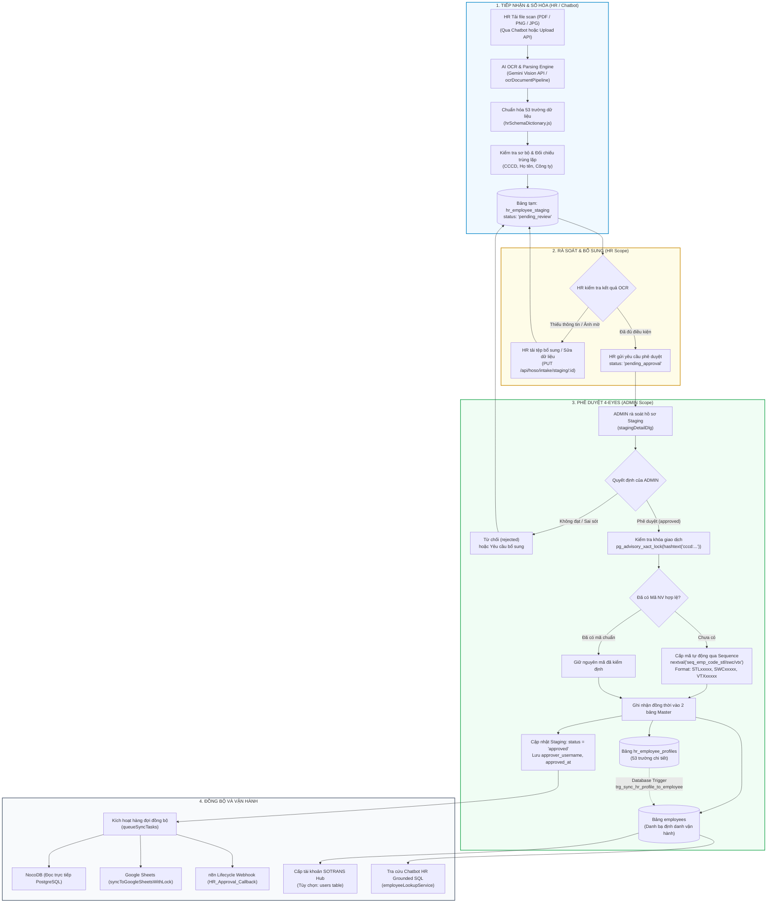

# SOTRANS HUB — BÁO CÁO KIỂM TOÁN CHỨC NĂNG & KIẾN TRÚC
# PHÂN HỆ QUẢN LÝ HỒ SƠ NHÂN SỰ & SỐ HÓA OCR (EMPLOYEE MASTER DATA MANAGEMENT)
## READ-ONLY FUNCTIONAL & TECHNICAL AUDIT REPORT

---

**Thông tin kiểm toán:**
- **Hệ thống:** SOTRANS Hub (Nền tảng Quản trị Nhân sự & Trợ lý AI Hợp nhất)
- **Mã workspace:** `D:\hoso-chat`
- **Phân hệ đối tượng:** Quản lý Hồ sơ Nhân sự & Số hóa OCR (Master Data & OCR Intake)
- **Chế độ thực thi:** **READ-ONLY AUDIT** (Tuyệt đối không sửa code, không migrate DB, không sửa n8n, không làm gián đoạn hệ thống Production)
- **Ngày thực hiện:** 10/11/2026
- **Trạng thái kiểm toán:** Hoàn tất toàn diện (100% bằng chứng đối soát từ mã nguồn, cơ sở dữ liệu PostgreSQL, Qdrant và workflow n8n)

---

## MỤC LỤC BÁO CÁO

1. [Tóm tắt điều hành (Executive Summary)](#1-t%C3%B3m-t%E1%BA%AFt-%C4%91i%E1%BB%81u-h%C3%A0nh-executive-summary)
2. [Hiện trạng chức năng và kiến trúc thực tế](#2-hi%E1%BB%87n-tr%E1%BA%A1ng-ch%E1%BB%A9c-n%C4%83ng-v%C3%A0-ki%E1%BA%BFn-tr%C3%BAc-th%E1%BB%B1c-t%E1%BA%BF)
3. [Sơ đồ luồng dữ liệu Staging → Hồ sơ chính thức](#3-s%C6%A1-%C4%91%E1%BB%93-lu%E1%BB%93ng-d%E1%BB%AF-li%E1%BB%87u-staging--h%E1%BB%93-s%C6%A1-ch%C3%ADnh-th%E1%BB%A9c)
4. [Phân tích tính cần thiết của chức năng & Đánh giá trùng lặp](#4-ph%C3%A2n-t%C3%ADch-t%C3%ADnh-c%E1%BA%A7n-thi%E1%BA%BFt-c%E1%BB%A7a-ch%E1%BB%A9c-n%C4%83ng--%C4%91%C3%A1nh-gi%C3%A1-tr%C3%B9ng-l%E1%BA%B7p)
5. [Bảng đánh giá các trường dữ liệu hiện tại](#5-b%E1%BA%A3ng-%C4%91%C3%A1nh-gi%C3%A1-c%C3%A1c-tr%C6%B0%E1%BB%9Dng-d%E1%BB%AF-li%E1%BB%87u-hi%E1%BB%87n-t%E1%BA%A1i)
6. [Danh sách trường thông tin còn thiếu (Phân cấp mức độ cần thiết)](#6-danh-s%C3%A1ch-tr%C6%B0%E1%BB%9Dng-th%C3%B4ng-tin-c%C3%B2n-thi%E1%BA%BFu-ph%C3%A2n-c%E1%BA%A5p-m%E1%BB%A9c-%C4%91%E1%BB%99-c%E1%BA%A7n-thi%E1%BA%BFt)
7. [Danh sách trường không nên thu thập hoặc không nên đặt tại biểu mẫu thêm mới](#7-danh-s%C3%A1ch-tr%C6%B0%E1%BB%9Dng-kh%C3%B4ng-n%C3%AAn-thu-th%E1%BA%ADp-ho%E1%BA%B7c-kh%C3%B4ng-n%C3%AAn-%C4%91%E1%BA%B7t-t%E1%BA%A1i-bi%E1%BB%83u-m%E1%BA%ABu-th%C3%AAm-m%E1%BB%9Bi)
8. [Đánh giá chuyên sâu cơ chế Mã nhân viên & Định danh CCCD](#8-%C4%91%C3%A1nh-gi%C3%A1-chuy%C3%AAn-s%C3%A2u-c%C6%A1-ch%E1%BA%BF-m%C3%A3-nh%C3%A2n-vi%C3%AAn--%C4%91%E1%BB%8Bnh-danh-cccd)
9. [Đánh giá phân quyền (RBAC), Phê duyệt 4-Eyes & Bảo mật dữ liệu](#9-%C4%91%C3%A1nh-gi%C3%A1-ph%C3%A2n-quy%E1%BB%81n-rbac-ph%C3%AA-duy%E1%BB%87t-4-eyes--b%E1%BA%A3o-m%E1%BA%ADt-d%E1%BB%AF-li%E1%BB%87u)
10. [So sánh chi tiết 3 phương án kiến trúc (A / B / C)](#10-so-s%C3%A1nh-chi-ti%E1%BA%BFt-3-ph%C6%B0%C6%A1ng-%C3%A1n-ki%E1%BA%BFn-tr%C3%BAc-a--b--c)
11. [Mô hình nghiệp vụ & Cấu trúc biểu mẫu chuẩn đề xuất](#11-m%C3%B4-h%C3%ACnh-nghi%E1%BB%87p-v%E1%BB%A5--c%E1%BA%A5u-tr%C3%BAc-bi%E1%BB%83u-m%E1%BA%ABu-chu%E1%BA%A9n-%C4%91%E1%BB%81-xu%E1%BA%A5t)
12. [Bảng đăng ký các vấn đề kỹ thuật (P0 / P1 / P2)](#12-b%E1%BA%A3ng-%C4%91%C4%83ng-k%C3%BD-c%C3%A1c-v%E1%BA%A5n-%C4%91%E1%BB%81-k%E1%BB%B9-thu%E1%BA%ADt-p0--p1--p2)
13. [Kết luận bắt buộc (Trả lời dứt khoát 5 câu hỏi của Ban Điều Hành)](#13-k%E1%BA%BFt-lu%E1%BA%ADn-b%E1%BA%AFt-bu%E1%BB%99c-tr%E1%BA%A3-l%E1%BB%9Di-d%E1%BB%A9t-kho%C3%A1t-5-c%C3%A2u-h%E1%BB%8Fi-c%E1%BB%A7a-ban-%C4%91i%E1%BB%81u-h%C3%A0nh)

---

## 1. TÓM TẮT ĐIỀU HÀNH (EXECUTIVE SUMMARY)

Đợt kiểm toán độc lập này rà soát toàn diện chức năng **Quản lý Hồ sơ Nhân sự & Số hóa OCR** trên cả 5 tầng kiến trúc của SOTRANS Hub: Frontend (`hr-admin.html`, `index.html`), Backend API (`employees.js`, `intake.js`, `hoso.js`), Cơ sở dữ liệu PostgreSQL (`employees`, `hr_employee_profiles`, `hr_employee_staging`), Cơ sở dữ liệu Vector Qdrant và Hệ thống tự động hóa n8n.

### Các phát hiện then chốt:

1. **Sự tồn tại của hai luồng nhập liệu song song bị lệch chuẩn nghiêm trọng:**
   - **Luồng 1 (Staging Pipeline):** HR tải chứng từ scan $\rightarrow$ OCR bóc tách 53 trường $\rightarrow$ Lưu `hr_employee_staging` $\rightarrow$ ADMIN duyệt $\rightarrow$ Sinh mã nhân viên tự động từ PostgreSQL Sequence (`seq_emp_code_*`) $\rightarrow$ Lưu đủ 53 trường vào `hr_employee_profiles` $\rightarrow$ Upsert sang `employees`. Luồng này tuân thủ nguyên tắc kiểm soát 4-Eyes.
   - **Luồng 2 (Direct Form / Legacy OCR trong Master Tab):** Tại tab "Hồ sơ chính thức", tồn tại nút **"+ Thêm hồ sơ mới"** chỉ có 6 trường sơ sài (không có CCCD, không ngày sinh, không địa chỉ) và nút **"+ Tải lên hồ sơ scan (OCR)"** cho phép HR lưu thẳng dữ liệu vào CSDL thông qua `/api/employees/confirm-ocr`. Luồng này **bỏ qua hoàn toàn quy trình phê duyệt của ADMIN**, phá vỡ nguyên tắc 4-Eyes và tạo ra các bản ghi "mồ côi" trong bảng `employees` mà không có dữ liệu chi tiết trong `hr_employee_profiles`.
2. **Sai lệch nghiêm trọng về định danh (Mã nhân viên vs CCCD):**
   - Placeholder trên giao diện gợi ý: `"Ví dụ: STL-1029, VTX_881, SWC-402 hoặc CCCD"`.
   - Backend `auth-service/routes/employees.js` (dòng 36-37) chấp nhận regex số CCCD 12 chữ số làm mã nhân viên cho SWC: `regex: /^(SWC-\d{3,5}|\d{12})$/i`.
   - Câu truy vấn tìm kiếm (dòng 121, 434) có logic chắp vá: `p.citizen_id = e.employee_code`.
   - **Kết luận:** Hệ thống đang đánh đồng định danh quốc gia (CCCD - PII nhạy cảm) với mã số định danh doanh nghiệp (Employee ID). Điều này vi phạm nguyên tắc chuẩn hóa dữ liệu nhân sự Master Data.
3. **Xung đột định dạng mã nhân viên giữa các module:**
   - Sequence trong `intake.js` sinh mã: `STL00014`, `SWC00025` (5 chữ số, **không có dấu gạch ngang**).
   - Validation trong `employees.js` (dòng 28) lại bắt buộc có dấu gạch: `/^STL-\d{3,5}$/i` (Ví dụ: `STL-1029`). Khi một hồ sơ được Staging sinh mã tự động, nếu đưa sang hàm cập nhật của `employees.js` sẽ bị văng lỗi định dạng!
4. **Qdrant Vector DB không lưu trữ hồ sơ nhân sự:**
   - Xác minh thực tế: Qdrant chỉ lưu 2 collection `hr_docs` và `hr_docs_staging` dùng cho quy chế, chính sách. Hồ sơ nhân sự được lưu thuần túy dạng quan hệ (Relational) trong PostgreSQL để đảm bảo tính chính xác 100% và bảo vệ dữ liệu PII.
5. **Khuyến nghị chiến lược:**
   - **Lựa chọn Phương án B (Tái cấu trúc luồng thống nhất):** Giữ nguyên phân hệ Quản lý Hồ sơ Nhân sự nhưng định vị lại rõ ràng là **Sổ cái Dữ liệu Chính thức (Master Data Registry / System of Record)**; chuyển toàn bộ chức năng tiếp nhận đầu vào (cả OCR chứng từ lẫn nhập liệu thủ công) về **Staging Gateway**. Mọi hồ sơ mới đều phải đi qua Staging để rà soát chống trùng CCCD và chỉ trở thành hồ sơ chính thức sau khi ADMIN phê duyệt và hệ thống cấp mã tự động.

---

## 2. HIỆN TRẠNG CHỨC NĂNG VÀ KIẾN TRÚC THỰC TẾ

### 2.1 Cấu trúc Giao diện Frontend (`chat/hr-admin.html`)

Tại giao diện quản trị `chat/hr-admin.html` (dòng 3026 - 3282), phân hệ **Quản lý Hồ sơ Nhân sự** được chia thành 2 sub-tab chính:

```
[Tab Quản lý Hồ sơ Nhân sự] (id: tabViewEmployees)
 ├── Sub-tab 1: Hồ sơ nhân sự chính thức (id: btnSubTabOfficial)
 │    ├── Nút: "+ Tải lên hồ sơ scan (OCR)" (id: btnOpenEmpUpload -> openUploadEmployeeOcrModal())
 │    ├── Nút: "📥 Xuất Excel chuẩn (53 cột)" (id: btnExportEmpExcel)
 │    ├── Nút: "📋 Xuất kèm Metadata" (id: btnExportEmpMeta)
 │    ├── Nút: "+ Thêm hồ sơ mới" (id: btnOpenCreateEmp -> openCreateEmployeeModal())
 │    ├── Thanh thống kê: Tổng số, ACTIVE, OCR, Đã có tài khoản, RESIGNED
 │    ├── Bảng danh sách: 8 cột (Mã NV, Họ tên, Công ty, Phòng ban, Vị trí, Email, Trạng thái, Thao tác)
 │    └── Dialogs liên kết:
 │         ├── empCreateDlg (Thêm thủ công 6 trường)
 │         ├── empEditDlg (Sửa hồ sơ nhanh)
 │         ├── empDetailDlg (Xem chi tiết 53 trường chia làm 7 nhóm)
 │         └── empUploadOcrDlg (Bóc tách OCR trực tiếp 2 bước)
 └── Sub-tab 2: Tiếp nhận & Duyệt hồ sơ (Staging) (id: btnSubTabStaging)
      ├── Thanh thống kê: Tất cả, Chờ duyệt, Chờ rà soát, Trùng lặp, Đã duyệt, Từ chối
      ├── Bảng danh sách hồ sơ Staging: Tên tệp, Họ tên, CCCD, Mã đề xuất, Đơn vị, Trạng thái, Người tải, Thao tác
      └── Dialog: stagingDetailDlg (Chi tiết bóc tách OCR, đối soát trùng CCCD, duyệt/từ chối/yêu cầu bổ sung)
```

### 2.2 Biểu mẫu Thêm mới Hồ sơ Nhân sự hiện tại (`empCreateDlg`)

Biểu mẫu được định nghĩa tại `chat/hr-admin.html` (dòng 4719 - 4761) và xử lý sự kiện submit tại dòng 9663 - 9727:

```html
<!-- Trích xuất nguyên văn mã nguồn form thêm mới -->
<dialog id="empCreateDlg" style="...">
  ...
  <form id="empCreateForm" onsubmit="event.preventDefault();submitCreateEmployee();">
    <div>
      <label>Mã nhân viên (*)</label>
      <input type="text" id="newEmpCode" required 
             placeholder="Ví dụ: STL-1029, VTX_881, SWC-402 hoặc CCCD">
    </div>
    <div>
      <label>Họ và tên (*)</label>
      <input type="text" id="newEmpName" required placeholder="Ví dụ: Nguyễn Văn A">
    </div>
    <div id="newEmpCompanyWrap" style="display:none">
      <label>Công ty (*)</label>
      <select id="newEmpCompany">
        <option value="STL">📦 SOTRANS Logistics (STL)</option>
        <option value="VTX">🚚 Vietranstimex (VTX)</option>
        <option value="SWC">⚓ Sowatco (SWC)</option>
      </select>
    </div>
    <div>
      <label>Phòng ban</label>
      <input type="text" id="newEmpDept" placeholder="Ví dụ: Vận tải, Cảng...">
    </div>
    <div>
      <label>Chức vụ / Vị trí</label>
      <input type="text" id="newEmpPosition" placeholder="Ví dụ: Chuyên viên, Thợ máy...">
    </div>
    <div>
      <label>Email</label>
      <input type="email" id="newEmpEmail" placeholder="example@sotrans.com.vn">
    </div>
    <button type="submit" id="btnSubmitCreateEmp">Lưu hồ sơ</button>
  </form>
</dialog>
```

### 2.3 Backend API Endpoints liên quan

| Module / Tuyến đường | HTTP Method & URI | Vai trò nghiệp vụ | Quyền yêu cầu | Bảng DB tương tác |
|---|---|---|---|---|
| `routes/employees.js` | `GET /api/employees` | Lấy danh sách hồ sơ Master (phân trang, lọc theo công ty, trạng thái) | `ADMIN`, `HR` | `employees`, `companies`, `users`, `hr_employee_profiles` |
| `routes/employees.js` | `GET /api/employees/:id` | Xem chi tiết 53 trường của nhân viên (tự động mapping 7 nhóm) | `ADMIN`, `HR`, `EMPLOYEE` (self) | `employees`, `hr_employee_profiles`, `users` |
| `routes/employees.js` | `POST /api/employees` | Thêm mới hồ sơ nhân viên thủ công | `ADMIN`, `HR` | **Chỉ ghi `employees`** (Bỏ trống `hr_employee_profiles`) |
| `routes/employees.js` | `PUT /api/employees/:id` | Cập nhật thông tin cơ bản nhân viên | `ADMIN`, `HR` | `employees` |
| `routes/employees.js` | `POST /api/employees/parse-ocr` | Bóc tách tài liệu scan và kiểm tra trùng lặp | `ADMIN`, `HR` | Không ghi DB, chỉ trích xuất qua Gemini AI |
| `routes/employees.js` | `POST /api/employees/confirm-ocr` | **Lưu trực tiếp kết quả OCR vào CSDL chính thức (Bypass Staging)** | `ADMIN`, `HR` | Ghi cả `employees` và `hr_employee_profiles` |
| `routes/intake.js` | `POST /api/hoso/intake/upload` | Tiếp nhận tệp scan, phân tích OCR và đưa vào hàng đợi Staging | `ADMIN`, `HR` | `hr_employee_staging` |
| `routes/intake.js` | `GET /api/hoso/intake/staging` | Danh sách hồ sơ đang chờ xử lý trong Staging | `ADMIN`, `HR` | `hr_employee_staging` |
| `routes/intake.js` | `POST /api/hoso/intake/approve` | **ADMIN phê duyệt hồ sơ Staging chính thức** | `ADMIN` (yêu cầu `hr.intake.approve`) | `hr_employee_staging`, sinh mã sequence, ghi `hr_employee_profiles`, upsert `employees` |
| `routes/hoso.js` | `POST /api/hoso/chat` | Chatbot tiếp nhận file hoặc tra cứu hồ sơ nhân viên qua AI | Mọi role (phân luồng `query_all` vs `query_self`) | `hr_employee_staging`, `employees`, `hr_employee_profiles` |

### 2.4 Cấu trúc Cơ sở Dữ liệu PostgreSQL thực tế

Hệ thống hiện tại có 3 bảng chính lưu trữ dữ liệu nhân sự:

#### 1. Bảng `employees` (Danh bạ nhân sự vận hành hệ thống):
- **Khóa chính:** `id` (UUID, mặc định `gen_random_uuid()`).
- **Các cột nghiệp vụ:** `employee_code` (VARCHAR 50, UNIQUE), `citizen_id` (VARCHAR 50), `employee_name` (VARCHAR 255), `company_id` (VARCHAR 50, FK companies), `department` (VARCHAR 255), `position` (VARCHAR 255), `email` (VARCHAR 255), `status` (ACTIVE/INACTIVE/RESIGNED/DELETED).
- **Ràng buộc:**
  - `uq_employees_employee_code` UNIQUE (employee_code).
  - `uq_employees_company_code` UNIQUE (company_id, employee_code).
  - `uq_employees_company_citizen` UNIQUE (company_id, citizen_id) WHERE citizen_id IS NOT NULL AND citizen_id <> ''.

#### 2. Bảng `hr_employee_profiles` (Hồ sơ số hóa chi tiết 53 trường theo `Hoso_Nhansu.xlsx`):
- **Khóa chính:** `id` (SERIAL / INTEGER).
- **Khóa ngoại:** `employee_id` REFERENCES `employees(employee_code)` ON UPDATE CASCADE ON DELETE CASCADE.
- **Ràng buộc duy nhất:** `uq_hr_employee_citizen_id` UNIQUE (citizen_id).
- **Các nhóm trường:** 53 cột chuẩn bao gồm thân nhân, CCCD, địa chỉ, trình độ, học vấn, lương, phụ cấp, hợp đồng, quyết định tuyển dụng...
- **Database Trigger:** `trg_sync_hr_profile_to_employee` (AFTER INSERT OR UPDATE) $\rightarrow$ Tự động đồng bộ các trường cơ bản sang bảng `employees`.
- **Lỗ hổng Trigger:** **Không có trigger ngược lại từ `employees` sang `hr_employee_profiles`**.

#### 3. Bảng `hr_employee_staging` (Vùng đệm tiếp nhận, rà soát và kiểm duyệt):
- **Khóa chính:** `id` (UUID).
- **Các trường:** `batch_id`, `file_name`, `file_storage_path`, `full_name`, `citizen_id`, `employee_code`, `date_of_birth`, `gender`, `job_title`, `department`, `company_id`, `staging_status` (pending_review, pending_approval, approved, rejected), `extracted_data` (JSONB chứa toàn bộ 53 trường OCR), `missing_fields`, `uncertain_fields`, `suspected_duplicate` (BOOLEAN), `duplicate_reason`.

---

## 3. SƠ ĐỒ LUỒNG DỮ LIỆU STAGING → HỒ SƠ CHÍNH THỨC



---

## 4. PHÂN TÍCH TÍNH CẦN THIẾT CỦA CHỨC NĂNG & ĐÁNH GIÁ TRÙNG LẶP

| Câu hỏi kiểm toán | Phân tích kỹ thuật & Thực tế hệ thống | Đánh giá & Kết luận |
|---|---|---|
| **1. Chức năng Quản lý Hồ sơ Nhân sự đang đảm nhiệm nghiệp vụ gì?** | Đang đảm nhiệm: (1) Hiển thị danh bạ nhân sự chính thức của tập đoàn và từng đơn vị (STL, VTX, SWC); (2) Cho phép xem chi tiết 53 trường thông tin; (3) Cập nhật trạng thái nhân viên (Nghỉ việc RESIGNED, Xóa mềm DELETED, Khôi phục RESTORE); (4) Liên kết và kích hoạt tài khoản hệ thống cho nhân viên (`POST /:id/create-account`); (5) Kết xuất dữ liệu Excel chuẩn 53 cột; (6) Cho phép tìm kiếm và lọc phục vụ quản trị HR. | **CỰC KỲ CẦN THIẾT.** Đây là Sổ cái dữ liệu gốc (Master Data Registry / System of Record) của doanh nghiệp. Không thể vận hành hệ thống nếu không có nơi quản trị nhân sự chính thức. |
| **2. Những nghiệp vụ nào đã được xử lý trong Staging?** | Staging (`intake.js`) xử lý: (1) Tiếp nhận tệp scan đa định dạng; (2) OCR và nhận diện AI 53 trường; (3) Rà soát lỗi bóc tách, cảnh báo trường thiếu (`missing_fields`), trường độ tin cậy thấp (`uncertain_fields`); (4) Kiểm tra chống trùng CCCD toàn hệ thống và liên công ty; (5) Cơ chế nộp hồ sơ chờ duyệt (`pending_approval`); (6) Cơ chế duyệt 4-Eyes của ADMIN (`approve`/`reject`/`request-changes`). | Staging đóng vai trò là **Cổng kiểm soát chất lượng & Kiểm duyệt đầu vào (Ingestion & Quality Control Gateway)**. |
| **3. Hai phân hệ đang dùng chung dữ liệu hay lưu trữ hai nguồn khác nhau?** | Dữ liệu Staging nằm riêng ở bảng `hr_employee_staging`. Khi ADMIN phê duyệt, dữ liệu mới được đẩy sang bảng Master `hr_employee_profiles` và `employees`. Tuy nhiên, trong tab Master lại có nút **"+ Tải lên hồ sơ scan (OCR)"** và **"+ Thêm hồ sơ mới"** ghi thẳng vào `employees` và `hr_employee_profiles` mà không hề đi qua `hr_employee_staging`. | **TỒN TẠI 2 CƠ CHẾ NHẬP LIỆU ĐỘC LẬP.** Một luồng qua Staging (có kiểm duyệt), một luồng trực tiếp (bỏ qua kiểm duyệt). Đây là rủi ro phân mảnh dữ liệu. |
| **4. Có nguy cơ tạo hai hồ sơ cho cùng một người không?** | CÓ. Nếu HR sử dụng biểu mẫu thêm mới thủ công (`empCreateDlg`) — vốn **không có trường CCCD**, hệ thống chỉ kiểm tra cặp `(company_id, employee_code)`. Một nhân sự đã có trong hệ thống với CCCD `079205001589` hoàn toàn có thể bị tạo thêm một bản ghi mới với mã nhân viên khác vì form thủ công không hề nhập CCCD để đối chiếu! | **RỦI RO RẤT CAO (P0).** Biểu mẫu thủ công hiện tại là "cửa sau" vô hiệu hóa cơ chế chống trùng CCCD của hệ thống. |
| **5. Có thể tạo nhân viên chính thức trực tiếp mà không qua OCR không?** | Có thể (thông qua API `POST /api/employees`). Tuy nhiên, bản ghi tạo ra theo cách này chỉ có 6 trường trên bảng `employees` và **hoàn toàn không có dữ liệu trên bảng `hr_employee_profiles`**. Khi bấm xem chi tiết 53 trường, nhân viên này sẽ có hồ sơ rỗng! | **BẤT CẬP NGHIỆP VỤ.** Tạo ra dữ liệu không đồng nhất giữa danh bạ và hồ sơ chi tiết. |
| **6. Hồ sơ giấy và nhập thủ công có nên cùng tồn tại không?** | **NÊN CÙNG TỒN TẠI**, vì thực tế doanh nghiệp luôn có các trường hợp: (a) Lao động thời vụ, công nhân bốc xếp, thợ máy chưa kịp nộp đủ giấy tờ scan số hóa; (b) Tiếp nhận hồ sơ giấy trực tiếp từ văn phòng; (c) Nhập dữ liệu chuyển đổi từ hệ thống cũ. **TUY NHIÊN**, việc nhập thủ công bắt buộc phải nhập đủ các trường định danh cốt lõi (Họ tên, CCCD, Ngày sinh, Giới tính, Công ty) và phải đi qua quy trình kiểm soát chống trùng trước khi cấp mã chính thức. | Cần cơ chế nhập thủ công nhưng phải chuẩn hóa biểu mẫu và đưa vào luồng kiểm duyệt thống nhất. |
| **7. Có nên giữ chức năng này làm nơi quản lý hồ sơ chính thức sau Staging?** | **CHẮC CHẮN NÊN GIỮ.** Mô hình chuẩn là: **Staging (Cổng tiếp nhận & duyệt) $\rightarrow$ Master Data (Quản lý hồ sơ chính thức)**. Cần đóng các nút nhập liệu tùy tiện tại Master tab để đảm bảo tính toàn vẹn dữ liệu. | Đây là giải pháp kiến trúc tối ưu nhất (Phương án B). |

---

## 5. BẢNG ĐÁNH GIÁ CÁC TRƯỜNG DỮ LIỆU HIỆN TẠI

Đánh giá chi tiết 6 trường đang có trên biểu mẫu thêm mới thủ công (`empCreateDlg`):

| STT | Tên trường | Hiện trạng trên UI | Bắt buộc | Đánh giá tính cần thiết & Bất cập thực tế | Khuyến nghị chuẩn hóa |
|:---:|---|---|:---:|---|---|
| 1 | **Mã nhân viên** | Ô nhập thủ công (`newEmpCode`), placeholder: `"Ví dụ: STL-1029, VTX_881, SWC-402 hoặc CCCD"` | Bắt buộc (`required`) | **BẤT CẬP NGHIỆM TRỌNG (P0):**<br/>1. Đánh đồng mã nhân viên với số CCCD.<br/>2. Nhập thủ công dễ gây trùng lặp, nhảy số, sai quy ước.<br/>3. Xung đột với bộ sinh mã sequence tự động của Staging (`STLxxxxx`). | **BỎ NHẬP THỦ CÔNG.** Hệ thống tự động cấp mã theo sequence của công ty (`STLxxxxx`, `SWCxxxxx`, `VTXxxxxx`) khi ADMIN phê duyệt hồ sơ chính thức. |
| 2 | **Họ và tên** | Ô nhập thủ công (`newEmpName`), placeholder: `"Ví dụ: Nguyễn Văn A"` | Bắt buộc (`required`) | **CẦN THIẾT.** Bắt buộc phải có để định danh nhân sự. Tuy nhiên hiện chưa có hàm tự động chuẩn hóa chữ hoa (ví dụ: `NGUYỄN VĂN A`) dẫn đến hiển thị không đồng nhất trên danh bạ và hợp đồng. | **GIỮ LẠI.** Bổ sung tự động chuẩn hóa: viết hoa toàn bộ, cắt bỏ khoảng trắng thừa (`trim().toUpperCase().replace(/\s+/g, ' ')`). |
| 3 | **Công ty** | Dropdown chọn đơn vị (`newEmpCompany`): STL, VTX, SWC. Ẩn với HR, chỉ hiện với ADMIN. | Bắt buộc | **CẦN THIẾT.** Bắt buộc để phân định đơn vị thành viên trực thuộc tập đoàn và thực thi Tenant Isolation. HR chỉ được tạo trong công ty của mình; ADMIN được chọn công ty. | **GIỮ LẠI.** Duy trì logic bảo vệ tenant: HR tự động gán theo `user.company_id`, ADMIN chọn từ danh mục chuẩn. |
| 4 | **Phòng ban** | Ô nhập tự do (`newEmpDept`), placeholder: `"Ví dụ: Vận tải, Cảng..."` | Không bắt buộc | **KHÔNG HỢP LÝ (P1):** Nhập tự do gây phân mảnh taxonomy. Ví dụ người nhập "Phòng Vận Tải", người nhập "Vận tải", người nhập "P.VT". Dẫn đến bộ lọc phòng ban và chatbot tra cứu định biên bị sai lệch. | **CHUYỂN THÀNH DROPDOWN CHỌN LỰA.** Lấy dữ liệu từ danh mục phòng ban định biên (`department_staffing_plan`) đã được chuẩn hóa theo từng công ty. |
| 5 | **Chức vụ / Vị trí** | Ô nhập tự do (`newEmpPosition`), placeholder: `"Ví dụ: Chuyên viên, Thợ máy..."` | Không bắt buộc | **KHÔNG HỢP LÝ (P1):** Nhập tự do gây nhầm lẫn giữa Chức danh công việc (`job_title`) và Chức danh chuyên môn (`professional_title`). | **CHUYỂN THÀNH DANH MỤC CHUẨN.** Cho phép chọn từ danh mục vị trí chức danh của công ty kèm ô ghi chú nếu là vị trí mới. |
| 6 | **Email** | Ô nhập email (`newEmpEmail`), placeholder: `"example@sotrans.com.vn"` | Không bắt buộc | **CẦN THIẾT NHƯNG CHƯA ĐỦ RÕ:** Chưa phân định rõ đây là Email doanh nghiệp được cấp hay Email cá nhân dùng để liên hệ khẩn cấp khi mới vào làm. | **LÀM RÕ NGHIỆP VỤ:** Tách thành Email công ty (nếu đã cấp) và Email cá nhân (để gửi thông báo tiếp nhận/phiếu lương). |

---

## 6. DANH SÁCH TRƯỜNG THÔNG TIN CÒN THIẾU (PHÂN CẤP MỨC ĐỘ CẦN THIẾT)

Dựa trên cấu trúc 53 trường chuẩn (`Hoso_Nhansu.xlsx`) và nghiệp vụ nhân sự thực tế tại SOTRANS Group:

### Nhóm 1: Bắt buộc tuyệt đối (Core Identity — Mức độ P0)
*Không thể tạo hồ sơ nhân sự nếu thiếu các trường này, vì sẽ phá vỡ toàn bộ cơ chế chống trùng lặp và pháp lý lao động.*

1. **Số CCCD / CMND / Mã định danh cá nhân (`citizen_id`):**
   - *Mục đích:* Khóa duy nhất (Unique Key) định danh công dân theo pháp luật Việt Nam. Đây là căn cứ số 1 để chặn trùng lặp nhân sự giữa các công ty thành viên STL, VTX, SWC.
   - *Quy chuẩn:* 12 chữ số (hoặc 9 chữ số với CMND cũ), giữ nguyên số 0 ở đầu.
2. **Ngày sinh (`date_of_birth`):**
   - *Mục đích:* Xác thực độ tuổi lao động theo Bộ luật Lao động, tính ngày nghỉ hưu, phân biệt nhân viên trùng họ tên.
   - *Định dạng:* `YYYY-MM-DD`.
3. **Giới tính (`gender`):**
   - *Mục đích:* Quản lý chế độ thai sản, bảo hộ lao động cho công việc nặng nhọc (Cảng, Thuyền viên, Kho vận).
   - *Định dạng:* Danh sách chọn (`Nam` / `Nữ`).
4. **Số điện thoại liên hệ cá nhân (`phone_number`):**
   - *Mục đích:* Liên lạc trực tiếp, gửi mã OTP kích hoạt tài khoản hệ thống hoặc thông báo nhân sự.
   - *Định dạng:* Chuẩn hóa đầu số Việt Nam (10 chữ số).
5. **Ngày bắt đầu làm việc (`employment_start_date`):**
   - *Mục đích:* Tính thâm niên công tác, tính ngày phép năm, thời gian thử việc.
   - *Định dạng:* `YYYY-MM-DD`.

### Nhóm 2: Rất cần thiết nhưng có thể bổ sung sau (Mức độ P1)
*Cần thu thập trong vòng 7 - 15 ngày kể từ khi nhân viên nhận việc để hoàn thiện hồ sơ.*

6. **Ngày cấp CCCD (`citizen_id_issue_date`) & Nơi cấp CCCD (`citizen_id_issue_place`):**
   - Cần thiết để ký hợp đồng lao động và khai báo bảo hiểm xã hội.
7. **Địa chỉ thường trú (`permanent_address`) & Nơi ở hiện nay (`current_address`):**
   - Cần thiết cho hồ sơ lý lịch tư pháp, khai báo thuế và hồ sơ quản lý lao động địa phương.
8. **Loại hợp đồng lao động (`contract_type`):**
   - Chọn loại: Thử việc, Có thời hạn (12-36 tháng), Không xác định thời hạn, Hợp đồng mùa vụ/khoán việc.
9. **Thời hạn hợp đồng (`contract_start_date`, `contract_end_date`):**
   - Cảnh báo tự động khi hợp đồng sắp hết hạn để làm thủ tục tái ký hoặc chấm dứt.
10. **Bộ phận định biên (`section_staffing_plan`):**
    - Chi tiết dưới phòng ban (ví dụ: Phòng Vận tải $\rightarrow$ Đội xe Container, Tổ Thợ máy tàu kéo).

### Nhóm 3: Dữ liệu hồ sơ chuyên sâu (Mức độ P2 — Thu thập qua OCR hoặc cập nhật định kỳ)
*Tuyệt đối KHÔNG đưa vào biểu mẫu thêm mới ban đầu để tránh quá tải người nhập liệu.*

11. **Trình độ học vấn & Bằng cấp (`education_level`, `major`, `training_institution`, `graduation_grade`):**
    - Tự động trích xuất từ Bằng tốt nghiệp / Chứng chỉ scan qua OCR Staging.
12. **Mức lương & Phụ cấp (`base_salary`, `social_insurance_salary`, `meal_allowance`, `responsibility_allowance`):**
    - Trích xuất từ Quyết định lương hoặc HĐLĐ; thuộc diện bảo mật cao, chỉ HR chuyên trách chế độ đãi ngộ (C&B) được xem.
13. **Số Quyết định tuyển dụng (`recruitment_decision_no`) & Ngày ký HĐLĐ chính thức:**
    - Trích xuất tự động từ văn bản pháp lý scan.
14. **Quê quán (`place_of_origin`), Nơi khai sinh (`birth_registration_place`), Dân tộc (`ethnicity`):**
    - Tự động lấy từ mặt sau CCCD hoặc Sơ yếu lý lịch qua OCR.

---

## 7. DANH SÁCH TRƯỜNG KHÔNG NÊN THU THẬP HOẶC KHÔNG NÊN ĐẶT TẠI BIỂU MẪU THÊM MỚI

Theo nguyên tắc tối thiểu hóa dữ liệu (Data Minimization) và chuẩn mực thiết kế UX biểu mẫu nhân sự:

| Tên trường | Lý do KHÔNG đưa vào biểu mẫu Thêm mới | Nơi quản lý / Phương thức thu thập phù hợp |
|---|---|---|
| **Mã nhân viên** | Dễ gây trùng lặp, sai quy ước, xung đột đồng thời. | **Hệ thống tự động sinh qua Sequence** khi hồ sơ được duyệt. |
| **Mức lương chi tiết & Các khoản phụ cấp (10 cột lương)** | Thông tin tài chính cực kỳ nhạy cảm. Người tạo hồ sơ ban đầu (HR tuyển dụng) có thể không phải là người quyết định lương. Gây lộ thông tin thu nhập. | Quản lý tại phân hệ C&B (Lương - Thưởng) hoặc trích xuất tự động từ HĐLĐ được bảo mật phân quyền. |
| **Mã số thuế cá nhân (MST) & Mã số BHXH** | Thường nhân viên mới chưa có hoặc cần thời gian tra cứu từ cổng dịch vụ công. Bắt buộc nhập ngay sẽ làm tắc nghẽn quy trình tiếp nhận. | Thu thập tại bước hoàn tất hồ sơ sau tuyển dụng (sau 30 ngày). |
| **Thông tin tài khoản ngân hàng** | Thuộc dữ liệu thanh toán lương, không phải dữ liệu định danh nhân sự cốt lõi. | Thu thập tại biểu mẫu đăng ký nhận lương riêng gửi về phòng Kế toán. |
| **Thông tin người phụ thuộc** | Chỉ phát sinh khi nhân viên làm thủ tục giảm trừ gia cảnh thuế TNCN. | Quản lý tại phân hệ Thuế / Hồ sơ giảm trừ gia cảnh. |
| **Chi tiết quá trình đào tạo (11 cột học vấn)** | Rất dài dòng nếu gõ tay (Tên trường, Hệ đào tạo, Năm tốt nghiệp, Xếp loại, Chứng chỉ khác...). | **Để OCR tự động trích xuất từ ảnh chụp bằng cấp** trong Staging. |
| **Tài khoản đăng nhập hệ thống (Username/Password)** | Tách biệt hoàn toàn giữa "Hồ sơ nhân sự" (Nhân sự pháp lý) và "Tài khoản hệ thống" (User IAM). Rất nhiều nhân sự vận tải/cảng không cần tài khoản SOTRANS Hub. | Cấp sau thông qua nút *"Kích hoạt tài khoản"* khi có nhu cầu sử dụng thực tế. |

---

## 8. ĐÁNH GIÁ CHUYÊN SÂU CƠ CHẾ MÃ NHÂN VIÊN & ĐỊNH DANH CCCD

### 8.1 Phân biệt rạch ròi giữa Mã nhân viên và Số CCCD

| Tiêu chí so sánh | Số CCCD / Định danh cá nhân | Mã nhân viên (Employee Code) |
|---|---|---|
| **Bản chất định danh** | Định danh công dân quốc gia theo pháp luật | Định danh nội bộ của tổ chức doanh nghiệp |
| **Cơ quan cấp** | Bộ Công an (Nhà nước cấp 1 lần duy nhất) | Doanh nghiệp (SOTRANS Group cấp theo từng đơn vị) |
| **Phạm vi sử dụng** | Toàn quốc, không bao giờ thay đổi | Nội bộ công ty thành viên (STL, VTX, SWC) |
| **Tính bảo mật** | **Dữ liệu định danh cá nhân nhạy cảm (PII)** | Mã định danh công khai trong công việc |
| **Quy tắc khi chuyển đơn vị** | Giữ nguyên suốt đời | Có thể được cấp mã mới khi chuyển từ STL sang SWC |
| **Rủi ro khi dùng lẫn** | Lộ lọt CCCD trên các danh bạ, email, báo cáo nội bộ | Vi phạm nghiêm trọng tiêu chuẩn bảo vệ dữ liệu cá nhân |

> [!CAUTION]
> **Phát hiện kiểm toán nghiêm trọng (P0):**
> 1. Tại `chat/hr-admin.html` (dòng 4727), placeholder ghi rõ: `"Ví dụ: STL-1029, VTX_881, SWC-402 hoặc CCCD"`.
> 2. Tại `auth-service/routes/employees.js` (dòng 36-37), định dạng mã nhân viên của SWC cho phép 12 chữ số CCCD:
>    ```javascript
>    'SWC': {
>      regex: /^(SWC-\d{3,5}|\d{12})$/i,
>      hint: 'Mã nhân viên Sowatco (SWC) phải có định dạng "SWC-xxx" hoặc số CCCD 12 chữ số'
>    }
>    ```
> 3. Tại `auth-service/routes/employees.js` (dòng 121, dòng 434), xuất hiện câu query fallback: `p.citizen_id = e.employee_code`.
> 
> **KẾT LUẬN KIỂM TOÁN:** Đây là di chứng của việc nhập liệu tạm bợ trong quá khứ khi chưa có quy trình cấp mã chuẩn. **Cần loại bỏ triệt để việc chấp nhận CCCD làm mã nhân viên**. Mã nhân viên và CCCD phải là hai trường tách biệt 100%.

### 8.2 Đánh giá cơ chế cấp mã tự động hiện có

Trong file `auth-service/routes/intake.js` (dòng 64-92), hệ thống đã xây dựng hàm sinh mã tự động an toàn khi phê duyệt hồ sơ:

```javascript
async function generateNextEmployeeCode(client, companyId) {
  const comp = String(companyId || 'STL').trim().toUpperCase();
  const seqMap = {
    'STL': 'seq_emp_code_stl',
    'SWC': 'seq_emp_code_swc',
    'VTX': 'seq_emp_code_vtx'
  };
  const seqName = seqMap[comp] || 'seq_emp_code_stl';
  const prefix = comp;

  let assignedCode = null;
  // Vòng lặp bảo đảm chống trùng nếu mã đó đã từng được gán thủ công trong quá khứ
  while (!assignedCode) {
    const seqRes = await client.query(`SELECT nextval($1) AS num`, [seqName]);
    const num = seqRes.rows[0].num;
    const candidateCode = `${prefix}${String(num).padStart(5, '0')}`;

    // Kiểm tra tính duy nhất trên bảng employees (uq_employees_employee_code)
    const checkRes = await client.query(
      `SELECT 1 FROM employees WHERE employee_code = $1 LIMIT 1`,
      [candidateCode]
    );
    if (checkRes.rows.length === 0) {
      assignedCode = candidateCode;
    }
  }
  return assignedCode;
}
```

#### Đánh giá ưu điểm:
1. Sử dụng **PostgreSQL Sequence** (`nextval`), hoàn toàn miễn nhiễm với race condition khi nhiều người cùng thao tác đồng thời.
2. Tuyệt đối không dùng cơ chế đếm bản ghi (`COUNT(*) + 1`), tránh được lỗi trùng mã khi có thao tác xóa bản ghi hoặc rollback giao dịch.
3. Có vòng lặp kiểm tra đối chiếu ngược vào bảng `employees` để bỏ qua các số đã vô tình bị nhập thủ công trong quá khứ.
4. Thời điểm cấp mã diễn ra tại bước **ADMIN Phê duyệt**, không cấp ở bước HR mới tải lên Staging.

#### Điểm khiếm khuyết cần chuẩn hóa đồng bộ:
- Mã sinh ra có định dạng `STL00014`, `SWC00025` (**5 số, không có gạch ngang**).
- Trong khi đó, `COMPANY_CODE_PATTERNS['STL']` tại `employees.js` lại yêu cầu `/^STL-\d{3,5}$/i` (**bắt buộc có gạch ngang**).
- **Khuyến nghị:** Thống nhất quy tắc regex trên toàn hệ thống chấp nhận cả định dạng chuẩn không gạch ngang `${PREFIX}\d{5}` và có gạch ngang `${PREFIX}-\d{3,5}` để tương thích dữ liệu lịch sử.

---

## 9. ĐÁNH GIÁ PHÂN QUYỀN (RBAC), PHÊ DUYỆT 4-EYES & BẢO MẬT DỮ LIỆU

### 9.1 Ma trận Phân quyền thực tế (Role Permissions Audit)

Kết quả truy vấn trực tiếp từ bảng `role_permissions` trong PostgreSQL:

| Vai trò (Role) | Quyền tiếp nhận hồ sơ (Intake) | Quyền phê duyệt (Approval) | Quyền tạo trực tiếp Master (`POST /api/employees`) | Quyền xác nhận OCR Master (`/confirm-ocr`) | Đánh giá an toàn |
|:---:|:---:|:---:|:---:|:---:|:---:|
| **ADMIN** | `hr.intake.upload`<br/>`hr.intake.submit`<br/>`hr.intake.confirm_company` | `hr.intake.approve` | Có quyền (qua `requireRoles('ADMIN', 'HR')`) | Có quyền (qua `requireRoles('ADMIN', 'HR')`) | Hợp lệ theo vai trò Quản trị cấp cao. |
| **HR** | `hr.intake.upload`<br/>`hr.intake.submit`<br/>`hr.intake.confirm_company` | **KHÔNG CÓ QUYỀN** (Chặn phê duyệt Staging) | **CÓ QUYỀN** (Chỉ kiểm tra Role, không kiểm tra quyền approve) | **CÓ QUYỀN** (Chỉ kiểm tra Role, không kiểm tra quyền approve) | **LỖ HỔNG KIẾN TRÚC NGHIÊM TRỌNG (P0).** |
| **EMPLOYEE** | Không có quyền | Không có quyền | Không có quyền | Không có quyền | Tuân thủ tốt. Chỉ xem được hồ sơ của chính mình qua cơ chế Self-Service. |

### 9.2 Lỗ hổng phá vỡ nguyên tắc 4-Eyes (Segregation of Duties)

Hệ thống được thiết kế nghiệp vụ rất chuẩn tại Staging: HR chỉ được tải lên và submit hồ sơ (`pending_approval`), còn ADMIN mới có quyền phê duyệt (`hr.intake.approve`) để hồ sơ vào Master.

**TUY NHIÊN, tại phân hệ Quản lý Hồ sơ Nhân sự (`employees.js`):**
- Tuyến đường `POST /api/employees` (dòng 1460) và `POST /api/employees/confirm-ocr` (dòng 1035) chỉ sử dụng middleware kiểm tra vai trò đơn giản: `requireRoles('ADMIN', 'HR')`.
- Điều này tạo ra một **"cửa ngách"**: Một chuyên viên HR bình thường không thể duyệt hồ sơ trong Staging, nhưng chỉ cần bấm nút "+ Thêm hồ sơ mới" hoặc "+ Tải lên hồ sơ scan (OCR)" ở tab Master là có thể ghi thẳng nhân viên vào CSDL chính thức mà không cần bất kỳ ADMIN nào phê duyệt!
- **Hệ quả:** Phá vỡ toàn bộ kiến trúc kiểm soát 4-Eyes (Người lập không được là người duyệt).

### 9.3 Bảo vệ dữ liệu cá nhân (PII Protection) & Tenant Isolation

1. **Cô lập dữ liệu đa công ty (Tenant Isolation):**
   - Đã được triển khai tốt tại tầng API: HR bị khóa cứng theo `req.user.company_id`. Nếu HR cố tình truy vấn hoặc sửa hồ sơ của công ty khác, hệ thống chặn 403 Forbidden.
   - ADMIN có quyền xem toàn bộ tập đoàn (`company_id = 'all'`) hoặc lọc theo từng đơn vị thành viên.
2. **Che giấu dữ liệu nhạy cảm (Data Masking):**
   - Khi nhân viên tự tra cứu hồ sơ của chính mình qua Chatbot hoặc API, số CCCD được che tự động: `079******589` (chỉ hiện 3 số đầu và 3 số cuối).
   - Mức lương chi tiết được ẩn đối với nhân viên thường và HR công ty khác.
3. **Kiểm tra Qdrant Vector DB:**
   - Hoàn toàn **KHÔNG LƯU DỮ LIỆU NHÂN SỰ VÀO QDRANT**. Qdrant chỉ chứa các văn bản quy chế chính sách phân mảnh. Điều này bảo vệ an toàn PII tuyệt đối trước nguy cơ "ảo giác" (hallucination) của AI.

---

## 10. SO SÁNH CHI TIẾT 3 PHƯƠNG ÁN KIẾN TRÚC (A / B / C)

| Tiêu chí đánh giá | Phương án A — Giữ nguyên chức năng, chỉ bổ sung trường form | Phương án B — Tái cấu trúc thành Master Data Registry thống nhất (KHUYÊN NGHỊ) | Phương án C — Xóa bỏ Master Data, gộp toàn bộ vào Staging |
|---|---|---|---|
| **Mô tả giải pháp** | Giữ nguyên nút thêm mới và OCR tại Master tab; mở rộng form từ 6 trường lên 15-20 trường; thêm CCCD. | Biến Master tab thành **Sổ cái Hồ sơ Chính thức** thuần túy (View, Lifecycle, Export). **Chuyển toàn bộ luồng tạo mới (cả OCR và thủ công) qua Staging**. Thủ công sẽ tạo bản ghi nháp (Staging Draft) để ADMIN duyệt trước khi vào Master. | Xóa bỏ sub-tab Hồ sơ chính thức; chuyển mọi nghiệp vụ quản lý nhân viên đang làm việc, nghỉ việc vào chung bảng Staging. |
| **Ưu điểm** | - Dễ sửa trong ngắn hạn.<br/>- Tận dụng form có sẵn. | - **Thống nhất 100% luồng dữ liệu** vào một cửa ngách duy nhất (Single Ingestion Pipeline).<br/>- Bảo toàn nguyên tắc 4-Eyes (HR đề xuất, ADMIN duyệt).<br/>- Không bao giờ sinh mã trùng, không lệch trường.<br/>- Bảng `employees` và `hr_employee_profiles` luôn đồng bộ 53 trường. | - Giảm bớt 1 màn hình quản trị. |
| **Nhược điểm** | - Vẫn tồn tại 2 luồng nhập liệu song song.<br/>- HR vẫn có thể tạo thẳng nhân viên không qua ADMIN.<br/>- Dễ phát sinh lỗi không đồng bộ giữa 2 bảng Master. | - Cần bổ sung 1 nút "Tạo hồ sơ nháp thủ công" bên trong Staging tab cho các trường hợp không có file scan. | - Phá vỡ kiến trúc CSDL quan hệ.<br/>- Làm bảng Staging phình to mất kiểm soát.<br/>- Phá vỡ logic phân quyền, chatbot tra cứu và NocoDB sync. |
| **Rủi ro kỹ thuật** | Rất cao (Lệch dữ liệu giữa `employees` và `hr_employee_profiles`). | Rất thấp (Kiến trúc Staging $\rightarrow$ Master đã hoàn thiện 90%, chỉ cần quy hoạch lại nút bấm). | Cực kỳ nguy hiểm (Gây sập toàn bộ hệ thống tra cứu chatbot và đồng bộ Google Sheets). |
| **Rủi ro nghiệp vụ** | HR tạo nhân viên "chui" không có phê duyệt của Ban Giám Đốc. | An toàn tuyệt đối, tuân thủ kiểm toán nội bộ tập đoàn. | Không phân biệt được hồ sơ đang chờ duyệt với nhân sự chính thức đang làm việc. |
| **Ảnh hưởng dữ liệu hiện tại** | Không ảnh hưởng ngay nhưng tạo rác dữ liệu về sau. | **Bảo toàn 100% dữ liệu hiện có** (Không cần thay đổi schema DB hiện tại). | Phải migrate toàn bộ CSDL, nguy cơ mất mát dữ liệu cao. |
| **Khả năng mở rộng** | Kém (Mỗi lần thêm trường phải sửa cả 2 form ở 2 nơi). | Rất cao (Mọi mở rộng đều đi qua Schema Dictionary 53 trường chuẩn). | Không khả thi cho hệ sinh thái doanh nghiệp lớn. |
| **Chi phí bảo trì** | Cao (Liên tục phải fix lỗi không khớp dữ liệu giữa 2 phân hệ). | Thấp (Mọi luồng đi qua 1 quy trình kiểm duyệt chuẩn). | Vô cùng tốn kém và phức tạp. |

### LỰA CHỌN TỐI ƯU NHẤT: PHƯƠNG ÁN B
> **Lý do lựa chọn:** Phương án B giải quyết triệt để gốc rễ vấn đề mà không làm xáo trộn kiến trúc hệ thống hiện có. Staging làm tốt vai trò "người gác cổng" (Gatekeeper), còn Quản lý Hồ sơ Nhân sự làm tốt vai trò "sổ cái quản trị" (Master Registry). Mọi hành động ghi nhận nhân sự mới đều được kiểm soát chống trùng lặp và phê duyệt chặt chẽ.

---

## 11. MÔ HÌNH NGHIỆP VỤ & CẤU TRÚC BIỂU MẪU CHUẨN ĐỀ XUẤT

### 11.1 Tái cấu trúc luồng người dùng (User Experience Flow)

1. **Tại Sub-tab "Hồ sơ nhân sự chính thức":**
   - **Gỡ bỏ:** Nút "+ Tải lên hồ sơ scan (OCR)" (chuyển hẳn sang Staging).
   - **Gỡ bỏ:** Nút "+ Thêm hồ sơ mới" trực tiếp vào Master.
   - **Giữ lại & Tối ưu:**
     - Bảng danh bạ nhân sự chính thức (Tra cứu, lọc công ty, lọc phòng ban, trạng thái).
     - Xem chi tiết hồ sơ 53 trường (`empDetailDlg`).
     - Các thao tác vòng đời: Sửa thông tin hành chính (`empEditDlg`), Đánh dấu nghỉ việc (`empResignConfirmDlg`), Xóa mềm/Khôi phục, Cấp tài khoản SOTRANS Hub (`createEmpAccountDlg`).
     - Xuất báo cáo Excel chuẩn 53 cột và Metadata.
2. **Tại Sub-tab "Tiếp nhận & Duyệt hồ sơ (Staging)":**
   - **Nút 1: "+ Tải lên hồ sơ scan (OCR)"** $\rightarrow$ Dành cho trường hợp có chứng từ giấy (CCCD, SYLL, Quyết định...).
   - **Nút 2: "+ Thêm hồ sơ tiếp nhận thủ công (Manual Staging Draft)"** $\rightarrow$ Dành cho trường hợp nhập liệu không có file scan.

### 11.2 Thiết kế Biểu mẫu Tiếp nhận Thủ công Chuẩn hóa (Manual Staging Form)

Biểu mẫu được tổ chức thành **3 nhóm thông tin gọn gàng, tối ưu trải nghiệm (UX)**, không dàn trải quá dài:

```
┌─────────────────────────────────────────────────────────────────────────────┐
│ 👤 TIẾP NHẬN HỒ SƠ NHÂN SỰ MỚI (STAGING DRAFT)                              │
├─────────────────────────────────────────────────────────────────────────────┤
│ 📌 NHÓM 1: ĐỊNH DANH CÁ NHÂN (BẮT BUỘC)                                     │
│ ┌────────────────────────────────────┬────────────────────────────────────┐ │
│ │ Họ và tên (*)                      │ Số CCCD / Mã định danh (*)         │ │
│ │ [ NGUYỄN VĂN A                   ] │ [ 079205001589                   ] │ │
│ ├────────────────────────────────────┼────────────────────────────────────┤ │
│ │ Ngày sinh (*)                      │ Giới tính (*)                      │ │
│ │ [ 15/08/1990                     ] │ (•) Nam    ( ) Nữ                  │ │
│ ├────────────────────────────────────┼────────────────────────────────────┤ │
│ │ Ngày cấp CCCD                      │ Nơi cấp CCCD                       │ │
│ │ [ 20/05/2021                     ] │ [ Cục Cảnh sát QLHC về TTXH      ] │ │
│ └────────────────────────────────────┴────────────────────────────────────┘ │
│                                                                             │
│ 🏢 NHÓM 2: TỔ CHỨC & VỊ TRÍ CÔNG TÁC (BẮT BUỘC)                             │
│ ┌────────────────────────────────────┬────────────────────────────────────┐ │
│ │ Công ty trực thuộc (*)             │ Phòng ban định biên (*)            │ │
│ │ [ 📦 SOTRANS Logistics (STL)    ▼] │ [ Phòng Vận tải                  ▼] │ │
│ ├────────────────────────────────────┼────────────────────────────────────┤ │
│ │ Bộ phận trực thuộc                 │ Chức danh / Vị trí công tác (*)    │ │
│ │ [ Đội xe Container              ▼] │ [ Chuyên viên Vận tải            ▼] │ │
│ ├────────────────────────────────────┼────────────────────────────────────┤ │
│ │ Ngày bắt đầu làm việc (*)          │ Loại hợp đồng đề xuất (*)          │ │
│ │ [ 01/12/2026                     ] │ [ Hợp đồng xác định thời hạn     ▼] │ │
│ └────────────────────────────────────┴────────────────────────────────────┘ │
│                                                                             │
│ 📞 NHÓM 3: THÔNG TIN LIÊN HỆ & NƠI CƯ TRÚ                                   │
│ ┌────────────────────────────────────┬────────────────────────────────────┐ │
│ │ Số điện thoại di động (*)          │ Email liên hệ                      │ │
│ │ [ 0903123456                     ] │ [ a.nguyen@sotrans.com.vn        ] │ │
│ ├────────────────────────────────────┴────────────────────────────────────┤ │
│ │ Địa chỉ thường trú (Theo CCCD)                                          │ │
│ │ [ Số 123 đường ABC, Phường X, Quận Y, TP. Hồ Chí Minh                 ] │ │
│ ├─────────────────────────────────────────────────────────────────────────┤ │
│ │ Nơi ở hiện nay                                                          │ │
│ │ [ Cùng địa chỉ thường trú                                             ] │ │
│ └─────────────────────────────────────────────────────────────────────────┘ │
│                                                                             │
│ [ℹ️ Ghi chú: Mã nhân viên sẽ được hệ thống TỰ ĐỘNG CẤP sau khi ADMIN duyệt] │
│                                    [ Hủy bỏ ]   [ 📥 Gửi duyệt Staging ]   │
└─────────────────────────────────────────────────────────────────────────────┘
```

#### Quy tắc xử lý khi bấm "Gửi duyệt Staging":
1. Kiểm tra chống trùng số CCCD ngay lập tức (Check realtime trên cả `employees` và `hr_employee_profiles`).
2. Ghi bản ghi vào bảng `hr_employee_staging` với trạng thái `pending_approval` (nếu HR gửi) hoặc `approved` (nếu chính ADMIN nhập).
3. Đưa vào danh sách Staging để ADMIN kiểm duyệt tập trung trước khi chuyển thành hồ sơ chính thức.

---

## 12. BẢNG ĐĂNG KÝ CÁC VẤN ĐỀ KỸ THUẬT (P0 / P1 / P2)

| Mã vấn đề | Mức độ | Mô tả chi tiết vấn đề | Vị trí file / Code liên quan | Hậu quả kỹ thuật & Nghiệp vụ | Phương án xử lý kiến nghị |
|---|:---:|---|---|---|---|
| **ISSUE-01** | **P0** | Form thêm mới thủ công không có trường CCCD | `chat/hr-admin.html` (dòng 4725-4755)<br/>`routes/employees.js` (dòng 1460) | Vô hiệu hóa tính năng chống trùng lặp, nguy cơ tạo nhiều hồ sơ cho cùng 1 người. | Đưa CCCD làm trường bắt buộc; đóng luồng tạo trực tiếp, chuyển qua Staging Draft. |
| **ISSUE-02** | **P0** | Cho phép CCCD làm mã nhân viên tại đơn vị SWC | `routes/employees.js` (dòng 36-37)<br/>`chat/hr-admin.html` (dòng 4727) | Lộ lọt dữ liệu định danh PII; sai lệch bản chất mã quản lý doanh nghiệp. | Xóa bỏ `\d{12}` khỏi regex mã nhân viên SWC; cập nhật placeholder giao diện. |
| **ISSUE-03** | **P0** | Xung đột định dạng mã nhân viên giữa Staging và Validation | `routes/intake.js` (dòng 79: `STL00014`)<br/>`routes/employees.js` (dòng 28: `/^STL-\d{3,5}$/`) | Hồ sơ được Staging sinh mã tự động sẽ bị chặn lỗi khi cập nhật tại Master API. | Chuẩn hóa regex tại `employees.js` thành: `/^(STL\|SWC\|VTX)[-_]?\d{3,5}$/i`. |
| **ISSUE-04** | **P0** | Bỏ qua nguyên tắc 4-Eyes tại API `POST /api/employees` và `/confirm-ocr` | `routes/employees.js` (dòng 1035, 1460: chỉ dùng `requireRoles('ADMIN', 'HR')`) | HR có thể tự tạo nhân viên chính thức mà không cần ADMIN phê duyệt. | Chuyển quyền tạo Master trực tiếp thành độc quyền của `ADMIN` hoặc yêu cầu quyền `hr.intake.approve`. |
| **ISSUE-05** | **P1** | Trùng lặp giao diện OCR tại Sub-tab 1 và Sub-tab 2 | `chat/hr-admin.html` (nút `btnOpenEmpUpload` dòng 3057 vs `empStagingSection` dòng 3183) | Gây rối loạn người dùng, phân mảnh quy trình số hóa OCR. | Gỡ bỏ nút tải OCR tại Sub-tab 1; quy hoạch toàn bộ việc tải tệp scan về Sub-tab Staging. |
| **ISSUE-06** | **P1** | Tạo nhân viên qua form thủ công để lại bản ghi rỗng trong `hr_employee_profiles` | `routes/employees.js` (dòng 1598: chỉ INSERT `employees`) | Khi xem chi tiết 53 trường của nhân viên tạo thủ công, 90% dữ liệu bị trống. | Bổ sung đồng bộ ghi cả `hr_employee_profiles` khi tạo hồ sơ được duyệt. |
| **ISSUE-07** | **P2** | Nhập tự do Phòng ban và Vị trí chức danh | `chat/hr-admin.html` (dòng 4744, 4748) | Phân mảnh từ điển danh mục, chatbot tra cứu bị sai lệch. | Chuyển thành select dropdown theo danh mục định biên chuẩn của công ty. |

---

## 13. KẾT LUẬN BẮT BUỘC (TRẢ LỜI DỨT KHOÁT 5 CÂU HỎI CỦA BAN ĐIỀU HÀNH)

### 1. Chức năng Quản lý Hồ sơ Nhân sự & Số hóa OCR có cần tiếp tục tồn tại không?
**CÓ, BẮT BUỘC PHẢI TỒN TẠI.**  
Phân hệ này đóng vai trò là **Sổ cái Hồ sơ Gốc (Master Data Registry / System of Record)** của toàn bộ tập đoàn SOTRANS. Đây là nơi duy nhất lưu trữ danh bạ nhân sự chính thức đang làm việc, liên kết tài khoản truy cập hệ thống SOTRANS Hub, quản lý trạng thái nghỉ việc/khôi phục, kết xuất báo cáo Excel 53 cột và làm căn cứ dữ liệu chuẩn xác cho Chatbot AI tra cứu. Nếu loại bỏ chức năng này, hệ thống sẽ mất hoàn toàn tầng dữ liệu nhân sự vận hành.

### 2. Vai trò chính xác của chức năng này khác gì với Tiếp nhận & Phê duyệt Hồ sơ Nhân sự (Staging)?
Hai phân hệ có trách nhiệm nghiệp vụ tách biệt hoàn toàn theo chuẩn kiến trúc doanh nghiệp:
- **Tiếp nhận & Phê duyệt Hồ sơ Nhân sự (Staging):** Là **Cổng tiếp nhận đầu vào & Kiểm duyệt chất lượng (Ingestion & Clearance Gateway)**. Nơi đây tiếp nhận tệp scan, chạy OCR bóc tách AI, kiểm tra lỗi mờ/thiếu dữ liệu, phát hiện trùng lặp CCCD, cho phép HR rà soát/bổ sung và là nơi ADMIN thực hiện quyền phê duyệt 4-Eyes. Dữ liệu tại Staging là dữ liệu tạm thời, có thể bị chỉnh sửa, từ chối hoặc xóa bỏ.
- **Quản lý Hồ sơ Nhân sự (Master Data):** Là **Sổ cái dữ liệu chính thức (Official Master Registry)**. Nơi đây chỉ tiếp nhận những hồ sơ **đã được ADMIN phê duyệt từ Staging** và đã được cấp mã nhân viên chính thức. Nơi đây quản lý vòng đời nhân sự (Active $\rightarrow$ Resigned $\rightarrow$ Terminated), phân quyền bảo mật, đồng bộ NocoDB/Google Sheets và phục vụ các nghiệp vụ nhân sự hàng ngày.

### 3. Biểu mẫu Thêm mới Hồ sơ Nhân sự hiện tại đang thiếu những trường nào?
Biểu mẫu 6 trường hiện tại thiếu nghiêm trọng các thông tin sống còn:
- **Thiếu số CCCD / CMND (`citizen_id`):** Lỗ hổng P0 khiến hệ thống không thể kiểm tra chống trùng lặp người lao động giữa các công ty thành viên.
- **Thiếu Ngày sinh (`date_of_birth`) và Giới tính (`gender`):** Không đủ điều kiện pháp lý để thiết lập hồ sơ lao động theo quy định của Nhà nước.
- **Thiếu Số điện thoại cá nhân (`phone_number`):** Không có kênh liên lạc để cấp tài khoản hoặc gửi thông báo tiếp nhận.
- **Thiếu Ngày bắt đầu làm việc (`employment_start_date`):** Không có căn cứ tính thâm niên và thời gian thử việc.
- **Thiếu Loại hợp đồng lao động (`contract_type`) và Địa chỉ thường trú (`permanent_address`).**

### 4. Nên thiết kế biểu mẫu cuối cùng gồm những nhóm trường nào, trường nào bắt buộc, trường nào tùy chọn và trường nào được tự động điền?
Biểu mẫu chuẩn hóa được cấu trúc thành 3 nhóm tối ưu:
- **Nhóm 1: Định danh cá nhân**
  - *Họ và tên:* **Bắt buộc** (Hệ thống tự động chuẩn hóa viết hoa tiếng Việt).
  - *Số CCCD:* **Bắt buộc** (Kiểm tra chống trùng lặp realtime toàn hệ thống).
  - *Ngày sinh:* **Bắt buộc**.
  - *Giới tính:* **Bắt buộc** (Chọn Nam / Nữ).
  - *Ngày cấp, Nơi cấp CCCD:* Tùy chọn (Bổ sung sau).
- **Nhóm 2: Tổ chức & Vị trí công tác**
  - *Công ty trực thuộc:* **Bắt buộc** (HR tự động điền theo đơn vị; ADMIN chọn STL/VTX/SWC).
  - *Phòng ban định biên:* **Bắt buộc** (Dropdown chọn danh mục chuẩn).
  - *Bộ phận trực thuộc:* Tùy chọn (Dropdown chọn danh mục chuẩn).
  - *Chức vụ / Vị trí công việc:* **Bắt buộc** (Dropdown chọn danh mục chuẩn).
  - *Ngày bắt đầu làm việc:* **Bắt buộc**.
  - *Loại hợp đồng lao động:* **Bắt buộc** (Dropdown).
- **Nhóm 3: Thông tin liên hệ & Cư trú**
  - *Số điện thoại di động:* **Bắt buộc**.
  - *Email liên hệ:* Tùy chọn.
  - *Địa chỉ thường trú & Nơi ở hiện nay:* Tùy chọn (Khuyến khích nhập).
- **CÁC TRƯỜNG ĐƯỢC HỆ THỐNG TỰ ĐỘNG ĐIỀN / TỰ ĐỘNG CẤP (TUYỆT ĐỐI KHÔNG NHẬP TAY):**
  - *Mã nhân viên (`employee_code`):* **Hệ thống tự động sinh qua PostgreSQL Sequence** (`STLxxxxx`, `SWCxxxxx`, `VTXxxxxx`) tại thời điểm phê duyệt chính thức.
  - *Trạng thái hồ sơ (`status`):* Tự động gán `ACTIVE`.
  - *Thời gian khởi tạo (`created_at`):* Tự động gán thời gian thực.
  - *Mức lương chi tiết, Bằng cấp học vấn, Quyết định tuyển dụng:* Tự động bóc tách qua OCR từ chứng từ đính kèm trong Staging hoặc do bộ phận C&B cập nhật riêng.

### 5. Kiến trúc nghiệp vụ nào phù hợp nhất để SOTRANS Hub không có hai nguồn dữ liệu độc lập, không nhập liệu trùng và mở rộng lâu dài?
**KIẾN TRÚC MỘT CỔNG DUY NHẤT (SINGLE INGESTION GATEWAY — PHƯƠNG ÁN B):**
1. **Một cửa tiếp nhận duy nhất (Staging Gateway):**
   - Mọi nhân sự mới vào hệ thống — dù đi từ file scan OCR hay nhập liệu hồ sơ giấy thủ công — đều phải đi qua **Staging**.
   - Trường hợp có file scan: Tải qua tính năng OCR bóc tách tự động.
   - Trường hợp không có file scan: Nhập qua biểu mẫu chuẩn hóa 3 nhóm thông tin trên để tạo bản ghi nháp (`Staging Draft`).
2. **Một quy trình kiểm soát chất lượng & Chống trùng lặp tập trung:**
   - Tại Staging, hệ thống chạy cơ chế kiểm tra đối soát tự động: Khóa giao dịch Advisory Lock theo CCCD $\rightarrow$ Kiểm tra CCCD trên cả `employees` và `hr_employee_profiles` $\rightarrow$ Cảnh báo nếu trùng lặp hoặc mâu thuẫn dữ liệu.
3. **Một thời điểm cấp mã và phê duyệt 4-Eyes:**
   - Chỉ khi ADMIN bấm **Phê duyệt** tại Staging, mã nhân viên mới được tự sinh từ Sequence và dữ liệu mới được đồng thời ghi vào `hr_employee_profiles` (53 trường) và `employees` (danh bạ vận hành).
4. **Sổ cái Master Data làm trung tâm tích hợp:**
   - Sau khi vào Master Data, hệ thống tự động kích hoạt đồng bộ sang NocoDB, Google Sheets, n8n lifecycle và sẵn sàng cho Chatbot AI tra cứu an toàn với 100% dữ liệu grounded từ PostgreSQL.

---

*Báo cáo kiểm toán được hoàn thành ở chế độ Read-Only, không làm thay đổi bất kỳ tệp mã nguồn hoặc dữ liệu nào trên hệ thống SOTRANS Hub. Kính trình Ban Điều Hành và Đội ngũ Kỹ thuật xem xét phê duyệt phương án tái cấu trúc trước khi triển khai.*
