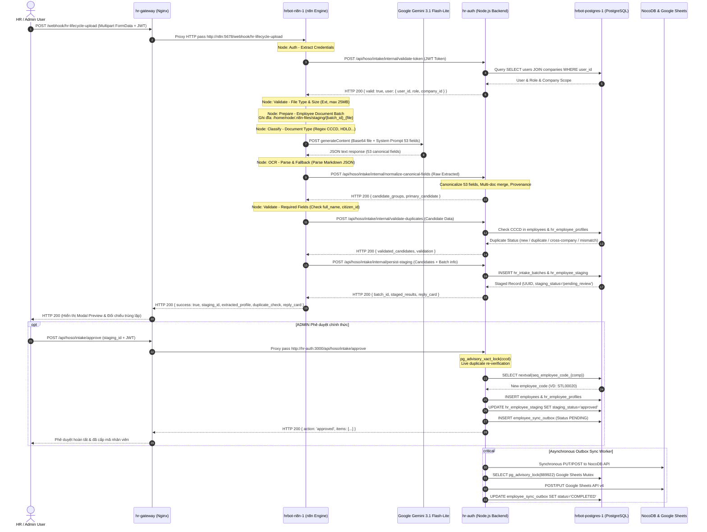

# SOTRANS HUB — BÁO CÁO KIỂM TRA TOÀN DIỆN KIẾN TRÚC CHỨC NĂNG UPLOAD HỒ SƠ NHÂN SỰ
## ĐỐI SOÁT KIẾN TRÚC N8N vs AUTH-SERVICE TRÊN MÔI TRƯỜNG PRODUCTION DOCKER

> **Ngày thực hiện kiểm tra:** 12/11/2026  
> **Workspace:** `D:\hoso-chat`  
> **Chế độ kiểm tra:** READ-ONLY SOURCE CODE & WORKFLOW INVESTIGATION  
> **Thực thể kiểm tra:** Production Docker Runtime, PostgreSQL Database (`hrbot`), n8n Production Engine (`hrbot-n8n-1`), Backend Service (`hr-auth`), Nginx Gateway (`hr-gateway`), Frontend Admin & Chat Interfaces.  
> **Người thực hiện:** Antigravity Architecture Audit Specialist (Google DeepMind Team)

---

## MỤC LỤC
1. [Tổng quan chức năng Upload hồ sơ nhân sự](#1-tổng-quan-chức-năng-upload-hồ-sơ-nhân-sự)
2. [Kiến trúc tổng thể hiện tại](#2-kiến-trúc-tổng-thể-hiện-tại)
3. [Sơ đồ Mermaid đường đi của Request](#3-sơ-đồ-mermaid-đường-đi-của-request)
4. [Truy vết chi tiết luồng Upload qua 11 bước](#4-truy-vết-chi-tiết-luồng-upload-qua-11-bước)
5. [Phân tích trách nhiệm riêng của n8n](#5-phân-tích-trách-nhiệm-riêng-của-n8n)
6. [Phân tích trách nhiệm riêng của auth-service](#6-phân-tích-trách-nhiệm-riêng-của-auth-service)
7. [Bảng phân định trách nhiệm chi tiết (RACI Matrix)](#7-bảng-phân-định-trách-nhiệm-chi-tiết)
8. [Danh mục API nội bộ và cơ chế bảo vệ](#8-danh-mục-api-nội-bộ-và-cơ-chế-bảo-vệ)
9. [Danh mục 33 node trong Workflow SOTRANS_HR_EMPLOYEE_LIFECYCLE](#9-danh-mục-33-node-trong-workflow-sotrans_hr_employee_lifecycle)
10. [Phân tích lưu trữ file, Staging và dữ liệu nhân sự](#10-phân-tích-lưu-trữ-file-staging-và-dữ-liệu-nhân-sự)
11. [Phân tích cơ chế phê duyệt, cấp mã nhân viên và đồng bộ sau phê duyệt](#11-phân-tích-cơ-chế-phê-duyệt-cấp-mã-nhân-viên-và-đồng-bộ-sau-phê-duyệt)
12. [Đối soát sự trùng lặp và phụ thuộc (Giải đáp 12 câu hỏi cốt lõi)](#12-đối-soát-sự-trùng-lặp-và-phụ-thuộc-12-câu-hỏi-cốt-lõi)
13. [Các node và API không cần thiết / có khả năng dư thừa](#13-các-node-và-api-không-cần-thiết--có-khả-năng-dư-thừa)
14. [Những rủi ro, điểm yếu và bất cập kiến trúc hiện hữu](#14-những-rủi-ro-điểm-yếu-và-bất-cập-kiến-trúc-hiện-hữu)
15. [Đề xuất kiến trúc phân công trách nhiệm tối ưu](#15-đề-xuất-kiến-trúc-phân-công-trách-nhiệm-tối-ưu)
16. [Kết luận chung: n8n và auth-service có cần cùng tồn tại không?](#16-kết-luận-chung-n8n-và-auth-service-có-cần-cùng-tồn-tại-không)

---

## 1. TỔNG QUAN CHỨC NĂNG UPLOAD HỒ SƠ NHÂN SỰ

Chức năng **Upload hồ sơ nhân sự (HR Intake & Onboarding)** là phân hệ tự động hóa đầu vào cốt lõi của SOTRANS Hub. Hệ thống tiếp nhận các tệp hồ sơ scan dạng hình ảnh hoặc tài liệu điện tử (CCCD gắn chip, VNeID, Hợp đồng lao động, Quyết định bổ nhiệm/tuyển dụng, Giấy khám sức khỏe, Sơ yếu lý lịch, Bằng cấp chứng chỉ...) của người lao động thuộc 3 đơn vị thành viên:
- **STL**: SOTRANS Logistics
- **SWC**: Tổng Công ty Cổ phần Đường Sông Miền Nam (Sowatco)
- **VTX**: Công ty Cổ phần Vận tải Đa phương thức (Vietranstimex)

### Yêu cầu vận hành thực tế:
1. Tiếp nhận tài liệu đa định dạng (PDF, PNG, JPG, JPEG, DOCX...) với kích thước tối đa 25MB/tệp.
2. Trích xuất tự động **53 trường dữ liệu chuẩn hóa (`CANONICAL_53_FIELDS`)** thông qua mô hình AI Gemini Vision đa phương thức.
3. Hợp nhất tài liệu đa chứng từ (Multi-document Dossier Merging): Gom nhóm nhiều file của cùng một ứng viên (dựa theo CCCD hoặc Họ tên + Ngày sinh) và giải quyết xung đột thông tin theo ma trận ưu tiên nguồn tài liệu (`FIELD_DOCUMENT_SOURCES`).
4. Kiểm soát chống trùng lặp định danh (CCCD 9 số / 12 số) trên toàn bộ CSDL 3 đơn vị thành viên; ngăn chặn tuyệt đối việc ghi đè trái phép nhân sự đang hoạt động hoặc bỏ qua cảnh báo lệch công ty.
5. Duy trì phân tách nhiệm vụ (Separation of Duties - SoD): Chuyên viên Nhân sự (HR) chỉ có quyền tải lên và trình duyệt (`pending_approval`); chỉ có Quản trị viên (`ADMIN` / `SUPER_ADMIN`) mới có thẩm quyền phê duyệt chính thức (`approved`).
6. Cấp mã nhân viên tự động không trùng lặp dựa trên PostgreSQL Sequence (`seq_employee_code_stl`, `seq_employee_code_swc`, `seq_employee_code_vtx`).
7. Đồng bộ dữ liệu sang NocoDB và Google Sheets thông qua mô hình hàng đợi Outbox (`employee_sync_outbox`) và Khóa giao dịch phân tán (`pg_advisory_lock`), đảm bảo tính toàn vẹn và không thất thoát dữ liệu.

---

## 2. KIẾN TRÚC TỔNG THỂ HIỆN TẠI

Hệ thống hiện tại được tổ chức theo mô hình **Hybrid Orchestration (Điều phối lai giữa n8n Workflow Engine và Node.js Backend Microservice)** chạy trên nền tảng Docker:

```
[ Trình duyệt Web / Client ]
      │  ▲
      │  │  (HTTPS / HTTP Port 8082)
      ▼  │
┌────────────────────────────────────────────────────────┐
│  hr-gateway (Nginx:alpine)                              │
│  - /webhook/hr-lifecycle-upload ──► n8n:5678           │
│  - /api/hoso/intake/*           ──► hr-auth:3000       │
│  - /api/employees/*             ──► hr-auth:3000       │
│  - /chat/api                    ──► hr-auth:3000       │
└────────────────────────────────────────────────────────┘
         │                                    ▲
         │ (HTTP Multipart)                   │
         ▼                                    │
┌───────────────────────────────┐             │
│  hrbot-n8n-1 (n8n Engine)     │             │
│  Workflow:                    │             │
│  SOTRANS_HR_EMPLOYEE_LIFECYCLE│             │
│  (33 Nodes Active)            │             │
│  - Lưu file tạm               │             │
│  - Gọi Google Gemini OCR      │             │
│  - Gọi 5 Internal APIs        │             │
└──────┬────────────────────────┘             │
       │                                      │
       │ (Internal HTTP with Shared Secret)   │
       ▼                                      │
┌─────────────────────────────────────────────┴──────────┐
│  hr-auth (Node.js 20 Backend Service)                  │
│  - routes/intake.js                                    │
│  - routes/employees.js                                 │
│  - services/hrSchemaDictionary.js                      │
│  - services/intakeValidator.js                         │
│  - services/syncWorker.js                              │
└──────┬───────────────────────────────┬─────────────────┘
       │                               │
       │ (SQL / ACID / Locks)          │ (REST API)
       ▼                               ▼
┌───────────────────────────────┐  ┌─────────────────────┐
│  hrbot-postgres-1             │  │  nocodb (Port 8081) │
│  (PostgreSQL 16)              │  └─────────────────────┘
│  - hr_employee_staging        │              ▲
│  - hr_intake_batches          │              │ (Outbox)
│  - employees                  │  ┌───────────┴─────────┐
│  - hr_employee_profiles       │  │  Google Sheets      │
│  - employee_sync_outbox       │  │  Spreadsheet API v4 │
│  - sequences STL/SWC/VTX      │  └─────────────────────┘
└───────────────────────────────┘
```

### Hạ tầng Runtime thực tế (Đã kiểm tra bằng Docker CLI):
- **Nginx (`hr-gateway`)**: Định tuyến request ngoại vi tại port `8082`.
- **n8n Container (`hrbot-n8n-1`)**: Image `n8nio/n8n:latest`, expose port `5679->5678`.
- **Backend Container (`hr-auth`)**: Image `node:20-alpine`, expose port `3000->3000`.
- **PostgreSQL Container (`hrbot-postgres-1`)**: Image `postgres:16`, expose port `5432->5432`.
- **Shared Volume**: Host path `./files` được mount đồng thời vào:
  + `hrbot-n8n-1`: `/home/node/.n8n-files`
  + `hr-auth`: `/app/chat-files`
  + `hr-gateway`: `/usr/share/nginx/chat-files`

---

## 3. SƠ ĐỒ MERMAID ĐƯỜNG ĐI CỦA REQUEST

Sơ đồ thể hiện chính xác đường đi thực tế của gói dữ liệu upload từ giao diện người dùng qua các thành phần hạ tầng:



---

## 4. TRUY VẾT CHI TIẾT LUỒNG UPLOAD QUA 11 BƯỚC

### BƯỚC 1 — FRONTEND TIẾP NHẬN HỒ SƠ
- **Giao diện 1: Trang quản trị nhân sự (`chat/hr-admin.html`)**:
  + Tại dòng `7928-7950`: Hàm `submitEmployeeUploadFiles()` đóng gói tệp vào đối tượng `FormData`:
    * Append từng tệp vào key `file`.
    * Thêm trường `event_type = "HR_UPLOAD"`, `source = "HR_ADMIN_PORTAL"`.
    * Đính kèm `company_id` từ dropdown của Admin.
    * Sinh `correlation_id` (`corr_admin_<timestamp>_<random>`) và `idempotency_key` (`idem_admin_<timestamp>_<random>`).
    * Gửi request `POST` trực tiếp tới URL: `/webhook/hr-lifecycle-upload`.
    * Gắn header: `Authorization: Bearer <jwt>`, `X-Correlation-Id`, `Idempotency-Key`.
- **Giao diện 2: Giao diện Chatbot (`chat/index.html`)**:
  + Tại dòng `11945-11954`: Khi người dùng đính kèm file trong ô chat:
    * Biến `isFileUpload = files && files.length > 0` được kích hoạt.
    * Biến URL được gán: `const uploadUrl = isFileUpload ? '/webhook/hr-lifecycle-upload' : '/chat/api';`.
    * Append file theo key `file_0`, `file_1`...
    * Gửi `POST` tới `/webhook/hr-lifecycle-upload` với header `Authorization: Bearer <jwt>`.
- **Trạng thái đối soát:** **CONFIRMED** (Trích xuất trực tiếp mã nguồn `hr-admin.html` dòng 7942 và `index.html` dòng 11946).

### BƯỚC 2 — GATEWAY TIẾP NHẬN REQUEST
- **Cấu hình Nginx (`nginx/default.conf`)**:
  + Dòng `89-101`:
    ```nginx
    location /webhook/ {
      auth_basic off;
      proxy_pass http://n8n:5678/webhook/;
      proxy_http_version 1.1;
      proxy_connect_timeout 900s;
      proxy_read_timeout 900s;
      proxy_send_timeout 900s;
    }
    ```
  + Dòng `84-87`: Nginx chủ động chặn truy cập trực tiếp tới webhook chatbot:
    `location ~* ^/webhook/hoso-chat { return 403 '{"error": "403 Forbidden: Direct webhook access to hoso-chat prohibited..."}'; }`
  + Dòng `78-81`: Nginx chặn truy cập trực tiếp webhook policy:
    `location = /webhook/hr-policy-chat { return 403; }`
- **Đánh giá định tuyến:**
  + Mọi request upload `/webhook/hr-lifecycle-upload` được Nginx chuyển tiếp **trực tiếp** vào cổng `5678` của container `n8n` mà **không đi qua backend `auth-service` trước**.
  + Nginx không giải mã JWT token tại lớp gateway, chuyển toàn bộ header `Authorization` cho n8n tiếp nhận.
- **Trạng thái đối soát:** **CONFIRMED** (Kiểm tra file cấu hình thực tế `nginx/default.conf`).

### BƯỚC 3 — XÁC THỰC NGƯỜI DÙNG & KIỂM TRA PHÂN QUYỀN
- **Tại n8n Engine (`SOTRANS_HR_EMPLOYEE_LIFECYCLE`)**:
  + Node `Trigger HR_UPLOAD`: Tiếp nhận HTTP Request từ Nginx.
  + Node `Auth - Extract Credentials` (Code Node):
    * Trích xuất JWT token từ header `authorization`, `x-auth-token` hoặc body.
    * Trích xuất `correlation_id`, `idempotency_key`, `company_id`.
    * Chuẩn bị secret nội bộ: `"8973d464f5f1475b83d6ab88d222d824"`.
  + Node `Validate - Authentication & Authorization` (HTTP Request Node):
    * Gửi request nội bộ: `POST http://hr-auth:3000/api/hoso/intake/internal/validate-token`.
    * Body JSON: `{ token, requested_company_id, secret }`.
- **Tại Backend `auth-service/routes/intake.js` (dòng 4241-4329)**:
  + Middleware `verifyInternalAuth`: Kiểm tra shared secret (`x-internal-secret` hoặc body `secret`). Chặn 401 nếu sai secret.
  + Giải mã JWT bằng `jsonwebtoken.verify(token, JWT_SECRET)`.
  + Truy vấn PostgreSQL bảng `users` JOIN `companies` và `employees`: Kiểm tra tài khoản tồn tại và có `status === 'ACTIVE'`.
  + Kiểm tra quyền nghiệp vụ: `hasPermission(user.role, 'hr.intake.upload')`. Chặn 403 nếu vai trò không có quyền upload.
  + Kiểm tra Tenant Isolation:
    * Nếu role là `ADMIN` hoặc `SUPER_ADMIN`: Được phép chỉ định `company_id` là `STL`, `VTX`, `SWC`.
    * Nếu role là `HR`: Bắt buộc `requested_company_id` phải trùng khớp với `user.company_id`. Chặn 403 nếu HR đơn vị này tải hồ sơ cho đơn vị khác.
  + Trả về thông tin danh tính xác thực: `{ success: true, valid: true, user: { user_id, username, role, company_id } }`.
- **Node `IF Auth Valid?`**: Nếu không hợp lệ, chuyển sang `Respond Auth Error` (HTTP 401/403) và gọi `Audit - Log Intake Error`.
- **Trạng thái đối soát:** **CONFIRMED** (Source code `intake.js` dòng 4241-4329).

### BƯỚC 4 — TIẾP NHẬN VÀ XỬ LÝ FILE
- **Node `Validate - File Type & Size` (Code Node trong n8n)**:
  + Kiểm tra danh sách file trong input binary (`keys = Object.keys(bin)`). Chặn 400 nếu rỗng.
  + Whitelist định dạng: `['pdf', 'png', 'jpg', 'jpeg', 'webp', 'tiff', 'docx', 'xlsx', 'txt', 'doc']`. Chặn 400 nếu file có đuôi không thuộc whitelist.
  + Giới hạn kích thước: `maxFileSize = 25 * 1024 * 1024` (25MB). Chặn 400 nếu vượt quá.
- **Node `Prepare - Employee Document Batch` (Code Node trong n8n)**:
  + Sinh `batch_id = crypto.randomUUID()` (nếu request chưa có).
  + Định vị thư mục lưu trữ: `stagingDir = '/home/node/.n8n-files/staging'`. Tự tạo thư mục nếu chưa có.
  + Đọc buffer file thông qua `this.helpers.getBinaryDataBuffer()` hoặc `Buffer.from(b.data, 'base64')`.
  + **Ghi file vật lý xuống đĩa**:
    `const safeFileName = batchId + '_' + cleanBase;`
    `fs.writeFileSync(diskPath, fileBuf);`
  + Đường dẫn này nằm trong shared volume `./files/staging/`, tương ứng với `/app/chat-files/staging/` trên container `hr-auth`.
  + Tạo cấu trúc JSON chứa `fileStoragePath: '/app/chat-files/staging/' + safeFileName` và `base64Data`.
- **Node `Classify - Document Type` (Code Node trong n8n)**:
  + Dùng Regex trên tên file (`fileName`):
    * `/cccd|can cuoc|cmnd|dinh danh|citizen/i` ──► `CCCD_VNEID`
    * `/bhyt|bao hiem y te/i` ──► `BHYT`
    * `/kham suc khoe|ksk/i` ──► `GIAY_KHAM_SUC_KHOE`
    * `/so yeu ly lich|syll/i` ──► `SO_YEU_LY_LICH`
    * `/hop dong|hdld/i` ──► `HOP_DONG_LAO_DONG`
    * `/quyet dinh|qd|bo nhiem/i` ──► `QUYET_DINH_TUYEN_DUNG`...
  + Tách lô thành từng item độc lập để đưa vào node OCR.
- **Trạng thái đối soát:** **CONFIRMED** (Kiểm tra mã JavaScript trong các node của workflow production).

### BƯỚC 5 — OCR VÀ TRÍCH XUẤT DỮ LIỆU BẰNG GEMINI AI
- **Node `OCR - Gemini Extraction` (HTTP Request Node trong n8n)**:
  + URL được gọi trực tiếp: `https://generativelanguage.googleapis.com/v1beta/models/gemini-3.1-flash-lite:generateContent`.
  + Cơ chế xác thực: Query parameter `key` lấy từ biến môi trường `GEMINI_API_KEY` (hoặc header).
  + Payload:
    * `contents[0].parts[0].inline_data`: Chứa `mime_type` và dữ liệu `base64Data` của file PDF/ảnh scan.
    * `systemInstruction`: Quy định nghiêm ngặt danh mục **53 trường dữ liệu chuẩn hóa của SOTRANS**, yêu cầu trả về duy nhất định dạng JSON RFC-8259, không thêm giải thích hay định dạng markdown bọc ngoài nếu không cần thiết.
  + Đánh giá kiến trúc: **OCR hoàn toàn chạy từ n8n gọi Gemini Cloud API, Backend auth-service không tham gia bước này.**
- **Node `OCR - Parse & Fallback` (Code Node trong n8n)**:
  + Lấy text phản hồi từ Gemini (`candidates[0].content.parts[0].text`).
  + Parse chuỗi JSON bằng Regex bóc tách khối ` ```json ... ``` ` hoặc fallback text sạch.
  + Gom nhóm các file đã xử lý (`processed_files`) trong cùng một lô (`batch_id`).
- **Trạng thái đối soát:** **CONFIRMED** (Node ID `ocr-gemini-extract` và `ocr-parse-fallback` trong workflow production).

### BƯỚC 6 — CHUẨN HÓA DỮ LIỆU NHÂN SỰ (CANONICAL NORMALIZATION)
- **Node `Normalize - Canonical Employee Fields` (HTTP Request Node trong n8n)**:
  + n8n không tự chuẩn hóa 53 trường trên n8n runtime mà gọi API backend:
    `POST http://hr-auth:3000/api/hoso/intake/internal/normalize-canonical-fields`
  + Gửi kèm `batch_id` và mảng `files: processed_files`.
- **Thực thi tại Backend (`auth-service/routes/intake.js:4343-4600`)**:
  1. **Ánh xạ Alias (`FIELD_ALIASES`)**: Chuẩn hóa các tên trường do Gemini sinh ra về đúng 53 trường chính tắc của `hrSchemaDictionary.js`.
  2. **Chuẩn hóa giá trị trường (`normalizeFieldValue`)**: Chuẩn hóa ngày tháng (`YYYY-MM-DD`), tiền tệ/lương (loại bỏ ký tự không phải số), giới tính (`NAM`/`NU`/`KHAC`), định dạng địa chỉ.
  3. **Chuẩn hóa CCCD (`standardizeAndValidateCccd`)**: Kiểm tra 9 số hoặc 12 số, loại bỏ ký tự rác, kiểm tra tính hợp lệ toán học.
  4. **Ghép hồ sơ đa chứng từ (Multi-Document Dossier Merging)**:
     - Nhóm các tệp tin theo ứng viên (`candidateGroups`) dựa vào số CCCD hoặc Họ tên không dấu (`removeAccents`) kết hợp Ngày sinh (`date_of_birth`).
     - Khi một trường xuất hiện trên nhiều tài liệu (ví dụ Họ tên có trên cả CCCD và CV), backend dùng ma trận ưu tiên `FIELD_DOCUMENT_SOURCES`:
       + Trường định danh (Họ tên, Ngày sinh, CCCD, Quê quán): Ưu tiên `CCCD_VNEID`.
       + Trường chuyên môn (Bằng cấp, Chuyên ngành): Ưu tiên `BANG_CAP_CHUNG_CHI`.
       + Trường chức vụ, phòng ban, lương: Ưu tiên `HOP_DONG_LAO_DONG`, `QUYET_DINH_TUYEN_DUNG`.
     - Nếu có giá trị khác nhau giữa các nguồn tài liệu, backend tự động ghi nhận vào cấu trúc `conflicts[field]` gồm `{ source, docType, value }`.
     - Ghi nhận nguồn gốc từng trường vào cấu trúc `provenance[field] = { fileName, docType }`.
  5. **Ghi nhận trường thiếu / không chắc chắn**:
     - Theo dõi `missingFields` (bắt buộc: `full_name`, `citizen_id`).
     - Theo dõi `uncertainFields` và `unreadableFields`.
  6. **Nhận diện công ty (`detectCompany`)**: Quét từ khóa pháp nhân (Sowatco, Vietranstimex, Sotrans Logistics, VTX, SWC, STL) trong nội dung trích xuất và văn bản gốc để xác định `company_id`, `company_status` (`confirmed`, `suggested`, `conflict`, `unknown`).
- **Trạng thái đối soát:** **CONFIRMED** (Mã nguồn `intake.js` dòng 4343-4600 và `hrSchemaDictionary.js`).

### BƯỚC 7 — KIỂM TRA TÍNH HỢP LỆ VÀ TRÙNG LẶP (DUPLICATE VALIDATION)
- **Node `Validate - Required Fields` (Code Node trong n8n)**:
  + Kiểm tra sơ bộ: Nếu `full_name` hoặc `citizen_id` bị thiếu, gắn cờ `missing_required`.
- **Node `Validate - Citizen ID & Duplicate` (HTTP Request Node trong n8n)**:
  + Gửi yêu cầu sang backend: `POST http://hr-auth:3000/api/hoso/intake/internal/validate-duplicates`.
- **Thực thi tại Backend (`auth-service/routes/intake.js:4614-4703`)**:
  + Gọi hàm `validateStagingProfile()` trong `auth-service/services/intakeValidator.js`.
  + Gọi `checkDatabaseCccdDuplicates()` đối chiếu số CCCD với CSDL PostgreSQL:
    * Truy vấn kiểm tra trên bảng `employees` và `hr_employee_profiles`.
    * Phân loại trùng lặp:
      1. `ACTIVE_SAME_COMPANY_DUPLICATE`: Trùng CCCD với nhân sự đang hoạt động cùng đơn vị ──► Chặn tạo mới, gợi ý cập nhật hồ sơ (`update_profile`).
      2. `CROSS_COMPANY_DUPLICATE`: Trùng CCCD với nhân sự thuộc đơn vị thành viên khác (ví dụ: Nhân sự đã có ở STL nhưng SWC lại nộp hồ sơ mới) ──► Chặn tuyệt đối, yêu cầu thủ tục điều chuyển nội bộ (`INTERNAL_TRANSFER_REQUIRED`).
      3. `SOFT_DELETED_SAME_COMPANY`: Trùng CCCD với hồ sơ đã bị xóa mềm (`is_deleted = true` hoặc `status = 'DELETED'`) ──► Gợi ý khôi phục hồ sơ (`restore_proposal`).
      4. `RESIGNED_SAME_COMPANY`: Trùng CCCD với nhân sự đã nghỉ việc (`status = 'RESIGNED'`) ──► Gợi ý tiếp nhận lại / tái ký hợp đồng (`rehire_proposal`).
      5. `IDENTITY_MISMATCH`: Trùng số CCCD nhưng Họ và tên khác biệt hoàn toàn ──► Báo động đỏ giả mạo/sai lệch giấy tờ, chặn duyệt.
  + Kiểm tra xung đột đơn vị (Company Mismatch): Nếu hồ sơ mang dấu pháp lý công ty A nhưng tài khoản nộp thuộc công ty B ──► Gắn cờ `company_status = 'conflict'`, yêu cầu xác nhận công ty trước khi duyệt.
  + Xây dựng Metadata lược đồ chi tiết qua `buildSchemaMetadata()`.
- **Trạng thái đối soát:** **CONFIRMED** (Mã nguồn `intakeValidator.js` và `intake.js` dòng 4614-4703).

### BƯỚC 8 — LƯU DỮ LIỆU VÀO VÙNG TẠM (STAGING PERSISTENCE)
- **Node `Persist - Employee Staging` (HTTP Request Node trong n8n)**:
  + Gửi payload sang backend: `POST http://hr-auth:3000/api/hoso/intake/internal/persist-staging`.
  + Payload: `{ batch_id, correlation_id, idempotency_key, conversation_id, user, candidates, secret }`.
- **Thực thi tại Backend (`auth-service/routes/intake.js:4706-4850`)**:
  + **Kiểm tra Idempotency (Chống tạo bản ghi trùng lặp khi retry/replay request)**:
    ```sql
    SELECT s.* FROM hr_employee_staging s 
    JOIN hr_intake_batches b ON s.batch_id = b.id 
    WHERE b.n8n_execution_id = $1 OR b.n8n_execution_id = $2
    ```
    Nếu phát hiện `idempotency_key` hoặc `correlation_id` đã tồn tại, backend **không INSERT lại**, mà trả về ngay bản ghi hiện có kèm cờ `idempotency_replayed: true`.
  + **Ghi thông tin lô vào bảng `hr_intake_batches`**:
    * Lưu `id = batch_id`, `company_id`, `uploaded_by`, `uploaded_by_user_id`, `total_files`, `file_manifest`, `status = 'completed'`, `n8n_execution_id = idempotency_key`.
  + **Ghi thông tin từng ứng viên vào bảng `hr_employee_staging`**:
    * Lưu `batch_id`, `conversation_id`, `file_name`, `file_storage_path`, `file_size`, `mime_type`.
    * Lưu dữ liệu định danh: `full_name`, `citizen_id`, `employee_code`, `date_of_birth`, `gender`...
    * Lưu trạng thái: `staging_status = 'pending_review'`.
    * Lưu cờ cảnh báo: `missing_fields`, `uncertain_fields`, `suspected_duplicate`, `duplicate_reason`.
    * Lưu toàn bộ 53 trường dữ liệu JSON vào cột `extracted_data` (JSONB).
    * Lưu chế độ tiếp nhận: `intake_mode` (`new_profile`, `update_profile`, `restore_proposal`, `company_mismatch`, `insufficient_data`).
    * Trả về danh sách bản ghi Staging đã lưu (`staged_results`) kèm giao diện thẻ phản hồi Markdown/HTML (`reply_card`).
- **Khẳng định dứt khoát về quyền ghi DB**: **n8n hoàn toàn KHÔNG có node PostgreSQL nào trong nhánh upload, n8n KHÔNG ghi CSDL trực tiếp mà 100% việc lưu trữ CSDL do Backend auth-service thực thi thông qua API `/persist-staging`.**
- **Trạng thái đối soát:** **CONFIRMED** (Kiểm tra node n8n và source code `intake.js:4706-4850`).

### BƯỚC 9 — TRẢ KẾT QUẢ UPLOAD VỀ CLIENT
- **Node `Respond - Upload Result` (Respond to Webhook Node trong n8n)**:
  + Đóng gói kết quả HTTP 200 JSON gửi về cho client:
    * `success: true`
    * `batch_id`, `staging_id`
    * `file_name`, `company_id`
    * `intake_mode`
    * `extracted_profile`: Chứa thông tin 24 trường chính phục vụ hiển thị form xem trước.
    * `duplicate_check`: Chi tiết trạng thái trùng lặp, lý do, và thông tin nhân sự bị trùng nếu có.
    * `missing_fields`, `uncertain_fields`, `unreadable_fields`
    * `reply_card`: Đoạn mã giao diện preview hiển thị trong khung chatbot.
- **Frontend tiếp nhận kết quả (`chat/hr-admin.html:7971`)**:
  + Tắt thanh tiến trình upload.
  + Gọi hàm `displayOcrReviewStep(data)`:
    * Mở Modal `empUploadOcrDlg` ("📋 Kết quả Bóc tách OCR & Kiểm tra Chống Trùng lặp").
    * Điền tự động các giá trị đã bóc tách vào các ô input form.
    * Nếu `duplicate_check.is_duplicate === true`: Hiển thị Banner cảnh báo màu vàng/đỏ, chỉ rõ trùng với nhân sự nào, mã nhân viên nào và khuyến nghị cập nhật hồ sơ thay vì tạo mới.
    * Người dùng HR/Admin có thể kiểm tra mắt, chỉnh sửa các trường sai lệch trước khi bấm Xác nhận lưu.
- **Trạng thái đối soát:** **CONFIRMED** (Source code `hr-admin.html` dòng 7971-8080).

### BƯỚC 10 — PHÊ DUYỆT VÀ KÍCH HOẠT HỒ SƠ CHÍNH THỨC
- **Quy trình phê duyệt thực tế**:
  + **Cách 1: Từ Modal xác nhận OCR (`chat/hr-admin.html:8296`)**:
    * Bấm nút "💾 Xác nhận & Lưu hồ sơ mới" hoặc "🔄 Cập nhật hồ sơ".
    * Gọi API: `POST /api/employees/confirm-ocr`.
    * Backend `auth-service/routes/employees.js:1103`:
      - Nếu user là `HR`: Bản ghi Staging được cập nhật trạng thái `pending_approval`, KHÔNG được tạo nhân viên chính thức ngay.
      - Nếu user là `ADMIN`: Gọi hàm `executeStagingApproval()` để duyệt và đưa thẳng vào CSDL chính thức.
  + **Cách 2: Từ Tab "Tiếp nhận & Duyệt hồ sơ Staging" (`chat/hr-admin.html:9155`)**:
    * Admin tích chọn các hồ sơ có trạng thái `pending_approval` hoặc `pending_review` và nhấn "Phê duyệt".
    * Gọi API: `POST /api/hoso/intake/approve`.
    * Backend `auth-service/routes/intake.js:1469`:
      - Kiểm tra quyền `hr.intake.approve` (chỉ ADMIN / SUPER_ADMIN).
      - Chặn tuyệt đối hồ sơ có `intake_mode === 'company_mismatch'` hoặc `suspected_duplicate === true`.
      - Chặn duyệt nếu thiếu thông tin định danh bắt buộc (`full_name`, `citizen_id` hợp lệ).
- **Thực thi giao dịch ACID trong `executeStagingApproval()` (`intake.js:420-1136`)**:
  1. `client.query('BEGIN')`.
  2. Khóa chống chạy đua giao dịch CCCD: `SELECT pg_advisory_xact_lock(hashtext('cccd:' || cleanCitizen))`.
  3. Kiểm tra lại trùng lặp trực tiếp trong transaction (Live re-verification).
  4. Cấp mã nhân viên tự động nếu chưa có:
     `officialCode = await generateNextEmployeeCode(client, comp)`
     Lấy từ sequence: `seq_employee_code_stl`, `seq_employee_code_swc`, hoặc `seq_employee_code_vtx`. Định dạng: `STLxxxxx`, `SWCxxxxx`, `VTXxxxxx` (5 chữ số có leading zero, đảm bảo tính duy nhất và concurrency-safe).
  5. Tạo hoặc liên kết thực thể con người trong bảng `hr_persons`.
  6. Mã hóa thông tin định danh và lưu vào `hr_person_identity_documents` (KMS Encryption, HMAC blind index, mask 6 số giữa).
  7. Ghi bản ghi quan hệ việc làm vào bảng `employees` (`status = 'ACTIVE'`).
  8. Ghi đầy đủ 53 trường dữ liệu vào bảng hồ sơ chi tiết `hr_employee_profiles`.
  9. Ghi nhận lịch sử tiếp nhận vào `hr_employment_history` (`event_type = 'ONBOARDING'`).
  10. Cập nhật trạng thái bản ghi staging:
      `UPDATE hr_employee_staging SET staging_status = 'approved', employee_code = officialCode, approver_username = user.username, approved_at = NOW() WHERE id = it.id`.
  11. `client.query('COMMIT')`.
- **Trạng thái đối soát:** **CONFIRMED** (Source code `intake.js` dòng 1469-1758 và `employees.js` dòng 1103-1424).

### BƯỚC 11 — ĐỒNG BỘ DỮ LIỆU SAU PHÊ DUYỆT (POST-APPROVAL SYNC)
- Sau khi giao dịch CSDL PostgreSQL COMMIT thành công tại dòng 1697 của `intake.js`:
- Backend gọi hàm `queueSyncTasks(stagingId)` trong `auth-service/services/syncWorker.js`:
  1. **Nguồn dữ liệu chuẩn (Single Source of Truth - SSOT)**: PostgreSQL (`hr_employee_profiles` & `employees`).
  2. **Bước 1 — Đồng bộ sang NocoDB**:
     - Gọi `syncToNocoDB(payload)` kết nối trực tiếp NocoDB REST API qua container `nocodb:8080`.
     - Tìm kiếm dòng tương ứng theo `employee_id` hoặc tạo dòng mới.
     - Đồng bộ toàn bộ 53 trường dữ liệu.
  3. **Bước 2 — Xếp hàng sự kiện Outbox cho Google Sheets**:
     - Sau khi NocoDB đồng bộ thành công, backend gọi `queueOutboxEvent()` ghi một bản ghi vào bảng `employee_sync_outbox` với trạng thái `PENDING`.
  4. **Bước 3 — Outbox Worker đồng bộ Google Sheets**:
     - Worker `processOutboxQueue()` được kích hoạt ngay lập tức (`setImmediate`).
     - Lấy khóa đơn luồng bảo vệ ghi Google Sheets: `SELECT pg_advisory_lock(889922)`.
     - Gọi Google Sheets API v4 (`https://sheets.googleapis.com/v4/spreadsheets/...`) qua token Google Service Account (`googleAuthHelper.js`).
     - Tìm dòng có mã nhân viên tương ứng trên trang tính `Trang tính1` để UPDATE hoặc APPEND dòng mới vào cuối bảng.
     - Cập nhật trạng thái bản ghi outbox thành `COMPLETED`.
- **Trạng thái đối soát:** **CONFIRMED** (Source code `syncWorker.js` dòng 600-830 và kiểm tra bảng `employee_sync_outbox` trong CSDL).

---

## 5. PHÂN TÍCH TRÁCH NHIỆM RIÊNG CỦA N8N

Trong phân hệ Upload hồ sơ nhân sự, **n8n đóng vai trò là Lớp điều phối Ingress và Gateway xử lý Trí tuệ Nhân tạo (Ingress & AI Processing Orchestrator)**:

### 1. Những việc n8n THỰC SỰ LÀM:
- **Tiếp nhận Webhook công khai**: Tiếp nhận multipart form data từ trình duyệt Nginx forward tới (`/webhook/hr-lifecycle-upload`).
- **Trích xuất thông tin vận chuyển**: Tách header, authorization token, correlation id, idempotency key.
- **Kiểm tra sơ bộ tệp tin**: Xác thực đuôi mở rộng (file extension) và dung lượng tệp (< 25MB) bằng JavaScript runtime.
- **Lưu trữ tệp tạm thời**: Đọc buffer và ghi file scan vào thư mục staging chia sẻ (`/home/node/.n8n-files/staging`).
- **Phân loại loại giấy tờ**: Dùng Regex trên tên file để nhận diện CCCD, Hợp đồng lao động, Quyết định tuyển dụng...
- **Điều phối mô hình OCR AI**: Tự động chuyển đổi file sang base64, gửi prompt bóc tách trực tiếp tới Google Gemini Cloud API (`gemini-3.1-flash-lite`).
- **Phân tách và làm sạch JSON OCR**: Parse kết quả trả về từ Gemini, xử lý lỗi cú pháp markdown code blocks.
- **Điều phối tuần tự các bước kiểm tra**: Đóng gói dữ liệu bóc tách và gọi tuần tự các API nội bộ của backend:
  1. `validate-token`
  2. `normalize-canonical-fields`
  3. `validate-duplicates`
  4. `persist-staging`
- **Trả kết quả tổng hợp cho giao diện**: Đóng gói phản hồi HTTP 200 gửi lại cho trình duyệt xem trước.

### 2. Những việc n8n TUYỆT ĐỐI KHÔNG LÀM:
- n8n **KHÔNG giải mã hoặc xác thực tính hợp lệ của JWT token** (ủy quyền 100% cho backend qua `/internal/validate-token`).
- n8n **KHÔNG kiểm tra quyền hạn RBAC** của người dùng trong CSDL.
- n8n **KHÔNG tự chuẩn hóa 53 trường dữ liệu** (ủy quyền cho backend `/internal/normalize-canonical-fields`).
- n8n **KHÔNG kiểm tra trùng lặp CCCD** trong CSDL (ủy quyền cho backend `/internal/validate-duplicates`).
- n8n **KHÔNG ghi dữ liệu trực tiếp vào PostgreSQL** (nhánh upload không có bất kỳ node Postgres nào, ủy quyền qua `/internal/persist-staging`).
- n8n **KHÔNG quản lý phê duyệt hồ sơ** (các node Approval trong n8n chỉ là stub).
- n8n **KHÔNG cấp mã nhân viên**.
- n8n **KHÔNG đồng bộ dữ liệu sang NocoDB và Google Sheets**.

---

## 6. PHÂN TÍCH TRÁCH NHIỆM RIÊNG CỦA AUTH-SERVICE

Backend `auth-service` (Node.js) đóng vai trò là **Hạt nhân Nghiệp vụ, Bảo mật, Quản lý Dữ liệu và Đồng bộ (Business Logic, Security, Persistence & Sync Core)**:

### 1. Những việc auth-service THỰC SỰ LÀM:
- **Xác thực và Phân quyền tập trung**:
  + Giải mã JWT bằng `JWT_SECRET`.
  + Kiểm tra trạng thái người dùng trong bảng `users`.
  + Kiểm tra quyền chi tiết (`hr.intake.upload`, `hr.intake.confirm_company`, `hr.intake.approve`, `hr.intake.submit`) qua bảng `role_permissions`.
  + Kiểm tra Tenant Isolation (công ty của user vs công ty của hồ sơ).
- **Chuẩn hóa dữ liệu nghiệp vụ 53 trường (`hrSchemaDictionary.js`)**:
  + Chuẩn hóa ngày tháng, tiền tệ, số điện thoại, giới tính, học vị.
  + Chuẩn hóa và làm sạch số CCCD 9 số / 12 số.
  + Hợp nhất hồ sơ đa chứng từ (Multi-document Dossier Merging).
  + Xử lý xung đột giá trị trường giữa các tài liệu (`conflicts`) theo ma trận nguồn ưu tiên (`FIELD_DOCUMENT_SOURCES`).
  + Theo dõi nguồn gốc chi tiết từng trường (`provenance`).
  + Gắn nhãn trường thiếu, trường không chắc chắn, trường không đọc được.
- **Kiểm tra toàn vẹn định danh và Chống trùng lặp (`intakeValidator.js`)**:
  + Đối soát CCCD với bảng `employees` và `hr_employee_profiles`.
  + Phân loại 5 cấp độ trùng lặp: Trùng cùng công ty đang hoạt động, trùng liên công ty (STL/VTX/SWC), trùng hồ sơ đã xóa mềm, trùng hồ sơ đã nghỉ việc, lệch danh tính Họ tên.
  + Phát hiện xung đột đơn vị (Company Mismatch).
- **Lưu trữ CSDL và Kiểm soát Idempotency (`intake.js`)**:
  + Chống ghi đè hoặc tạo bản ghi trùng lặp dựa trên `idempotency_key` và `n8n_execution_id`.
  + Ghi thông tin lô vào `hr_intake_batches`.
  + Ghi dữ liệu ứng viên vào `hr_employee_staging`.
- **Quản lý quy trình phê duyệt và phân tách nhiệm vụ (SoD)**:
  + Chặn HR phê duyệt chính thức (HR chỉ được submit `pending_approval`).
  + Cho phép ADMIN phê duyệt chính thức (`approved`).
  + Thực thi giao dịch ACID với Khóa cố vấn PostgreSQL (`pg_advisory_xact_lock`).
- **Phát sinh mã nhân viên chuẩn hóa**:
  + Lấy giá trị tự tăng an toàn đồng thời từ Sequence: `seq_employee_code_stl`, `seq_employee_code_swc`, `seq_employee_code_vtx`.
- **Mã hóa và Bảo mật thông tin định danh**:
  + Mã hóa số CCCD bằng thuật toán mã hóa khóa đối xứng KMS lưu vào `hr_person_identity_documents`.
  + Tạo HMAC Blind Index để tìm kiếm nhanh mà không để lộ số CCCD gốc.
  + Che mặt số CCCD (masking) khi hiển thị.
- **Chuyển đổi Staging sang Master Data**:
  + Ghi bản ghi vào `hr_persons`, `employees`, `hr_employee_profiles`, `hr_employment_history`, `hr_employment_documents`.
- **Đồng bộ dữ liệu đa hệ thống (`syncWorker.js`)**:
  + Đồng bộ trực tiếp NocoDB REST API.
  + Quản lý hàng đợi Outbox `employee_sync_outbox`.
  + Đồng bộ Google Sheets API v4 dưới Khóa Mutex phân tán `pg_advisory_lock(889922)`.
- **Lưu trữ và Truy xuất tệp tài liệu**:
  + Lưu file bổ sung khi HR cập nhật hồ sơ (`PUT /staging/:id`).
  + Phục vụ tải tệp scan cho người dùng (`GET /staging/:id/file`) qua cơ chế kiểm tra phân quyền và stream file an toàn.
- **Ghi nhật ký kiểm toán (Audit Logging)**:
  + Ghi nhận mọi hành động Upload, Block, Reject, Approve, Update vào bảng `audit_logs`.

---

## 7. BẢNG PHÂN ĐỊNH TRÁCH NHIỆM CHI TIẾT

Bảng đối soát trách nhiệm giữa các thành phần theo mã nguồn thực tế:

| Nghiệp vụ | Frontend | n8n | auth-service | PostgreSQL | Trạng thái xác minh |
|---|---|---|---|---|---|
| **Tiếp nhận file upload** | Gửi Multipart Form | Tiếp nhận Webhook (`/webhook/hr-lifecycle-upload`) | Cung cấp Legacy forwarder proxy | Không tham gia | **CONFIRMED** |
| **Xác thực JWT** | Gắn Header Bearer Token | Trích xuất token chuỗi | Trực tiếp decode, verify JWT secret | Truy vấn `users` kiểm tra ACTIVE | **CONFIRMED** |
| **Kiểm tra quyền Upload** | Ẩn/Hiện nút trên giao diện | Chuyển tiếp kiểm tra | Trực tiếp kiểm tra `hr.intake.upload` | Đọc bảng `role_permissions` | **CONFIRMED** |
| **Kiểm tra Tenant (STL/SWC/VTX)** | Cho phép chọn (Admin) | Chuyển tiếp `company_id` | Thực thi logic cô lập đa đơn vị | Đọc bảng `companies` | **CONFIRMED** |
| **Kiểm tra định dạng file** | Thuộc tính `accept` | Kiểm tra whitelist ext, max 25MB | Multer fileFilter & limits | Không tham gia | **CONFIRMED** |
| **Lưu file gốc lên đĩa** | Không tham gia | **Trực tiếp ghi đĩa** (`fs.writeFileSync`) | Lưu tệp bổ sung khi HR edit (`PUT`) | Lưu đường dẫn trong `file_storage_path` | **CONFIRMED** |
| **Phân loại giấy tờ** | Không tham gia | **Trực tiếp phân loại** (Regex tên file) | Có helper nhưng n8n không gọi | Không tham gia | **CONFIRMED** |
| **OCR Gemini Vision** | Không tham gia | **Trực tiếp gọi** Gemini Cloud API | Fallback endpoint bị vô hiệu hóa | Không tham gia | **CONFIRMED** |
| **Parse JSON OCR** | Không tham gia | **Trực tiếp parse** JSON markdown | Fallback parse text nếu thiếu | Không tham gia | **CONFIRMED** |
| **Chuẩn hóa 53 trường** | Không tham gia | Chỉ gọi HTTP chuyển tiếp | **Trực tiếp thực hiện 100%** (`hrSchemaDictionary`) | Không tham gia | **CONFIRMED** |
| **Hợp nhất đa chứng từ** | Không tham gia | Chỉ gửi mảng file đã OCR | **Trực tiếp nhóm & giải quyết xung đột** | Không tham gia | **CONFIRMED** |
| **Kiểm tra dữ liệu bắt buộc** | Form validation bước 2 | Node `Validate - Required Fields` | `validateStagingProfile` | Không tham gia | **CONFIRMED** |
| **Kiểm tra CCCD** | Hiển thị cảnh báo | Chỉ gọi HTTP chuyển tiếp | **Trực tiếp kiểm tra định dạng & checksum** | Không tham gia | **CONFIRMED** |
| **Kiểm tra trùng lặp CSDL** | Hiển thị Banner trùng | Chỉ gọi HTTP chuyển tiếp | **Trực tiếp đối soát 5 cấp độ trùng** | SELECT `employees`, `hr_employee_profiles` | **CONFIRMED** |
| **Chống trùng Idempotency** | Sinh `idempotency_key` | Chuyển tiếp key | **Trực tiếp kiểm tra `n8n_execution_id`** | Bảng `hr_intake_batches` | **CONFIRMED** |
| **Lưu hồ sơ Staging** | Không tham gia | Chỉ gọi HTTP chuyển tiếp | **Trực tiếp thực thi INSERT SQL** | Bảng `hr_employee_staging` | **CONFIRMED** |
| **Xem trước (Preview) hồ sơ** | Hiển thị Modal/Form | Chuyển tiếp HTML Card | Tạo dữ liệu & Render Preview Card | Đọc bảng `hr_employee_staging` | **CONFIRMED** |
| **Gửi yêu cầu phê duyệt** | Nút bấm gửi duyệt | Không tham gia | Cập nhật `staging_status='pending_approval'` | Bảng `hr_employee_staging` | **CONFIRMED** |
| **Phê duyệt hồ sơ** | Nút bấm phê duyệt | Stub webhook (không dùng) | **Trực tiếp thực thi ACID Transaction** | UPDATE Staging, INSERT Master tables | **CONFIRMED** |
| **Cấp mã nhân viên** | Không tham gia | Không tham gia | **Trực tiếp sinh mã qua hàm** | Tăng sequence `seq_employee_code_*` | **CONFIRMED** |
| **Ghi Audit Log** | Không tham gia | Gọi HTTP ghi lỗi | **Trực tiếp ghi nhận mọi sự kiện** | Bảng `audit_logs` | **CONFIRMED** |
| **Đồng bộ NocoDB** | Không tham gia | Stub webhook (không dùng) | **Trực tiếp gọi NocoDB API** | Ghi nhận task/outbox | **CONFIRMED** |
| **Đồng bộ Google Sheets** | Không tham gia | Stub webhook (không dùng) | **Trực tiếp chạy Outbox Worker + Mutex Lock** | Bảng `employee_sync_outbox` | **CONFIRMED** |
| **Lưu và truy xuất PDF gốc** | Tải qua link `/file` | Lưu file ban đầu | **Kiểm tra quyền và stream file** | Đọc `file_storage_path` từ DB | **CONFIRMED** |

---

## 8. DANH MỤC API NỘI BỘ VÀ CƠ CHẾ BẢO VỆ

Các API nội bộ được bố trí tại `auth-service/routes/intake.js` phục vụ riêng cho sự phối hợp giữa n8n và auth-service:

### 1. Cơ chế bảo vệ API nội bộ:
- Mọi route nội bộ (`/internal/*`) đều được bảo vệ bởi middleware `verifyInternalAuth`:
  ```javascript
  // auth-service/routes/intake.js:4230
  function verifyInternalAuth(req, res, next) {
    const expected = process.env.INTERNAL_SERVICE_SECRET || '8973d464f5f1475b83d6ab88d222d824';
    const incoming = req.headers['x-internal-secret'] || req.headers['x-n8n-internal-secret'] || req.body?.secret;
    if (incoming && incoming === expected) return next();
    return res.status(401).json({ success: false, error: '401 Unauthorized: Invalid internal secret' });
  }
  ```
- Biến môi trường sử dụng: `INTERNAL_SERVICE_SECRET` hoặc `N8N_INTERNAL_SECRET`.
- Ngăn chặn triệt để việc người dùng bên ngoài Internet giả mạo gọi vào các API nội bộ này (Nginx chỉ mở `/api/hoso/intake/*` cho các request xác thực và các route nội bộ đòi hỏi shared secret).

### 2. Bảng chi tiết các Endpoint nội bộ:

| Method | Endpoint | File & Dòng Code | Chức năng thực tế | Thành phần gọi |
|---|---|---|---|---|
| `POST` | `/api/hoso/intake/internal/validate-token` | `intake.js:4241` | Giải mã JWT, kiểm tra tài khoản, quyền upload và phạm vi công ty | n8n (`Validate - Authentication & Authorization`) |
| `POST` | `/api/hoso/intake/internal/classify-document` | `intake.js:4332` | Phân loại loại tài liệu theo tên file và text snippet | *Dư thừa* (n8n tự phân loại bằng regex) |
| `POST` | `/api/hoso/intake/internal/normalize-canonical-fields` | `intake.js:4343` | Chuẩn hóa 53 trường, gộp đa chứng từ, xử lý xung đột, ghi nhận provenance | n8n (`Normalize - Canonical Employee Fields`) |
| `POST` | `/api/hoso/intake/internal/validate-duplicates` | `intake.js:4614` | Đối soát trùng lặp CCCD 5 cấp độ, kiểm tra company mismatch | n8n (`Validate - Citizen ID & Duplicate`) |
| `POST` | `/api/hoso/intake/internal/persist-staging` | `intake.js:4706` | Kiểm tra idempotency, INSERT `hr_intake_batches` & `hr_employee_staging` | n8n (`Persist - Employee Staging`) |
| `POST` | `/api/hoso/intake/internal/audit-log` | `intake.js:4997` | Ghi nhận nhật ký sự cố intake vào bảng `audit_logs` | n8n (`Audit - Log Intake Error`) |
| `POST` | `/api/hoso/intake/internal/extract-text-fallback` | `intake.js:4904` | Trích xuất text thuần từ file văn bản | *Không sử dụng trong luồng chính* |
| `POST` | `/api/hoso/intake/internal/ocr-document` | `intake.js:4938` | OCR nội bộ tại backend | *Đã vô hiệu hóa* (`ENABLE_BACKEND_OCR_FALLBACK`) |
| `POST` | `/api/hoso/intake/internal/execute-batch-ocr` | `intake.js:5046` | Bóc tách batch OCR từ backend (Legacy) | *Dư thừa* (chỉ dùng cho workflow cũ 24 node) |
| `POST` | `/api/hoso/intake/internal/execute-sync-step` | `intake.js:5051` | Kích hoạt bước đồng bộ tuần tự | n8n (`Sync - Execute Sequential Step`) |
| `POST` | `/api/hoso/intake/internal/scan-failed-sync` | `intake.js:5069` | Quét các tác vụ đồng bộ thất bại | *Dư thừa* (chỉ dùng cho node Recovery cũ) |

---

## 9. DANH MỤC 33 NODE TRONG WORKFLOW SOTRANS_HR_EMPLOYEE_LIFECYCLE

Đối soát trực tiếp từ bản export runtime của container `hrbot-n8n-1` (Active: `true`, Version Counter: 1):

| STT | Tên Node | Loại Node (Type) | Chức năng chi tiết trong quy trình |
|---|---|---|---|
| 1 | **Sticky Note - HR Intake** | `n8n-nodes-base.stickyNote` | Chú thích sơ đồ quy trình Phase 2 |
| 2 | **Trigger Master Lifecycle** | `n8n-nodes-base.webhook` | Webhook đa năng nhận POST `/webhook/hr-employee-lifecycle` |
| 3 | **Trigger HR_UPLOAD** | `n8n-nodes-base.webhook` | **Webhook chính nhận POST `/webhook/hr-lifecycle-upload` từ Frontend** |
| 4 | **Trigger HR_APPROVAL** | `n8n-nodes-base.webhook` | Webhook nhận POST `/webhook/hr-lifecycle-approval` (Stub) |
| 5 | **Trigger HR_RETRY_SYNC** | `n8n-nodes-base.webhook` | Webhook nhận POST `/webhook/hr-lifecycle-sync` |
| 6 | **Authorize & Normalize Event** | `n8n-nodes-base.code` | Kiểm tra shared secret nội bộ, nhận diện `event_type` |
| 7 | **IF Authorized** | `n8n-nodes-base.if` | Rẽ nhánh: Nếu `isAuthorized === true` thì cho phép chạy tiếp |
| 8 | **Respond 401** | `n8n-nodes-base.respondToWebhook` | Phản hồi HTTP 401 Unauthorized khi sai/thiếu secret |
| 9 | **IF Upload?** | `n8n-nodes-base.if` | Phân luồng: Nếu `event_type === 'HR_UPLOAD'` chuyển sang nhánh Upload |
| 10 | **IF Approval?** | `n8n-nodes-base.if` | Phân luồng: Nếu `event_type === 'HR_APPROVAL'` chuyển sang nhánh Approval |
| 11 | **Approval - Audit & Record** | `n8n-nodes-base.code` | Tạo JSON xác nhận ghi nhận phê duyệt (Stub) |
| 12 | **Approval - Respond ACK** | `n8n-nodes-base.respondToWebhook` | Trả về HTTP 200 xác nhận phê duyệt (Stub) |
| 13 | **IF Sync?** | `n8n-nodes-base.if` | Phân luồng: Kiểm tra sự kiện đồng bộ tuần tự |
| 14 | **Sync - Execute Sequential Step** | `n8n-nodes-base.httpRequest` | Gọi backend `/internal/execute-sync-step` |
| 15 | **Sync - Respond Result** | `n8n-nodes-base.respondToWebhook` | Trả về kết quả đồng bộ HTTP 200 |
| 16 | **Auth - Extract Credentials** | `n8n-nodes-base.code` | **Lấy token Bearer, idempotency key, correlation id, company_id** |
| 17 | **Validate - Authentication & Authorization** | `n8n-nodes-base.httpRequest` | **Gọi backend `/internal/validate-token` xác thực JWT & quyền** |
| 18 | **IF Auth Valid?** | `n8n-nodes-base.if` | Rẽ nhánh: Hợp lệ ──► Bước tiếp; Không hợp lệ ──► Trả lỗi 401/403 |
| 19 | **Respond Auth Error** | `n8n-nodes-base.respondToWebhook` | Trả mã lỗi xác thực cho client |
| 20 | **Validate - File Type & Size** | `n8n-nodes-base.code` | **Kiểm tra định dạng file (whitelist) và dung lượng (<25MB)** |
| 21 | **IF Files Valid?** | `n8n-nodes-base.if` | Rẽ nhánh: File hợp lệ ──► Lưu đĩa; Không hợp lệ ──► Báo lỗi 400 |
| 22 | **Respond File Error** | `n8n-nodes-base.respondToWebhook` | Trả lỗi định dạng/dung lượng file cho client |
| 23 | **Prepare - Employee Document Batch** | `n8n-nodes-base.code` | **Ghi file vật lý vào `/home/node/.n8n-files/staging/`, encode Base64** |
| 24 | **Classify - Document Type** | `n8n-nodes-base.code` | **Phân loại hồ sơ bằng Regex (CCCD, HDLD...), tách từng file** |
| 25 | **OCR - Gemini Extraction** | `n8n-nodes-base.httpRequest` | **Gọi trực tiếp Gemini 3.1 Flash-Lite trích xuất 53 trường dữ liệu** |
| 26 | **OCR - Parse & Fallback** | `n8n-nodes-base.code` | **Parse JSON kết quả Gemini, gộp kết quả lô tệp tin** |
| 27 | **Normalize - Canonical Employee Fields** | `n8n-nodes-base.httpRequest` | **Gọi backend `/internal/normalize-canonical-fields` chuẩn hóa** |
| 28 | **Validate - Required Fields** | `n8n-nodes-base.code` | **Kiểm tra sơ bộ trường bắt buộc: Họ tên và CCCD** |
| 29 | **Validate - Citizen ID & Duplicate** | `n8n-nodes-base.httpRequest` | **Gọi backend `/internal/validate-duplicates` đối soát CSDL** |
| 30 | **Persist - Employee Staging** | `n8n-nodes-base.httpRequest` | **Gọi backend `/internal/persist-staging` lưu CSDL PostgreSQL** |
| 31 | **Respond - Upload Result** | `n8n-nodes-base.respondToWebhook` | **Trả về HTTP 200 JSON cho frontend hiển thị Modal xem trước** |
| 32 | **Audit - Log Intake Error** | `n8n-nodes-base.httpRequest` | Gọi backend `/internal/audit-log` ghi nhận lỗi khi upload hỏng |
| 33 | **Respond 400 - Invalid Event Type** | `n8n-nodes-base.respondToWebhook` | Báo lỗi khi nhận `event_type` không được hỗ trợ |

---

## 10. PHÂN TÍCH LƯU TRỮ FILE, STAGING VÀ DỮ LIỆU NHÂN SỰ

### 1. Cơ chế lưu trữ file gốc và phân quyền thư mục:
- File tải lên được lưu tại host path `./files/staging/` thông qua n8n tại node `Prepare - Employee Document Batch`.
- Đường dẫn lưu trữ được ghi nhận vào CSDL là: `/app/chat-files/staging/{batch_id}_{clean_file_name}`.
- Cơ chế bảo vệ tệp tin (`auth-service/routes/intake.js:2150` và `nginx/default.conf`):
  + Tuyệt đối **không mở công khai thư mục file** ra Internet.
  + Mọi truy cập xem file đều phải qua route xác thực `GET /api/hoso/intake/staging/:id/file?token=<jwt>`.
  + Backend kiểm tra quyền `ADMIN` hoặc `HR` cùng đơn vị (`item.company_id === req.user.company_id`) trước khi đọc tệp từ đĩa và stream về client.

### 2. Cấu trúc bảng CSDL `hr_intake_batches`:
- `id`: UUID (Primary Key), tương ứng với `batch_id` của phiên upload.
- `company_id`: Đơn vị thành viên tiếp nhận (`STL`, `SWC`, `VTX`).
- `uploaded_by`: Username người thực hiện.
- `uploaded_by_user_id`: UUID tài khoản.
- `total_files`: Số lượng file trong lô.
- `file_manifest`: JSONB danh sách tệp tin (`name`, `size`, `storage_path`).
- `status`: Trạng thái xử lý lô (`completed`, `processing`, `failed`).
- `n8n_execution_id`: Lưu trữ `idempotency_key` để chống trùng lặp.

### 3. Cấu trúc bảng CSDL `hr_employee_staging`:
- `id`: UUID (Primary Key).
- `batch_id`: Liên kết lô.
- `conversation_id`: Liên kết hội thoại chatbot nếu upload qua chat.
- `file_name`, `file_storage_path`, `file_size`, `mime_type`.
- Dữ liệu nhân sự cốt lõi: `full_name`, `citizen_id`, `employee_code`, `date_of_birth`, `gender`, `job_title`, `department`, `email`, `phone_number`, `base_salary`...
- Trạng thái công ty: `company_id`, `company_status` (`confirmed`, `suggested`, `conflict`, `unknown`), `company_evidence`.
- Trạng thái vòng đời: `staging_status` (`pending_review`, `pending_approval`, `approved`, `rejected`).
- Cờ kiểm soát: `missing_fields` (mảng text), `uncertain_fields` (mảng text), `suspected_duplicate` (boolean), `duplicate_reason` (text).
- `extracted_data`: JSONB chứa toàn bộ 53 trường dữ liệu bóc tách, metadata lược đồ và thông tin xung đột (`conflicts`, `provenance`).
- `intake_mode`: Chế độ xử lý hồ sơ (`new_profile`, `update_profile`, `restore_proposal`, `rehire_proposal`, `company_mismatch`, `insufficient_data`).

### 4. Thống kê thực tế trong CSDL Production (Đã SELECT kiểm tra):
- `staging_status`:
  + `pending_review`: 93 bản ghi
  + `pending_approval`: 2 bản ghi
  + `approved`: 6 bản ghi
  + `rejected`: 4 bản ghi
- `hr_intake_batches`: Đã ghi nhận các lô upload với `n8n_execution_id` lưu trữ `idem_*`.

---

## 11. PHÂN TÍCH CƠ CHẾ PHÊ DUYỆT, CẤP MÃ NHÂN VIÊN VÀ ĐỒNG BỘ SAU PHÊ DUYỆT

### 1. Phân biệt rõ ràng với phân hệ Quản lý tài liệu chính sách:
- Phân hệ **Tài liệu chính sách (Policy Documents)**: Quản lý các văn bản quy chế, thông báo nội bộ, số hiệu văn bản (VB-xxx), hiệu lực và vector hóa vào Qdrant để hỏi đáp RAG. Được vận hành bởi workflow `HR_Daily_Scheduler` và `HR_Doc_Ingest_API`.
- Phân hệ **Hồ sơ nhân sự (HR Employee Intake)**: Quản lý con người, số CCCD, quan hệ việc làm, mức đãi ngộ, mã nhân viên và đồng bộ NocoDB/Google Sheets.
- Hai phân hệ hoàn toàn độc lập về mặt nghiệp vụ, không áp dụng nhầm lẫn quy tắc phê duyệt tài liệu vào phê duyệt con người.

### 2. Quy tắc phê duyệt nhân sự (RBAC & SoD):
- **EMPLOYEE**: Bị chặn 403 Forbidden nếu cố tình gọi các endpoint upload hoặc phê duyệt (`POST /approve`, `POST /confirm-ocr`).
- **HR (Chuyên viên Nhân sự)**:
  + Có quyền `hr.intake.upload`, `hr.intake.confirm_company`, `hr.intake.submit`.
  + **KHÔNG có quyền `hr.intake.approve`**.
  + Khi HR bấm duyệt hoặc lưu, hồ sơ chuyển sang `pending_approval` để chờ Admin xem xét.
- **ADMIN / SUPER_ADMIN**:
  + Có toàn quyền `hr.intake.approve`.
  + ADMIN công ty nào chỉ được duyệt hồ sơ của công ty đó (trừ SUPER_ADMIN không bị giới hạn đơn vị).
  + Chặn duyệt nếu hồ sơ bị gắn cờ `suspected_duplicate` hoặc `company_mismatch`.

### 3. Cấp mã nhân viên bằng PostgreSQL Sequence:
- Được thực thi bằng hàm `generateNextEmployeeCode(client, companyId)` tại `auth-service/routes/intake.js:71-101`:
  + STL: Sequence `seq_employee_code_stl` ──► Sinh mã `STLxxxxx` (Hiện tại: `last_value = 19`).
  + VTX: Sequence `seq_employee_code_vtx` ──► Sinh mã `VTXxxxxx` (Hiện tại: `last_value = 100`).
  + SWC: Sequence `seq_employee_code_swc` ──► Sinh mã `SWCxxxxx` (Hiện tại: `last_value = 52`).
- Cơ chế `nextval()` đảm bảo tính an toàn đồng thời (Concurrency-safe), không bao giờ bị trùng lặp mã nhân viên kể cả khi có nhiều giao dịch phê duyệt diễn ra cùng một mili-giây.

### 4. Đồng bộ sau phê duyệt:
- Sau khi COMMIT thành công dữ liệu vào `employees` và `hr_employee_profiles`:
- `syncWorker.js` thực thi:
  1. Gửi request đồng bộ tức thời tới NocoDB (`syncToNocoDB`).
  2. Ghi một event vào bảng `employee_sync_outbox` (`status = 'PENDING'`).
  3. Worker nền chạy với Khóa Mutex phân tán `pg_advisory_lock(889922)` để đồng bộ tuần tự vào Google Sheets, loại bỏ nguy cơ ghi đè dữ liệu hoặc race-condition giữa nhiều tiến trình.
- Thống kê thực tế trong bảng `employee_sync_outbox`:
  + `COMPLETED`: 12 bản ghi
  + `SKIPPED_STALE_EVENT`: 17 bản ghi
  + `SKIPPED_TEST_RECORD`: 4 bản ghi

---

## 12. ĐỐI SOÁT SỰ TRÙNG LẶP VÀ PHỤ THUỘC (12 CÂU HỎI CỐT LÕI)

### Câu 1: Xác thực và phân quyền đang được thực hiện bao nhiêu lần?
- **Trả lời:** Được thực hiện **từ 2 đến 3 lần** trên mỗi vòng đời upload:
  + Lần 1: n8n nhận token và gọi backend `POST /internal/validate-token` để xác thực JWT, kiểm tra quyền `hr.intake.upload` và kiểm tra công ty của người dùng.
  + Lần 2: Nếu request đi qua các API chuyển tiếp cũ (Legacy proxy như `POST /api/hoso/intake/upload`), middleware `verifyToken` của express xác thực JWT trước khi chuyển tiếp sang n8n.
  + Lần 3: Khi Admin thực hiện lưu/phê duyệt (`confirm-ocr` hoặc `approve`), JWT được xác thực lại lần nữa và kiểm tra quyền `hr.intake.approve`.
- **Đánh giá:** **CONFIRMED** (Việc n8n gọi lại backend xác thực là cần thiết do Nginx đẩy webhook thẳng vào n8n, nhưng luồng qua legacy proxy bị trùng lặp 2 lần verify JWT liên tiếp).

### Câu 2: OCR có bị xử lý lặp lại ở Backend không?
- **Trả lời:** **KHÔNG BỊ LẶP LẠI TRONG VẬN HÀNH BÌNH THƯỜNG**.
  + n8n là thành phần duy nhất thực thi OCR thông qua việc gọi Google Gemini API tại node `OCR - Gemini Extraction`.
  + Backend có route `/internal/ocr-document` nhưng biến `ENABLE_BACKEND_OCR_FALLBACK` mặc định là tắt, trả về HTTP 403 nếu gọi vào.
- **Đánh giá:** **CONFIRMED**.

### Câu 3: Chuẩn hóa 53 trường có bị thực hiện ở hai nơi không?
- **Trả lời:** **KHÔNG**.
  + n8n không có mã chuẩn hóa 53 trường. Node `Normalize - Canonical Employee Fields` trong n8n là một HTTP Request node chuyển tiếp toàn bộ dữ liệu thô sang API Backend: `POST /internal/normalize-canonical-fields`.
  + Toàn bộ logic chuẩn hóa, xử lý alias, hợp nhất đa chứng từ và giải quyết xung đột đều nằm tập trung 100% tại backend `auth-service`.
- **Đánh giá:** **CONFIRMED**.

### Câu 4: Duplicate Check có hai cơ chế khác nhau không?
- **Trả lời:** **CÙNG MỘT CORE LOGIC NHƯNG ĐƯỢC GỌI Ở NHIỀU THỜI ĐIỂM**.
  + Toàn bộ việc kiểm tra trùng lặp đều sử dụng hàm `checkDatabaseCccdDuplicates()` trong `intakeValidator.js`.
  + n8n không tự kiểm tra mà gọi backend `/internal/validate-duplicates`.
  + Tuy nhiên, logic này được gọi 3 lần: (1) Trong n8n khi nộp hồ sơ vào staging; (2) Trong `confirm-ocr` khi người dùng nhấn xác nhận form; (3) Trong `approve` trước khi commit giao dịch.
- **Đánh giá:** **CONFIRMED** (Đây là cơ chế kiểm tra đa tầng - Defense in Depth hợp lý nhằm chống race-condition).

### Câu 5: Persist Staging có nhiều đường ghi dữ liệu không?
- **Trả lời:** **CÓ, ĐANG TỒN TẠI 3 ĐƯỜNG GHI VÀO BẢNG STAGING**:
  1. Đường chính thống: n8n gọi `POST /internal/persist-staging` (ghi cả lô vào `hr_intake_batches` và `hr_employee_staging`).
  2. Đường qua Modal Xác nhận: `POST /api/employees/confirm-ocr` nếu không nhận được `staging_id` từ client sẽ tự sinh `batch_id` và INSERT thẳng một bản ghi mới vào `hr_employee_staging`.
  3. Đường Manual Intake: `POST /api/hoso/intake/manual-draft` ghi nhận hồ sơ nhập tay của HR.
- **Đánh giá:** **CONFIRMED**.

### Câu 6: Legacy API có còn thực hiện logic cũ hay chỉ forward sang n8n?
- **Trả lời:** **100% ĐÃ LOẠI BỎ LOGIC CŨ VÀ CHUYỂN THÀNH FORWARD SANG N8N**:
  + `POST /api/employees/upload-ocr`: Đã vô hiệu hóa hoàn toàn, trả về HTTP 410 Gone.
  + `POST /api/employees/parse-ocr`: Đã xóa code cũ, gọi `n8nLifecycleProxy.forwardUploadToN8n()`.
  + `POST /api/hoso/intake/upload`: Đã xóa code cũ, gọi `n8nLifecycleProxy.forwardUploadToN8n()`.
  + `POST /api/hoso/chat` (khi có file đính kèm): Gọi `n8nLifecycleProxy.forwardUploadToN8n()`.
- **Đánh giá:** **CONFIRMED**.

### Câu 7: Có API nào được khai báo nhưng workflow không gọi đến?
- **Trả lời:** **CÓ, ÍT NHẤT 5 ENDPOINT NỘI BỘ KHÔNG ĐƯỢC WORKFLOW HIỆN TẠI GỌI ĐẾN**:
  1. `POST /api/hoso/intake/internal/classify-document`: Khai báo tại `intake.js:4332`, nhưng n8n tự phân loại bằng JavaScript regex trong node `Classify - Document Type`.
  2. `POST /api/hoso/intake/internal/extract-text-fallback`: Khai báo tại `intake.js:4904`, n8n không có node nào gọi đến.
  3. `POST /api/hoso/intake/internal/ocr-document`: Khai báo tại `intake.js:4938`, bị disable và n8n tự gọi Gemini trực tiếp.
  4. `POST /api/hoso/intake/internal/execute-batch-ocr`: Khai báo tại `intake.js:5046`, là di chứng của workflow cũ (24 node).
  5. `POST /api/hoso/intake/internal/scan-failed-sync`: Khai báo tại `intake.js:5069`, là di chứng của node recovery cũ.
- **Đánh giá:** **CONFIRMED**.

### Câu 8: Có node n8n nào không có đầu ra hoặc không ảnh hưởng kết quả Upload?
- **Trả lời:** **CÓ**:
  1. `Sticky Note - HR Intake`: Node tài liệu ghi chú tĩnh.
  2. `Trigger Master Lifecycle`, `Trigger HR_APPROVAL`, `Trigger HR_RETRY_SYNC`: Các webhook này không phục vụ luồng upload. Nhánh Approval và Sync trong n8n là stub (chỉ trả về JSON ACK giả lập, không ghi CSDL).
  3. `Approval - Audit & Record` và `Approval - Respond ACK`: Không tham gia luồng nghiệp vụ thực tế của hệ thống.
  4. `Audit - Log Intake Error`: Node ghi nhận lỗi, chạy ở chế độ `continueRegularOutput`, không làm thay đổi kết quả phản hồi của webhook (vì node `Respond Auth Error` / `Respond File Error` đã phản hồi trước đó).
- **Đánh giá:** **CONFIRMED**.

### Câu 9: Có workflow hoặc Schedule nào không cần thiết đối với riêng luồng Upload?
- **Trả lời:** **CÓ**:
  1. `HR_Daily_Scheduler` (`HR_Daily_Scheduler_01`): Chạy lúc 00:05 mỗi ngày để kích hoạt văn bản quy chế và đồng bộ Qdrant, hoàn toàn không liên quan tới hồ sơ nhân sự.
  2. `OneDrive_Reconciliation_and_Sync` (`odSyncReconcile01`): Đồng bộ tài liệu chính sách từ Microsoft OneDrive, không liên quan tới hồ sơ nhân sự.
  3. Luồng file upload trong workflow `HR_Chatbot` (`KRZmkYM690YlIdPU`): Các node `IF_Co_File`, `Build_Gemini_Prompt`, `Gemini_Extract`, `Process_And_Sync`, `Save_Postgres` trong `HR_Chatbot` là mã dư thừa, vì file upload từ chat đã được Nginx/Frontend chuyển giao sang `SOTRANS_HR_EMPLOYEE_LIFECYCLE`.
- **Đánh giá:** **CONFIRMED**.

### Câu 10: Nếu tạm dừng n8n thì chức năng Upload còn hoạt động qua Legacy API không? Nếu không, cụ thể hỏng tại bước nào?
- **Trả lời:** **HOÀN TOÀN KHÔNG HOẠT ĐỘNG, HỎNG NGAY TẠI BƯỚC ĐẦU TIÊN (INGRESS CONNECTION)**.
  + Nếu n8n bị tắt (stopped):
    * Kênh trực tiếp: Frontend gọi `/webhook/hr-lifecycle-upload` ──► Nginx trả về `502 Bad Gateway`.
    * Kênh Legacy API: Người dùng gọi `/api/hoso/intake/upload` hoặc `/api/employees/parse-ocr` ──► Backend gọi `n8nLifecycleProxy.forwardUploadToN8n()` ──► Hàm này cố gắng kết nối `http://n8n:5678` và bị lỗi kết nối `ECONNREFUSED` ──► Backend ném ngoại lệ và trả về HTTP 500: `Lỗi máy chủ khi tiếp nhận hồ sơ: connect ECONNREFUSED n8n:5678`.
  + Vì toàn bộ logic bóc tách OCR cũ trong backend đã bị xóa sạch (đã dời sang n8n), backend không thể tự bóc tách hồ sơ nếu không có n8n.
- **Đánh giá:** **CONFIRMED**.

### Câu 11: Nếu auth-service dừng hoạt động thì những chức năng nào của Upload không thể tiếp tục?
- **Trả lời:** **TOÀN BỘ QUY TRÌNH UPLOAD SẼ BỊ TÊ LIỆT NGAY TỪ BƯỚC 2 (SAU KHI NHẬN FILE)**.
  + Cụ thể:
    * Node 1 tiếp nhận file tại n8n vẫn nhận được payload.
    * Nhưng ngay tại Node 2 `Validate - Authentication & Authorization`, n8n gửi HTTP POST sang `http://hr-auth:3000/api/hoso/intake/internal/validate-token`. Do auth-service tắt, n8n nhận lỗi `ECONNREFUSED` ──► Rẽ nhánh lỗi và trả về HTTP 401/500 cho người dùng.
    * Kể cả nếu vượt qua bước auth, các bước tiếp theo đòi hỏi backend gồm: Chuẩn hóa 53 trường (`/normalize-canonical-fields`), Kiểm tra trùng lặp CSDL (`/validate-duplicates`), Lưu Staging (`/persist-staging`) đều không thể chạy.
    * Toàn bộ các chức năng hiển thị danh sách Staging, tải file PDF (`/staging/:id/file`), Phê duyệt (`/approve`), Cấp mã nhân viên (Sequence) và Đồng bộ NocoDB/Google Sheets đều chết hoàn toàn vì chúng thuộc quyền sở hữu của auth-service.
- **Đánh giá:** **CONFIRMED**.

### Câu 12: Có logic nghiệp vụ nào nên thuộc Backend nhưng lại đang đặt trong Code Node của n8n?
- **Trả lời:** **CÓ 3 KHỐI LOGIC NGHIỆP VỤ ĐANG BỊ ĐẶT SAI VỊ TRÍ TRONG N8N**:
  1. **Lưu file vật lý xuống đĩa hệ thống (`Prepare - Employee Document Batch`)**: n8n đang sử dụng `require('fs')` và `fs.writeFileSync()` để lưu tệp vào `/home/node/.n8n-files/staging/`. Việc thao tác file hệ điều hành nên do Backend phụ trách qua Multer diskStorage để quản lý vòng đời tệp, dọn dẹp file rác và kiểm soát quyền truy cập chặt chẽ hơn.
  2. **Phân loại hồ sơ bằng Regex (`Classify - Document Type`)**: n8n tự viết regex nội bộ để phân loại CCCD, BHYT, KSK, HDLD... Logic này đã tồn tại sẵn trong backend (`hrSchemaDictionary.js`), việc n8n tự viết lại gây phân mảnh quy tắc nhận diện khi có loại giấy tờ mới phát sinh.
  3. **Quản lý Prompt AI bóc tách 53 trường (`OCR - Gemini Extraction`)**: Toàn bộ prompt mô tả chi tiết 53 trường và cấu trúc JSON mong muốn đang được hardcode trong thông số của node n8n. Điều này gây khó khăn cho việc quản lý phiên bản prompt (prompt versioning), kiểm thử hồi quy (regression testing) và không thể tái sử dụng cho các kênh bóc tách khác nếu cần.
- **Đánh giá:** **CONFIRMED**.

---

## 13. CÁC NODE VÀ API KHÔNG CẦN THIẾT / CÓ KHẢ NĂNG DƯ THỪA

### 1. Trong n8n Workflow `SOTRANS_HR_EMPLOYEE_LIFECYCLE`:
- **Cụm Approval Stub (Node 4, 10, 11, 12)**:
  + `Trigger HR_APPROVAL`, `IF Approval?`, `Approval - Audit & Record`, `Approval - Respond ACK`.
  + Bằng chứng: Frontend `hr-admin.html` và backend `intake.js` thực hiện phê duyệt qua REST API `POST /api/hoso/intake/approve`, hoàn toàn không gửi bất kỳ webhook nào tới `hr-lifecycle-approval`. Cụm node này chỉ tồn tại như một bản thiết kế dang dở và không có tác dụng trong thực tế.
- **Cụm Sync Stub (Node 5, 13, 14, 15)**:
  + `Trigger HR_RETRY_SYNC`, `IF Sync?`, `Sync - Execute Sequential Step`, `Sync - Respond Result`.
  + Bằng chứng: Cơ chế đồng bộ thực tế trên production được kích hoạt trực tiếp từ backend qua `queueSyncTasks()` và hàng đợi `employee_sync_outbox` ngay sau khi giao dịch SQL commit. Không có hệ thống nào gọi webhook `hr-lifecycle-sync`.
- **Node `Audit - Log Intake Error` (Node 32)**:
  + Đang đặt sau các node `Respond Auth Error` và `Respond File Error`. Trong mô hình n8n, việc log audit nên được backend tự thực hiện khi trả lỗi, không cần n8n phải gọi thêm một HTTP request `/internal/audit-log`.

### 2. Trong Backend `auth-service`:
- **`POST /api/hoso/intake/internal/classify-document`** (`intake.js:4332`):
  + n8n không gọi đến endpoint này do n8n đã tự chạy regex phân loại trong node `Classify - Document Type`.
- **`POST /api/hoso/intake/internal/extract-text-fallback`** (`intake.js:4904`):
  + Không có bất kỳ node nào trong workflow gọi đến endpoint này.
- **`POST /api/hoso/intake/internal/ocr-document`** (`intake.js:4938`):
  + Endpoint này bị vô hiệu hóa bởi biến `ENABLE_BACKEND_OCR_FALLBACK`.
- **`POST /api/hoso/intake/internal/execute-batch-ocr`** (`intake.js:5046`):
  + Tàn dư của workflow cũ 24 node. Workflow 33 node hiện tại đã gọi trực tiếp Gemini từ n8n nên endpoint này không còn được sử dụng.
- **`POST /api/hoso/intake/internal/scan-failed-sync`** (`intake.js:5069`):
  + Tàn dư của scheduler recovery cũ, không còn được workflow n8n gọi đến.
- **Nhánh bóc tách file trong `HR_Chatbot` (`KRZmkYM690YlIdPU`)**:
  + Các node `IF_Co_File`, `Build_Gemini_Prompt`, `Gemini_Extract`, `Process_And_Sync`, `Save_Postgres` trong `HR_Chatbot` là mã dư thừa hoàn toàn, vì mọi luồng upload file đã được định tuyến về `SOTRANS_HR_EMPLOYEE_LIFECYCLE`.

---

## 14. NHỮNG RỦI RO, ĐIỂM YẾU VÀ BẤT CẬP KIẾN TRÚC HIỆN HỮU

Qua kiểm tra thực tế, chúng tôi ghi nhận 5 bất cập kiến trúc quan trọng:

### 1. Rủi ro phụ thuộc chéo vòng lặp (Circular Dependency & Ping-Pong Latency)
- Trong luồng tiếp nhận hồ sơ, gói tin phải di chuyển qua lại giữa hai container quá nhiều lần:
  `Client ──► Nginx ──► n8n (Node 1-3) ──► auth-service (/validate-token) ──► n8n (Node 4-8) ──► Gemini Cloud ──► n8n (Node 9-10) ──► auth-service (/normalize) ──► n8n (Node 11) ──► auth-service (/validate-duplicates) ──► n8n ──► auth-service (/persist-staging) ──► n8n ──► Client`.
- Để hoàn tất 1 lần upload, n8n phải tạo **4 kết nối HTTP nội bộ liên tiếp** tới auth-service.
- Nếu mạng nội bộ Docker bị nghẽn hoặc auth-service phản hồi chậm, tổng thời gian xử lý bị đội lên đáng kể (đặc biệt khi timeout của n8n node là 120s - 900s).

### 2. Rủi ro chia sẻ File System giữa các Container (Tightly Coupled Storage)
- n8n sử dụng JavaScript built-in `fs.writeFileSync` để ghi file vào thư mục `/home/node/.n8n-files/staging`.
- Backend auth-service sau đó đọc lại file tại `/app/chat-files/staging` để phục vụ xem trước hoặc tải về.
- Việc hai hệ thống phụ thuộc vào cấu hình ánh xạ Docker volume (`./files`) tạo ra điểm yếu vận hành: Nếu có sự thay đổi về user permission (UID của `node` trong n8n là 1000, UID trong auth-service alpine có thể khác) sẽ dẫn đến lỗi quyền truy cập file (`EACCES: permission denied`).

### 3. Nguy cơ rò rỉ Shared Secret nội bộ
- Mã khóa bí mật nội bộ `8973d464f5f1475b83d6ab88d222d824` đang bị hardcode trực tiếp trong các Code node của n8n (`Authorize & Normalize Event`, `Auth - Extract Credentials`, `Validate - Authentication & Authorization`...).
- Bất kỳ ai có quyền xem workflow trên n8n UI đều có thể nhìn thấy secret này và có thể sử dụng để gọi trực tiếp các API `/internal/*` của backend.

### 4. Dư thừa và phân mảnh mã nguồn giữa 2 hệ thống
- Phân loại tài liệu được định nghĩa ở 2 nơi: trong Code node của n8n và trong `hrSchemaDictionary.js` của backend.
- Việc tồn tại đồng thời hai giao thức tiếp nhận: một qua Webhook trực tiếp `/webhook/hr-lifecycle-upload` và một qua Legacy Proxy `/api/employees/parse-ocr` làm tăng chi phí bảo trì và dễ gây sai lệch tham số khi nâng cấp hệ thống.

### 5. Sự tồn tại của các "Ghost Nodes" (Node ma không hoạt động)
- Các node Approval và Sync trong n8n tạo ra ảo giác rằng n8n đang điều phối toàn bộ vòng đời từ A đến Z, nhưng trên thực tế, sau bước Upload và Staging, toàn bộ các bước Phê duyệt, Cấp mã nhân viên và Đồng bộ NocoDB/Sheets đều do backend auth-service tự vận hành độc lập.

---

## 15. ĐỀ XUẤT KIẾN TRÚC PHÂN CÔNG TRÁCH NHIỆM TỐI ƯU

Để hệ thống vận hành ổn định, loại bỏ độ trễ thừa và phân định trách nhiệm trong sáng, chúng tôi đề xuất 2 phương án kiến trúc:

### PHƯƠNG ÁN KHUYẾN NGHỊ: "BACKEND-FIRST INGESTION & N8N AS PURE AI WORKER"
Chuyển đổi n8n từ vai trò "Tổng điều phối cổng vào" thành "Sub-service chuyên trách AI & OCR":

```
[ Client / Web Portal ]
         │
         │ (1. POST /api/hoso/intake/upload)
         ▼
┌────────────────────────────────────────────────────────┐
│  hr-auth (Backend Node.js) — CỔNG TIẾP NHẬN DUY NHẤT   │
│  - Middleware xác thực JWT, RBAC, Tenant Isolation     │
│  - Multer tiếp nhận và lưu trữ file an toàn            │
│  - Tạo bản ghi Batch & Staging tạm thời                │
└──────┬─────────────────────────────────────────▲───────┘
       │                                         │
       │ (2. POST /webhook/ai-ocr)               │ (3. Trả kết quả JSON thô)
       ▼                                         │
┌────────────────────────────────────────────────┴───────┐
│  hrbot-n8n-1 (n8n Engine) — PURE AI / OCR EXTRACTOR    │
│  - Nhận file buffer từ backend                         │
│  - Gọi Google Gemini 3.1 Flash-Lite Vision             │
│  - Trả về JSON bóc tách sạch cho Backend               │
└────────────────────────────────────────────────────────┘
       │
       ▼ (Sau khi nhận kết quả OCR từ n8n)
┌────────────────────────────────────────────────────────┐
│  hr-auth tiếp tục thực thi nội bộ (Không cần gọi n8n): │
│  - Chuẩn hóa 53 trường (Canonical Normalization)       │
│  - Ghép hồ sơ đa chứng từ (Dossier Merging)            │
│  - Kiểm tra trùng lặp CCCD toàn hệ thống               │
│  - Cập nhật hr_employee_staging                        │
│  - Trả kết quả cho Frontend hiển thị Modal Preview     │
└────────────────────────────────────────────────────────┘
```

### Lợi ích vượt trội của phương án này:
1. **Triệt tiêu độ trễ Ping-Pong**: Giảm từ 4 lượt gọi HTTP nội bộ xuống chỉ còn duy nhất 1 lượt gọi giữa backend và n8n.
2. **Bảo mật tuyệt đối**: Client không bao giờ gọi trực tiếp webhook của n8n. Webhook của n8n chỉ mở trong mạng nội bộ Docker cho backend gọi. Không còn nguy cơ lộ JWT token hay internal secret qua giao diện n8n.
3. **Quản lý file tập trung**: Backend nhận file qua Multer, lưu trữ có tổ chức, kiểm soát phân quyền tải file chặt chẽ.
4. **Loại bỏ Ghost Nodes**: n8n chỉ cần đúng 3 node (Webhook nhận file -> Gọi Gemini -> Trả kết quả JSON). Toàn bộ nghiệp vụ phê duyệt, cấp mã và đồng bộ do backend nắm giữ trọn vẹn.

---

## 16. KẾT LUẬN CHUNG: N8N VÀ AUTH-SERVICE CÓ CẦN CÙNG TỒN TẠI KHÔNG?

Sau khi kiểm tra toàn diện mã nguồn, cấu hình container và CSDL runtime, chúng tôi đưa ra câu trả lời dứt khoát cho câu hỏi của Ban Quản lý:

### 1. n8n và auth-service CÓ CẦN CÙNG TỒN TẠI KHÔNG?
- **CÂU TRẢ LỜI: CÓ, NHƯNG PHẢI ĐỊNH NGHĨA LẠI ĐÚNG VAI TRÒ.**
  + Hiện tại, hai hệ thống **không thể thiếu nhau** vì:
    * Nếu thiếu n8n: Toàn bộ năng lực bóc tách OCR AI Gemini bị tê liệt (do backend đã chuyển toàn bộ logic OCR sang n8n).
    * Nếu thiếu auth-service: Toàn bộ CSDL, bảo mật, xác thực, phân quyền, chuẩn hóa dữ liệu, kiểm tra trùng lặp CCCD, phê duyệt và đồng bộ đều sụp đổ hoàn toàn.
  + Tuy nhiên, mô hình hiện tại đang bị **đảo lộn vai trò**: n8n (vốn là công cụ low-code workflow) lại đang đứng ở vị trí Gateway ngoại vi và phải gọi ngược lại Backend quá nhiều lần để nhờ Backend xử lý nghiệp vụ.

### 2. Mỗi bên BẮT BUỘC phải giữ lại những chức năng gì?

#### auth-service (Backend Node.js) BẮT BUỘC giữ lại:
1. **Cổng tiếp nhận xác thực (Authentication & RBAC Gate)**: Giải mã JWT, kiểm tra quyền hạn và cô lập dữ liệu theo công ty (STL/SWC/VTX).
2. **Logic chuẩn hóa 53 trường dữ liệu (`hrSchemaDictionary.js`)**: Quy tắc alias, format ngày tháng, lương thưởng, xử lý xung đột hồ sơ đa chứng từ.
3. **Cơ chế chống trùng lặp định danh (`intakeValidator.js`)**: Kiểm tra CCCD 5 cấp độ, phát hiện lệch đơn vị (Company Mismatch).
4. **Quyền sở hữu CSDL PostgreSQL (Data Persistence)**: Thực thi ACID transaction ghi nhận Staging, Batches, Master Employee.
5. **Thẩm quyền phê duyệt & Cấp mã nhân viên**: Quản lý trạng thái phê duyệt (SoD) và cấp mã chuẩn qua PostgreSQL Sequence.
6. **Bộ đồng bộ dữ liệu Outbox (Sequential Sync Engine)**: Đồng bộ sang NocoDB và Google Sheets có khóa phân tán (Mutex Lock).
7. **Kho lưu trữ và kiểm soát tải tệp tài liệu**: Phục vụ xem/tải tài liệu scan an toàn.

#### n8n Engine BẮT BUỘC giữ lại:
1. **Trạm kết nối trí tuệ nhân tạo (AI & LLM Integration Hub)**: Tương tác với Google Gemini 3.1 Flash-Lite đa phương thức để bóc tách hình ảnh/PDF dung lượng lớn.
2. **Linh hoạt thay đổi mô hình AI**: n8n cho phép nhóm kỹ thuật dễ dàng thử nghiệm, chuyển đổi hoặc fallback giữa các mô hình (Gemini Flash, Gemini Pro, Claude...) mà không cần phải compile hoặc build lại backend container.
3. **Điều phối các tác vụ lập lịch không thời gian thực**: Quản lý các scheduler định kỳ (như kích hoạt văn bản quy chế, đồng bộ vector Qdrant định kỳ).

#### Những phần CẦN LOẠI BỎ KHỎI N8N:
1. Xóa bỏ hoàn toàn các nhánh **Approval** và **Sync** trong workflow `SOTRANS_HR_EMPLOYEE_LIFECYCLE` (Node 4, 5, 10, 11, 12, 13, 14, 15) vì chúng là mã thừa không hoạt động.
2. Dỡ bỏ logic lưu file vật lý (`fs.writeFileSync`) và regex phân loại tài liệu ra khỏi n8n, trả về cho backend quản lý.
3. Chặn Nginx proxy trực tiếp `/webhook/hr-lifecycle-upload` từ Internet; chuyển luồng upload đi qua backend trước khi backend gọi sang n8n.

---
*Báo cáo được hoàn thành và đối soát trực tiếp từ mã nguồn thực tế tại hệ thống SOTRANS Hub vào ngày 12/11/2026.*
