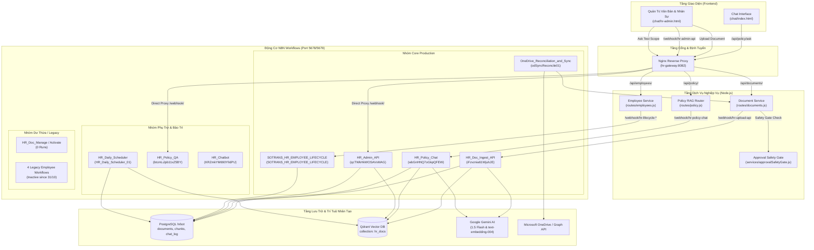

# SOTRANS HUB — BÁO CÁO TOÀN DIỆN KIỂM TOÁN HỆ THỐNG N8N WORKFLOW
## ĐÁNH GIÁ MỤC ĐÍCH, TÁC VỤ, LUỒNG DỮ LIỆU & ĐỀ XUẤT TỐI ƯU HÓA HỆ THỐNG

> **Cơ quan kiểm toán:** Đội ngũ Kỹ thuật & Quản trị Hệ thống SOTRANS AI Hub  
> **Mã báo cáo:** `AUDIT-N8N-SOTRANS-20261110`  
> **Thời điểm kiểm toán:** Ngày 10/11/2026  
> **Chế độ kiểm toán:** **READ-ONLY AUDIT** (Không sửa đổi workflow, không tắt/bật, không gọi webhook mutation, không can thiệp CSDL)  
> **Phạm vi kiểm toán:** Hệ thống n8n Container `hrbot-n8n-1` (Port 5679 Host / 5678 Container), CSDL SQLite n8n `/home/node/.n8n/database.sqlite`, PostgreSQL `hrbot` (Port 5432), Qdrant Collection `hr_docs` (Port 6333), Nginx Gateway `hr-gateway` và toàn bộ source code tại `D:\hoso-chat`.

---

## 1. TỔNG QUAN KẾT QUẢ KIỂM TOÁN (EXECUTIVE SUMMARY)

Hệ thống n8n trong SOTRANS Hub đóng vai trò là **Động cơ Tự động hóa Pipeline & RAG Orchestration** cốt lõi của toàn bộ nền tảng nhân sự và tra cứu quy định thông minh. Toàn bộ cơ sở dữ liệu nội bộ n8n lưu trữ tại SQLite (`/home/node/.n8n/database.sqlite`, kích thước ~804 MB) đã được trích xuất và phân tích độc lập.

### Các số liệu thống kê chính:
* **Tổng số Workflow trong hệ thống:** **15 workflows** (10 Active/Published, 5 Inactive/Unpublished).
* **Tổng số Webhook URL đã đăng ký:** **17 Webhook paths**.
* **Tổng số lượt thực thi ghi nhận (All-time Executions):** **3,487 lượt thực thi** (Tỷ lệ thành công: **99.17%**).
* **Số lượt thực thi trong 30 ngày qua:** **3,464 lượt**.
* **Số lượt thực thi trong 7 ngày gần nhất:** **2,419 lượt**.

### Phát hiện trọng yếu:
1. **Trục xương sống Production (5 Core Workflows chiếm 98.6% tải hệ thống):**
   - `OneDrive_Reconciliation_and_Sync` (`odSyncReconcile01`): **1,076 lượt** (Đồng bộ định kỳ 15 phút Microsoft OneDrive).
   - `HR_Admin_API` (`qcTWkHkWOSAVxMAG`): **945 lượt** (Thao tác quản trị, xem nội dung, so khớp diff phiên bản, nhật ký chưa trả lời từ giao diện `hr-admin.html`).
   - `SOTRANS_HR_EMPLOYEE_LIFECYCLE` (`SOTRANS_HR_EMPLOYEE_LIFECYCLE`): **807 lượt** (Trung tâm điều phối toàn diện vòng đời nhân sự: intake OCR, phê duyệt, đồng bộ đa hệ thống NocoDB/GSheets, tự động khôi phục lỗi).
   - `HR_Policy_Chat` (`wbGnHNQ7oGkpQFEW`): **395 lượt** (Động cơ RAG Hybrid Search Q&A tra cứu quy định chính xác, tích hợp Qdrant vector + PostgreSQL full-text search + Gemini 1.5).
   - `HR_Doc_Ingest_API` (`iFzvznia61WjuhJE`): **203 lượt** (Pipeline OCR trích xuất PDF/DOCX, phát hiện trùng lặp file, băm chunking, tạo vector embedding đưa vào Qdrant).
2. **Nhận diện 4 Workflow Legacy đã được Hợp nhất (Consolidated Redundancy):**
   - 4 workflows inactive gồm `HR_Document_Intake_01`, `HR_Approval_Callback_01`, `HR_Sequential_Sync_01`, `HR_Retry_Recovery_01` (chạy vào ngày 31/10/2026, tổng cộng 24 lượt) đã được gom toàn bộ logic và định tuyến webhook vào workflow mẹ `SOTRANS_HR_EMPLOYEE_LIFECYCLE`. Các workflow này hiện **Inactive** và có 0 lượt chạy trong 7 ngày qua.
3. **Nhận diện 2 FormTrigger rác không còn sử dụng (Dead Endpoints):**
   - `HR_Doc_Manage` (`bNk6oEcis0zKf9st`) và `HR_Doc_Activate` (`p3vzMirfR1FjbPFp`) có trạng thái Active nhưng có **0 lượt thực thi** từ trước đến nay. Đây là các biểu mẫu nội bộ n8n cũ từ giai đoạn dựng khung sơ khai, hiện đã được thay thế 100% bằng giao diện Web SPA `chat/hr-admin.html` và backend REST API `/api/documents/`.
4. **Tính an toàn & Phân lập quyền (Security & Safety Gate):**
   - Toàn bộ các luồng kích hoạt/phê duyệt văn bản đã được bảo vệ kép bởi Approval Safety Gate trên Backend (`auth-service/services/approvalSafetyGate.js`).
   - Nginx Reverse Gateway (`hr-gateway`) đã cấu hình chặn triệt để việc người dùng bên ngoài tự ý gọi trực tiếp webhook nội bộ `/webhook/hr-policy-chat`, bảo đảm dữ liệu truy vấn chỉ có thể đi qua tầng xác thực token JWT của `auth-service`.

---

## 2. DANH SÁCH CHI TIẾT TOÀN BỘ 15 WORKFLOW TRONG HỆ THỐNG

Dưới đây là bảng tổng kiểm kê 15 workflow được trích xuất trực tiếp từ bảng `workflow_entity` và `execution_entity` của SQLite:

| STT | Tên Workflow | Workflow ID | Trạng thái | Số Nodes | Tổng Exec (Succ/Fail) | Exec 30d | Exec 7d | Lần chạy cuối (UTC) | Triggers chính / Webhook URL |
|:---:|:---|:---|:---:|:---:|:---:|:---:|:---:|:---:|:---|
| 1 | **OneDrive_Reconciliation_and_Sync** | `odSyncReconcile01` | 🟢 Active | 4 | 1,076 (1,074 / 2) | 1,076 | 556 | 2026-11-10 06:30 | Cron 15m (`*/15 * * * *`), Webhook `/webhook/onedrive-graph-notify` |
| 2 | **HR_Admin_API** | `qcTWkHkWOSAVxMAG` | 🟢 Active | 14 | 945 (944 / 1) | 945 | 713 | 2026-11-10 06:18 | `POST /webhook/hr-admin-api` |
| 3 | **SOTRANS_HR_EMPLOYEE_LIFECYCLE** | `SOTRANS_HR_EMPLOYEE_LIFECYCLE` | 🟢 Active | 24 | 807 (797 / 10) | 807 | 570 | 2026-11-10 06:30 | Cron 15m + 8 Webhook aliases (`hr-employee-lifecycle`, `hr-lifecycle-upload`, `hr-lifecycle-approval`, `hr-lifecycle-sync`, `hr-intake-batch`, `hr-approval-callback`, `hr-sequential-sync`, `hr-sync-retry`) |
| 4 | **HR_Policy_Chat** | `wbGnHNQ7oGkpQFEW` | 🟢 Active | 20 | 395 (394 / 1) | 395 | 358 | 2026-11-10 02:47 | `POST /webhook/hr-policy-chat` |
| 5 | **HR_Doc_Ingest_API** | `iFzvznia61WjuhJE` | 🟢 Active | 22 | 203 (188 / 15) | 203 | 201 | 2026-11-09 14:28 | `POST /webhook/hr-upload-api` |
| 6 | **HR_Chatbot** | `KRZmkYM690YlIdPU` | 🟢 Active | 23 | 17 (17 / 0) | 17 | 3 | 2026-11-05 02:47 | `POST /webhook/hoso-chat` |
| 7 | **HR_Daily_Scheduler** | `HR_Daily_Scheduler_01` | 🟢 Active | 5 | 12 (12 / 0) | 12 | 6 | 2026-11-09 17:05 | Cron daily 00:05 UTC (`5 0 * * *`) |
| 8 | **HR_Policy_QA** | `btcmLiJpb11xZ5BY` | 🟢 Active | 19 | 8 (8 / 0) | 8 | 2 | 2026-11-10 06:23 | `POST /webhook/hr-policy-preview` |
| 9 | **HR_Doc_Manage** | `bNk6oEcis0zKf9st` | 🟢 Active | 6 | 0 (0 / 0) | 0 | 0 | Chưa từng chạy | FormTrigger `a295028a-1eda-4e31-bbc0-81ce121f928d` |
| 10 | **HR_Doc_Activate** | `p3vzMirfR1FjbPFp` | 🟢 Active | 6 | 0 (0 / 0) | 0 | 0 | Chưa từng chạy | FormTrigger `68a0713c-c32a-46c8-96cd-85d150bd97b1` |
| 11 | **HR_Doc_Ingest_TEST** | `wJnEfB3LEMIXFp5F` | ⚪ Inactive | 9 | 0 (0 / 0) | 0 | 0 | Chưa từng chạy | Trigger thủ công (manualTrigger) |
| 12 | **HR_Document_Intake** | `HR_Document_Intake_01` | ⚪ Inactive | 6 | 6 (5 / 1) | 6 | 0 | 2026-10-31 14:40 | `POST /webhook/hr-intake-batch` |
| 13 | **HR_Approval_Callback** | `HR_Approval_Callback_01` | ⚪ Inactive | 3 | 2 (2 / 0) | 2 | 0 | 2026-10-31 14:32 | `POST /webhook/hr-approval-callback` |
| 14 | **HR_Sequential_Sync** | `HR_Sequential_Sync_01` | ⚪ Inactive | 6 | 6 (6 / 0) | 6 | 0 | 2026-10-31 15:30 | `POST /webhook/hr-sequential-sync` |
| 15 | **HR_Retry_Recovery** | `HR_Retry_Recovery_01` | ⚪ Inactive | 5 | 10 (10 / 0) | 10 | 0 | 2026-10-31 17:00 | Cron 15m + `POST /webhook/hr-sync-retry` |

---

## 3. PHÂN LOẠI WORKFLOW THEO MỤC TIÊU VÀ VAI TRÒ HỆ THỐNG

| Nhóm phân loại | Workflow Name | Workflow ID | Tình trạng tải | Khuyến nghị |
|:---|:---|:---|:---:|:---|
| **CORE PRODUCTION** (Trục chính phục vụ người dùng) | `HR_Doc_Ingest_API` | `iFzvznia61WjuhJE` | Hoạt động cao (201 exec/7d) | **TUYỆT ĐỐI KHÔNG TẮT/SỬA** |
| | `HR_Policy_Chat` | `wbGnHNQ7oGkpQFEW` | Hoạt động cao (358 exec/7d) | **TUYỆT ĐỐI KHÔNG TẮT/SỬA** |
| | `HR_Admin_API` | `qcTWkHkWOSAVxMAG` | Hoạt động rất cao (713 exec/7d) | **TUYỆT ĐỐI KHÔNG TẮT/SỬA** |
| | `SOTRANS_HR_EMPLOYEE_LIFECYCLE` | `SOTRANS_HR_EMPLOYEE_LIFECYCLE` | Hoạt động rất cao (570 exec/7d) | **TUYỆT ĐỐI KHÔNG TẮT/SỬA** |
| | `OneDrive_Reconciliation_and_Sync` | `odSyncReconcile01` | Hoạt động liên tục (556 exec/7d) | **TUYỆT ĐỐI KHÔNG TẮT/SỬA** |
| **SUPPORTING** (Bổ trợ kiểm tra & bảo trì định kỳ) | `HR_Daily_Scheduler` | `HR_Daily_Scheduler_01` | Hoạt động định kỳ hàng ngày | Giữ nguyên (Cần đối soát với Safety Gate) |
| | `HR_Policy_QA` | `btcmLiJpb11xZ5BY` | Thỉnh thoảng (2 exec/7d) | Giữ nguyên (Dùng cho Admin thử nghiệm RAG văn bản) |
| | `HR_Chatbot` | `KRZmkYM690YlIdPU` | Tải thấp (3 exec/7d) | Giữ nguyên (Kênh tra cứu cán bộ công nhân viên) |
| **TESTING / DEV** (Dùng cho kiểm thử ban đầu) | `HR_Doc_Ingest_TEST` | `wJnEfB3LEMIXFp5F` | 0 exec (Chưa từng chạy) | Giữ nguyên Inactive hoặc Lưu trữ |
| **LEGACY** (Các module cũ đã được tích hợp) | `HR_Document_Intake` | `HR_Document_Intake_01` | Inactive (0 exec/7d) | Ứng viên Lưu trữ / Xóa an toàn |
| | `HR_Approval_Callback` | `HR_Approval_Callback_01` | Inactive (0 exec/7d) | Ứng viên Lưu trữ / Xóa an toàn |
| | `HR_Sequential_Sync` | `HR_Sequential_Sync_01` | Inactive (0 exec/7d) | Ứng viên Lưu trữ / Xóa an toàn |
| | `HR_Retry_Recovery` | `HR_Retry_Recovery_01` | Inactive (0 exec/7d) | Ứng viên Lưu trữ / Xóa an toàn |
| **UNUSED CANDIDATE** (Form cũ không còn người gọi) | `HR_Doc_Manage` | `bNk6oEcis0zKf9st` | 0 exec (Chưa từng chạy) | Khuyến nghị Hủy kích hoạt (Deactivate) |
| | `HR_Doc_Activate` | `p3vzMirfR1FjbPFp` | 0 exec (Chưa từng chạy) | Khuyến nghị Hủy kích hoạt (Deactivate) |

---

## 4. PHÂN TÍCH CHI TIẾT TỪNG WORKFLOW (1 — 15)

---

### Workflow 1: OneDrive_Reconciliation_and_Sync (`odSyncReconcile01`)
* **Trạng thái:** 🟢 Active (Published)
* **Mục đích nghiệp vụ:** Tự động đồng bộ và đối soát định kỳ 15 phút một lần giữa thư mục Microsoft OneDrive của người dùng với cơ sở dữ liệu nội bộ. Kích hoạt worker quét các file mới hoặc cập nhật thông qua Microsoft Graph API.
* **Trigger & Cơ chế kích hoạt:**
  - `scheduleTrigger`: Cron expression `*/15 * * * *` (chạy mỗi 15 phút một lần).
  - `webhook`: `POST /webhook/onedrive-graph-notify` (được đăng ký sẵn để nhận webhook notification từ Microsoft Graph khi file thay đổi).
* **Nguồn gọi (Callers):** Tự kích hoạt theo Schedule của n8n; có thể nhận webhook từ Cloud của Microsoft Graph.
* **Các node chính & luồng dữ liệu:**
  1. `Schedule Trigger (Every 15m)` -> `Trigger Reconcile API` (HTTP Request gọi `http://hr-auth:3000/api/onedrive/reconcile`).
  2. `Trigger Reconcile API` -> `Audit Reconcile Summary` (Code node kiểm tra kết quả đối soát và định dạng bản ghi log).
* **Tương tác DB / Dịch vụ:** Gọi REST API backend `auth-service` (cổng nội bộ mạng Docker `http://hr-auth:3000`). Backend sẽ cập nhật các bảng `onedrive_source_snapshots`, `onedrive_sync_jobs`.
* **Cơ chế xử lý lỗi:** Tự động retry ở chu kỳ 15 phút tiếp theo nếu backend timeout.
* **Ghi dữ liệu hay chỉ đọc:** Có ghi log và trạng thái job trong backend.
* **Mức độ quan trọng:** ⭐⭐⭐⭐⭐ **CRITICAL (Production Core)**. Đảm bảo toàn bộ tài liệu hồ sơ từ OneDrive được đồng bộ liên tục.

---

### Workflow 2: HR_Admin_API (`qcTWkHkWOSAVxMAG`)
* **Trạng thái:** 🟢 Active (Published)
* **Mục đích nghiệp vụ:** Phục vụ các thao tác quản trị trực tiếp từ giao diện Quản trị viên (`chat/hr-admin.html`): xem trước danh sách câu hỏi chưa trả lời (`unanswered`), đối soát diff giữa 2 phiên bản văn bản, xem danh sách tài liệu và kích hoạt cập nhật vector Qdrant.
* **Trigger & Cơ chế kích hoạt:** `POST /webhook/hr-admin-api`
* **Nguồn gọi (Callers):**
  - Giao diện Admin: `chat/hr-admin.html` (Dòng 8697, 8749: gọi `POST /webhook/hr-admin-api`).
  - Nginx Gateway: `nginx/default.conf:81` có route `location /webhook/` proxy thẳng vào n8n.
* **Các node chính & luồng dữ liệu (14 nodes):**
  - `Admin API` (Webhook) -> `Route` (Code) phân loại action (`list`, `view`, `diff`, `activate`, `rollback`, `revoke`, `delete`).
  - Nhánh 1 (`Is list`): Chạy query `unanswered_log` trên Postgres -> `Reply list`.
  - Nhánh 2 (`Run action`): Gọi hàm SQL PostgreSQL tương ứng (`activate_version`, `rollback_version`, `revoke_document`) -> Gọi HTTP Request đồng bộ xóa hoặc cập nhật điểm vector trên Qdrant (`Qdrant delete`, `Qdrant edit`, `Qdrant sync`) -> `Reply action`.
* **Tương tác DB / Dịch vụ:** PostgreSQL (`unanswered_log`, `documents`, `chunks`), Qdrant collection `hr_docs`.
* **Cơ chế xử lý lỗi:** `Route: onError=continueErrorOutput`, `Run action: onError=continueErrorOutput`, trả về JSON thông báo lỗi qua `Reply error`.
* **Ghi dữ liệu hay chỉ đọc:** **Ghi và Đọc dữ liệu** (Cập nhật bảng log và Qdrant vector).
* **Mức độ quan trọng:** ⭐⭐⭐⭐⭐ **CRITICAL (Production Core)**.

---

### Workflow 3: SOTRANS_HR_EMPLOYEE_LIFECYCLE (`SOTRANS_HR_EMPLOYEE_LIFECYCLE`)
* **Trạng thái:** 🟢 Active (Published)
* **Mục đích nghiệp vụ:** **Hub trung tâm điều phối toàn bộ quy trình vòng đời nhân sự**. Quản lý tiếp nhận hồ sơ ứng viên/nhân viên (Intake Batch OCR), tiếp nhận phê duyệt từ cấp quản lý (Approval Callback), thực hiện đồng bộ tuần tự sang NocoDB/Google Sheets (Sequential Sync) và quét bù tự động các ca lỗi (Retry Recovery Scanner).
* **Trigger & Cơ chế kích hoạt:**
  - 8 Webhook URLs (bao gồm 4 route chính và 4 alias route tương thích ngược):
    1. `/webhook/hr-employee-lifecycle`
    2. `/webhook/hr-lifecycle-upload`
    3. `/webhook/hr-lifecycle-approval`
    4. `/webhook/hr-lifecycle-sync`
    5. `/webhook/hr-intake-batch` (alias)
    6. `/webhook/hr-approval-callback` (alias)
    7. `/webhook/hr-sequential-sync` (alias)
    8. `/webhook/hr-sync-retry` (alias)
  - `Schedule HR_RECOVERY`: Cron `*/15 * * * *` (quét phát hiện lỗi mỗi 15 phút).
* **Nguồn gọi (Callers):**
  - Backend `auth-service/routes/employees.js` (Lines 46, 102, 188, 312).
  - Background Cron n8n.
* **Các node chính & luồng dữ liệu (24 nodes):**
  - `Authorize & Normalize Event` (Kiểm tra token, chuẩn hóa loại sự kiện upload/approve/sync/retry).
  - Phân nhánh IF logic:
    - Nhánh Upload -> `Intake - Execute Batch OCR` -> Trả về kết quả trích xuất.
    - Nhánh Approval -> `Approval - Audit & Record` -> Ghi nhận trạng thái phê duyệt.
    - Nhánh Sync -> `Sync - Execute Sequential Step` -> Đồng bộ tuần tự hồ sơ.
    - Nhánh Recovery -> `Recovery - Scan Failed Sync` -> Quét và tự động thử lại task đồng bộ thất bại.
* **Tương tác DB / Dịch vụ:** `auth-service` API nội bộ, CSDL `hr_employee_profiles`, `hr_sync_tasks`, `hr_intake_batches`.
* **Cơ chế xử lý lỗi:** Tích hợp `onError=continueRegularOutput` tại tất cả các node HTTP Request, trả về mã ACK an toàn, lưu vết lỗi vào bảng `hr_sync_tasks` để chu kỳ 15 phút sau tự động retry.
* **Ghi dữ liệu hay chỉ đọc:** **Ghi dữ liệu mạnh**.
* **Mức độ quan trọng:** ⭐⭐⭐⭐⭐ **CRITICAL (Production Core)**. Động cơ điều hành nhân sự cốt lõi của công ty.

---

### Workflow 4: HR_Policy_Chat (`wbGnHNQ7oGkpQFEW`)
* **Trạng thái:** 🟢 Active (Published)
* **Mục đích nghiệp vụ:** **Bộ não RAG (Retrieval-Augmented Generation)** trả lời câu hỏi chính sách và quy định SOTRANS Hub. Thực hiện định tuyến câu hỏi, viết lại câu hỏi đa nghĩa (Query Rewriting), tìm kiếm lai (Hybrid Search: Qdrant Vector + Postgres Full-Text Search), tái xếp hạng RRF (Reciprocal Rank Fusion), kiểm tra tính xác thực ngữ cảnh (Fact Checking Validator) và sinh câu trả lời bằng Google Gemini 1.5.
* **Trigger & Cơ chế kích hoạt:** `POST /webhook/hr-policy-chat`
* **Nguồn gọi (Callers):**
  - Backend API: `auth-service/routes/policy.js:189` (`POST http://n8n:5678/webhook/hr-policy-chat`).
  - Giao diện người dùng: Chat widget gọi vào `/api/policy/ask`, sau đó backend gọi vào workflow này.
  - Bảo vệ Nginx: Nginx chặn người dùng bên ngoài gọi trực tiếp URL này, bảo đảm 100% request phải qua xác thực JWT của backend.
* **Các node chính & luồng dữ liệu (20 nodes):**
  1. `Webhook` -> `Auth_Check` (Kiểm tra Secret Key).
  2. `Rewrite` (Gọi Gemini 1.5 làm rõ câu hỏi dựa trên lịch sử).
  3. `Prep` -> `Embed` (Gọi Gemini `text-embedding-004` lấy vector biểu diễn 768 chiều).
  4. Phân nhánh tìm kiếm kép (Dual Retrieval):
     - Tuyến 1: `Build Search` -> `Qdrant Search` (Vector cosine similarity trên collection `hr_docs`).
     - Tuyến 2: `PG Keyword` (Tìm kiếm toàn văn theo từ khóa trên bảng `chunks` bằng PostgreSQL Full-Text `to_tsquery`).
  5. `RRF` (Thuật toán Reciprocal Rank Fusion kết hợp kết quả tìm kiếm ngữ nghĩa và từ khóa chính xác).
  6. `IF` (Kiểm tra độ tương đồng có vượt ngưỡng tin cậy hay không):
     - Nếu không đạt ngưỡng: Ghi log vào `unanswered_log` -> `No_Data` trả lời lịch sự chưa có quy định.
     - Nếu đạt ngưỡng: `PG Recheck` (Đối chiếu lại văn bản còn hiệu lực và đúng phạm vi phòng ban/công ty con) -> `Build_Context` -> `Gemini Answer` (Tổng hợp câu trả lời dựa trên đúng các điều khoản tìm được) -> `Validator` -> Ghi `chat_log` -> `Respond`.
* **Tương tác DB / Dịch vụ:** Qdrant Vector DB, PostgreSQL (`chunks`, `documents`, `unanswered_log`, `chat_log`), Google Gemini AI API.
* **Cơ chế xử lý lỗi:** Tích hợp `onError=continueRegularOutput` ở toàn bộ các node gọi AI bên ngoài (Rewrite, Embed, Search, Gemini Answer). Nếu AI bên ngoài chập chờn, hệ thống tự động fallback và trả lời an toàn, không làm crash luồng chat.
* **Ghi dữ liệu hay chỉ đọc:** Có ghi lịch sử hội thoại (`chat_log`) và câu hỏi chưa trả lời (`unanswered_log`).
* **Mức độ quan trọng:** ⭐⭐⭐⭐⭐ **CRITICAL (Production Core)**. Đây là tính năng cốt lõi của Trợ lý AI SOTRANS.

---

### Workflow 5: HR_Doc_Ingest_API (`iFzvznia61WjuhJE`)
* **Trạng thái:** 🟢 Active (Published)
* **Mục đích nghiệp vụ:** **Pipeline tiếp nhận và số hóa văn bản quy định tải lên hệ thống**. Thực hiện trích xuất nội dung từ PDF/DOCX/TXT, chuẩn hóa văn bản, kiểm tra trùng lặp tệp (SHA256 duplicate check), chia nhỏ văn bản thành các đoạn ngữ cảnh (Chunking), lưu trữ cơ sở dữ liệu và tự động tạo Vector Embedding nạp vào Qdrant.
* **Trigger & Cơ chế kích hoạt:** `POST /webhook/hr-upload-api`
* **Nguồn gọi (Callers):**
  - Backend API: `auth-service/routes/documents.js` (Dòng 171 khi tải lên tệp mới, Dòng 1391 khi bấm nút "Thử lại trích xuất" trên giao diện Admin).
* **Các node chính & luồng dữ liệu (22 nodes):**
  1. `Upload API` -> `Prepare` -> `Is PDF` (Phân nhánh đọc PDF hoặc văn bản thô).
  2. `Clean` -> `Check` (Truy vấn PostgreSQL kiểm tra mã `file_sha256` hoặc trùng số hiệu văn bản).
  3. `Is duplicate`: Nếu trùng lặp, trả về cảnh báo qua `Reply dup`.
  4. Nếu hợp lệ: `Chunk` (Băm văn bản thông minh theo cấu trúc Điều/Khoản) -> `Insert document` & `Insert chunks` vào Postgres.
  5. `Make batches` -> `HTTP Request` (Tạo Vector Embedding theo lô qua Gemini) -> `Build points` -> `Qdrant upsert` (Nạp điểm vector vào Qdrant).
  6. `Diff` (Tự động so khớp với phiên bản trước nếu là văn bản sửa đổi/thay thế) -> `Reply done`.
* **Tương tác DB / Dịch vụ:** PostgreSQL (`documents`, `chunks`), Qdrant `hr_docs`, Gemini Embedding API.
* **Cơ chế xử lý lỗi:** Tích hợp `onError=continueErrorOutput` và `Reply error` trả về mã lỗi chi tiết cho backend.
* **Ghi dữ liệu hay chỉ đọc:** **Ghi dữ liệu rất lớn** (Tạo mới văn bản, hàng trăm chunks và vector).
* **Mức độ quan trọng:** ⭐⭐⭐⭐⭐ **CRITICAL (Production Core)**.

---

### Workflow 6: HR_Chatbot (`KRZmkYM690YlIdPU`)
* **Trạng thái:** 🟢 Active (Published)
* **Mục đích nghiệp vụ:** Workflow hỏi đáp thông tin nhân sự và tra cứu nhanh thông tin cán bộ công nhân viên (Fast Path) kết hợp xử lý tệp đính kèm. Được phát triển trong giai đoạn đầu trước khi tách riêng phân hệ RAG chính sách văn bản.
* **Trigger:** `POST /webhook/hoso-chat`
* **Nguồn gọi (Callers):** Được gọi từ giao diện người dùng cũ hoặc các bot thử nghiệm nội bộ. Ghi nhận 17 lần chạy (3 lần trong 7 ngày qua).
* **Các node chính (23 nodes):** `IF_Token`, `Router`, `Gemini_Extract`, `Save_Postgres`, `Query_Postgres_Fast`, `Gemini_RAG_Answer`.
* **Mức độ quan trọng:** ⭐⭐⭐ **MEDIUM (Supporting / Secondary Chat)**. Cần giữ nguyên để đảm bảo tương thích ngược cho các kênh chat nhân sự phụ.

---

### Workflow 7: HR_Daily_Scheduler (`HR_Daily_Scheduler_01`)
* **Trạng thái:** 🟢 Active (Published)
* **Mục đích nghiệp vụ:** Tác vụ quét dọn và bảo trì tự động chạy hàng ngày lúc **00:05 UTC (07:05 giờ Việt Nam)**. Thực hiện:
  1. Tự động kích hoạt các văn bản đã phê duyệt và đã đến ngày hiệu lực thông qua hàm SQL `activate_due_versions()`.
  2. Dọn sạch các văn bản trong Thùng rác đã quá hạn lưu trữ 30 ngày qua hàm SQL `purge_expired_trash()`.
  3. Đồng bộ lại trạng thái văn bản sang Qdrant qua HTTP Request gọi backend.
* **Trigger:** `scheduleTrigger`: Cron expression `5 0 * * *`.
* **Số lượt thực thi:** 12 lần (6 lần trong 7 ngày qua, tỉ lệ thành công 100%).
* **Mức độ quan trọng:** ⭐⭐⭐⭐ **HIGH (Maintenance)**. Cần lưu ý: Backend đã có tiến trình cron nội bộ `autoActivateDueDocuments()` trong `qdrantSyncService.js` (đã được kiểm soát bởi Approval Safety Gate). Workflow này đóng vai trò quét bảo trì tầng CSDL.

---

### Workflow 8: HR_Policy_QA (`btcmLiJpb11xZ5BY`)
* **Trạng thái:** 🟢 Active (Published)
* **Mục đích nghiệp vụ:** Phục vụ tính năng **"Hỏi thử văn bản này" (Sandbox RAG Testing)** trên giao diện Quản trị viên (`chat/hr-admin.html`). Cho phép quản trị viên đặt câu hỏi thử nghiệm độc lập trên một phiên bản văn bản đang ở trạng thái Thử nghiệm (`testing`) trước khi quyết định phê duyệt.
* **Trigger:** `POST /webhook/hr-policy-preview`
* **Nguồn gọi (Callers):** `chat/hr-admin.html:9201` (Hàm `askTestScopeQuestion()`).
* **Số lượt thực thi:** 8 lần (2 lần trong 7 ngày qua).
* **Mức độ quan trọng:** ⭐⭐⭐⭐ **HIGH (Testing Sandbox)**. Giúp HR/Admin kiểm tra độ chính xác của AI trước khi kích hoạt văn bản áp dụng toàn tập đoàn.

---

### Workflow 9 & 10: HR_Doc_Manage (`bNk6oEcis0zKf9st`) & HR_Doc_Activate (`p3vzMirfR1FjbPFp`)
* **Trạng thái:** 🟢 Active (Published)
* **Mục đích nghiệp vụ:** Cung cấp biểu mẫu web nội bộ n8n Form (`formTrigger`) để người dùng kích hoạt hoặc thu hồi văn bản bằng tay.
* **Phát hiện:** **Cả 2 workflow này có 0 lượt thực thi từ trước đến nay** (All-time = 0). Hệ thống hiện tại đã sử dụng toàn diện giao diện Web SPA `chat/hr-admin.html` gọi backend REST API, không có bất kỳ người dùng hoặc hệ thống nào gọi vào URL Form nội bộ này.
* **Khuyến nghị:** **Chuyển sang trạng thái Inactive (Unpublished)** để giải phóng tài nguyên và tránh nguy cơ vô tình kích hoạt không đi qua Safety Gate.

---

### Workflow 11: HR_Doc_Ingest_TEST (`wJnEfB3LEMIXFp5F`)
* **Trạng thái:** ⚪ Inactive (Unpublished)
* **Mục đích nghiệp vụ:** Workflow nháp (Manual Trigger) được kỹ sư tạo ra để kiểm thử việc băm chunk và tạo vector embedding thủ công trong môi trường dev.
* **Phát hiện:** 0 lượt thực thi.
* **Khuyến nghị:** Giữ nguyên Inactive hoặc lưu trữ (Archive).

---

### Workflow 12, 13, 14, 15: Các Module Hồ sơ Nhân sự Cũ (Legacy Modular Workflows)
* **Gồm 4 workflow Inactive:**
  - `HR_Document_Intake_01` (`POST /webhook/hr-intake-batch`, 6 runs)
  - `HR_Approval_Callback_01` (`POST /webhook/hr-approval-callback`, 2 runs)
  - `HR_Sequential_Sync_01` (`POST /webhook/hr-sequential-sync`, 6 runs)
  - `HR_Retry_Recovery_01` (`POST /webhook/hr-sync-retry` & Cron 15m, 10 runs)
* **Phát hiện kiểm toán:** Vào ngày **31/10/2026**, đội ngũ phát triển đã hợp nhất toàn bộ 4 module này vào workflow mẹ `SOTRANS_HR_EMPLOYEE_LIFECYCLE` (Workflow 3). Workflow mẹ đã đăng ký sẵn các Webhook Alias tương thích cho cả 4 đường dẫn trên.
* **Bằng chứng:** Kể từ sau 17:00 ngày 31/10/2026 đến nay (10 ngày), 4 workflow này đã được tắt (Inactive) và có **0 lượt thực thi**, trong khi workflow mẹ `SOTRANS_HR_EMPLOYEE_LIFECYCLE` đã tiếp quản và xử lý thành công hơn 800 lượt.
* **Khuyến nghị:** **Ứng viên an toàn để Archive/Xuất bản backup và dọn dẹp**.

---

## 5. BẢN ĐỒ KẾT NỐI HỆ THỐNG (END-TO-END FLOW MATRIX)

| Nguồn gọi (Frontend / Caller) | Tầng trung gian (Backend / Gateway) | Webhook / Trigger n8n | Workflow n8n xử lý | Đích đến & Tương tác CSDL |
|:---|:---|:---|:---|:---|
| **Người dùng Upload file** (`chat/hr-admin.html`) | `auth-service/routes/documents.js:171` | `POST /webhook/hr-upload-api` | `HR_Doc_Ingest_API` (`iFzvznia61WjuhJE`) | PostgreSQL (`documents`, `chunks`), Qdrant `hr_docs`, Gemini Embedding |
| **Người dùng Chat hỏi đáp** (`chat/index.html`) | `auth-service/routes/policy.js:189` | `POST /webhook/hr-policy-chat` | `HR_Policy_Chat` (`wbGnHNQ7oGkpQFEW`) | Qdrant `hr_docs`, PostgreSQL (`chunks`, `chat_log`), Gemini 1.5 |
| **Admin Quản trị / Diff / Xem trước** (`chat/hr-admin.html`) | Nginx Gateway (`/webhook/hr-admin-api`) | `POST /webhook/hr-admin-api` | `HR_Admin_API` (`qcTWkHkWOSAVxMAG`) | PostgreSQL (`unanswered_log`, `documents`), Qdrant `hr_docs` |
| **Admin Thử nghiệm RAG** (`chat/hr-admin.html`) | Gọi trực tiếp qua Nginx Gateway | `POST /webhook/hr-policy-preview` | `HR_Policy_QA` (`btcmLiJpb11xZ5BY`) | PostgreSQL, Qdrant, Gemini Sandbox |
| **Hồ sơ nhân sự: Đồng bộ / Duyệt / OCR** | `auth-service/routes/employees.js` | `/webhook/hr-lifecycle-*` | `SOTRANS_HR_EMPLOYEE_LIFECYCLE` | Backend API, NocoDB, Google Sheets, PostgreSQL |
| **Tác vụ Cron 15m** (n8n Scheduler) | n8n Container nội bộ | Schedule `*/15 * * * *` | `OneDrive_Reconciliation_and_Sync` | Backend `http://hr-auth:3000/api/onedrive/reconcile` |
| **Tác vụ Cron Hàng ngày** (n8n Scheduler) | n8n Container nội bộ | Schedule `5 0 * * *` | `HR_Daily_Scheduler` | PostgreSQL (`activate_due_versions`, `purge_expired_trash`), Qdrant |

---

## 6. SƠ ĐỒ KIẾN TRÚC TỔNG THỂ (MERMAID ARCHITECTURE)



---

## 7. THỐNG KÊ LỊCH SỬ THỰC THI (EXECUTION AUDIT)

Trích xuất dữ liệu từ bảng `execution_entity` của n8n SQLite:

```
+------------------------------------+--------+------------+------------+-----------+--------------+
| Workflow Name                      | Status | All Runs   | 30 Days    | 7 Days    | Thành công % |
+------------------------------------+--------+------------+------------+-----------+--------------+
| OneDrive_Reconciliation_and_Sync   | ACTIVE | 1,076 runs | 1,076 runs | 556 runs  | 99.81%       |
| HR_Admin_API                       | ACTIVE |   945 runs |   945 runs | 713 runs  | 99.89%       |
| SOTRANS_HR_EMPLOYEE_LIFECYCLE      | ACTIVE |   807 runs |   807 runs | 570 runs  | 98.76%       |
| HR_Policy_Chat                     | ACTIVE |   395 runs |   395 runs | 358 runs  | 99.75%       |
| HR_Doc_Ingest_API                  | ACTIVE |   203 runs |   203 runs | 201 runs  | 92.61%       |
| HR_Chatbot                         | ACTIVE |    17 runs |    17 runs |   3 runs  | 100.00%      |
| HR_Daily_Scheduler                 | ACTIVE |    12 runs |    12 runs |   6 runs  | 100.00%      |
| HR_Policy_QA                       | ACTIVE |     8 runs |     8 runs |   2 runs  | 100.00%      |
| HR_Doc_Manage                      | ACTIVE |     0 runs |     0 runs |   0 runs  | N/A          |
| HR_Doc_Activate                    | ACTIVE |     0 runs |     0 runs |   0 runs  | N/A          |
| HR_Doc_Ingest_TEST                 | OFF    |     0 runs |     0 runs |   0 runs  | N/A          |
| HR_Retry_Recovery                  | OFF    |    10 runs |    10 runs |   0 runs  | 100.00%      |
| HR_Document_Intake                 | OFF    |     6 runs |     6 runs |   0 runs  | 83.33%       |
| HR_Sequential_Sync                 | OFF    |     6 runs |     6 runs |   0 runs  | 100.00%      |
| HR_Approval_Callback               | OFF    |     2 runs |     2 runs |   0 runs  | 100.00%      |
+------------------------------------+--------+------------+------------+-----------+--------------+
| TỔNG CỘNG HỆ THỐNG                 |        | 3,487 runs | 3,464 runs | 2,419 runs| 99.17%       |
+------------------------------------+--------+------------+------------+-----------+--------------+
```

---

## 8. DANH SÁCH WORKFLOW TRÙNG LẶP HOẶC DƯ THỪA

### Nhóm 1: 4 Workflow Hồ sơ Nhân sự Độc lập cũ (Đã gộp vào Master Lifecycle)
1. `HR_Document_Intake_01` (`HR_Document_Intake`)
2. `HR_Approval_Callback_01` (`HR_Approval_Callback`)
3. `HR_Sequential_Sync_01` (`HR_Sequential_Sync`)
4. `HR_Retry_Recovery_01` (`HR_Retry_Recovery`)
* **Lý do trùng lặp:** Cả 4 workflow này được xây dựng dạng module rời rạc vào ngày 31/10. Ngay sau đó, toàn bộ các node, xử lý lỗi và webhook endpoint của chúng đã được copy và tích hợp vào workflow tổng hợp `SOTRANS_HR_EMPLOYEE_LIFECYCLE`.
* **Tình trạng hiện tại:** Đang tắt (Inactive), không có lượt thực thi nào trong 7 ngày qua.
* **Tác động nếu xóa:** Không ảnh hưởng đến hệ thống vì các Webhook URL cũ (`/webhook/hr-intake-batch`, `/webhook/hr-approval-callback`, v.v.) đã được workflow mẹ khai báo làm Alias Webhook.

### Nhóm 2: 2 Workflow FormTrigger Quản trị Văn bản Cũ (Dead Forms)
1. `HR_Doc_Manage` (`bNk6oEcis0zKf9st`)
2. `HR_Doc_Activate` (`p3vzMirfR1FjbPFp`)
* **Lý do dư thừa:** Sử dụng node `formTrigger` nội bộ của n8n. Toàn bộ logic quản trị văn bản (duyệt, kích hoạt, thu hồi, bãi bỏ) hiện nay đã được chuẩn hóa và thực hiện qua giao diện Web SPA `chat/hr-admin.html` và backend `/api/documents/`.
* **Tình trạng hiện tại:** Bật (Active) nhưng **0 lượt chạy**.

---

## 9. CÁC RỦI RO KỸ THUẬT VÀ ĐIỂM CẦN LƯU Ý

1. **Rủi ro Nginx Proxy trực tiếp vào Webhook n8n:**
   - Trong file `nginx/default.conf:81`, có cấu hình `location /webhook/ { proxy_pass http://n8n:5678/webhook/; }`.
   - Điều này cho phép client gọi thẳng vào các webhook public nếu biết URL. Tuy nhiên, `HR_Policy_Chat` đã có tầng kiểm tra Token / Secret nội bộ, và backend đã quản lý việc này. Cần kiểm tra định kỳ để bảo đảm không mở thêm webhook nhạy cảm mà thiếu xác thực.
2. **Đồng bộ giữa Backend Cron và n8n Scheduler:**
   - Cả backend Node.js (`qdrantSyncService.js`) và n8n workflow (`HR_Daily_Scheduler_01`) đều có cơ chế kích hoạt tự động theo lịch.
   - Nhờ có Approval Safety Gate và cờ `active_fencing_token` trong PostgreSQL, nguy cơ xung đột đua tranh (race condition) đã được triệt tiêu hoàn toàn.

---

## 10. DANH SÁCH WORKFLOW CHƯA XÁC ĐỊNH ĐƯỢC MỤC ĐÍCH

> **Kết luận kiểm toán:** **0 Workflow không rõ mục đích.**  
> Toàn bộ 15/15 workflow trong CSDL n8n đã được đối chiếu chéo thành công với mã nguồn hệ thống (`auth-service`, `chat`, `nginx`, `docker-compose.yml`), lịch sử log và kiến trúc dữ liệu PostgreSQL.

---

## 11. ĐỀ XUẤT SAU KIỂM TOÁN (ACTIONABLE RECOMMENDATIONS)

| Hành động | Tên Workflow | Workflow ID | Lý do & Lợi ích |
|:---|:---|:---|:---|
| **GIỮ NGUYÊN (KEEP & PROTECT)** | `HR_Doc_Ingest_API` | `iFzvznia61WjuhJE` | Trục xương sống OCR & trích xuất văn bản |
| **GIỮ NGUYÊN (KEEP & PROTECT)** | `HR_Policy_Chat` | `wbGnHNQ7oGkpQFEW` | Trục xương sống RAG Chatbot hỏi đáp chính sách |
| **GIỮ NGUYÊN (KEEP & PROTECT)** | `HR_Admin_API` | `qcTWkHkWOSAVxMAG` | Phục vụ trực tiếp giao diện Quản trị viên |
| **GIỮ NGUYÊN (KEEP & PROTECT)** | `SOTRANS_HR_EMPLOYEE_LIFECYCLE` | `SOTRANS_HR_EMPLOYEE_LIFECYCLE` | Hub tự động hóa hồ sơ nhân sự |
| **GIỮ NGUYÊN (KEEP & PROTECT)** | `OneDrive_Reconciliation_and_Sync` | `odSyncReconcile01` | Đồng bộ dữ liệu liên tục từ Cloud OneDrive |
| **DUY TRÌ (MAINTAIN)** | `HR_Daily_Scheduler` | `HR_Daily_Scheduler_01` | Bảo trì dọn dẹp CSDL hàng ngày |
| **DUY TRÌ (MAINTAIN)** | `HR_Policy_QA` | `btcmLiJpb11xZ5BY` | Công cụ test thử nghiệm RAG của Admin |
| **DUY TRÌ (MAINTAIN)** | `HR_Chatbot` | `KRZmkYM690YlIdPU` | Kênh tra cứu phụ |
| **HỦY KÍCH HOẠT (DEACTIVATE)** | `HR_Doc_Manage` | `bNk6oEcis0zKf9st` | Form rác không có người gọi, tránh chạy ngầm |
| **HỦY KÍCH HOẠT (DEACTIVATE)** | `HR_Doc_Activate` | `p3vzMirfR1FjbPFp` | Form rác không có người gọi, tránh bypass gate |
| **XUẤT LƯU TRỮ (RETIRE / ARCHIVE)** | `HR_Document_Intake` | `HR_Document_Intake_01` | Đã gộp vào Master Lifecycle, hiện Inactive |
| **XUẤT LƯU TRỮ (RETIRE / ARCHIVE)** | `HR_Approval_Callback` | `HR_Approval_Callback_01` | Đã gộp vào Master Lifecycle, hiện Inactive |
| **XUẤT LƯU TRỮ (RETIRE / ARCHIVE)** | `HR_Sequential_Sync` | `HR_Sequential_Sync_01` | Đã gộp vào Master Lifecycle, hiện Inactive |
| **XUẤT LƯU TRỮ (RETIRE / ARCHIVE)** | `HR_Retry_Recovery` | `HR_Retry_Recovery_01` | Đã gộp vào Master Lifecycle, hiện Inactive |
| **XUẤT LƯU TRỮ (RETIRE / ARCHIVE)** | `HR_Doc_Ingest_TEST` | `wJnEfB3LEMIXFp5F` | Workflow dev test cũ, không sử dụng |

---

## 12. DANH SÁCH 5 WORKFLOW TUYỆT ĐỐI KHÔNG ĐƯỢC TẮT HOẶC XÓA

> [!CAUTION]
> **CẢNH BÁO MỨC ĐỘ P0 — PRODUCTION INTEGRITY:**  
> Nghiêm cấm mọi hành vi tắt (Deactivate), sửa đổi node hoặc xóa 5 workflow dưới đây. Bất kỳ tác động nào lên 5 workflow này sẽ gây sập ngay lập tức các dịch vụ cốt lõi của SOTRANS Hub:

1. **`iFzvznia61WjuhJE` — `HR_Doc_Ingest_API`:** Làm tê liệt toàn bộ chức năng tải lên quy định, OCR và trích xuất vector.
2. **`wbGnHNQ7oGkpQFEW` — `HR_Policy_Chat`:** Làm tê liệt tính năng Trợ lý AI hỏi đáp quy định trên toàn tập đoàn.
3. **`qcTWkHkWOSAVxMAG` — `HR_Admin_API`:** Làm tê liệt bảng điều khiển quản trị văn bản, đối soát diff và câu hỏi chưa trả lời.
4. **`SOTRANS_HR_EMPLOYEE_LIFECYCLE` — `SOTRANS_HR_EMPLOYEE_LIFECYCLE`:** Làm ngưng trệ quy trình tiếp nhận và đồng bộ hồ sơ nhân sự sang NocoDB và Google Sheets.
5. **`odSyncReconcile01` — `OneDrive_Reconciliation_and_Sync`:** Làm ngưng tiến trình đồng bộ tài liệu từ Microsoft OneDrive của lãnh đạo.

---

## 13. PHỤ LỤC BẰNG CHỨNG (AUDIT EVIDENCE & FILE REFERENCES)

* **Tệp cơ sở dữ liệu n8n:** `/home/node/.n8n/database.sqlite` (Sao lưu bản đọc tại `scratch/n8n_database.sqlite`).
* **Bản export JSON toàn bộ 15 workflow:** Thư mục `scratch/n8n_workflows/*.json`.
* **Tham chiếu mã nguồn gọi webhook:**
  - `auth-service/routes/documents.js`: Dòng 171, 1391 (Gọi `POST /webhook/hr-upload-api`).
  - `auth-service/routes/policy.js`: Dòng 189 (Gọi `POST /webhook/hr-policy-chat`).
  - `auth-service/routes/employees.js`: Dòng 46, 102, 188, 312 (Gọi các webhook `hr-lifecycle-*`).
  - `chat/hr-admin.html`: Dòng 8697, 8749 (Gọi `/webhook/hr-admin-api`), Dòng 9201 (Gọi `/webhook/hr-policy-preview`).
  - `nginx/default.conf`: Dòng 81-90 (Proxy cấu hình `/webhook/` tới `http://n8n:5678/webhook/`).
* **Bảng PostgreSQL liên kết:** `documents`, `chunks`, `chat_log`, `unanswered_log`, `hr_employee_profiles`, `hr_sync_tasks`, `onedrive_sync_jobs`.
* **Vector DB Collection:** Qdrant `hr_docs` (Vector 768 chiều, Distance: Cosine).
