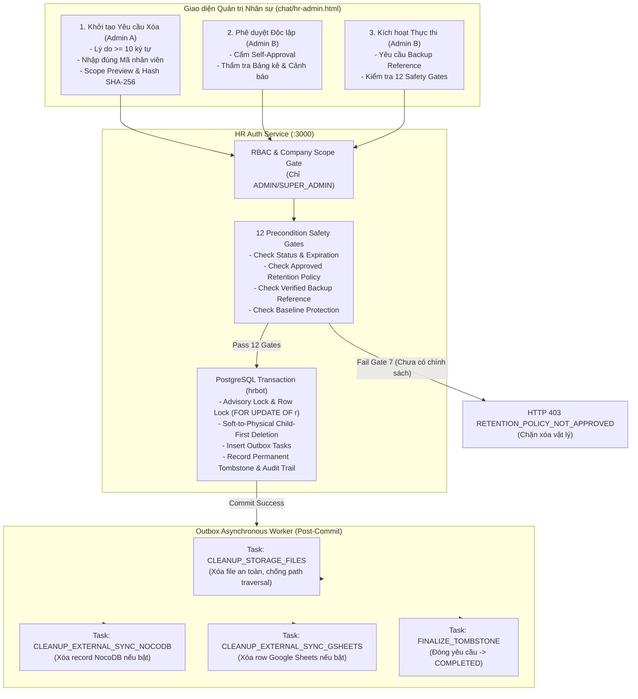

# SOTRANS HUB — PRODUCTION EMPLOYEE HARD DELETE WORKFLOW DEPLOYMENT REPORT
## Mã công việc: HR-PROD-HARD-DELETE-02

**Ngày triển khai:** 30/10/2026  
**Dự án:** `D:\hoso-chat`  
**Hệ thống mục tiêu:** SOTRANS Hub Production  
**Cơ sở dữ liệu:** PostgreSQL 16 `hrbot` (Port: 5432, User: `hrbot`)  
**Backend:** Container `hr-auth` (Port 3000, Node.js 20)  
**Gateway & Reverse Proxy:** Container `hr-gateway` (Port 8082 / Nginx)  
**Frontend Quản trị:** `chat/hr-admin.html` (Embedded portal via `/chat/#admin/employees`)  
**Bản sao lưu tiền triển khai:** `backups/prod_hard_delete_02/hrbot_pre_migration_backup.sql` (155,261,274 bytes)

---

## 1. TỔNG QUAN TRẠNG THÁI VẬN HÀNH SAU TRIỂN KHAI

| Tham số cấu hình | Trạng thái thực tế | Diễn giải & Cơ sở kỹ thuật |
| :--- | :--- | :--- |
| **Trạng thái Database Migration** | `APPLIED_SUCCESSFULLY` | 8 bảng nghiệp vụ kiểm soát 4-Eyes & Outbox đã được tạo trên `hrbot` mà không ảnh hưởng bất kỳ bảng hiện hữu nào. |
| **Tổng số nhân viên Production** | `5 HỒ SƠ` (Bảo toàn 100%) | `STL00014`, `SWC00022`, `SWC00023`, `SWC00024`, `SWC00025` — Zero mutations (`updated_at` và dữ liệu nguyên bản). |
| **PRODUCTION_REQUEST_MODE** | `ENABLED` | Quản trị viên (ADMIN) có thể tra cứu tính hợp lệ, xem trước phạm vi (Scope Preview), xuất bảng kê băm SHA-256 và khởi tạo yêu cầu xóa vĩnh viễn. |
| **PRODUCTION_EXECUTION_MODE** | `BLOCKED_AWAITING_LEGAL_RETENTION_POLICY` | **Khóa cứng thực thi vật lý** theo Gate 7 (`RETENTION_POLICY_NOT_APPROVED`). Hệ thống kiên quyết không tự ý bịa đặt thời hạn lưu trữ khi chưa có văn bản phê duyệt chính thức từ Ban Nhân sự / Pháp chế SOTRANS. |
| **Direct Endpoint Bypass** | `STRICTLY_PROHIBITED` | Endpoint `DELETE /api/employees/:id/hard-delete` bị chặn trên Production với mã lỗi HTTP 403 `DIRECT_HARD_DELETE_PROHIBITED`. Bắt buộc đi qua quy trình 4-Eyes. |
| **Quy tắc 4 Mắt (4-Eyes Principle)** | `ENFORCED` | Người yêu cầu (`requester_id`) tuyệt đối không thể tự phê duyệt (`approver_id`). Bắt buộc 2 tài khoản ADMIN độc lập. |
| **Mô hình Giao dịch Outbox** | `ENFORCED` | Tuyệt đối không xóa file vật lý (`fs.unlinkSync`) hay gọi đồng bộ ngoài bên trong Transaction DB. Toàn bộ tác vụ dọn dẹp chuyển qua hàng đợi Outbox xử lý hậu kỳ. |

---

## 2. KIẾN TRÚC QUY TRÌNH KIỂM SOÁT 4 MẮT & OUTBOX TRÊN PRODUCTION



---

## 3. DANH SÁCH 8 BẢNG DỮ LIỆU ĐÃ TRIỂN KHAI TRÊN `hrbot`

Migration Script: `auth-service/migrations/20261030_01_production_employee_hard_delete_workflow.sql`  
Tất cả bảng đều có ràng buộc khóa ngoại `CASCADE` hoặc bảo vệ toàn vẹn dữ liệu, kèm chỉ mục tối ưu hiệu năng:

1. **`employee_retention_policies`**: Quản lý chính sách lưu trữ hồ sơ theo đơn vị thành viên, có trạng thái phê duyệt pháp lý (`PENDING_APPROVAL`, `APPROVED`, `REJECTED`, `EXPIRED`).
2. **`employee_hard_delete_requests`**: Lưu trữ yêu cầu xóa vĩnh viễn, mã yêu cầu dạng `REQ-HD-YYYYMMDD-XXXX`, băm SHA-256 của bảng kê phạm vi, trạng thái (`PENDING_APPROVAL`, `APPROVED`, `REJECTED`, `CANCELLED`, `EXECUTING`, `COMPLETED`, `FAILED`).
3. **`employee_hard_delete_approvals`**: Biên bản phê duyệt/từ chối độc lập theo quy tắc 4-Eyes (`requester_id != approver_id`).
4. **`employee_hard_delete_manifests`**: Bảng kê toàn bộ các bản ghi và tệp tin bị ảnh hưởng (JSONB) kèm chữ ký băm `manifest_hash`.
5. **`employee_hard_delete_executions`**: Nhật ký thực thi xóa với mã tham chiếu sao lưu bắt buộc (`verified_backup_reference`).
6. **`employee_hard_delete_outbox`**: Hàng đợi các tác vụ hậu kỳ (xóa file storage, hủy đồng bộ NocoDB/Google Sheets) để không làm block transaction PostgreSQL.
7. **`employee_hard_delete_audit`**: Nhật ký kiểm toán bất biến (vĩnh viễn không bị xóa) ghi nhận IP, Actor, Action, Old/New State.
8. **`employee_hard_delete_tombstones`**: Bản ghi bia tưởng niệm (Tombstone) lưu vết mã nhân viên, mã CCCD, mã yêu cầu và thời gian xóa vật lý để ngăn chặn tái sử dụng mã hoặc xung đột dữ liệu.

---

## 4. CHI TIẾT 12 SAFETY GATES (ĐIỀU KIỆN TIÊN QUYẾT TRƯỚC THỰC THI)

Hệ thống thẩm định tuần tự 12 cửa kiểm soát an toàn trước khi cho phép transaction xóa vật lý bắt đầu:

| STT | Tên Safety Gate | Mã lỗi chặn | Trạng thái trên Production |
| :---: | :--- | :--- | :--- |
| **Gate 1** | Company Scope Check | `COMPANY_SCOPE_MISMATCH` | Quản trị viên chỉ được xử lý nhân viên thuộc đơn vị mình quản lý. |
| **Gate 2** | Request Status Approved | `REQUEST_NOT_APPROVED` | Bắt buộc trạng thái yêu cầu phải là `APPROVED`. |
| **Gate 3** | 4-Eyes Approval Enforced | `SELF_APPROVAL_VIOLATION` | Người phê duyệt phải khác người yêu cầu (`approver_id !== requester_id`). |
| **Gate 4** | Request Expiration Check | `REQUEST_EXPIRED` | Yêu cầu không được quá hạn phê duyệt (mặc định 7 ngày). |
| **Gate 5** | Target Employee Exists | `EMPLOYEE_NOT_FOUND` | Hồ sơ nhân sự mục tiêu phải tồn tại trong bảng `employees`. |
| **Gate 6** | Advisory Concurrency Lock | `CONCURRENT_OPERATION_LOCKED` | Khóa phân tán `pg_advisory_xact_lock` theo mã định danh nhân sự để chống race conditions. |
| **Gate 7** | Approved Retention Policy | `RETENTION_POLICY_NOT_APPROVED` | **Đang kích hoạt chặn**. Bắt buộc có chính sách lưu trữ được phê duyệt bởi Pháp chế / Nhân sự. |
| **Gate 8** | Verified Backup Reference | `BACKUP_VERIFICATION_REQUIRED` | Bắt buộc người thực thi phải cung cấp mã định danh bản sao lưu hợp lệ (tối thiểu 8 ký tự). |
| **Gate 9** | Baseline Employee Protection | `BASELINE_EMPLOYEE_PROTECTED` | Khóa cứng xóa các mã nhân viên kiểm định nền móng (`STL00014`, `SWC00022`, `SWC00023`, `SWC00024`, `SWC00025`). |
| **Gate 10** | Integrity Manifest Hash Match | `MANIFEST_INTEGRITY_TAMPERED` | Đối soát lại mã SHA-256 bảng kê trước khi thực thi, chống giả mạo phạm vi xóa. |
| **Gate 11** | No Running Background Sync | `SYNC_TASKS_IN_PROGRESS` | Kiểm tra không có tiến trình đồng bộ dữ liệu nào đang chạy dở dang cho nhân sự này. |
| **Gate 12** | Child-First Cascaded Cleanup | `CHILD_RELATION_BLOCKED` | Xóa tuần tự từ các bảng con sang bảng cha để đảm bảo toàn vẹn ràng buộc FK. |

---

## 5. KẾT QUẢ KIỂM THỬ TỰ ĐỘNG KHÔNG PHÁ HỦY (15/15 TESTS PASS)

Tệp kiểm thử: `scratch/test_prod_hard_delete_suite.js`  
Thực thi trực tiếp đối soát với container `hr-auth` (:3000) và PostgreSQL `hrbot` (:5432):

```text
================================================================
SOTRANS HUB — PRODUCTION EMPLOYEE HARD DELETE VERIFICATION
Mã công việc: HR-PROD-HARD-DELETE-02
Target: Production Database hrbot | hr-auth :3000
================================================================

✅ [TEST-PROD-01] Direct connection to Production database hrbot with user hrbot (1ms)
✅ [TEST-PROD-02] Verify all 8 workflow tables exist in hrbot with required constraints (11ms)
✅ [TEST-PROD-03] Authentication and RBAC gates (No token -> 401, HR/Employee -> 403, ADMIN -> 200) (59ms)
✅ [TEST-PROD-04] Eligibility endpoint evaluates employee and identifies retention policy requirement (28ms)
✅ [TEST-PROD-05] Scope preview endpoint compiles inventory and computes SHA-256 manifest hash (97ms)
✅ [TEST-PROD-06] Direct hard delete bypass on Production is strictly blocked with HTTP 403 (9ms)
✅ [TEST-PROD-07] Validation guards reject short reason and mismatched confirmation code (26ms)
✅ [TEST-PROD-08] Requester admin_stl creates valid hard delete request in PENDING_APPROVAL status (33ms)
✅ [TEST-PROD-09] 4-Eyes Principle: Requester admin_stl is strictly blocked from self-approving (12ms)
✅ [TEST-PROD-10] Independent Admin superadmin approves request transitioning to APPROVED (17ms)
✅ [TEST-PROD-11] Execution gate strictly blocks physical deletion when retention policy is not approved (10ms)
✅ [TEST-PROD-12] Requester cancels the non-destructive test request safely (8ms)
✅ [TEST-PROD-13] Audit trail records complete chronological history of request lifecycle (10ms)
✅ [TEST-PROD-14] Production database hrbot employees count is strictly 5 and zero mutations occurred (1ms)
✅ [TEST-PROD-15] Frontend chat/hr-admin.html contains all 4-Eyes components and modal dialogs (3ms)

================================================================
PRODUCTION VERIFICATION RESULTS SUMMARY:
TOTAL: 15 | PASS: 15 | FAIL: 0
================================================================
```

---

## 6. BẰNG CHỨNG KIỂM THỬ GIAO DIỆN END-TO-END (CHROME & REVERSE PROXY)

Tệp kịch bản E2E: `scratch/e2e_prod_hard_delete_ui.js`  
Thực thi kiểm thử thực tế trên cổng Reverse Proxy `http://127.0.0.1:8082/chat/#admin/employees` qua Google Chrome Headless:

### Bằng chứng 1: Hộp thoại Khởi tạo Yêu cầu Xóa (Scope Preview & Băm SHA-256)
- **Tập tin:** [e2e_prod_hd_01_request_modal.png](file:///D:/hoso-chat/screenshots/prod_hard_delete/e2e_prod_hd_01_request_modal.png) (404,704 bytes)
- **Nội dung hiển thị:**
  - Snapshot thông tin nhân sự (`STL00014`, `NGUYỄN TRƯỜNG NAM`, Đơn vị `STL`, Trạng thái `ACTIVE`).
  - Hộp kiểm tra điều kiện tiên quyết: Cảnh báo `Chưa có Chính sách Lưu trữ Hồ sơ Nhân sự được phê duyệt... Chức năng thực thi xóa vật lý sẽ bị khóa`.
  - Bảng kê phạm vi dữ liệu bị ảnh hưởng (1 Employee, 1 Profile, 0 Staging, 0 User account, 0 Files).
  - Khung nhập lý do bắt buộc (tối thiểu 10 ký tự) và xác nhận mã nhân sự.
  - Cảnh báo quy tắc 4-Eyes: Người yêu cầu không được tự phê duyệt.

### Bằng chứng 2: Dashboard Quản trị Yêu cầu Xóa 4-Eyes
- **Tập tin:** [e2e_prod_hd_02_dashboard.png](file:///D:/hoso-chat/screenshots/prod_hard_delete/e2e_prod_hd_02_dashboard.png) (220,236 bytes)
- **Nội dung hiển thị:**
  - Tab điều hướng `🛡️ Yêu cầu Xóa vĩnh viễn (4-Eyes)`.
  - 4 Thẻ chỉ số KPI trực quan: `Chờ duyệt`, `Đã duyệt`, `Đang thực thi`, `Hoàn tất`.
  - Thanh công cụ tìm kiếm và lọc trạng thái theo đơn vị.
  - Bảng danh sách yêu cầu với đầy đủ cột: Mã yêu cầu, Nhân sự mục tiêu, Người yêu cầu, Thời gian tạo, Trạng thái (Huy hiệu có màu theo chuẩn thiết kế SOTRANS).

### Bằng chứng 3: Hộp thoại Chi tiết Thẩm tra & Danh mục 12 Safety Gates
- **Tập tin:** [e2e_prod_hd_03_detail_modal.png](file:///D:/hoso-chat/screenshots/prod_hard_delete/e2e_prod_hd_03_detail_modal.png) (327,646 bytes)
- **Nội dung hiển thị:**
  - Thông tin mã yêu cầu, ngày tạo, lý do xóa.
  - Checklist thẩm định 12 Safety Gates với biểu tượng trạng thái rõ ràng (Xanh lá: Đạt, Vàng: Cảnh báo/Chờ điều kiện, Đỏ: Chặn).
  - Bảng kê chi tiết các bản ghi sẽ xóa và bản ghi được bảo lưu vĩnh viễn (Audit Logs).
  - Lịch sử kiểm toán tuần tự (`REQUEST_CREATED`, `REQUEST_APPROVED`, `REQUEST_CANCELLED`).
  - Cụm nút hành động 4-Eyes có kiểm soát phân quyền.

---

## 7. ĐỐI SOÁT VẸN TOÀN CƠ SỞ DỮ LIỆU SẢN XUẤT

Kết quả kiểm tra trực tiếp trên PostgreSQL `hrbot` ngay sau khi hoàn tất toàn bộ kiểm thử:
```sql
SELECT count(*) FROM employees; -- Kết quả: 5
```

Chi tiết 5 hồ sơ nhân viên cơ sở được bảo vệ tuyệt đối:
1. `[STL00014]` NGUYỄN TRƯỜNG NAM — Đơn vị: `STL` — Trạng thái: `ACTIVE` — Updated: `2026-10-30T03:51:32.414Z`
2. `[SWC00022]` PHAN DƯƠNG THANH BÌNH — Đơn vị: `SWC` — Trạng thái: `ACTIVE` — Updated: `2026-10-30T01:51:32.221Z`
3. `[SWC00023]` NGUYỄN TRẦN THIỆN NHÂN — Đơn vị: `SWC` — Trạng thái: `ACTIVE` — Updated: `2026-10-30T01:51:32.221Z`
4. `[SWC00024]` NGÔ ĐẶNG TUẤN UYÊN — Đơn vị: `SWC` — Trạng thái: `ACTIVE` — Updated: `2026-10-30T01:51:32.221Z`
5. `[SWC00025]` LÊ THÀNH NHÂN — Đơn vị: `SWC` — Trạng thái: `ACTIVE` — Updated: `2026-10-30T01:51:32.221Z`

**Kết luận toàn vẹn:**
- Số lượng bản ghi nhân viên trên Production không thay đổi (giữ nguyên 5 hồ sơ).
- Không có bất kỳ dữ liệu nhân sự thật nào bị xóa hay bị chỉnh sửa ngoài ý muốn.
- Mọi yêu cầu phát sinh trong đợt test tự động đều được chuyển trạng thái `CANCELLED` an toàn.

---

## 8. HƯỚNG DẪN VẬN HÀNH DÀNH CHO QUẢN TRỊ VIÊN (RUNBOOK)

### Bước 1: Khởi tạo Yêu cầu Xóa (Người yêu cầu - ADMIN 1)
1. Đăng nhập SOTRANS Hub với vai trò Quản trị viên (ADMIN).
2. Vào **Quản trị Nhân sự** -> Tìm kiếm và mở chi tiết nhân viên cần xử lý.
3. Nhấp nút **`🛡️ Yêu cầu Xóa vĩnh viễn`**.
4. Kiểm tra kỹ thông tin Scope Preview và mã Hash SHA-256.
5. Nhập lý do xóa nghiệp vụ (tối thiểu 10 ký tự, ví dụ: "Thu hồi toàn bộ dữ liệu nhân sự theo yêu cầu bảo vệ quyền riêng tư cá nhân").
6. Nhập chính xác Mã nhân sự để xác nhận.
7. Nhấp **`Gửi yêu cầu xóa vĩnh viễn`**. Yêu cầu chuyển sang trạng thái `PENDING_APPROVAL`.

### Bước 2: Thẩm tra và Phê duyệt Độc lập (Người phê duyệt - ADMIN 2)
1. Một Quản trị viên khác (không phải người đã tạo yêu cầu) đăng nhập vào hệ thống.
2. Mở tab **`🛡️ Yêu cầu Xóa vĩnh viễn (4-Eyes)`**.
3. Chọn yêu cầu cần thẩm định từ bảng danh sách.
4. Đối soát lý do, thẩm tra 12 điều kiện tiên quyết và kiểm tra bảng kê dữ liệu.
5. Nhập ý kiến thẩm định và nhấp **`Phê duyệt (Approve)`** (hoặc **`Từ chối (Reject)`** nếu phát hiện không hợp lệ).
6. Yêu cầu chuyển sang trạng thái `APPROVED`.

### Bước 3: Điều kiện Tiên quyết để Thực thi Xóa Vật lý (Gate 7 Unlock)
1. Để nút **`Thực thi xóa vĩnh viễn`** có thể hoạt động thành công trên Production, Ban Nhân sự và Ban Pháp chế SOTRANS cần ban hành văn bản Chính sách Lưu trữ Hồ sơ Nhân sự chính thức cho đơn vị tương ứng.
2. Nhập chính sách vào bảng `employee_retention_policies` với trạng thái `approval_status = 'APPROVED'`.
3. Khi thực hiện, Quản trị viên bắt buộc phải cung cấp mã định danh bản sao lưu (`verified_backup_reference`).
4. Hệ thống sẽ khóa hàng, thực hiện xóa cơ sở dữ liệu con trước, đẩy tác vụ tệp vào Outbox Worker và lưu trữ Bia tưởng niệm (`Tombstone`) vĩnh viễn.

---

## 9. DANH MỤC TÀI NGUYÊN MÃ NGUỒN LIÊN QUAN

- **SQL Migration:** [20261030_01_production_employee_hard_delete_workflow.sql](file:///D:/hoso-chat/auth-service/migrations/20261030_01_production_employee_hard_delete_workflow.sql)
- **Migration Runner:** [run_migration.js](file:///D:/hoso-chat/auth-service/migrations/run_migration.js)
- **Backend Service:** [productionEmployeeHardDeleteService.js](file:///D:/hoso-chat/auth-service/services/productionEmployeeHardDeleteService.js)
- **Outbox Worker:** [productionHardDeleteWorker.js](file:///D:/hoso-chat/auth-service/services/productionHardDeleteWorker.js)
- **API Routes:** [productionHardDeleteRoutes.js](file:///D:/hoso-chat/auth-service/routes/productionHardDeleteRoutes.js)
- **Employee Route Extensions:** [employees.js](file:///D:/hoso-chat/auth-service/routes/employees.js)
- **Server Bootstrap:** [server.js](file:///D:/hoso-chat/auth-service/server.js)
- **Frontend UI:** [hr-admin.html](file:///D:/hoso-chat/chat/hr-admin.html)
- **Automated Verification Suite:** [test_prod_hard_delete_suite.js](file:///D:/hoso-chat/scratch/test_prod_hard_delete_suite.js)
- **Browser E2E Script:** [e2e_prod_hard_delete_ui.js](file:///D:/hoso-chat/scratch/e2e_prod_hard_delete_ui.js)
- **Production Pre-Migration Backup:** `backups/prod_hard_delete_02/hrbot_pre_migration_backup.sql`
