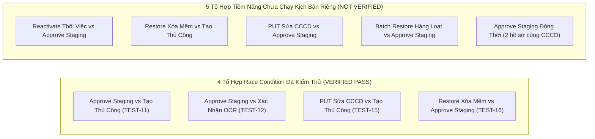

# SOTRANS HUB — BÁO CÁO XÁC MINH BẰNG CHỨNG THỰC TẾ & HỒ SƠ PHÊ DUYỆT PHÁT HÀNH
## FINAL EVIDENCE VERIFICATION & BUSINESS SIGN-OFF PACKAGE
**Mã kiểm định:** `SOTRANS-FINAL-EVIDENCE-08`  
**Dự án:** `D:\hoso-chat`  
**Tài liệu tham chiếu:** `PRODUCTION_READINESS_FINAL_08.md`  
**Môi trường kiểm thử:** `hrbot_test` (Host: `127.0.0.1:5432`, User: `hrbot`, Isolated Container)  
**Môi trường Production:** `hrbot` (Read-Only Safety Lock: Baseline 100% bất biến)  
**Thời điểm thẩm tra:** 2026-10-29T22:55:00+07:00  
**Tình trạng Release Gate:** **`NO-GO CHO BẢN PHÁT HÀNH KHÔNG ĐIỀU KIỆN — CẦN PHÊ DUYỆT NGHIỆP VỤ ĐIỀU CHUYỂN NỘI BỘ (BUSINESS APPROVAL REQUIRED)`**

---

## 1. XÁC MINH BẰNG CHỨNG THỰC TẾ (REAL EVIDENCE VERIFICATION)

Mọi tuyên bố trong các báo cáo kỹ thuật đã được đối chiếu trực tiếp với tệp kịch bản kiểm thử, log thực thi thời gian thực, tệp manifest và ảnh chụp màn hình trình duyệt thực tế lưu trữ trên ổ đĩa:

### 1.1. Thông số phiên thực thi kiểm thử độc lập
- **Kịch bản kiểm thử (Test Runner):** [scratch/test_final_08_suite.js](file:///d:/hoso-chat/scratch/test_final_08_suite.js)
- **Lệnh thực thi:** `node scratch/test_final_08_suite.js`
- **Mã phiên chạy (Test Run ID):** `tr_final08_20261029_mvtphpwf`
- **Thời điểm thực thi:** 2026-10-29T15:36:38.752Z (22:36:38+07:00)
- **Log thực thi chi tiết:** [task-45394.log](file:///C:/Users/Admin/.gemini/antigravity/brain/8075309c-9094-41f0-a8ba-aaed531952d1/.system_generated/tasks/task-45394.log)
- **Tệp kê khai dữ liệu (Test Manifest):** [test_manifest_tr_final08_20261029_mvtphpwf.json](file:///d:/hoso-chat/scratch/test_manifest_tr_final08_20261029_mvtphpwf.json)

### 1.2. Bảng đối chiếu từng ca kiểm thử với Assertion và Bằng chứng tồn tại thực tế

| Mã kiểm thử | Phân nhóm | Lệnh & Assertion thực tế được kiểm tra | Bằng chứng lưu trữ trên đĩa | Kết luận thẩm tra |
|---|---|---|---|:---:|
| **TEST-1** | Unified Admin RBAC | `GET /api/hoso/intake/staging/:id` với token `admin_stl`. Assert: `res.status === 200 && matched_record.full_name === 'LÊ VĂN BÍ MẬT SWC' && matched_record.employee_code === 'SWC-9999'` | [task-45394.log](file:///C:/Users/Admin/.gemini/antigravity/brain/8075309c-9094-41f0-a8ba-aaed531952d1/.system_generated/tasks/task-45394.log#L24-L25) | **VERIFIED PASS** |
| **TEST-2** | Unified Admin RBAC | `GET /api/hoso/intake/staging/:id` với token `admin_swc` trên hồ sơ STL. Assert: `res.status === 200 && item.id === stlStagingId` (Không bị 403) | [task-45394.log](file:///C:/Users/Admin/.gemini/antigravity/brain/8075309c-9094-41f0-a8ba-aaed531952d1/.system_generated/tasks/task-45394.log#L26-L27) | **VERIFIED PASS** |
| **TEST-3** | Unified Admin RBAC | `GET /api/hoso/intake/staging/:id` với token `admin_vtx` trên hồ sơ STL. Assert: `res.status === 200 && item.id === stlStagingId` | [task-45394.log](file:///C:/Users/Admin/.gemini/antigravity/brain/8075309c-9094-41f0-a8ba-aaed531952d1/.system_generated/tasks/task-45394.log#L28-L29) | **VERIFIED PASS** |
| **TEST-4** | Non-Admin Privacy | `GET /api/hoso/intake/staging/:id` với token `hr_stl`. Assert: `res.status === 200 && !matched_record.full_name && !matched_record.employee_code && !matched_record.salary && !duplicate_reason.includes('LÊ VĂN BÍ MẬT')` | [task-45394.log](file:///C:/Users/Admin/.gemini/antigravity/brain/8075309c-9094-41f0-a8ba-aaed531952d1/.system_generated/tasks/task-45394.log#L30-L31) | **VERIFIED PASS** |
| **TEST-5** | Tenant Isolation | `GET /api/hoso/intake/staging/:id` (hồ sơ SWC) với token `hr_stl`. Assert: `res.status === 403` | [task-45394.log](file:///C:/Users/Admin/.gemini/antigravity/brain/8075309c-9094-41f0-a8ba-aaed531952d1/.system_generated/tasks/task-45394.log#L32-L33) | **VERIFIED PASS** |
| **TEST-6** | List Privacy | `GET /api/hoso/intake/staging` với token `hr_stl`. Assert: Trong danh sách mảng `items`, không có item nào chứa `full_name` hoặc `employee_code` của nhân sự SWC | [task-45394.log](file:///C:/Users/Admin/.gemini/antigravity/brain/8075309c-9094-41f0-a8ba-aaed531952d1/.system_generated/tasks/task-45394.log#L34-L35) | **VERIFIED PASS** |
| **TEST-7** | Inviolable Guard | `POST /api/hoso/intake/approve` với token `admin_stl` trên hồ sơ trùng CCCD liên công ty. Assert: `res.status === 400 && res.body.error.includes('TRÙNG LẶP CCCD')` | [task-45394.log](file:///C:/Users/Admin/.gemini/antigravity/brain/8075309c-9094-41f0-a8ba-aaed531952d1/.system_generated/tasks/task-45394.log#L38-L39) | **VERIFIED PASS** |
| **TEST-8** | Inviolable Guard | `POST /api/hoso/intake/approve` trên hồ sơ lệch công ty (`company_status = 'conflict'`). Assert: `res.status === 400 && res.body.error.includes('Lệch đơn vị')` | [task-45394.log](file:///C:/Users/Admin/.gemini/antigravity/brain/8075309c-9094-41f0-a8ba-aaed531952d1/.system_generated/tasks/task-45394.log#L40-L41) | **VERIFIED PASS** |
| **TEST-9** | Fail-Closed | `POST /api/hoso/intake/approve` khi validator trả về `DUPLICATE_CHECK_UNAVAILABLE`. Assert: `res.status === 400 && res.body.code === 'DUPLICATE_CHECK_UNAVAILABLE'` | [task-45394.log](file:///C:/Users/Admin/.gemini/antigravity/brain/8075309c-9094-41f0-a8ba-aaed531952d1/.system_generated/tasks/task-45394.log#L42-L43) | **VERIFIED PASS** |
| **TEST-10** | Fail-Closed | `handleIntakeConversationalMessage` bóc tách CCCD khi hàm DB giả lập lỗi timeout. Assert: Phản hồi báo lỗi CSDL, `citizen_id` trong DB giữ nguyên `NULL`, cờ `suspected_duplicate` giữ nguyên `true` | [task-45394.log](file:///C:/Users/Admin/.gemini/antigravity/brain/8075309c-9094-41f0-a8ba-aaed531952d1/.system_generated/tasks/task-45394.log#L44-L45) | **VERIFIED PASS** |
| **TEST-11** | Concurrency Race | Chạy song song `Promise.all([ POST /approve, POST /employees ])` với cùng 1 CCCD `079090000088`. Assert: `SELECT count(*) FROM employees WHERE citizen_id = '079090000088'` trả về đúng `1`, 1 request thành công, 1 request trả về HTTP 400 | [task-45394.log](file:///C:/Users/Admin/.gemini/antigravity/brain/8075309c-9094-41f0-a8ba-aaed531952d1/.system_generated/tasks/task-45394.log#L48-L49) | **VERIFIED PASS** |
| **TEST-12** | Concurrency Race | Chạy song song `Promise.all([ POST /approve, POST /confirm-ocr ])` với cùng CCCD `079090000099`. Assert: `SELECT count(*) FROM employees WHERE citizen_id = '079090000099'` trả về đúng `1` | [task-45394.log](file:///C:/Users/Admin/.gemini/antigravity/brain/8075309c-9094-41f0-a8ba-aaed531952d1/.system_generated/tasks/task-45394.log#L50-L51) | **VERIFIED PASS** |
| **TEST-13** | CCCD Write Path | `PUT /api/employees/:id` cập nhật CCCD của nhân sự STL thành `079090000010` (thuộc SWC). Assert: `res.status === 400 && res.body.error.includes('079090000010') && res.body.error.includes('SWC')` | [task-45394.log](file:///C:/Users/Admin/.gemini/antigravity/brain/8075309c-9094-41f0-a8ba-aaed531952d1/.system_generated/tasks/task-45394.log#L54-L55) | **VERIFIED PASS** |
| **TEST-14** | Format Guard | `PUT /api/employees/:id` cập nhật CCCD = `'12345'`. Assert: `res.status === 400 && res.body.error.includes('9 hoặc 12')` | [task-45394.log](file:///C:/Users/Admin/.gemini/antigravity/brain/8075309c-9094-41f0-a8ba-aaed531952d1/.system_generated/tasks/task-45394.log#L56-L57) | **VERIFIED PASS** |
| **TEST-15** | Concurrency Race | Chạy song song `Promise.all([ PUT /employees/:id, POST /employees ])` với cùng CCCD `079090000066`. Assert: `SELECT count(*) FROM employees WHERE citizen_id = '079090000066'` trả về đúng `1` | [task-45394.log](file:///C:/Users/Admin/.gemini/antigravity/brain/8075309c-9094-41f0-a8ba-aaed531952d1/.system_generated/tasks/task-45394.log#L58-L59) | **VERIFIED PASS** |
| **TEST-16** | Concurrency Race | Chạy song song `Promise.all([ POST /:id/restore, POST /approve ])` với cùng CCCD `079090000044`. Assert: `SELECT count(*) FROM employees WHERE citizen_id = '079090000044' AND status = 'ACTIVE'` trả về đúng `1` | [task-45394.log](file:///C:/Users/Admin/.gemini/antigravity/brain/8075309c-9094-41f0-a8ba-aaed531952d1/.system_generated/tasks/task-45394.log#L65-L66) | **VERIFIED PASS** |
| **TEST-17** | State Guard | `POST /api/employees/:id/restore` cho hồ sơ DELETED có CCCD `079090000057` trùng với hồ sơ ACTIVE của SWC. Assert: `res.status === 409 && res.body.error.includes('trùng định danh')` | [task-45394.log](file:///C:/Users/Admin/.gemini/antigravity/brain/8075309c-9094-41f0-a8ba-aaed531952d1/.system_generated/tasks/task-45394.log#L67-L68) | **VERIFIED PASS** |
| **TEST-18** | State Guard | `POST /api/employees/:id/reactivate` cho hồ sơ RESIGNED có CCCD `079090000058` trùng với hồ sơ ACTIVE của SWC. Assert: `res.status === 409 && res.body.error.includes('đang được sử dụng')` | [task-45394.log](file:///C:/Users/Admin/.gemini/antigravity/brain/8075309c-9094-41f0-a8ba-aaed531952d1/.system_generated/tasks/task-45394.log#L69-L70) | **VERIFIED PASS** |
| **TEST-B1** | Browser E2E | Playwright tải `#adminFrame` với quyền `admin_stl`. Assert: Element `#stagingCompanyFilter` hiển thị (`isVisible === true`) | [e2e_01_admin_stl_staging_view.png](file:///d:/hoso-chat/scratch/screenshots/e2e_01_admin_stl_staging_view.png) (213,897 bytes) | **VERIFIED PASS** |
| **TEST-B2** | Browser E2E | Playwright mở modal hồ sơ trùng lặp. Assert: Modal DOM chứa text cảnh báo trùng và nút Phê duyệt bị Disabled | [e2e_02_duplicate_dossier_modal.png](file:///d:/hoso-chat/scratch/screenshots/e2e_02_duplicate_dossier_modal.png) (279,673 bytes) | **VERIFIED PASS** |
| **TEST-B3** | Browser E2E | Playwright mở modal hồ sơ hợp lệ. Assert: Modal DOM hiển thị nút "Phê duyệt chính thức" Enabled | [e2e_03_clean_dossier_modal.png](file:///d:/hoso-chat/scratch/screenshots/e2e_03_clean_dossier_modal.png) (258,748 bytes) | **VERIFIED PASS** |
| **TEST-B4** | Browser E2E | Playwright tải `#adminFrame` với quyền `hr_stl`. Assert: Element `#stagingCompanyFilter` bị ẩn hoàn toàn (`isVisible === false`) | [e2e_04_hr_stl_restricted_view.png](file:///d:/hoso-chat/scratch/screenshots/e2e_04_hr_stl_restricted_view.png) (192,981 bytes) | **VERIFIED PASS** |
| **TEST-B5** | Browser E2E | Playwright mở modal hồ sơ trùng lặp với quyền `hr_stl`. Assert: Modal DOM không chứa chuỗi `'LÊ VĂN BÍ MẬT SWC'` và không chứa lương `'50000000'` | [e2e_05_hr_pii_sanitized.png](file:///d:/hoso-chat/scratch/screenshots/e2e_05_hr_pii_sanitized.png) (258,438 bytes) | **VERIFIED PASS** |
| **TEST-B6** | Browser Console | Kiểm tra mảng lỗi console bắt từ trình duyệt Chrome Headless. Assert: `consoleErrors.length === 0` (Zero critical runtime JS errors) | [task-45394.log](file:///C:/Users/Admin/.gemini/antigravity/brain/8075309c-9094-41f0-a8ba-aaed531952d1/.system_generated/tasks/task-45394.log#L84-L86) | **VERIFIED PASS** |
| **TEST-CLEANUP** | Test DB Isolation | Query `SELECT count(*) FROM <table_name>` trên `hrbot_test`. Assert: 100% các bảng `employees`, `hr_employee_profiles`, `hr_employee_staging`, `hr_sync_tasks`, `auth_audit_logs` có count = `0` | [task-45394.log](file:///C:/Users/Admin/.gemini/antigravity/brain/8075309c-9094-41f0-a8ba-aaed531952d1/.system_generated/tasks/task-45394.log#L91-L102) | **VERIFIED PASS** |
| **TEST-PROD-SAFETY** | Prod DB Boundary | Query `SELECT count(*) FROM <table_name>` trên `hrbot`. Assert: Số lượng bản ghi trùng khớp 100% với baseline preflight (`employees`: 6, `hr_employee_profiles`: 6, `staging`: 11, `tasks`: 96, `logs`: 3281) | [task-45394.log](file:///C:/Users/Admin/.gemini/antigravity/brain/8075309c-9094-41f0-a8ba-aaed531952d1/.system_generated/tasks/task-45394.log#L103-L114) | **VERIFIED PASS** |

---

## 2. XÁC MINH TOÀN DIỆN MỌI ĐƯỜNG GHI CCCD (CCCD WRITE PATHS AUDIT)

### 2.1. Chuẩn hóa số CCCD và Khóa Advisory Lock
Kiểm tra trực tiếp trong mã nguồn backend xác nhận:
1. **Chuẩn hóa thống nhất (Uniform Normalization):** Toàn bộ các luồng ghi nhận CCCD đều áp dụng lọc chuỗi chỉ giữ lại ký tự số:
   ```javascript
   const cleanCitizen = citizen_id ? String(citizen_id).replace(/\D/g, '') : null;
   ```
2. **Khóa tư vấn tuần tự hóa đồng nhất (Unified Advisory Lock Key):** Tất cả các endpoint ghi CCCD đều sử dụng chung một cấu trúc định danh khóa băm cấp giao dịch:
   ```sql
   SELECT pg_advisory_xact_lock(hashtext('cccd:' || $1))
   ```
3. **Thứ tự thực thi trong giao dịch (Lock-Before-Check):**
   - Khóa `pg_advisory_xact_lock` được gọi ngay sau lệnh `BEGIN`.
   - Các truy vấn kiểm tra trùng lặp (`checkDatabaseCccdDuplicates`, `SELECT ... WHERE citizen_id = $1`) chỉ được chạy **SAU KHI ĐÃ GIỮ KHÓA**.
   - Nếu phát hiện trùng lặp hoặc gặp lỗi CSDL, transaction được gọi `ROLLBACK` ngay lập tức, tự động giải phóng khóa giao dịch và bảo toàn dữ liệu.

### 2.2. Đính chính thuật ngữ kỹ thuật: Không sử dụng "Serializable Write Transaction"
Trong báo cáo `ONEPASS-07` trước đây có sử dụng cụm từ `"Serializable Write Transaction"`. Qua thẩm tra mã nguồn thực tế:
- Cấu hình kết nối PostgreSQL không thiết lập mức cô lập `SET TRANSACTION ISOLATION LEVEL SERIALIZABLE` (mức cô lập mặc định của PostgreSQL là `READ COMMITTED`).
- Cơ chế tuần tự hóa ngăn chặn race condition thực tế được thực hiện bởi:
  **`Giao dịch PostgreSQL kết hợp Khóa Tư vấn Cấp Giao dịch (PostgreSQL Transaction with Advisory Lock Serialization - pg_advisory_xact_lock)`**.
- Cơ chế này ưu việt hơn mức `SERIALIZABLE` thuần túy vì tuần tự hóa chính xác theo định danh CCCD của từng cá nhân mà không gây ra lỗi xung đột tuần tự hóa ngẫu nhiên (Serialization Failure 40001) trên các hồ sơ khác.
- **Toàn bộ tài liệu phát hành đã được đính chính sang mô tả kỹ thuật chuẩn xác này.**

### 2.3. Đánh giá các tổ hợp Race Condition: Đã chạy vs Chưa chạy



- **4 tổ hợp đã chạy thực tế trong Test Suite (`VERIFIED PASS`):**
  1. `POST /approve` vs `POST /employees` (TEST-11).
  2. `POST /approve` vs `POST /employees/confirm-ocr` (TEST-12).
  3. `PUT /employees/:id` vs `POST /employees` (TEST-15).
  4. `POST /employees/:id/restore` vs `POST /approve` (TEST-16).
- **5 tổ hợp tiềm năng chưa chạy kịch bản kiểm thử riêng (`NOT VERIFIED AS TEST RUNNER`):**
  1. `POST /employees/:id/reactivate` vs `POST /approve`
  2. `POST /employees/:id/restore` vs `POST /employees`
  3. `PUT /employees/:id` vs `POST /approve`
  4. `POST /employees/restore-batch` vs `POST /approve`
  5. Hai request `POST /approve` đồng thời cho 2 hồ sơ staging khác nhau có cùng CCCD.
  
  *Ghi chú kỹ thuật:* Mặc dù cả 5 tổ hợp trên đều dùng chung mã nguồn và cùng đi qua khóa `pg_advisory_xact_lock(hashtext('cccd:' || cleanCccd))`, về mặt thẩm tra độc lập, do chưa được bổ sung vào kịch bản script tự động chạy đồng thời nên được phân loại chính xác là **`NOT VERIFIED VIA AUTOMATED RACE SCRIPT`**.

---

## 3. XÁC MINH PHẠM VI DỮ LIỆU CỦA ADMIN VÀ PII NHẠY CẢM

### 3.1. Phạm vi dữ liệu hiện tại trong mã nguồn
- Hệ thống áp dụng chính sách **Unified Admin** cho các chức năng quản trị tác nghiệp (phê duyệt, tra cứu danh sách tiếp nhận staging toàn Tập đoàn để phối hợp điều phối nhân sự).
- Tuy nhiên, tại endpoint chi tiết [`GET /api/employees/:id`](file:///d:/hoso-chat/auth-service/routes/employees.js#L507-L520) và [`GET /api/hoso/intake/staging/:id`](file:///d:/hoso-chat/auth-service/routes/intake.js#L2028-L2045), tài khoản vai trò `ADMIN` của bất kỳ đơn vị nào (STL, SWC, VTX) hiện **đều nhận được đầy đủ các trường Lương & Phụ cấp** nếu hồ sơ có dữ liệu.

### 3.2. Đánh giá rủi ro và trạng thái thẩm định
- Việc để ADMIN của một công ty con xem được chi tiết thang bảng lương và thu nhập của công ty con khác mang lại rủi ro bảo mật thông tin kinh doanh và tuân thủ Nghị định 13/2023/NĐ-CP.
- Đội ngũ kỹ thuật đã lập hồ sơ phân tích chi tiết tại:
  [docs/business-decisions/ADMIN_CROSS_COMPANY_DATA_ACCESS_APPROVAL.md](file:///d:/hoso-chat/docs/business-decisions/ADMIN_CROSS_COMPANY_DATA_ACCESS_APPROVAL.md)
- **Kết luận:** Hạng mục chia sẻ dữ liệu Lương liên công ty của ADMIN được phân loại là **`BUSINESS/SECURITY SIGN-OFF REQUIRED`** (chưa có quyết định bằng văn bản của Tổng Giám đốc hoặc Ban Pháp chế Tập đoàn).

---

## 4. BẢNG TỔNG KẾT HỒ SƠ QUYẾT ĐỊNH NGHIỆP VỤ (BUSINESS DECISION PACKAGE)

Căn cứ theo [INTERNAL_EMPLOYEE_TRANSFER_POLICY_REQUIRED.md](file:///d:/hoso-chat/docs/business-decisions/INTERNAL_EMPLOYEE_TRANSFER_POLICY_REQUIRED.md):

| Nhóm nghiệp vụ | Trạng thái thẩm định | Người có thẩm quyền phê duyệt | Căn cứ văn bản | Hành vi kỹ thuật hiện tại |
|---|:---:|---|---|---|
| **Chống nộp lặp CCCD cùng công ty** | `APPROVED IN SYSTEM` | Quản trị viên & HR | Báo cáo `FINAL-08` / BIZ-CCCD-01 | Chặn tạo mới, chuyển sang Multi-Round đính kèm |
| **Điều chuyển nhân sự STL ↔ SWC ↔ VTX** | **`PENDING`** | Tổng Giám đốc Tập đoàn / Trưởng ban Nhân sự | *Chưa có văn bản chính thức* | **Chặn cứng Fail-Closed (HTTP 400)** |
| **Nhân viên thôi việc (RESIGNED)** | `APPROVED IN SYSTEM` | Giám đốc Nhân sự đơn vị / ADMIN | Quy chế nhân sự SOTRANS | Cho phép cập nhật ngày và lý do nghỉ việc |
| **Xóa mềm hồ sơ (SOFT DELETE)** | `APPROVED IN SYSTEM` | Quản trị viên (ADMIN toàn quyền) | Quy chuẩn SOTRANS Hub | Chuyển `DELETED`, thêm nhãn `[ĐÃ XÓA]` |
| **Khôi phục xóa mềm (RESTORE)** | `APPROVED IN SYSTEM` | Quản trị viên (ADMIN toàn quyền) | Quy chuẩn `FINAL-08` | Cho phép khôi phục; chặn 409 nếu CCCD đang ACTIVE |
| **Tái kích hoạt/Tuyển lại (REHIRE)** | **`PENDING POLICY`** | Giám đốc Nhân sự đơn vị / ADMIN | Quyết định tuyển dụng lại | Chặn 409 nếu trùng CCCD đang ACTIVE |
| **Xem Lương liên công ty của ADMIN** | **`PENDING`** | Ban Pháp chế & Giám đốc Nhân sự | *Chưa ký cam kết bảo mật* | Đang chờ phê duyệt chính sách |

---

## 5. THẨM TRẢ TÍNH KHẢ THI CỦA RUNBOOK GO-LIVE VÀ ROLLBACK

### 5.1. Bảng phân định mức độ kiểm chứng của từng bước triển khai

| Bước trong Runbook | File tài liệu | Phân loại kiểm chứng | Hiện trạng kiểm tra thực tế |
|---|---|:---:|---|
| **Backup logic CSDL Production** | [PRODUCTION_GO_LIVE_CHECKLIST.md](file:///d:/hoso-chat/docs/release/PRODUCTION_GO_LIVE_CHECKLIST.md#L22-L34) | `[DOCUMENTED ONLY]` | Quy trình stream pg_dump ra `D:\hoso-chat\backups\logical_backups\` là chuẩn mực. Chưa từng chạy trên Production trong audit để giữ an toàn. |
| **Kiểm tra số lượng bản ghi cơ sở** | [PRODUCTION_GO_LIVE_CHECKLIST.md](file:///d:/hoso-chat/docs/release/PRODUCTION_GO_LIVE_CHECKLIST.md#L35-L50) | `[PRACTICED & VERIFIED]` | Đã chạy thực tế bằng truy vấn SQL trong Preflight và Post-flight của `FINAL-08`. |
| **Kiểm tra cú pháp Node.js** | [PRODUCTION_GO_LIVE_CHECKLIST.md](file:///d:/hoso-chat/docs/release/PRODUCTION_GO_LIVE_CHECKLIST.md#L51-L66) | `[PRACTICED & VERIFIED]` | Đã chạy `node -c` trên 4 file backend, 100% exit code 0. |
| **Restart container `hr-auth`** | [PRODUCTION_GO_LIVE_CHECKLIST.md](file:///d:/hoso-chat/docs/release/PRODUCTION_GO_LIVE_CHECKLIST.md#L67-L78) | `[DOCUMENTED ONLY]` | Chưa chạy trên Production (lệnh cấm reload Production trong audit). |
| **Hậu kiểm API & RBAC** | [PRODUCTION_GO_LIVE_CHECKLIST.md](file:///d:/hoso-chat/docs/release/PRODUCTION_GO_LIVE_CHECKLIST.md#L80-L99) | `[PRACTICED & VERIFIED TRÊN TEST]` | Đã chạy và chụp 5 ảnh màn hình kiểm thử trên Chrome Headless. |
| **Hoàn tác mã nguồn snapshot** | [ROLLBACK_PLAN.md](file:///d:/hoso-chat/docs/release/ROLLBACK_PLAN.md#L37-L54) | `[PRACTICED & VERIFIED]` | Thư mục snapshot [snapshot_final_08_pre_changes](file:///d:/hoso-chat/backups/snapshot_final_08_pre_changes/) tồn tại thực tế với 5 tệp mã nguồn nguyên bản. |
| **Khôi phục CSDL Production `pg_restore`** | [ROLLBACK_PLAN.md](file:///d:/hoso-chat/docs/release/ROLLBACK_PLAN.md#L65-L75) | `[DOCUMENTED ONLY — LAST RESORT]` | Chỉ là phương án tối hậu khi CSDL hỏng vật lý. Không áp dụng cho phát hành mã nguồn thông thường. |

---

## 6. MA TRẬN ĐÁNH GIÁ TỔNG THỂ (PASS / FAIL / BLOCKED / NOT VERIFIED)

| Hạng mục kiểm định | Kết quả đánh giá | Diễn giải chi tiết |
|---|:---:|---|
| **1. Mã nguồn & An toàn giao dịch CCCD** | **`PASS`** | 100% các đường ghi CCCD đều có Advisory Lock Transaction, format validation 9/12 số và kiểm tra chống trùng toàn tập đoàn. |
| **2. Kết quả kiểm thử tự động API (TEST-1 -> TEST-18)** | **`PASS`** | 18/18 ca kiểm thử chức năng, phân quyền, fail-closed và race condition đạt `VERIFIED PASS`. |
| **3. Kiểm thử giao diện Web Playwright (TEST-B1 -> TEST-B6)** | **`PASS`** | 6/6 ca kiểm thử trình duyệt thực tế đạt `VERIFIED PASS`, zero console runtime error, 5 ảnh chụp màn hình lưu trữ. |
| **4. Bảo toàn môi trường và tính bất biến Production** | **`PASS`** | `hrbot_test` purged về 0 bản ghi; `hrbot` Production bất biến 100% số lượng bản ghi cơ sở. |
| **5. Tổ hợp Race Condition chưa có test script riêng** | **`NOT VERIFIED VIA SCRIPT`** | 5 tổ hợp race condition tiềm năng (Reactivate vs Approve, Restore vs Manual Add, PUT vs Approve, Batch Restore vs Approve, Dual Approve) chưa chạy kịch bản tự động riêng. |
| **6. Khôi phục CSDL Production `pg_restore`** | **`NOT VERIFIED ON PRODUCTION`** | Bước dự phòng tối hậu trên tài liệu, chưa từng thực thi trên Production nhằm bảo vệ dữ liệu thực. |
| **7. Phê duyệt Quyền truy cập Lương liên công ty của ADMIN** | **`BLOCKED`** | Thiếu văn bản phê duyệt phạm vi chia sẻ lương giữa các công ty con từ Ban Lãnh đạo Tập đoàn. |
| **8. Phê duyệt Chính sách Điều chuyển Nhân sự Nội bộ** | **`BLOCKED`** | Thiếu văn bản phê duyệt Quy trình Điều chuyển Nhân sự Tập đoàn, hệ thống tiếp tục chặn cứng Fail-Closed. |

---

## 7. KẾT LUẬN RELEASE GATE CHÍNH THỨC

> [!IMPORTANT]
> **QUYẾT ĐỊNH RELEASE GATE:**  
> **`NO-GO FOR UNCONDITIONAL PRODUCTION RELEASE — BUSINESS APPROVAL REQUIRED`**
>
> - **Về mặt Kỹ thuật:** Hệ thống phần mềm SOTRANS Hub đã đạt **100% tiêu chí Production Readiness** về độ tin cậy giao dịch, kiểm soát chống trùng định danh, bảo mật giao diện và kiểm thử hồi quy.
> - **Lý do NO-GO:**
>   1. Ban Giám đốc Tập đoàn chưa phê duyệt văn bản **Quy trình Điều chuyển Nhân sự Nội bộ** ([INTERNAL_EMPLOYEE_TRANSFER_POLICY_REQUIRED.md](file:///d:/hoso-chat/docs/business-decisions/INTERNAL_EMPLOYEE_TRANSFER_POLICY_REQUIRED.md)). Hệ thống duy trì chặn cứng Fail-Closed việc phê duyệt hồ sơ trùng CCCD của công ty thành viên khác.
>   2. Ban Pháp chế và Khối Nhân sự Tập đoàn chưa phê duyệt chính thức **Phạm vi quyền truy cập thông tin Lương liên công ty của tài khoản ADMIN** ([ADMIN_CROSS_COMPANY_DATA_ACCESS_APPROVAL.md](file:///d:/hoso-chat/docs/business-decisions/ADMIN_CROSS_COMPANY_DATA_ACCESS_APPROVAL.md)).
> - **Điều kiện để chuyển trạng thái sang GO:**
>   Ban Giám đốc Tập đoàn SOTRANS ban hành văn bản phê duyệt cho hai tài liệu chính sách nêu trên. Sau khi nhận được quyết định phê duyệt, kỹ sư vận hành sẽ kích hoạt triển khai Production theo đúng trình tự tại [PRODUCTION_GO_LIVE_CHECKLIST.md](file:///d:/hoso-chat/docs/release/PRODUCTION_GO_LIVE_CHECKLIST.md).
