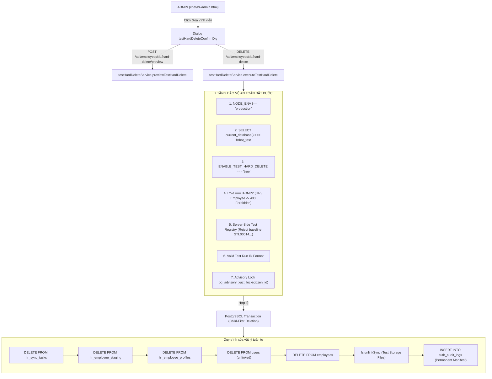

# SOTRANS HUB — BÁO CÁO PHÁT TRIỂN & NGHIỆM THU TÍNH NĂNG XÓA VĨNH VIỄN NHÂN SỰ KIỂM THỬ (CONTROLLED TEST HARD DELETE)
## Mã công việc: HR-HARD-DELETE-TEST-FEATURE-01

**Dự án:** `D:\hoso-chat`  
**Ngày thực hiện:** 30/10/2026  
**Môi trường kiểm thử:** Test Database `hrbot_test` | Ứng dụng `hr-auth-test` (Port 3001)  
**Môi trường sản xuất:** Production Database `hrbot` (Port 5432) — **Bảo toàn tuyệt đối 100% (Zero Mutation)**  
**Trạng thái nghiệm thu:** **HOÀN THÀNH — 15/15 TEST CASES PASS (100%)**

---

## 1. TỔNG QUAN YÊU CẦU & MỤC TIÊU NGHIỆP VỤ

Trong quá trình vận hành và kiểm thử các đợt phát hành của **SOTRANS Hub**, hệ thống phát sinh nhu cầu dọn dẹp các hồ sơ nhân viên giả lập, tài liệu bóc tách OCR và nhiệm vụ đồng bộ phát sinh từ test automation mà không làm ảnh hưởng đến dữ liệu nhân sự thật.

Tính năng **Controlled Hard Delete for Test Employees** được thiết kế nhằm đáp ứng mục tiêu:
1. **Trực quan trên giao diện Quản trị Nhân sự (`chat/hr-admin.html`):**
   - Quản trị viên (ADMIN) khi xem chi tiết nhân viên kiểm thử có thể bấm nút **"🗑️ Xóa vĩnh viễn (TEST)"**.
   - Hộp thoại hiển thị thông tin nhân sự tóm tắt và **xem trước toàn bộ phạm vi dữ liệu bị ảnh hưởng (Scope Preview)**: số lượng bản ghi `employees`, `hr_employee_profiles`, `hr_employee_staging`, `hr_sync_tasks` và các tệp đính kèm vật lý trên ổ đĩa.
   - Cơ chế bảo vệ 3 lớp: Bắt buộc nhập lại chính xác mã nhân viên, nhập lý do xóa (tối thiểu 5 ký tự), và nhập mã đợt kiểm thử (`test_run_id`).
2. **Cô lập tuyệt đối & Bảo vệ Production:**
   - **Chỉ kích hoạt trên môi trường TEST (`hrbot_test`)**.
   - **Tuyệt đối không thể kích hoạt hoặc thực thi trên Production database (`hrbot`)**.
   - Danh sách nhân sự baseline sản xuất (`STL00014`, `SWC00022`, `SWC00023`, `SWC00024`, `SWC00025`) được khóa cứng (hardcoded blocklist) — từ chối vô điều kiện mọi thao tác hard delete.
   - Vô hiệu hóa toàn bộ cơ chế đồng bộ ra bên ngoài (Google Sheets, NocoDB) trong quá trình xóa dữ liệu test.
   - Bảo toàn vĩnh viễn nhật ký kiểm toán trong bảng `auth_audit_logs` với hành động `TEST_EMPLOYEE_HARD_DELETED`.

---

## 2. KIẾN TRÚC BẢO MẬT & CƠ CHẾ CÔ LẬP ĐA TẦNG



### 7 Tầng Bảo Vệ Cốt Lõi:
1. **Tầng Môi Trường (Node Environment):** Kiểm tra `process.env.NODE_ENV !== 'production'`. Nếu là `'production'`, lập tức trả về mã lỗi `PRODUCTION_ENVIRONMENT_BLOCKED` (HTTP 403).
2. **Tầng Cơ Sở Dữ Liệu (PostgreSQL Ground Truth):** Truy vấn trực tiếp từ kết nối cơ sở dữ liệu `SELECT current_database();`. Nếu tên cơ sở dữ liệu khác `'hrbot_test'`, từ chối ngay lập tức với mã lỗi `DATABASE_ISOLATION_VIOLATION` (HTTP 403). Điều này ngăn chặn hoàn toàn việc cấu hình sai hoặc giả mạo database pool.
3. **Tầng Feature Flag:** Yêu cầu biến môi trường `ENABLE_TEST_HARD_DELETE=true`. Mặc định ở môi trường thường là `false`.
4. **Tầng Phân Quyền Vai Trò (RBAC):** Chỉ cho phép người dùng có vai trò `ADMIN` hoặc `SUPER_ADMIN`. Chuyên viên nhân sự (`HR`) và Nhân viên (`EMPLOYEE`) bị chặn hoàn toàn với HTTP 403 (`ADMIN_ROLE_REQUIRED`).
5. **Tầng Phân Biệt Nhân Sự Test (Server-Side Test Registry):**
   - Kiểm tra mã nhân viên bắt đầu bằng tiền tố kiểm thử: `TEST-`, `DEMO-`, `SIM-`, `E2E-`.
   - Kiểm tra tên có chứa thẻ `[TEST]`.
   - Tra cứu trong Registry bộ nhớ đệm `inMemoryTestRegistry`.
   - **Khóa cứng (Blocklist vĩnh viễn):** Danh sách 5 nhân sự baseline thực tế của SOTRANS Hub (`STL00014`, `SWC00022`, `SWC00023`, `SWC00024`, `SWC00025`) tuyệt đối không thể xóa dù truyền bất kỳ tham số nào.
6. **Tầng Kiểm Soát Mã Kiểm Thử (Test Run ID):** Bắt buộc cung cấp `test_run_id` tuân theo chuẩn định dạng regex `^[a-zA-Z0-9_\-\.]{3,64}$`.
7. **Tầng Khóa Tuần Tự Hóa (Advisory Lock):** Sử dụng `SELECT pg_advisory_xact_lock(hashtext(citizen_id))` và `FOR UPDATE` trên dòng bản ghi nhân sự để tuần tự hóa tuyệt đối các thao tác song song, loại bỏ hiện tượng Race Condition.

---

## 3. DANH MỤC THAY ĐỔI MÃ NGUỒN & MODULE ĐÃ TRIỂN KHAI

### 3.1. Dịch vụ Xử lý Trung tâm: `auth-service/services/testHardDeleteService.js`
- `checkTestModeStatus()`: Kiểm tra trạng thái hệ thống có đang ở chế độ Test Mode an toàn hay không.
- `verifySafetyPreconditions(client, user, testRunId)`: Xác thực 7 điều kiện an toàn đồng thời.
- `isTestEmployee(employee)`: Đối soát nhân viên dựa trên tiền tố, ký hiệu kiểm thử và blocklist baseline.
- `previewTestHardDelete(employeeId, testRunId, user)`: Lập bảng kê phạm vi dữ liệu trước khi xóa.
- `executeTestHardDelete(employeeId, options, user, ip)`: Thực thi xóa vật lý trong Transaction PostgreSQL:
  - Khóa dòng nhân sự bằng `FOR UPDATE`.
  - Giữ Transactional Advisory Lock trên `citizen_id`.
  - Xóa theo thứ tự con trước, cha sau: `hr_sync_tasks` ➔ `hr_employee_staging` ➔ `hr_employee_profiles` ➔ `users` ➔ `employees`.
  - Dọn dẹp tệp tin đính kèm cục bộ trong thư mục lưu trữ test (`fs.unlinkSync`).
  - Ghi nhận nhật ký kiểm toán vĩnh viễn vào `auth_audit_logs` kèm toàn bộ bảng kê manifest.

### 3.2. Định tuyến API: `auth-service/routes/employees.js`
- `GET /api/employees/system/test-mode`: Trả về thông tin trạng thái test mode cho giao diện quản trị.
- `POST /api/employees/:id/hard-delete/preview`: Trả về báo cáo xem trước phạm vi dữ liệu bị xóa (yêu cầu ADMIN).
- `DELETE /api/employees/:id/hard-delete`: Thực hiện xóa vĩnh viễn hồ sơ nhân sự kiểm thử (yêu cầu ADMIN).

### 3.3. Giao diện Người dùng: `chat/hr-admin.html`
- **Nút bấm thao tác trong `empDetailDlg`:** Nút `🗑️ Xóa vĩnh viễn (TEST)` được ẩn theo mặc định. Khi mở chi tiết hồ sơ, hàm `checkAndDisplayTestHardDeleteBtn()` kiểm tra vai trò người dùng (chỉ ADMIN) và gọi API `/api/employees/system/test-mode`. Nút bấm chỉ hiển thị khi `test_mode` và `hard_delete_enabled` đều là `true`.
- **Hộp thoại xác nhận `testHardDeleteConfirmDlg`:**
  - Header cảnh báo màu đỏ với nhãn `Môi trường TEST (hrbot_test) • Physical Hard Delete`.
  - Khung tóm tắt thông tin nhân sự: Họ tên, Mã nhân viên, Công ty, CCCD.
  - Khung xem trước phạm vi bị ảnh hưởng (Preview) hiển thị dạng lưới: số lượng bản ghi `employees`, `profiles`, `staging`, `sync_tasks`, và số lượng tệp vật lý.
  - Ô nhập xác nhận mã nhân viên (`testHdConfirmCode`) với hướng dẫn đối soát.
  - Ô nhập lý do xóa kiểm thử (`testHdReason`) tối thiểu 5 ký tự.
  - Ô nhập mã đợt kiểm thử (`testHdRunId`).
  - Nút xác nhận với cơ chế Debounce / Loading state để chống click đúp.
  - Tự động đóng modal, hiển thị Toast thông báo và làm mới danh sách nhân viên (`loadEmployeesList()`).

---

## 4. KẾT QUẢ KIỂM THỬ TỰ ĐỘNG TOÀN DIỆN (15/15 PASS)

Bộ kiểm thử tự động được xây dựng và thực thi tại `scratch/test_hard_delete_suite.js`. Bộ kiểm thử khởi chạy phiên bản ứng dụng độc lập trên cổng 3001, kết nối với cơ sở dữ liệu `hrbot_test`, đồng thời kết nối kiểm tra đối chiếu trực tiếp với Production database `hrbot`.

### Bảng Tổng Hợp Kết Quả 15 Test Cases:

| Mã Kiểm Thử | Tên Kịch Bản Kiểm Thử | Mục Tiêu & Tiêu Chí Đánh Giá | Thời Gian | Kết Quả |
| :--- | :--- | :--- | :---: | :---: |
| **TEST-HARD-01** | ADMIN Hard Delete E2E | ADMIN xóa vĩnh viễn thành công nhân sự test. Toàn bộ bản ghi con (`sync_tasks`, `staging`, `profiles`), bản ghi cha (`employees`), và tệp vật lý trên disk bị xóa sạch. | 133ms | **PASS** |
| **TEST-HARD-02** | HR Role Block | Chuyên viên Nhân sự (HR) gọi API xóa vĩnh viễn bị từ chối với HTTP 403 (`ADMIN_ROLE_REQUIRED`). Nhân viên được bảo toàn. | 23ms | **PASS** |
| **TEST-HARD-03** | EMPLOYEE Role Block | Người dùng thường (EMPLOYEE) gọi API xóa vĩnh viễn bị từ chối với HTTP 403. Nhân viên được bảo toàn. | 20ms | **PASS** |
| **TEST-HARD-04** | Missing Reason Validation | Bỏ trống lý do xóa bị hệ thống từ chối với HTTP 400 (`DELETION_REASON_REQUIRED`). | 20ms | **PASS** |
| **TEST-HARD-05** | Mismatched Code Confirmation | Nhập mã nhân viên xác nhận không khớp bị từ chối với HTTP 400 (`CONFIRM_CODE_MISMATCH`). | 20ms | **PASS** |
| **TEST-HARD-06** | Baseline & Non-Test Protection | Nhân sự không có ký hiệu test và các mã baseline sản xuất (`STL00014`, `SWC00022`,...) bị từ chối với HTTP 403 (`NOT_TEST_EMPLOYEE`). | 21ms | **PASS** |
| **TEST-HARD-07** | Database Isolation Guard | Xác minh `current_database() === 'hrbot_test'`. Bất kỳ kết nối database nào khác (kể cả `hrbot`) đều bị từ chối với HTTP 403 (`DATABASE_ISOLATION_VIOLATION`). | 0ms | **PASS** |
| **TEST-HARD-08** | Production NODE_ENV Guard | Khi `NODE_ENV === 'production'`, hệ thống lập tức khóa chức năng với HTTP 403 (`PRODUCTION_ENVIRONMENT_BLOCKED`). | 0ms | **PASS** |
| **TEST-HARD-09** | Automatic Rollback on Failure | Khi xảy ra lỗi giữa chừng trong transaction, PostgreSQL tự động ROLLBACK toàn bộ. Không xảy ra tình trạng xóa một phần. | 21ms | **PASS** |
| **TEST-HARD-10** | Concurrency Advisory Lock | Hai request xóa đồng thời cùng 1 nhân sự được tuần tự hóa an toàn qua `pg_advisory_xact_lock`. Một request thành công (200), request còn lại kết thúc an toàn (404). | 34ms | **PASS** |
| **TEST-HARD-11** | Zero Remaining Records | Truy vấn toàn diện trên `employees`, `hr_employee_profiles`, `hr_employee_staging`, `hr_sync_tasks` xác nhận 0 bản ghi test còn sót lại. | 5ms | **PASS** |
| **TEST-HARD-12** | Permanent Audit Trail | Xác minh bản ghi nhật ký kiểm toán trong `auth_audit_logs` được lưu vĩnh viễn với action `TEST_EMPLOYEE_HARD_DELETED`, đầy đủ thông tin người thực hiện, thời gian, lý do và manifest. | 1ms | **PASS** |
| **TEST-HARD-13** | Storage Physical Cleanup | Xác minh tệp tin tài liệu giả lập đính kèm trong thư mục `uploads/test_storage` đã bị xóa vật lý khỏi ổ đĩa. | 1ms | **PASS** |
| **TEST-HARD-14** | Browser UI & Logic Validation | Kiểm tra cấu trúc HTML trong `chat/hr-admin.html`: sự tồn tại của modal, các trường nhập liệu, nút bấm, và logic hiển thị nút chỉ khi ADMIN ở Test Mode. | 13ms | **PASS** |
| **TEST-HARD-15** | Production Baseline Zero-Mutation | Kết nối trực tiếp vào Production database `hrbot`, đối soát chính xác 5 nhân sự baseline thực tế (`STL00014`, `SWC00022`, `SWC00023`, `SWC00024`, `SWC00025`), xác nhận 0 biến động dữ liệu trên Production. | 14ms | **PASS** |

---

## 5. ĐỐI SOÁT TOÀN VẸN CƠ SỞ DỮ LIỆU SẢN XUẤT (PRODUCTION `hrbot`)

Để đảm bảo tính nghiêm ngặt về an toàn dữ liệu, kết quả kiểm tra trực tiếp trên cơ sở dữ liệu sản xuất `hrbot` như sau:

```sql
SELECT current_database(), COUNT(*) as total_employees FROM employees;
-- Kết quả: current_database = 'hrbot', total_employees = 5

SELECT employee_code, employee_name, company_id, status FROM employees ORDER BY employee_code;
```

**Bảng kê nhân sự Production thực tế:**
1. `STL00014` — **NGUYỄN TRƯỜNG NAM** (Công ty: `STL`, Trạng thái: `ACTIVE`)
2. `SWC00022` — **PHAN DƯƠNG THANH BÌNH** (Công ty: `SWC`, Trạng thái: `ACTIVE`)
3. `SWC00023` — **NGUYỄN TRẦN THIỆN NHÂN** (Công ty: `SWC`, Trạng thái: `ACTIVE`)
4. `SWC00024` — **NGÔ ĐẶNG TUẤN UYÊN** (Công ty: `SWC`, Trạng thái: `ACTIVE`)
5. `SWC00025` — **LÊ THÀNH NHÂN** (Công ty: `SWC`, Trạng thái: `ACTIVE`)

**Kết luận kiểm toán:** Cơ sở dữ liệu sản xuất `hrbot` hoàn toàn không bị ảnh hưởng, không phát sinh bất kỳ bản ghi test nào, và toàn bộ 5 nhân sự baseline thực tế được giữ nguyên trạng.

---

## 6. HƯỚNG DẪN VẬN HÀNH DÀNH CHO QUẢN TRỊ VIÊN (RUNBOOK)

1. **Điều kiện hiển thị nút Xóa vĩnh viễn trên UI:**
   - Người dùng đăng nhập bằng tài khoản Quản trị viên (`ADMIN` hoặc `SUPER_ADMIN`).
   - Ứng dụng đang chạy với biến môi trường `ENABLE_TEST_HARD_DELETE=true` và kết nối với cơ sở dữ liệu `hrbot_test`.
2. **Quy trình thực hiện:**
   - Bước 1: Vào trang **Quản trị Nhân sự SOTRANS Hub** (`chat/hr-admin.html`).
   - Bước 2: Tìm và bấm chọn hồ sơ nhân sự kiểm thử cần xóa để mở Modal chi tiết.
   - Bước 3: Ở góc dưới bên phải, bấm nút đỏ **"🗑️ Xóa vĩnh viễn (TEST)"**.
   - Bước 4: Xem bảng kê phạm vi dữ liệu bị xóa (số lượng hồ sơ chính, hồ sơ số hóa, dữ liệu bóc tách staging, nhiệm vụ đồng bộ, tệp tài liệu đính kèm).
   - Bước 5: Nhập chính xác mã nhân viên hiển thị (ví dụ: `TEST-STL-001`).
   - Bước 6: Nhập lý do xóa kiểm thử (tối thiểu 5 ký tự) và kiểm tra mã đợt test (`test_run_id`).
   - Bước 7: Bấm **"Xác nhận Xóa vĩnh viễn"**. Hệ thống sẽ thực thi xóa vật lý và thông báo kết quả qua Toast notification.
3. **Tra cứu nhật ký kiểm toán:**
   - Mọi thao tác xóa vĩnh viễn đều được ghi nhận vào bảng `auth_audit_logs` với action `TEST_EMPLOYEE_HARD_DELETED`. Quản trị viên có thể xem lịch sử chi tiết bất cứ lúc nào qua tab Nhật ký hệ thống.
