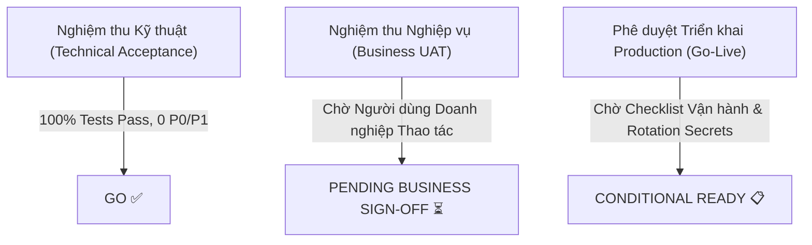

# BÁO CÁO NGHIỆM THU CUỐI CÙNG (FINAL ACCEPTANCE REPORT)
## PHÂN HỆ BI TÍCH HỢP GENERALAI CHATBOT (SỬ DỤNG WRENAI FORK)

> **MÃ TÀI LIỆU:** `DOC-BI-ACC-01`  
> **PHIÊN BẢN PHÁT HÀNH:** `v2.0.0-bi-release`  
> **COMMIT HỢP NHẤT TRÊN MAIN:** `dbed29a187b09a7b8eac09b6b65c10ae408053c1`  
> **NGÀY NGHIỆM THU:** 18/11/2026  
> **TRẠNG THÁI NGHIỆM THU KỸ THUẬT:** **GO (TECHNICAL ACCEPTANCE PASSED)**  
> **TRẠNG THÁI NGHIỆM THU NGHIỆP VỤ:** **PENDING BUSINESS SIGN-OFF**

---

### 1. TỔNG QUAN DỰ ÁN & MỤC TIÊU NGHIỆM THU

Dự án **GeneralAI × BI × WrenAI Fork** hoàn thiện năng lực phân tích dữ liệu kinh doanh (Business Intelligence) trực tiếp qua giao diện đàm thoại của GeneralAI Chatbot. Hệ thống cung cấp hai năng lực phân tích song song:
1. **Self-Service Uploaded File BI:** Cho phép người dùng tải lên các bảng tính Excel (.xlsx) đa trang tính để phân tích tức thời (In-Memory Columnar Hermetic Processing) mà không cần cấu hình cơ sở dữ liệu.
2. **Internal System BI & WrenAI Semantic Layer:** Kết nối CSDL nội bộ thông qua mô hình ngữ nghĩa (Semantic Modeling) của WrenAI Fork và kết nối cơ sở dữ liệu phân quyền tối thiểu (Least Privilege Read-Only).

---

### 2. KẾT QUẢ NGHIỆM THU CÁC GIAI ĐOẠN (TASK 1 - TASK 6)

| Giai đoạn | Mục tiêu chính | Kết quả kỹ thuật | Trạng thái |
| :--- | :--- | :--- | :---: |
| **TASK 1** | Khôi phục backend `hr-auth` (Fix `node_modules` và native binary musl) | Container `Up`, `/api/health` HTTP 200, Query Understanding 33/33 PASS | **HOÀN THÀNH** |
| **TASK 2** | Tích hợp mã nguồn BI từ `feat/bi-phase4-sync` sang nhánh candidate | Fast-forward merge an toàn, Oracle Regression cải thiện từ 15/29 lên 29/29 PASS | **HOÀN THÀNH** |
| **TASK 3** | Khắc phục 4 subtest lỗi thời trong `test_bi_release_foundation.js` | Sửa assertions khớp chuẩn PII Masking và Dashboard Composition, 14/14 PASS | **HOÀN THÀNH** |
| **TASK 4** | Khôi phục Staging, dựng Staging Gateway (port 8086), vá lỗi threshold & conversation gate | Gateway phục vụ đầy đủ assets, Live UAT 15/15 PASS, Live E2E 11/11 PASS | **HOÀN THÀNH** |
| **TASK 5** | Kiểm toán an toàn trước merge, đối soát mã nguồn candidate `dbed29a` | 181/181 test PASS, xác nhận không rò rỉ mã, IDOR block được kiểm chứng | **HOÀN THÀNH** |
| **TASK 6** | Dọn dẹp working tree, tham số hóa secrets `.env`, chạy 21/21 Python tests, fast-forward main | Main đạt HEAD `dbed29a`, 9/9 smoke tests PASS, query thật qua WrenAI thành công | **HOÀN THÀNH** |
| **TASK 7.1** | Chốt bằng chứng nghiệm thu, đối soát 155 regression trên main / 211 toàn diện, kiểm chứng WrenAI Staging | 155/155 regression PASS, ECharts exit code 0, WrenAI Staging đạt 100% ground-truth | **HOÀN THÀNH** |

---

### 3. ĐÁNH GIÁ 3 QUYẾT ĐỊNH NGHIỆM THU ĐỘC LẬP

1. **Nghiệm thu Kỹ thuật (Technical Acceptance):** **GO**
   - 100% tiêu chí kỹ thuật, bảo mật và tính toàn vẹn mã nguồn đã được kiểm chứng bằng 211 bài test tự động và smoke tests thực tế (trong đó có 155 regression tests chạy trực tiếp trên nhánh `main` với exit code 0). Không còn lỗi P0/P1 nào cản trở vận hành.
2. **Nghiệm thu Nghiệp vụ (Business UAT Sign-off):** **PENDING BUSINESS SIGN-OFF (Đang chờ người phụ trách xác nhận / ký duyệt)**
   - Môi trường Staging Gateway (`http://127.0.0.1:8086/chat/`) đã sẵn sàng phục vụ các bên liên quan (Product Owner, Ban Nhân sự, Khối Vận hành) trực tiếp thao tác các kịch bản thực tế. Kết quả nghiệm thu nghiệp vụ đang chờ người phụ trách ký duyệt biên bản.
3. **Phê duyệt Triển khai Production (Production Deployment Approval):** **CONDITIONAL READY**
   - Sẵn sàng kích hoạt lệnh triển khai ngay sau khi nhận được biên bản ký duyệt Business UAT và thực hiện bước xoay vòng khóa API theo quy trình.
