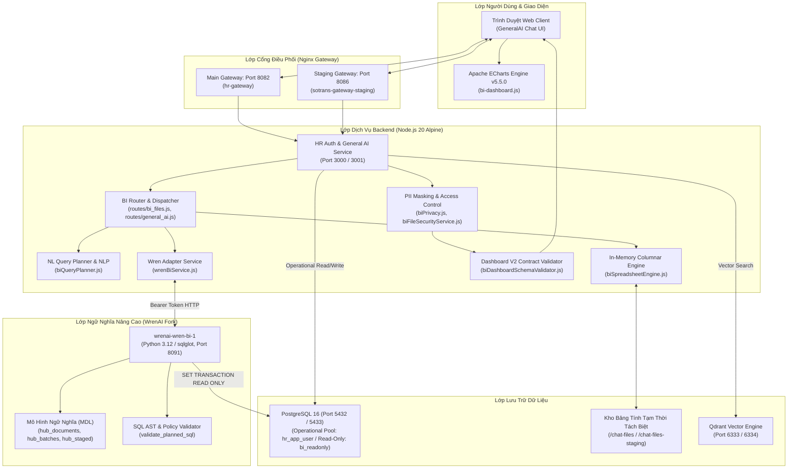

# TÀI LIỆU KIẾN TRÚC HỆ THỐNG THỰC TẾ (AS-BUILT ARCHITECTURE)
## GENERALAI × BI × WRENAI FORK

> **MÃ TÀI LIỆU:** `DOC-BI-ARCH-02`  
> **PHIÊN BẢN:** `2.0.0`  
> **CẬP NHẬT:** 18/11/2026

---

### 1. SƠ ĐỒ KIẾN TRÚC TỔNG THỂ

---

### 2. CÁC THÀNH PHẦN CỐT LÕI

#### 2.1. Phân Hệ File BI Độc Lập (Self-Service Columnar Engine)
- **Đặc tính:** Hermetic, In-Memory Columnar. Khi người dùng tải file `.xlsx`, hệ thống nạp dữ liệu vào cấu trúc cột trong bộ nhớ tạm thời của tiến trình, tự động phát hiện kiểu dữ liệu (`INTEGER`, `FLOAT`, `DATE`, `TEXT`), định danh các chiều phân tích (dimensions), chỉ số (measures) và nhãn thực thể.
- **Tính toán:** Hỗ trợ tính toán song song:
  - Hàm tổng hợp: `SUM`, `AVG`, `COUNT`, `DISTINCT_COUNT`, `MIN`, `MAX`, `MEDIAN`.
  - Phân tích tương quan: Tỷ trọng phân bổ (`PERCENTAGE`), Tăng trưởng chuỗi thời gian (`GROWTH_RATE`), So sánh chu kỳ (`PERIOD_COMPARISON`).
- **An toàn CSDL:** **Hoàn toàn không ghi bất kỳ dòng dữ liệu nào vào bảng nhân sự của PostgreSQL** (Zero HR table intrusion).

#### 2.2. Phân Hệ WrenAI Semantic Layer
- **Kiến trúc:** Sidecar container chạy Python 3.12 độc lập (`wrenai-wren-bi-1`), gắn mạng nội bộ Docker.
- **Giao thức:** Trao đổi qua API nội bộ (`/catalog`, `/query`) có xác thực Bearer token mã hóa an toàn.
- **Ràng buộc an toàn:** Mọi truy vấn SQL từ WrenAI được biên dịch qua thư viện `sqlglot`, phân tích cú pháp AST, đối soát với danh sách bảng cho phép (`public.documents`, `public.hr_intake_batches`, `public.hr_employee_staging`), và thực thi trên kết nối CSDL có cờ `SET TRANSACTION READ ONLY` dưới quyền `bi_readonly`.

#### 2.3. Hợp Đồng Dữ Liệu Tự Mô Tả (Dashboard Contract V2.0)
- Mọi kết quả phân tích được đóng gói vào payload JSON chuẩn hóa phiên bản 2.0 (`bi-dashboard-v2`):
  - `provenance`: Ghi nhận hệ thống tạo, checksum, version, thời gian thực thi.
  - `kpi_strip`: Dải thẻ chỉ số then chốt (hỗ trợ các trạng thái `AVAILABLE`, `CONDITIONAL`, `BLOCKED`, `DATA_UNAVAILABLE`).
  - `visualizations`: Cấu hình đồ họa cho 5 loại biểu đồ ECharts.
  - `data_tables`: Bảng số liệu chi tiết có phân trang và định dạng số.
  - `export_token`: Chữ ký số HMAC SHA-256 bảo đảm tính toàn vẹn khi tải file.
