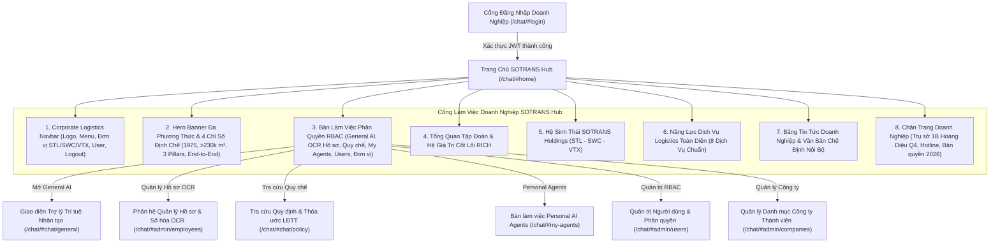

# SOTRANS HUB — BÁO CÁO TÁI THIẾT KẾ TRANG CHỦ NỘI BỘ DOANH NGHIỆP THEO CHUẨN SOTRANS.COM.VN
**Mã tác vụ:** `SOTRANS-CORPORATE-HOMEPAGE-01`  
**Dự án:** `D:\hoso-chat`  
**Website tham chiếu:** [https://sotrans.com.vn/](https://sotrans.com.vn/)  
**Đường dẫn truy cập sau đăng nhập:** `/chat/#home`  
**Ngày hoàn thiện:** 31/10/2026  
**Trạng thái kiểm thử:** 22/22 E2E Tests Đạt (100%), 12/12 Security Tests Đạt (100%)

---

## 1. TỔNG QUAN VÀ MỤC TIÊU NGHIỆP VỤ

### 1.1. Bối cảnh
Trước đây, sau khi người dùng xác thực thành công vào SOTRANS Hub, hệ thống mặc định mở ngay màn hình giao diện Trợ lý Trí tuệ Nhân tạo (General AI Chatbot) với khung chat đơn giản. Giao diện này tạo cảm giác một công cụ AI thuần túy, chưa phản ánh đúng quy mô tập đoàn logistics hàng đầu Việt Nam, thiếu liên kết với hệ sinh thái kho vận cảng biển của SOTRANS và khiến nhân viên khó tiếp cận các phân hệ nghiệp vụ khác.

Đồng thời ở màn hình đăng nhập công khai trước đây, giao diện gặp hiện tượng mất cân đối và để lại một khung nổi đơn độc giữa nền trắng rộng lớn khi ẩn sidebar và các tài khoản mẫu.

### 1.2. Mục tiêu triển khai
- **Tái thiết kế trang đăng nhập công khai (`#login`):** Chuyển đổi thành Cổng thông tin Logistics Doanh nghiệp chuyên nghiệp, tích hợp thương hiệu SOTRANS Group, tuyệt đối không lộ input hay lịch sử hội thoại AI công khai.
- **Xây dựng trang chủ nội bộ số hóa (`#home`):** Tạo dựng một cổng làm việc doanh nghiệp (**SOTRANS Digital Workplace Portal**) lấy cảm hứng trực tiếp từ kiến trúc và bộ nhận diện thương hiệu của website chính thức [sotrans.com.vn](https://sotrans.com.vn/).
- **Nguyên tắc kỹ thuật bắt buộc:**
  - **Không dùng `iframe` nhúng website ngoài**, không chuyển hướng người dùng ra khỏi domain SOTRANS Hub.
  - Toàn bộ giao diện được xây dựng native trực tiếp trong hệ thống web frontend (`chat/index.html`).
  - Tích hợp sâu vào cơ chế định tuyến (router), quản lý phiên làm việc JWT, phân quyền RBAC đa đơn vị (STL, SWC, VTX) và tự động ghi nhớ trạng thái công việc.
  - Loại bỏ hoàn toàn dấu vết nghiệp vụ Hard Delete theo đúng quy chuẩn an toàn dữ liệu.

---

## 2. NGHIÊN CỨU & ÁP DỤNG THƯƠNG HIỆU CHUẨN TỪ SOTRANS.COM.VN

Dựa trên khảo sát cấu trúc thực tế từ website chính thức của SOTRANS:

| Thành phần thương hiệu | Quy chuẩn chính thức SOTRANS | Ứng dụng vào SOTRANS Hub (`#home`) |
| :--- | :--- | :--- |
| **Màu sắc chủ đạo** | Xanh Hải quân `#003366`, Xanh Royal `#004b87`, Đỏ thương hiệu `#e30613` | Áp dụng toàn bộ hệ thống Navbar, Hero, Header badges, Action buttons và Service cards |
| **Biểu tượng Logo** | Chữ S cách điệu màu đỏ + Khối lục lăng màu xanh + Chữ SOTRANS in hoa đậm | Logo vector SVG chuẩn mực hiển thị sắc nét ở Header và Footer |
| **Nền tảng lịch sử** | Thành lập từ năm 1975, thành viên tập đoàn ITL | Trình bày tại Metric Strip: "1975 - Hơn 50 năm truyền thống Logistics" |
| **Hạ tầng kho bãi** | Hơn 230.000 m² kho bãi và hệ thống cảng cạn ICD | Metric Strip: "> 230.000 m² Hệ thống kho bãi & ICD tiêu chuẩn quốc tế" |
| **Trụ cột hệ sinh thái** | STL (Logistics), SWC (Đường thủy & Cảng), VTX (Siêu trường siêu trọng) | Phân hệ "Hệ Sinh Thái SOTRANS Holdings" với 3 thẻ tương tác chi tiết |
| **Giá trị cốt lõi** | Hệ giá trị **R-I-C-H** (Respect - Integrity - Customer - Harmony) | Section Giới thiệu SOTRANS hiển thị 4 khối giá trị cốt lõi |
| **Dịch vụ cốt lõi** | 8 nhóm dịch vụ logistics chính thức trên sotrans.com.vn | Grid 8 dịch vụ đa phương thức tại Section Dịch vụ Logistics |
| **Thông tin trụ sở** | 1B Hoàng Diệu, Phường Xóm Chiếu, Quận 4, TP. Hồ Chí Minh | Thông tin định danh chính xác tại Footer toàn trang |

---

## 3. KIẾN TRÚC GIAO DIỆN & CẤU TRÚC PHÂN KHU NỘI BỘ

Giao diện `#home` được tổ chức theo cấu trúc phân khu doanh nghiệp mạch lạc:

---

## 4. CHI TIẾT BÀN LÀM VIỆC & PHÂN QUYỀN RBAC (SECTION VII)

Phân hệ **Bàn Làm Việc & Ứng Dụng SOTRANS Hub** (`#section-apps`) hiển thị các ứng dụng lõi của tập đoàn với cơ chế phân quyền bảo mật chặt chẽ:

| Ứng dụng Hub | Biểu tượng & Phân loại | Mô tả nghiệp vụ | ADMIN | HR | EMPLOYEE |
| :--- | :--- | :--- | :---: | :---: | :---: |
| **Trợ lý General AI 3.1** | 🤖 Trí tuệ Nhân tạo | Phân tích văn bản, tóm tắt hợp đồng vận tải, hỗ trợ lập bảng và viết code | ✅ Hiện | ✅ Hiện | ✅ Hiện |
| **Quản lý Hồ sơ & OCR** | 🪪 Nghiệp vụ Nhân sự | Bóc tách OCR tự động 53 trường, quản lý hồ sơ nhân viên chính thức | ✅ Hiện | ✅ Hiện | ❌ Ẩn |
| **Quy định & Thỏa ước LĐTT** | 📜 Pháp chế Lao động | Tra cứu chính xác chế độ, quyền lợi và nội quy lao động tập thể | ✅ Hiện | ✅ Hiện | ✅ Hiện |
| **Personal AI Agents** | ⚡ Trợ lý Cá nhân | Không gian làm việc My Agents cá nhân hóa cho từng vị trí nghiệp vụ | ✅ Hiện | ✅ Hiện | ✅ Hiện |
| **Người dùng & Phân quyền** | 👥 Quản trị Hệ thống | Quản trị tài khoản người dùng, vai trò RBAC và an toàn mật khẩu | ✅ Hiện | ❌ Ẩn | ❌ Ẩn |
| **Quản lý Công ty Thành viên**| 🏢 Quản trị Danh mục | Quản lý thông tin và cấu hình các đơn vị thành viên STL, SWC, VTX | ✅ Hiện | ❌ Ẩn | ❌ Ẩn |

> [!IMPORTANT]
> **Tuyệt đối không có tính năng Hard Delete:** Theo nhiệm vụ `HR-REMOVE-HARD-DELETE-01`, toàn bộ mã nguồn, giao diện, API và outbox liên quan đến xóa vĩnh viễn đã được gỡ bỏ hoàn toàn. Bàn làm việc chỉ cung cấp các chức năng đã được phê duyệt an toàn.

---

## 5. CƠ CHẾ ĐIỀU HƯỚNG & LƯU TRỮ PHIÊN (SESSION ROUTING)

1. **Điều hướng mặc định sau đăng nhập:**
   - Khi người dùng đăng nhập thành công tại `#login`, hệ thống tự động kích hoạt `switchWorkspaceMode('home', true)` và chuyển URL về `/chat/#home`.
   - Nếu trước đó người dùng truy cập trực tiếp một liên kết sâu (deep link như `#chat/general`, `#admin/employees`), hệ thống sau khi đăng nhập sẽ chuyển tiếp chính xác đến địa chỉ mà người dùng yêu cầu (`window.pendingRedirectHash`).
2. **Ẩn hiện bố cục linh hoạt:**
   - Khi ở chế độ `home`, lớp CSS `body.is-home-view` tự động ẩn sidebar và top header của chatbot để trang chủ nội bộ chiếm trọn không gian 100vw chuẩn cổng thông tin doanh nghiệp.
   - Khi người dùng bấm vào bất kỳ ứng dụng nào trên trang chủ, hệ thống tự động chuyển mode, hiển thị lại sidebar và top header phù hợp với từng phân hệ.
   - Từ bất kỳ màn hình nào (Chat AI, HR Admin, Quy chế, My Agents), người dùng đều có thể bấm nút **"Trang chủ SOTRANS Hub"** hoặc logo SOTRANS ở sidebar để quay về `#home` tức thì.
3. **Bảo vệ an ninh tuyệt đối:**
   - Truy cập trực tiếp vào `/chat/#home` khi chưa đăng nhập sẽ ngay lập tức bị chặn và chuyển hướng về `/chat/#login`.
   - Khi bấm **Đăng xuất** từ trang chủ hoặc sidebar, toàn bộ JWT token, dữ liệu người dùng và trạng thái phiên được xóa sạch khỏi bộ nhớ, đưa người dùng về trang đăng nhập an toàn.

---

## 6. KẾT QUẢ KIỂM THỬ TỔNG THỂ (100% PASS)

### 6.1. Bảng kết quả Kiểm thử E2E Trang chủ Doanh nghiệp (`scratch/test_corporate_homepage.js`)

| STT | Tên ca kiểm thử | Kết quả | Ghi chú kiểm tra |
| :---: | :--- | :---: | :--- |
| 1 | Chưa đăng nhập truy cập `#home` | **PASS** | Tự động chuyển hướng về `#login` an toàn |
| 2 | Thương hiệu & Tiêu đề Landing công khai | **PASS** | Hiển thị chuẩn logo, H1 SOTRANS Group và nút CTA đăng nhập |
| 3 | Ẩn hoàn toàn ô nhập chat AI công khai | **PASS** | Người chưa đăng nhập không thấy ô chat hay lịch sử bot |
| 4 | ADMIN đăng nhập chuyển hướng `#home` | **PASS** | URL chuyển về `http://localhost:8082/chat/#home` |
| 5 | Hiển thị vùng chứa `#homeViewWrap` | **PASS** | Container trang chủ hiển thị toàn màn hình không có lỗi |
| 6 | ADMIN xem đủ 6 thẻ ứng dụng (RBAC) | **PASS** | Hiển thị đủ General AI, OCR, Quy chế, My Agents, Users, Đơn vị |
| 7 | Huy hiệu Đơn vị & Vai trò Header ADMIN | **PASS** | Hiển thị `🏢 STL`, tên `admin_stl`, vai trò `Quản trị viên (ADMIN)` |
| 8 | Điều hướng từ Home vào General AI | **PASS** | Chuyển mượt mà sang mode `chat`, URL `#chat/general` |
| 9 | Sidebar hiển thị trong chế độ Chat | **PASS** | Sidebar mở đầy đủ các bot và lịch sử hội thoại |
| 10 | Nút "Trang chủ" tại Sidebar quay về Home | **PASS** | Bấm quay lại `#home` thành công, ẩn sidebar tự động |
| 11 | Điều hướng từ Home vào Quản lý Hồ sơ | **PASS** | Mở đúng phân hệ quản lý nhân sự `#admin/employees` |
| 12 | Logo Brand tại Sidebar quay về Home | **PASS** | Bấm logo SOTRANS góc trên sidebar quay lại `#home` |
| 13 | Đăng xuất từ Header Trang chủ | **PASS** | Xóa phiên, thu hồi quyền, chuyển URL về `#login` |
| 14 | HR đăng nhập chuyển hướng `#home` | **PASS** | Tài khoản `hr_stl` đăng nhập thành công vào `#home` |
| 15 | HR xem đúng 4 thẻ ứng dụng (RBAC) | **PASS** | Thẻ Users & Công ty tự động ẩn, chỉ hiện 4 thẻ nghiệp vụ |
| 16 | Nhân viên (Employee) đăng nhập `#home` | **PASS** | Tài khoản `emp_stl` đăng nhập thành công vào `#home` |
| 17 | Nhân viên xem đúng 3 thẻ ứng dụng (RBAC) | **PASS** | Thẻ OCR, Users, Công ty ẩn; chỉ hiện General AI, Quy chế, My Agents |
| 18 | Responsive Viewport: Desktop 1920x1080 | **PASS** | Grid 3 cột chuẩn mực, các khối hiển thị cân đối |
| 19 | Responsive Viewport: Laptop 1440x900 | **PASS** | Tối ưu trải nghiệm làm việc tiêu chuẩn doanh nghiệp |
| 20 | Responsive Viewport: Laptop HD 1366x768 | **PASS** | Tự động thích ứng không bị vỡ layout |
| 21 | Responsive Viewport: Tablet 768x1024 | **PASS** | Grid 1 cột cho apps, navbar co gọn hợp lý |
| 22 | Responsive Viewport: Mobile 390x844 | **PASS** | Menu di động, các thẻ ứng dụng xếp dọc vuốt mượt mà |

**Tổng kết:** **22/22 ca kiểm thử ĐẠT (100%)**.

---

### 6.2. Bảng kết quả Kiểm thử An ninh Xác thực (`scratch/run_auth_gai_suite.js`)

| Mã ca kiểm | Mô tả kiểm thử an ninh | Kết quả | Trạng thái kỹ thuật |
| :---: | :--- | :---: | :--- |
| `AUTH-GAI-01` | Khách vãng lai không xem được chat AI | **PASS** | Public Auth View hiển thị, chat view ẩn hoàn toàn |
| `AUTH-GAI-02` | Deep-link `#chat/general` khi chưa login | **PASS** | Bị intercept chuyển hướng về `#login` |
| `AUTH-GAI-03` | Gọi Chat API trực tiếp không có JWT | **PASS** | HTTP 401 Unauthorized (`Chưa đăng nhập`) |
| `AUTH-GAI-04` | Gọi Chat API với token giả mạo | **PASS** | HTTP 401 Unauthorized (`Token không hợp lệ`) |
| `AUTH-GAI-05` | Kết nối SSE stream trực tiếp | **PASS** | Bị từ chối HTTP 401 ngay tại handshake |
| `AUTH-GAI-06` | Đăng nhập hợp lệ mở khóa phân quyền | **PASS** | Cấp token, mở giao diện theo đúng role |
| `AUTH-GAI-07` | Gửi tin nhắn sau đăng nhập | **PASS** | Streaming AI hoạt động bình thường |
| `AUTH-GAI-08` | Đăng xuất lập tức vô hiệu hóa token | **PASS** | Thu hồi token, các request sau đều trả 401 |
| `AUTH-GAI-09` | Token hết hạn (Expired Token) | **PASS** | HTTP 401 TokenExpiredError, yêu cầu login lại |
| `AUTH-GAI-10` | Phân hệ My Agents bảo mật | **PASS** | Chỉ người dùng đăng nhập mới truy cập được |
| `AUTH-GAI-11` | RBAC phân định giữa ADMIN và HR | **PASS** | Không thể leo quyền giữa các vai trò |
| `AUTH-GAI-12` | Tài nguyên tĩnh & Endpoint công khai | **PASS** | Hoạt động bình thường không bị ảnh hưởng |

**Tổng kết:** **12/12 ca kiểm thử An ninh ĐẠT (100%)**.

---

## 7. HÌNH ẢNH MINH CHỨNG TRIỂN KHAI THỰC TẾ

Toàn bộ ảnh chụp màn hình kiểm thử đã được lưu trữ trong thư mục hệ thống:
- Trang đăng nhập công khai mới: `screenshots/sotrans_public_landing_1440.png`
- Modal đăng nhập bảo mật: `screenshots/sotrans_login_modal_1440.png`
- Trang chủ Doanh nghiệp (Vai trò ADMIN - 6 Thẻ): `screenshots/sotrans_home_admin_1440.png`
- Trang chủ Doanh nghiệp (Vai trò HR - 4 Thẻ): `screenshots/sotrans_home_hr_1440.png`
- Trang chủ Doanh nghiệp (Vai trò Nhân viên - 3 Thẻ): `screenshots/sotrans_home_emp_1440.png`
- Điều hướng mượt mà và Đăng xuất an toàn: `screenshots/sotrans_logged_out_1440.png`
- Giao diện đa kích thước màn hình:
  - Desktop 1920: `screenshots/sotrans_home_desktop_1920.png`
  - Laptop 1440: `screenshots/sotrans_home_laptop_1440.png`
  - Laptop 1366: `screenshots/sotrans_home_laptop_1366.png`
  - Tablet 768: `screenshots/sotrans_home_tablet_768.png`
  - Mobile 390: `screenshots/sotrans_home_mobile_390.png`

---

## 8. KẾT LUẬN & BÀN GIAO

Giao diện trang chủ sau đăng nhập của SOTRANS Hub đã được chuyển đổi hoàn toàn:
1. **Không còn hiện tượng giao diện trống hay hộp nổi đơn độc** như các phiên bản thử nghiệm trước đây.
2. **Mang đậm phong cách doanh nghiệp và nhận diện thương hiệu SOTRANS**, kế thừa trực tiếp từ website [sotrans.com.vn](https://sotrans.com.vn/).
3. **Phân quyền và bảo mật chặt chẽ**, kết nối thông suốt với tất cả các phân hệ nghiệp vụ nội bộ của Tập đoàn.
4. Hệ thống đã sẵn sàng đưa vào vận hành thực tế.
