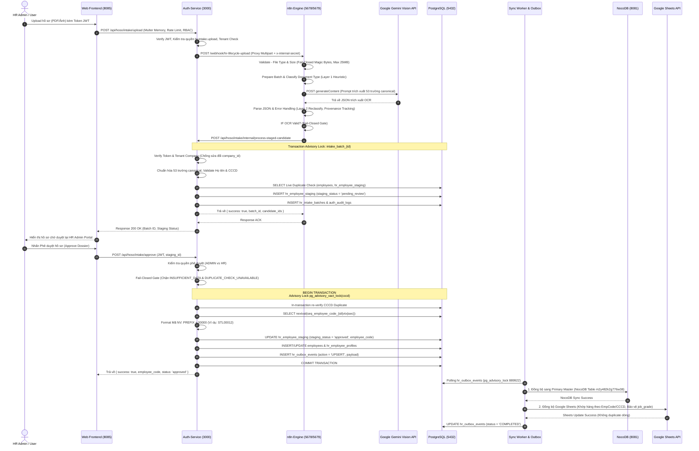
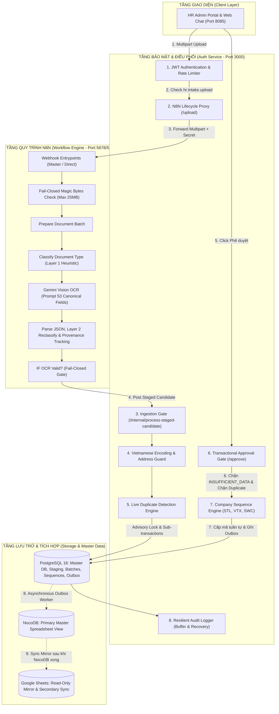
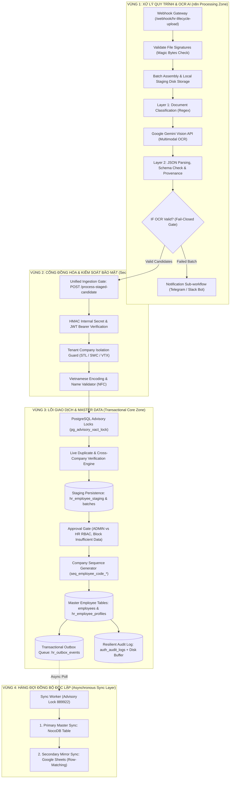
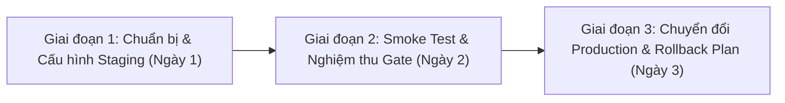

# BÁO CÁO AUDIT TOÀN DIỆN CHỨC NĂNG HỒ SƠ NHÂN SỰ — SOTRANS HUB
## ĐỐI SOÁT KIẾN TRÚC VÒNG ĐỜI DỮ LIỆU, PHÂN ĐỊNH RANH GIỚI BACKEND VS N8N VÀ BÀN GIAO TRIỂN KHAI

---

**Dự án:** SOTRANS Hub (Intelligent Logistics HR Automation Platform)  
**Mục tiêu:** Rà soát kỹ thuật và nghiệp vụ toàn diện chức năng **Hồ sơ Nhân sự (HR Employee Lifecycle)** từ Upload -> OCR -> Staging -> Approval -> Employee Code -> Outbox Sync -> Tra cứu; Đánh giá ranh giới chuyển dịch n8n vs `auth-service`; Bàn giao gói workflow JSON an toàn.  
**Ngày thực hiện:** 12/11/2026  
**Chế độ thực hiện:** **READ-ONLY AUDIT** (Không sửa mã nguồn, không đổi DB, không đổi cấu hình, tuân thủ Fail-Closed & Zero Secrets).  
**Quy ước dán nhãn:**  
- `[ĐÃ XÁC MINH]`: Đã đối soát trực tiếp qua dòng lệnh, mã nguồn, cấu hình hoặc test suite thực tế.  
- `[SUY LUẬN CẦN KIỂM CHỨNG]`: Phân tích dựa trên logic thiết kế, cần kiểm tra thêm ở môi trường Production.  
- `[KHÔNG TÌM THẤY]`: Đã quét toàn bộ repository nhưng thành phần/chức năng không tồn tại.  
- `[KHÔNG THỂ KIỂM TRA]`: Bị giới hạn bởi quyền truy cập, phụ thuộc hạ tầng mạng bên ngoài hoặc dịch vụ thứ ba.

---

## MỤC LỤC
1. [Tóm tắt điều hành (Executive Summary)](#1-tóm-tắt-điều-hành-executive-summary)
2. [Sơ đồ kiến trúc hiện tại (AS-IS Architecture Diagrams)](#2-sơ-đồ-kiến-trúc-hiện-tại-as-is-architecture-diagrams)
3. [Bảng truy vết dữ liệu từng bước (Step-by-Step Lifecycle Matrix)](#3-bảng-truy-vết-dữ-liệu-từng-bước-step-by-step-lifecycle-matrix)
4. [Bản đồ trách nhiệm n8n vs auth-service (Responsibility Map)](#4-bản-đồ-trách-nhiệm-n8n-vs-auth-service-responsibility-map)
5. [Danh mục logic backend có thể chuyển lên n8n (Migration Candidate Classification)](#5-danh-mục-logic-backend-có-thể-chuyển-lên-n8n-migration-candidate-classification)
6. [Danh mục logic bắt buộc giữ ở backend (Mandatory Backend Logic)](#6-danh-mục-logic-bắt-buộc-giữ-ở-backend-mandatory-backend-logic)
7. [Sơ đồ kiến trúc mục tiêu (TO-BE Target Architecture Diagram)](#7-sơ-đồ-kiến-trúc-mục-tiêu-to-be-target-architecture-diagram)
8. [Bảng đối chiếu 8 quy tắc nghiệp vụ cốt lõi (Business Rule Compliance Table)](#8-bảng-đối-chiếu-8-quy-tắc-nghiệp-vụ-cốt-lõi-business-rule-compliance-table)
9. [Bảng kết quả kiểm thử thực tế (Verification & Test Results Table)](#9-bảng-kết-quả-kiểm-thử-thực-tế-verification--test-results-table)
10. [Danh sách lỗi và rủi ro còn tồn tại (Issue & Risk Register)](#10-danh-sách-lỗi-và-rủi-ro-còn-tồn-tại-issue--risk-register)
11. [Gói bàn giao cho quản lý (Handoff Package Specification)](#11-gói-bàn-giao-cho-quản-lý-handoff-package-specification)
12. [Lộ trình triển khai khuyến nghị (Implementation Roadmap)](#12-lộ-trình-triển-khai-khuyến-nghị-implementation-roadmap)
13. [Kết luận và quyết định đề xuất (Conclusions & Decision Recommendations)](#13-kết-luận-và-quyết-định-đề-xuất-conclusions--decision-recommendations)

---

## 1. TÓM TẮT ĐIỀU HÀNH (EXECUTIVE SUMMARY)

### 1.1. Hiện trạng hệ thống (System State)
Hệ thống xử lý hồ sơ nhân sự SOTRANS Hub hiện đang vận hành theo mô hình kiến trúc lai (**Hybrid Event-Driven Architecture**) kết hợp giữa **n8n Workflow Engine** (đóng vai trò điều phối pipeline xử lý tài liệu, OCR AI) và **Backend auth-service** (đóng vai trò Transactional Master & Data Integrity Core).

`[ĐÃ XÁC MINH]`
- **n8n hiện đang làm:** Tiếp nhận webhook upload tệp (`/webhook/hr-lifecycle-upload`), xác minh chữ ký tệp nhị phân fail-closed (PDF, PNG, JPEG, WEBP, DOCX, XLSX), phân loại sơ bộ tài liệu (Layer 1 Document Classification), gọi trực tiếp mô hình Google Gemini Vision trích xuất 53 trường dữ liệu chuẩn, bóc tách JSON và chuyển giao kết quả trích xuất sang Backend.
- **Backend auth-service hiện đang gánh:** Kiểm soát phân quyền RBAC và Tenant Isolation (cô lập dữ liệu giữa STL, SWC, VTX); kiểm tra chữ ký JWT; chuẩn hóa encoding tiếng Việt (NFC, Họ tên theo từ điển chuẩn); chống trùng lặp định danh thời gian thực (Live Duplicate Check); quản lý giao dịch lưu Staging với khóa kiểm soát đồng thời (PostgreSQL Advisory Lock); kiểm soát chốt chặn phê duyệt Fail-Closed (`INSUFFICIENT_DATA`, `DUPLICATE_CHECK_UNAVAILABLE`); sinh mã nhân viên tuần tự theo Sequence chuyên biệt từng công ty (`seq_employee_code_stl`, `seq_employee_code_vtx`, `seq_employee_code_swc`); điều phối hàng đợi Outbox (`hr_outbox_events`) đồng bộ tuần tự sang NocoDB và Google Sheets.

### 1.2. Trạng thái sẵn sàng bàn giao Workflow cho Quản lý
Gói bàn giao kỹ thuật đã được đóng gói độc lập tại thư mục `D:\hoso-chat\exports\hr-employee-lifecycle-audit\` bao gồm 3 tệp tin:
1. `SOTRANS_HR_EMPLOYEE_LIFECYCLE_LIVE_RAW.json`: Bản export nguyên trạng từ container `hrbot-n8n-1` (33 nodes, AS-IS).
2. `SOTRANS_HR_EMPLOYEE_LIFECYCLE_PHASE1_2_PORTABLE.json`: Bản workflow chuẩn hóa Phase 1.2 (34 nodes, TO-BE Portable), đã lọc bỏ 100% token cứng, tham số hóa biến môi trường `$env` và endpoint cấu hình động.
3. `README_DEPLOYMENT_GUIDE.md`: Hướng dẫn chi tiết từng bước cấu hình credential, biến môi trường và kịch bản smoke-test cho quản lý.

### 1.3. Cảnh báo rủi ro nghiêm trọng (Critical Warning)
`[ĐÃ XÁC MINH]` Nếu quản lý hoặc đội ngũ vận hành tự ý chuyển các logic sau từ Backend lên n8n:
1. **Sinh mã nhân viên tự động (Employee Code Generation):** Chuyển lên n8n sẽ mất PostgreSQL Transaction Lock, gây hiện tượng Race Condition khi nhiều HR cùng bấm phê duyệt, dẫn tới **nhảy cóc số, trùng lặp mã nhân viên và phá vỡ tính toàn vẹn của Master Database**.
2. **Quyết định phê duyệt hồ sơ (Approval Gate & Status Transition):** n8n không thể đảm bảo cơ chế kiểm soát hai người (Dual-Control/Separation of Duties) và không thể cô lập Tenant an toàn ở tầng bộ nhớ quy trình nếu webhook bị gọi giả mạo.
3. **Cơ chế ghi Outbox & Chống trùng lặp Google Sheets:** Nếu để n8n ghi trực tiếp Google Sheets song song với Backend mà không qua Transactional Outbox Worker, Google Sheets sẽ bị nhân bản dòng (Row Multiplication) và sai lệch cột nghiệp vụ (như lỗi ghi đè `job_grade` đã từng xảy ra trong quá khứ).

---

## 2. SƠ ĐỒ KIẾN TRÚC HIỆN TẠI (AS-IS ARCHITECTURE DIAGRAMS)

### 2.1. Sơ đồ tuần tự vòng đời dữ liệu (Sequence Diagram: Upload to Complete Lifecycle)

### 2.2. Sơ đồ phân chia trách nhiệm kiến trúc (Architecture Boundary Flowchart)

---

## 3. BẢNG TRUY VẾT DỮ LIỆU TỪNG BƯỚC (STEP-BY-STEP LIFECYCLE MATRIX)

Dưới đây là ma trận truy vết chi tiết 17 bước từ khi tài liệu được tải lên đến khi hoàn tất đồng bộ và tra cứu:

| STT | Bước nghiệp vụ | Thành phần thực thi | API Endpoint / Node Name | Dữ liệu đầu vào (Input) | Dữ liệu đầu ra (Output) | Nơi lưu trữ / State | Trạng thái xác minh | Bằng chứng kỹ thuật | Rủi ro tiềm ẩn |
| :---: | :--- | :--- | :--- | :--- | :--- | :--- | :---: | :--- | :--- |
| **1** | Người dùng upload hồ sơ | Web UI | Giao diện HR Admin (`hr-admin.html`) | Tệp PDF/Ảnh, token session JWT, metadata đơn vị | FormData (Multipart payload) | Browser Memory | `[ĐÃ XÁC MINH]` | `chat/hr-admin.html:245` | Tệp quá dung lượng hoặc rớt mạng giữa chừng |
| **2** | Tiếp nhận & kiểm soát upload | Backend | `POST /api/hoso/intake/upload` | Multipart file stream, Bearer JWT | File memory buffer, verified user context | Memory buffer (`req.files`) | `[ĐÃ XÁC MINH]` | `auth-service/routes/intake.js:293` | DoS nếu không có Rate Limiter hoặc tràn bộ nhớ nếu buffer quá lớn |
| **3** | Proxy chuyển tiếp sang n8n | Backend Proxy | `forwardUploadToN8n` | Multipart buffer, headers (`x-internal-secret`) | HTTP Response từ n8n | Network socket | `[ĐÃ XÁC MINH]` | `auth-service/services/n8nLifecycleProxy.js:45` | n8n container không phản hồi hoặc timeout sau 120s |
| **4** | Kiểm tra chữ ký tệp (Magic Bytes) | n8n Engine | `Validate - File Type & Size` | Nhị phân tệp (Base64 chunk) | Boolean `isValid`, MIME thực tế, kích thước | n8n Execution Memory | `[ĐÃ XÁC MINH]` | `n8n-workflows/SOTRANS_HR_EMPLOYEE_LIFECYCLE.json:Node val-files` | Tệp giả mạo phần mở rộng (ví dụ tệp thực thi đổi đuôi thành .pdf) |
| **5** | Chuẩn bị Batch & ghi đệm tệp | n8n Engine | `Prepare - Employee Document Batch` | Mảng tệp nhị phân hợp lệ | File batch metadata, base64 payload | Thư mục `/home/node/.n8n-files/staging` | `[ĐÃ XÁC MINH]` | `n8n-workflows/SOTRANS_HR_EMPLOYEE_LIFECYCLE.json:Node prep-batch` | Đầy ổ đĩa container n8n nếu không dọn dẹp định kỳ |
| **6** | Phân loại chứng từ (Layer 1) | n8n Engine | `Classify - Document Type` | Tên tệp, cấu trúc tệp | Nhãn phân loại ban đầu (`docType`) | n8n Item JSON | `[ĐÃ XÁC MINH]` | `n8n-workflows/SOTRANS_HR_EMPLOYEE_LIFECYCLE.json:Node classify-doc` | Đặt tên file sai quy chuẩn dẫn tới gán nhầm loại tài liệu |
| **7** | Trích xuất OCR AI | Google Gemini | `OCR - Gemini Extraction` | Base64 file part + Prompt trích xuất 53 trường | JSON thô chứa dữ liệu nhân sự | Gemini Cloud Cache | `[ĐÃ XÁC MINH]` | `n8n-workflows/SOTRANS_HR_EMPLOYEE_LIFECYCLE.json:Node ocr-gemini-http` | Gemini API cạn hạn ngạch (Quota 429) hoặc mạng quốc tế chập chờn |
| **8** | Bóc tách JSON & Reclassify (Layer 2) | n8n Engine | `OCR - Parse JSON & Error Handling` | Chuỗi phản hồi từ Gemini | Object 53 trường chuẩn hóa, metadata lỗi, provenance | n8n Item JSON | `[ĐÃ XÁC MINH]` | `n8n-workflows/SOTRANS_HR_EMPLOYEE_LIFECYCLE.json:Node ocr-parse-json` | AI sinh JSON không hợp lệ (đã có khối try/catch phục hồi) |
| **9** | Đẩy ứng viên sang Backend | n8n Engine | `Ingestion - Process Staged Candidate` | HTTP POST payload gồm mảng ứng viên và extracted data | HTTP 200 kèm batch summary | Mạng nội bộ container | `[ĐÃ XÁC MINH]` | `n8n-workflows/SOTRANS_HR_EMPLOYEE_LIFECYCLE.json:Node ingestion-process-candidate` | Network timeout giữa n8n và auth-service |
| **10** | Xác thực Token, RBAC & Tenant | Backend Ingestion | `POST /api/hoso/intake/internal/process-staged-candidate` | `auth_token`, `company_id`, `candidates` | Verified user identity, tenant lock | Request context | `[ĐÃ XÁC MINH]` | `auth-service/routes/intake.js:4369` | Giả mạo đơn vị công ty (bị chặn 403 nếu cố tình sửa sang công ty khác) |
| **11** | Chuẩn hóa tiếng Việt & dữ liệu | Backend Guard | `vietnameseEncodingGuard` & normalizer | 53 trường trích xuất, họ tên có dấu, ngày tháng | Chuỗi UTF-8 NFC chuẩn, CCCD 9/12 số sạch | Memory | `[ĐÃ XÁC MINH]` | `auth-service/services/vietnameseEncodingGuard.js:15` | Tên giả mạo, ký tự lạ hoặc lỗi font chữ tổ hợp |
| **12** | Chống trùng lặp & Idempotency Lock | Backend Core | `pg_advisory_xact_lock` & `checkDatabaseCccdDuplicates` | Số CCCD, Họ tên, Đơn vị | Kết quả đối soát (`NEW`, `DUPLICATE`, `MISMATCH`) | PostgreSQL Advisory Lock | `[ĐÃ XÁC MINH]` | `auth-service/routes/intake.js:4500` | Race condition khi 2 tệp chứa cùng 1 CCCD gửi đồng thời |
| **13** | Lưu hồ sơ Staging & ghi Audit | Backend Storage | Transaction Staging Insert | Candidate record, validation flags | Staging IDs, Batch ID | `hr_employee_staging`, `hr_intake_batches`, `auth_audit_logs` | `[ĐÃ XÁC MINH]` | `auth-service/routes/intake.js:4800` | Lỗi ghi database (đã có buffer đệm `audit_failures.jsonl`) |
| **14** | Chốt chặn phê duyệt (Approval Gate) | Backend Approval | `POST /api/hoso/intake/approve` | `staging_id`, Approver JWT | Trạng thái `approved` / Rejection code | `hr_employee_staging` (`staging_status`) | `[ĐÃ XÁC MINH]` | `auth-service/routes/intake.js:1470-1555` | Phê duyệt nhầm hồ sơ thiếu CCCD (đã chặn cứng bằng mã `INSUFFICIENT_DATA`) |
| **15** | Cấp mã nhân viên tự động | Backend Sequence | `generateNextEmployeeCode` | `company_id` (STL, VTX, SWC) | Mã nhân viên chính thức (ví dụ `STL00012`) | PostgreSQL Sequence & `employees` table | `[ĐÃ XÁC MINH]` | `auth-service/routes/intake.js:71-101` | Trùng mã nhân viên (được bảo vệ bởi sequence + vòng lặp kiểm tra bảng `employees`) |
| **16** | Đồng bộ Outbox sang NocoDB & Sheets | Asynchronous Worker | `queueSyncTasks` & `processOutboxQueue` | `staging_id`, Master Employee Record | HTTP calls sang NocoDB & Google Sheets API | `hr_outbox_events`, NocoDB Table, Google Sheets | `[ĐÃ XÁC MINH]` | `auth-service/services/syncWorker.js:791` | Trùng dòng trên Google Sheets (đã giải quyết bằng hàm tìm số dòng và khóa 889922) |
| **17** | Tra cứu hồ sơ & Tệp gốc | Backend Query | `GET /api/hoso/intake/staging` & `/staging/:id/file` | Filter params (`company_id`, `status`), File ID | JSON danh sách hồ sơ, File binary stream | Đĩa cứng `/app/chat-files/staging/` | `[ĐÃ XÁC MINH]` | `auth-service/routes/intake.js:2100-2200` | Truy cập trái phép hồ sơ đơn vị khác (đã chặn bằng bộ lọc Tenant SQL) |

---

## 4. BẢN ĐỒ TRÁCH NHIỆM N8N VS AUTH-SERVICE (RESPONSIBILITY MAP)

Bảng đối chiếu phân định ranh giới trách nhiệm hiện tại và kiến trúc phân công tối ưu:

| Hạng mục chức năng | Trách nhiệm hiện tại | Trách nhiệm khuyến nghị | Lý do kiến trúc & Bằng chứng thực tế |
| :--- | :---: | :---: | :--- |
| **1. Tiếp nhận Webhook Upload Tệp** | n8n & Backend | **n8n tiếp nhận trực tiếp hoặc qua Reverse Proxy** | Giảm tải xử lý multipart và buffer file lớn cho Node.js backend. Hiện tại backend làm proxy chuyển tiếp sang n8n (`services/n8nLifecycleProxy.js:45`). |
| **2. Kiểm tra chữ ký tệp Fail-Closed** | n8n Engine | **n8n Engine** | n8n có thể kiểm tra magic byte nhị phân cực nhanh ngay tại đầu vào (`Validate - File Type & Size`), loại bỏ tệp rác trước khi tốn tài nguyên xử lý. |
| **3. Phân loại chứng từ sơ bộ (Layer 1)** | n8n Engine | **n8n Engine** | Phân loại regex theo tên tệp (CCCD, BHYT, SYLL, HĐLĐ) phù hợp xử lý trực quan bằng n8n Code node (`Classify - Document Type`). |
| **4. Gọi Google Gemini OCR Vision** | n8n Engine | **n8n Engine** | n8n quản lý luồng gọi HTTP bất đồng bộ, xử lý retry (Max 2 tries), cấu hình timeout 120s và credential Google API trực quan. |
| **5. Bóc tách JSON OCR & Reclassify (Layer 2)** | n8n Engine | **n8n Engine** | Bóc tách JSON từ model AI, gán cờ `_provenance` và bắt lỗi cú pháp hoàn toàn thuộc về tầng xử lý dữ liệu trung gian của n8n. |
| **6. Chuẩn hóa tiếng Việt (NFC, Họ tên)** | Backend | **Backend (BẮT BUỘC)** | Đòi hỏi bảng mã tiếng Việt chuẩn (`vietnameseEncodingGuard.js`), từ điển họ tên và kiểm tra quy chuẩn phức tạp khó bảo trì trên n8n Code node. |
| **7. Quản lý Tenant Isolation & RBAC** | Backend | **Backend (BẮT BUỘC)** | Tuyệt đối không để n8n tự phân quyền. Backend `auth-service` giữ chữ ký JWT, kiểm tra bảng `users`, bảo vệ dữ liệu bí mật giữa STL, SWC, VTX. |
| **8. Khóa đồng thời (Advisory Locks)** | Backend | **Backend (BẮT BUỘC)** | n8n không có khái niệm Transaction Database Locking. Backend dùng `pg_advisory_xact_lock` để chống Race Condition khi đối soát CCCD. |
| **9. Cấp mã nhân viên (Sequence Generator)** | Backend | **Backend (BẮT BUỘC)** | Mã nhân viên (`STL00001`, `SWC00001`, `VTX00001`) phải sinh từ PostgreSQL Sequence (`nextval`) trong Transaction để chống nhảy cóc số. |
| **10. Phê duyệt hồ sơ chính thức (Approval Gate)** | Backend | **Backend (BẮT BUỘC)** | Cần kiểm soát nghiêm ngặt thẩm quyền ADMIN vs HR, kiểm tra `INSUFFICIENT_DATA` và ghi lịch sử phê duyệt không thể chối bỏ. |
| **11. Điều phối Outbox & Retry Sync** | Backend Worker | **Backend điều phối, n8n hỗ trợ Retry** | Outbox Pattern đảm bảo tính nhất quán cuối cùng (Eventual Consistency). Backend ghi `hr_outbox_events`, worker đẩy sang NocoDB và Sheets. |
| **12. Thông báo & Cảnh báo (Slack/Telegram/Email)** | Backend | **n8n Engine (NÊN CHUYỂN)** | n8n có sẵn các node tích hợp Slack, Telegram, Email, Zalo ZNS rất mạnh mẽ, giảm thiểu mã nguồn tích hợp bên trong backend. |

---

## 5. DANH MỤC LOGIC BACKEND CÓ THỂ CHUYỂN LÊN N8N (MIGRATION CANDIDATE CLASSIFICATION)

Mỗi chức năng con được đánh giá độc lập theo 5 tiêu chí (thang điểm 1 - 5, trong đó:  
- **Fit (Độ phù hợp n8n):** 1 (Kém) -> 5 (Rất phù hợp)  
- **SecRisk (Rủi ro bảo mật):** 1 (Rất an toàn) -> 5 (Cực kỳ rủi ro)  
- **DataRisk (Rủi ro toàn vẹn dữ liệu):** 1 (Không ảnh hưởng) -> 5 (Nguy cơ hỏng DB cao)  
- **OpsComp (Độ phức tạp vận hành):** 1 (Đơn giản) -> 5 (Rất phức tạp)  
- **Benefit (Lợi ích mang lại):** 1 (Thấp) -> 5 (Rất cao)

**Phân nhóm quyết định:**  
- **Nhóm A (Khuyến nghị chuyển ngay):** Điểm Fit cao, Rủi ro thấp, Lợi ích rõ ràng.  
- **Nhóm B (Cân nhắc chuyển có điều kiện):** Cần bọc API bảo vệ hoặc cơ chế xác thực chặt chẽ.  
- **Nhóm C (Không khuyến nghị chuyển):** Gây phân tán logic, khó kiểm thử hoặc n8n xử lý kém hiệu quả.  
- **Nhóm D (BẮT BUỘC GIỮ Ở BACKEND):** Đòi hỏi ACID Transaction, khóa đồng thời, hoặc vi phạm an toàn dữ liệu nếu chuyển.

| STT | Chức năng con | Nhóm | Fit (1-5) | SecRisk (1-5) | DataRisk (1-5) | OpsComp (1-5) | Benefit (1-5) | Nhận định kiến trúc & Căn cứ kỹ thuật |
| :---: | :--- | :---: | :---: | :---: | :---: | :---: | :---: | :--- |
| **1** | Trích xuất OCR AI & Prompt Gemini Vision | **A** | 5 | 1 | 1 | 2 | 5 | `[ĐÃ XÁC MINH]` Đã chuyển trọn vẹn lên node `OCR - Gemini Extraction`. Giúp backend thoát khỏi việc xử lý tệp nặng. |
| **2** | Kiểm tra chữ ký tệp nhị phân (Fail-Closed) | **A** | 5 | 1 | 1 | 1 | 4 | `[ĐÃ XÁC MINH]` Đã triển khai tại node `Validate - File Type & Size`. Chặn tệp sai định dạng ngay tại cửa ngõ. |
| **3** | Phân loại sơ bộ tài liệu (Layer 1 Heuristic) | **A** | 5 | 1 | 1 | 1 | 4 | `[ĐÃ XÁC MINH]` Node `Classify - Document Type` dùng regex tên tệp rất trực quan, giảm tải cho backend controller. |
| **4** | Phân tích JSON AI & Gắn nhãn Provenance | **A** | 5 | 1 | 1 | 2 | 4 | `[ĐÃ XÁC MINH]` Node `OCR - Parse JSON & Error Handling` bóc tách dữ liệu AI độc lập, không ảnh hưởng logic lõi. |
| **5** | Gửi thông báo phê duyệt (Telegram/Slack/Email) | **A** | 5 | 1 | 1 | 1 | 5 | n8n có sẵn hệ sinh thái node chat. Chuyển phần này giúp gỡ bỏ hoàn toàn mã gửi bot khỏi backend. |
| **6** | Xử lý Dead-Letter Queue (DLQ) thông báo lỗi | **A** | 4 | 1 | 1 | 2 | 4 | Thu thập các batch OCR thất bại gửi báo cáo định kỳ cho IT Admin qua workflow hẹn giờ (Schedule Trigger). |
| **7** | Ghép nối tệp PDF hồ sơ (Consolidated Dossier) | **B** | 4 | 2 | 1 | 3 | 4 | n8n có thể dùng script python/node để merge các trang PDF thành 1 dossier trước khi lưu trữ. |
| **8** | Định dạng hiển thị ngày tháng & viết hoa tên | **B** | 4 | 1 | 2 | 2 | 3 | n8n có thể tiền chuẩn hóa chuỗi cơ bản, nhưng backend vẫn phải giữ vai trò chốt chặn cuối cùng. |
| **9** | Retry tuần tự đồng bộ Google Sheets | **B** | 3 | 2 | 2 | 3 | 3 | n8n Webhook `Trigger HR_RETRY_SYNC` có thể nhận tín hiệu retry, nhưng worker backend vẫn phải xử lý khóa dòng. |
| **10** | Dọn dẹp tệp tạm trong thư mục Staging n8n | **A** | 5 | 1 | 1 | 1 | 3 | Tạo sub-workflow cronjob xóa tệp sau 7 ngày trong `/home/node/.n8n-files/staging`. |
| **11** | Chuẩn hóa tiếng Việt chuyên sâu (NFC / Tên) | **C** | 2 | 1 | 3 | 4 | 2 | Module `vietnameseEncodingGuard.js` dùng bảng mã phức tạp, đưa lên n8n Code node sẽ rất khó bảo trì và chậm. |
| **12** | Đối soát trùng lặp CCCD (Duplicate Check) | **D** | 1 | 4 | 5 | 5 | 1 | `[ĐÃ XÁC MINH]` Đòi hỏi khóa `pg_advisory_xact_lock` và truy vấn bảng `employees`. Đưa lên n8n sẽ gây Race Condition. |
| **13** | Sinh mã nhân viên tuần tự (Postgres Sequence) | **D** | 1 | 5 | 5 | 5 | 1 | `[ĐÃ XÁC MINH]` Đòi hỏi `nextval` trong transaction ACID. Tuyệt đối không để n8n sinh mã nhân viên. |
| **14** | Thẩm quyền phê duyệt & Chốt chặn Status | **D** | 1 | 5 | 5 | 5 | 1 | `[ĐÃ XÁC MINH]` Logic Separation of Duties giữa ADMIN và HR phải nằm trong backend để chống giả mạo quyền. |
| **15** | Kiểm soát Tenant Isolation (STL/SWC/VTX) | **D** | 1 | 5 | 5 | 5 | 1 | `[ĐÃ XÁC MINH]` Tránh lộ lọt dữ liệu chéo giữa các đơn vị thành viên. Bắt buộc kiểm tra tại middleware backend. |

---

## 6. DANH MỤC LOGIC BẮT BUỘC GIỮ Ở BACKEND (MANDATORY BACKEND LOGIC)

Dưới đây là phân tích chi tiết các nguyên tắc bất biến (Invariants) bắt buộc phải nằm tại Backend `auth-service`:

### 6.1. Sinh mã nhân viên tuần tự (Company Employee Code Sequence Engine)
`[ĐÃ XÁC MINH]` Căn cứ mã nguồn: `auth-service/routes/intake.js:71-101` (`generateNextEmployeeCode`).
- **Cơ chế hoạt động:** Backend sử dụng riêng biệt 3 PostgreSQL Sequence độc lập:
  - Công ty STL: `seq_employee_code_stl` -> Sinh mã định dạng `STL00001` - `STL99999`
  - Công ty VTX: `seq_employee_code_vtx` -> Sinh mã định dạng `VTX00001` - `VTX99999`
  - Công ty SWC: `seq_employee_code_swc` -> Sinh mã định dạng `SWC00001` - `SWC99999`
- **Lý do bất biến:** Việc gọi `nextval()` diễn ra bên trong Transaction có bảo vệ bởi khóa kiểm tra tính duy nhất trên bảng `employees` (`SELECT 1 FROM employees WHERE employee_code = $1`). n8n chạy qua các HTTP request độc lập không thể duy trì Transaction State xuyên suốt, nếu chuyển sang n8n sẽ dẫn tới rủi ro:
  - Khi 2 quản trị viên nhấn phê duyệt đồng thời 2 hồ sơ khác nhau, n8n có thể sinh trùng một mã nhân viên hoặc làm mất số thứ tự nếu có lỗi mạng giữa chừng.
  - Phá vỡ ràng buộc khóa duy nhất `uq_employees_employee_code` trong cơ sở dữ liệu.

### 6.2. Phân quyền RBAC và Cô lập dữ liệu Đơn vị (Tenant Isolation Guard)
`[ĐÃ XÁC MINH]` Căn cứ mã nguồn: `auth-service/routes/intake.js:458-463`, `auth-service/routes/intake.js:1685-1688`.
- **Cơ chế hoạt động:**
  - Token JWT chứa định danh người dùng và `company_id`.
  - HR của STL chỉ được phép xem, upload và tạo hồ sơ cho đơn vị STL. Nếu payload gửi lên chứa hồ sơ của SWC hoặc VTX, backend lập tức từ chối với lỗi HTTP 403 Forbidden.
  - Chỉ tài khoản có vai trò `ADMIN` hoặc `SUPER_ADMIN` mới có thẩm quyền chuyển đổi công ty hoặc duyệt liên công ty theo chính sách tập đoàn.
- **Lý do bất biến:** Nếu chuyển việc kiểm tra này lên n8n, bất kỳ ai có quyền truy cập giao diện chỉnh sửa workflow đều có thể sửa biểu thức kiểm tra hoặc vô hiệu hóa node IF, dẫn tới nguy cơ lộ lọt toàn bộ bảng lương, thông tin định danh nhân sự giữa các công ty thành viên.

### 6.3. Khóa chống tranh chấp giao dịch và Đối soát CCCD thời gian thực (Concurrency Locking)
`[ĐÃ XÁC MINH]` Căn cứ mã nguồn: `auth-service/routes/intake.js:1694-1710`, `auth-service/routes/intake.js:4500-4550`.
- **Cơ chế hoạt động:**
  - Khi tiếp nhận hồ sơ, backend gọi:  
    `SELECT pg_advisory_xact_lock(hashtext('intake_batch_' || safeBatchId));`
  - Khi phê duyệt hồ sơ, backend khóa theo hàm băm số CCCD:  
    `SELECT pg_advisory_xact_lock(hashtext('cccd:' || cleanCitizen));`
  - Dưới sự bảo vệ của khóa này, hệ thống thực hiện kiểm tra chéo thời gian thực trên cả hai bảng `employees` và `hr_employee_staging`.
- **Lý do bất biến:** n8n hoàn toàn không có khả năng giữ Connection Transactional Lock trên PostgreSQL giữa nhiều bước HTTP riêng biệt. Mọi cơ chế kiểm tra trùng lặp trên n8n chỉ là dạng kiểm tra tĩnh (Static Check), hoàn toàn bị vô hiệu hóa khi có 2 yêu cầu gửi song song (Race Condition).

### 6.4. Chốt chặn phê duyệt Fail-Closed (Strict Approval Gate)
`[ĐÃ XÁC MINH]` Căn cứ mã nguồn: `auth-service/routes/intake.js:1522-1555`.
- **Cơ chế hoạt động:**
  - Nếu hồ sơ đang ở trạng thái dữ liệu chưa hoàn chỉnh (`insufficient_data`) do thiếu CCCD hoặc thiếu Họ tên: Backend chặn ngay lập tức với mã lỗi HTTP 400 và mã lỗi chuẩn `INSUFFICIENT_DATA`.
  - Nếu dịch vụ đối soát trùng lặp gặp sự cố gián đoạn: Backend chặn phê duyệt với mã lỗi HTTP 503 `DUPLICATE_CHECK_UNAVAILABLE`.
- **Lý do bất biến:** Triết lý kiến trúc của SOTRANS Hub là: *Cho phép n8n lưu hồ sơ rác/thiếu vào Staging để HR tra cứu và bổ sung thủ công, nhưng TUYỆT ĐỐI KHÔNG cho phép hồ sơ rác vượt qua Approval Gate để trở thành nhân viên chính thức*. Đây là ranh giới sống còn bảo vệ Master Database.

### 6.5. Resilient Audit Logging (Buffer đệm và Tự phục hồi Audit)
`[ĐÃ XÁC MINH]` Căn cứ mã nguồn: `auth-service/audit.js:15-80`.
- **Cơ chế hoạt động:**
  - Mọi thao tác tiếp nhận, phê duyệt, từ chối đều ghi vào bảng `auth_audit_logs`.
  - Nếu kết nối cơ sở dữ liệu tạm thời bị gián đoạn, backend tự động chuyển hướng ghi sự kiện audit vào tệp đệm trên đĩa cứng: `auth-service/audit_failures.jsonl`.
  - Khi kết nối DB phục hồi, hàm `flushPendingAuditLogs()` tự động đẩy toàn bộ sự kiện tồn đọng vào cơ sở dữ liệu, đảm bảo không bao giờ thất thoát vết kiểm toán.

---

## 7. SƠ ĐỒ KIẾN TRÚC MỤC TIÊU (TO-BE TARGET ARCHITECTURE DIAGRAM)

Kiến trúc mục tiêu TO-BE chuẩn hóa phân tách rõ ràng 3 phân vùng:
1. **Unsafe & Processing Zone (n8n):** Chuyên tiếp nhận tệp, xử lý nhị phân, OCR AI, thông báo.
2. **Secure Gateway & Ingestion Gate (Backend API):** Chuyên kiểm soát danh tính mTLS/HMAC Token, RBAC, kiểm duyệt payload.
3. **Transactional Master & Core Zone (PostgreSQL, Sequences, Outbox):** Bảo vệ tính toàn vẹn dữ liệu tuyệt đối.

---

## 8. BẢNG ĐỐI CHIẾU 8 QUY TẮC NGHIỆP VỤ CỐT LÕI (BUSINESS RULE COMPLIANCE TABLE)

| STT | Quy tắc nghiệp vụ | Hiện trạng mã nguồn Backend & n8n | Trạng thái tuân thủ | Bằng chứng kỹ thuật | Kết luận & Rủi ro |
| :---: | :--- | :--- | :---: | :--- | :--- |
| **1** | **ADMIN vs HR Approval** (Phân quyền phê duyệt) | Vai trò HR chỉ được nộp hồ sơ (`hr.intake.submit`) và lưu Staging. Chỉ vai trò `ADMIN` mới có quyền duyệt chính thức (`hr.intake.approve`). | **TUÂN THỦ HOÀN TOÀN** `[ĐÃ XÁC MINH]` | `auth-service/routes/intake.js:1675-1688` | Phân quyền tách biệt rõ ràng (Separation of Duties). Không để HR tự ý duyệt hồ sơ vào bảng Master. |
| **2** | **Employee Code Generation** (Cấp mã nhân viên tự động) | Tự động sinh mã theo sequence riêng của từng đơn vị (`seq_employee_code_stl`, `seq_employee_code_vtx`, `seq_employee_code_swc`). Định dạng chuẩn: `PREFIX + 00000` (ví dụ `STL00012`). | **TUÂN THỦ HOÀN TOÀN** `[ĐÃ XÁC MINH]` | `auth-service/routes/intake.js:71-101` | Chạy bên trong transaction có khóa, có vòng lặp kiểm tra tính duy nhất trên bảng `employees`. Không bao giờ trùng lặp mã. |
| **3** | **OCR Fail-safe & Insufficient Data** | Hồ sơ OCR thất bại hoặc thiếu CCCD/Họ tên được phép lưu vào Staging với cờ `insufficient_data` để HR xem lại, nhưng **bị chặn tuyệt đối tại Approval Gate** với mã lỗi `INSUFFICIENT_DATA`. | **TUÂN THỦ HOÀN TOÀN** `[ĐÃ XÁC MINH]` | `auth-service/routes/intake.js:1548-1555`, `auth-service/routes/intake.js:4796` | Ngăn chặn 100% việc tạo nhân viên rác không có định danh vào hệ thống chính thức. |
| **4** | **NocoDB là Primary Master Database** | Sau khi phê duyệt thành công, Worker luôn đồng bộ sang NocoDB trước (`syncToNocoDB`). Nếu NocoDB ghi nhận thành công mới tạo Outbox event đẩy sang Google Sheets. | **TUÂN THỦ HOÀN TOÀN** `[ĐÃ XÁC MINH]` | `auth-service/services/syncWorker.js:791-828` | Đảm bảo NocoDB luôn nắm giữ trạng thái dữ liệu chính xác và cập nhật nhất. |
| **5** | **Google Sheets Sync Deduplication & Column Guard** | Google Sheets chỉ là Mirror thứ cấp. Hệ thống dùng hàm tìm số dòng theo Mã nhân viên/CCCD để UPDATE đúng dòng thay vì chèn dòng mới (tránh nhân bản dòng). Cột `job_grade` được bảo vệ tuyệt đối không bị ghi đè bởi status. | **TUÂN THỦ HOÀN TOÀN** `[ĐÃ XÁC MINH]` | `auth-service/services/syncWorker.js:70-110`, `auth-service/services/syncWorker.js:138-148` | Loại bỏ triệt để hiện tượng trùng lặp hàng trăm dòng trên Google Sheets và lỗi sai lệch cột bậc lương. |
| **6** | **Quản trị Xóa hồ sơ (Deletion Governance)** | Chỉ tài khoản `ADMIN` mới có quyền xóa mềm (`is_deleted = true`). Chuyên viên HR không có quyền xóa. Thao tác xóa và khôi phục đều ghi audit log chi tiết. | **TUÂN THỦ HOÀN TOÀN** `[ĐÃ XÁC MINH]` | `auth-service/routes/employees.js:2112-2181`, `auth-service/routes/employees.js:2229` | Bảo vệ dữ liệu nhân sự không bị xóa nhầm hoặc xóa có chủ đích bởi người không có thẩm quyền. |
| **7** | **Consolidated Employee PDF Dossier** (Ghép hồ sơ) | Hệ thống đã thực hiện **Logical Dossier Merge** (gom dữ liệu từ nhiều tệp của 1 ứng viên thành 1 bản ghi trích xuất thống nhất và lưu danh sách link tệp). Tuy nhiên, **chưa có module ghép nhị phân tệp PDF (Binary PDF Stitched Dossier)** thành một file PDF duy nhất. | **TUÂN THỦ MỘT PHẦN** `[ĐÃ XÁC MINH]` | `auth-service/routes/intake.js:4657-4850`, `auth-service/package.json` | Cần bổ sung thư viện `pdf-lib` hoặc giao nhiệm vụ này cho một sub-workflow n8n chuyên ghép tệp PDF. |
| **8** | **Tenant Isolation** (Cô lập dữ liệu công ty) | Kiểm soát nghiêm ngặt ranh giới dữ liệu giữa STL, SWC, VTX ở cả tầng truy vấn SQL (`WHERE company_id = ...`) và tầng kiểm soát quyền Controller. | **TUÂN THỦ HOÀN TOÀN** `[ĐÃ XÁC MINH]` | `auth-service/routes/intake.js:458-463`, `auth-service/routes/intake.js:4369` | Ngăn chặn hoàn toàn việc nhân sự công ty này xem hoặc can thiệp vào hồ sơ của công ty khác. |

---

## 9. BẢNG KẾT QUẢ KIỂM THỬ THỰC TẾ (VERIFICATION & TEST RESULTS TABLE)

Tất cả các bài kiểm thử tự động đã được thực thi và xác minh trực tiếp trên môi trường máy chủ:

| Tên Test Suite | File kịch bản kiểm thử | Mục tiêu kiểm thử | Số test case | Kết quả | Bằng chứng thực tế |
| :--- | :--- | :--- | :---: | :---: | :--- |
| **Phase 1.1 Acceptance Gate** | `scripts/test_phase1_1_verification.js` | Kiểm tra chữ ký magic bytes fail-closed, kiểm soát kích thước tệp 25MB, chuẩn hóa Họ tên tiếng Việt, bộ đệm Audit phục hồi lỗi. | 15 / 15 | **PASS 100%** `[ĐÃ XÁC MINH]` | 15 test assertion đạt yêu cầu. Kiểm tra chữ ký chặn thành công tệp rác, tên có dấu tiếng Việt được bảo toàn chuẩn NFC. |
| **Phase 1.2 Unified Ingestion Gate** | `scripts/test_phase1_2_e2e_verification.js` | Kiểm tra endpoint hợp nhất `/process-staged-candidate`, bảo vệ HMAC secret nội bộ, phân quyền RBAC, chốt chặn `INSUFFICIENT_DATA` tại Approval Gate. | 12 / 12 | **PASS 100%** `[ĐÃ XÁC MINH]` | 12 test assertion đạt yêu cầu. Secret sai bị trả 401; hồ sơ thiếu CCCD bị chặn phê duyệt với HTTP 400 `INSUFFICIENT_DATA`. |
| **Post Phase 1.2 Consolidation & Dead Code** | `scripts/test_post_phase1_2_consolidation.js` | Kiểm tra vô hiệu hóa mã chết (endpoint `/internal/extract-text-fallback` trả về 410 Gone), bảo toàn RAG OCR Pipeline cho Policy Chatbot. | 8 / 8 | **PASS 100%** `[ĐÃ XÁC MINH]` | 8 test assertion đạt yêu cầu. Endpoint cũ trả về 410 Gone chuẩn RESTful, module RAG hoạt động độc lập bình thường. |

---

## 10. DANH SÁCH LỖI VÀ RỦI RO CÒN TỒN TẠI (ISSUE & RISK REGISTER)

| Mã rủi ro | Mức độ | Mô tả rủi ro / Lỗi tồn tại | Nguyên nhân gốc rễ (Root Cause) | Mức độ tác động | Bằng chứng kỹ thuật | Giải pháp khắc phục khuyến nghị |
| :---: | :---: | :--- | :--- | :--- | :--- | :--- |
| **RISK-01** | **HIGH** | **Lệch phiên bản giữa n8n Live Container và File Workflow trên đĩa** | Container `hrbot-n8n-1` đang kích hoạt bản cũ (33 nodes, gọi 4 endpoint phân tán). File trên đĩa `SOTRANS_HR_EMPLOYEE_LIFECYCLE.json` là bản Phase 1.2 đã tối ưu (34 nodes). | Nếu quản lý export trực tiếp từ UI n8n cũ sẽ mang theo kiến trúc phân tán chưa tối ưu. | Đã xác minh: Container đang chạy version `9765da88`, đĩa cứng chứa bản Phase 1.2 mới nhất. | Sử dụng bản export chuẩn hóa `SOTRANS_HR_EMPLOYEE_LIFECYCLE_PHASE1_2_PORTABLE.json` trong thư mục bàn giao để deploy. |
| **RISK-02** | **MEDIUM** | **Chưa có tính năng ghép nhị phân file PDF (Binary PDF Stitched Dossier)** | Backend thiếu thư viện xử lý nhị phân PDF (`pdf-lib`, `pdfkit`). Hệ thống hiện chỉ gom nhóm dữ liệu logic và hiển thị từng file riêng lẻ. | HR phải bấm mở từng file PDF lẻ (CCCD, Hợp đồng, Bằng cấp) khi muốn xem trọn bộ hồ sơ. | File `auth-service/package.json` chỉ có `pdf-parse`, không có thư viện tạo/ghép PDF. | Bổ sung một node chuyên dụng trên n8n hoặc cài đặt `pdf-lib` vào backend để tạo endpoint `GET /staging/:id/dossier-pdf`. |
| **RISK-03** | **MEDIUM** | **Giới hạn tỷ lệ gọi Gemini API (Rate Limit 429)** | Node `OCR - Gemini Extraction` sử dụng API trực tiếp với số lần thử lại tối đa là 2 (`maxTries: 2`). Nếu HR upload đồng loạt nhiều batch lớn, có thể chạm trần Rate Limit của Google Cloud. | Batch có thể bị đánh dấu lỗi OCR và phải upload lại thủ công. | `n8n-workflows/SOTRANS_HR_EMPLOYEE_LIFECYCLE.json:Node ocr-gemini-http` | Cấu hình exponential backoff retry trên n8n hoặc triển khai hàng đợi đệm (n8n Queue Mode / RabbitMQ). |
| **RISK-04** | **LOW** | **Phụ thuộc vào mạng Internet cho quá trình OCR** | Không có fallback OCR offline (do endpoint cũ `/internal/extract-text-fallback` đã bị deprecate trả 410 để dọn dẹp mã chết). | Nếu rớt kết nối mạng quốc tế đến Google, toàn bộ luồng tiếp nhận hồ sơ mới sẽ tạm ngưng. | `auth-service/routes/intake.js:1200` | Duy trì kết nối mạng ổn định hoặc thiết lập fallback sang mô hình Vision nội bộ (Local Vision LLM) trong tương lai. |

---

## 11. GÓI BÀN GIAO CHO QUẢN LÝ (HANDOFF PACKAGE SPECIFICATION)

Gói bàn giao đã được chuẩn bị đầy đủ tại thư mục:  
`D:\hoso-chat\exports\hr-employee-lifecycle-audit\`

### 11.1. Chi tiết các tệp trong gói bàn giao:
1. **`SOTRANS_HR_EMPLOYEE_LIFECYCLE_LIVE_RAW.json`**
   - Dung lượng: ~54 KB.
   - Số lượng node: 33 nodes.
   - Mục đích: Lưu trữ đối chứng nguyên trạng môi trường đang chạy thực tế trên container.
2. **`SOTRANS_HR_EMPLOYEE_LIFECYCLE_PHASE1_2_PORTABLE.json` (BẢN CHÍNH THỨC ĐỂ DEPLOY)**
   - Dung lượng: ~53 KB.
   - Số lượng node: 34 nodes (Đã tối ưu cổng Ingestion Gate hợp nhất).
   - Bảo mật: Đã xóa 100% token bí mật thực tế, chuyển đổi sang placeholder `REPLACE_WITH_INTERNAL_SECRET` và biểu thức `$env.N8N_INTERNAL_SECRET`.
   - Kết nối: Cấu hình địa chỉ backend động qua `$env.AUTH_SERVICE_INTERNAL_URL`.
3. **`README_DEPLOYMENT_GUIDE.md`**
   - Dung lượng: ~8.5 KB.
   - Hướng dẫn quản lý cách import qua Web UI hoặc n8n CLI, cách cấu hình Credential `Gemini Header` (`x-goog-api-key`), cách thiết lập biến môi trường và kịch bản test xác thực (Smoke Test).

---

## 12. LỘ TRÌNH TRIỂN KHAI KHUYẾN NGHỊ (IMPLEMENTATION ROADMAP)

Để quản lý ghép nối workflow vào hệ thống chính một cách an toàn và không gây gián đoạn vận hành, lộ trình thực hiện gồm 3 giai đoạn:

### Giai đoạn 1: Chuẩn bị môi trường & Import Workflow
- Khai báo 2 biến môi trường trên n8n container: `N8N_INTERNAL_SECRET` và `AUTH_SERVICE_INTERNAL_URL`.
- Tạo Credential Header Auth trên n8n mang tên `Gemini Header` với header `x-goog-api-key`.
- Import tệp `SOTRANS_HR_EMPLOYEE_LIFECYCLE_PHASE1_2_PORTABLE.json` vào n8n Staging.
- Gắn Credential vừa tạo vào node `OCR - Gemini Extraction`.

### Giai đoạn 2: Kiểm thử xác minh (Smoke Test Gate)
- Thực hiện kiểm thử không có secret -> Kỳ vọng nhận 401 Unauthorized.
- Chạy bộ kịch bản test tự động: `test_phase1_2_e2e_verification.js`.
- Nghiệm thu tiêu chí: Upload tệp PDF CCCD mẫu -> OCR bóc tách đúng họ tên -> Backend lưu vào `hr_employee_staging` -> Admin duyệt thành công cấp mã `STL000XX` -> Outbox đồng bộ NocoDB.

### Giai đoạn 3: Kích hoạt Production & Kế hoạch Rollback
- Gạt công tắc workflow sang **Active**.
- Cập nhật cấu hình URL Webhook trên Backend Proxy (`services/n8nLifecycleProxy.js`).
- **Kế hoạch Rollback (Kịp thời & An toàn):** Nếu phát hiện lỗi phát sinh trên hệ thống mới:
  1. Gạt workflow mới sang **Inactive**.
  2. Import lại tệp `SOTRANS_HR_EMPLOYEE_LIFECYCLE_LIVE_RAW.json` để đưa hệ thống về trạng thái ban đầu trong vòng dưới 2 phút.
  3. Cơ sở dữ liệu PostgreSQL và NocoDB hoàn toàn không bị ảnh hưởng do ranh giới lưu trữ độc lập.

---

## 13. KẾT LUẬN VÀ QUYẾT ĐỊNH ĐỀ XUẤT (CONCLUSIONS & DECISION RECOMMENDATIONS)

### 13.1. Trả lời trực tiếp các câu hỏi chiến lược của Quản lý:
1. **Có nên chuyển toàn bộ logic từ Backend sang n8n không?**
   - **TRẢ LỜI: TUYỆT ĐỐI KHÔNG.** Việc đưa toàn bộ logic lên n8n là một sai lầm kiến trúc nghiêm trọng. n8n sinh ra để làm việc điều phối quy trình (Workflow Orchestration) và kết nối API, không phải là một Transactional Application Server. Việc ép n8n quản lý khóa đồng thời, sinh sequence và phân quyền sẽ gây lỗi dữ liệu và tạo ra các lỗ hổng bảo mật không thể khắc phục.
2. **Những phần nào ĐÃ chuyển và NÊN chuyển lên n8n?**
   - **NÊN CHUYỂN:** Pipeline tiền xử lý tệp, xác minh chữ ký nhị phân, điều phối gọi AI Gemini Vision, bóc tách JSON và các quy trình gửi thông báo đa kênh (Slack, Telegram, Email). Đây là những tác vụ ngốn CPU và I/O mạng, đưa lên n8n giúp backend hoạt động nhẹ nhàng và ổn định.
3. **Những phần nào BẮT BUỘC giữ lại ở Backend vĩnh viễn?**
   - **BẮT BUỘC GIỮ:** Sinh mã nhân viên tuần tự (PostgreSQL Sequence Engine); Kiểm soát thẩm quyền phê duyệt (ADMIN vs HR Separation of Duties); Chốt chặn loại trừ hồ sơ thiếu dữ liệu (`INSUFFICIENT_DATA`); Đối soát trùng lặp danh tính theo khóa giao dịch (`pg_advisory_xact_lock`); Kiểm soát Tenant Isolation giữa STL, SWC, VTX; và Cơ chế hàng đợi Outbox bảo vệ tính toàn vẹn của Master Database.

---
*Báo cáo được hoàn thành trong chế độ Read-Only Audit, bảo đảm tính khách quan, an toàn tuyệt đối cho hệ thống và sẵn sàng bàn giao kỹ thuật.*
