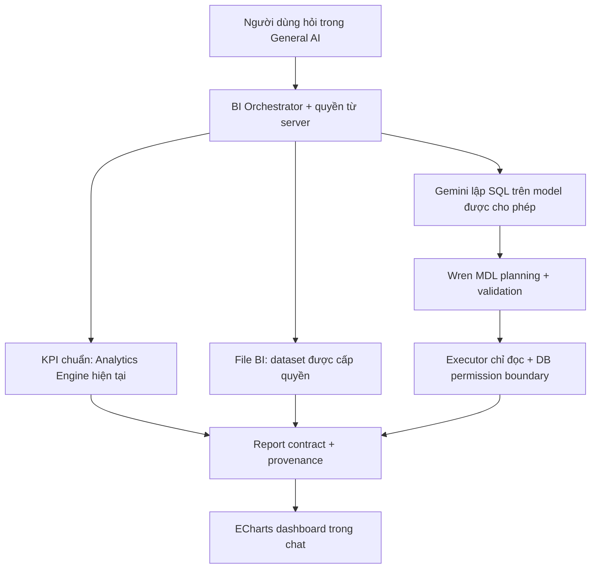

# WrenAI bổ trợ SOTRANS Hub — tích hợp và vận hành

Ngày: 16/11/2026. Nguồn chính là thư mục người dùng cung cấp: `D:\WrenAI-main`.

## 1. Phần đã thực hiện

- Trích **41 tệp, 1.058.664 bytes** nguyên bản, gồm 17 tệp runtime Python và 24 tệp schema, tài liệu, ví dụ, test tham khảo, version/lock metadata và giấy phép.
- Tạo `upstream-manifest.json`: đường dẫn nguồn/đích, SHA-256 từng tệp, phiên bản các gói. Thư mục là bản ZIP không có `.git`; không suy đoán commit/tag.
- Phiên bản khai báo trong source: `wrenai 0.18.0`, binding `wren-core-py 0.8.2`. Runtime Python được trích từ chính folder; chỉ binding Rust và dependency wheels cài vào `.venv` riêng của bộ tích hợp.
- Giữ adapter Node.js → Python → `WrenEngine.dry_plan` cho kiểm thử cục bộ; bổ sung private query service Python chạy trong Docker và orchestration trong General AI.
- Tạo ba model thử cho `documents`, `hr_intake_batches`, `hr_employee_staging`. Scope STL/VTX/SWC/ALL được gắn vào refSql bằng enum đã kiểm tra. Đây là model khởi đầu cần nghiệp vụ xác nhận, chưa phải semantic layer đã nghiệm thu.
- Kiểm tra planner/service: **21 Python tests + 14 Node adapter tests PASS**; thêm kiểm thử orchestration, General AI HTTP/streaming và trình duyệt thật. SHA-256 41 tệp khớp nguồn.

**Trạng thái 16/11/2026:** Wren đã nối vào General AI; sidecar `wrenai-wren-bi-1` healthy, cấu hình bật và `hr-auth` đã nạp mã mới. 12 đối chiếu tổng hợp trên PostgreSQL thật khớp; một luồng Gemini thật → SQL model → Wren → PostgreSQL khớp đối chiếu. Chưa chạy nghiệm thu bằng tài khoản người dùng thật trong General AI; test route dùng JWT/DB/provider fixture được ghi rõ. Staging ở workspace khác chưa được cập nhật. Unified BI ghép file–hệ thống còn chờ khóa ghép/ngữ nghĩa, chưa bật.

Chi tiết triển khai, ma trận tính năng và giới hạn vận hành: xem tại `docs/release/bi_handover/03_BI_FEATURE_MATRIX.md` và `docs/release/bi_handover/07_KNOWN_LIMITATIONS.md` ở repository gốc.

## 2. Cấu trúc và phần cần dùng

```text
integrations/wrenai/
  upstream/runtime/wren/        SDK runtime chọn lọc, giữ nguyên bytes
  upstream/reference/          MDL schema, docs, ví dụ và tests tham khảo
  upstream/licenses/           License overview, Apache-2.0, CC-BY-4.0
  upstream-manifest.json       Nguồn, version, hash của từng tệp
  bridge/hubPlanner.js         Adapter Node: scope, subprocess, timeout, protocol
  bridge/plan_worker.py        Admission + Wren dry-plan; không execute
  bridge/query_service.py      Private HTTP executor, replan + transaction READ ONLY
  Dockerfile/compose.wren.yml  Sidecar trên hrbot_net, user không đặc quyền
  models/hub.mdl.template.json Ba model SOTRANS khởi đầu
  models/business-rules.md     Ngữ nghĩa, giới hạn, quy tắc hỏi lại
  examples/plan-demo.js        Demo local không DB
  tests/                      Kiểm thử adapter và engine thật
  tools/extract_upstream.py    Trích xuất tái lập / kiểm hash
  requirements-plan.txt        Phiên bản dependency trực tiếp từ lock upstream
  requirements-postgres-optional.txt  Dependency trực tiếp của executor PostgreSQL
```

Các thành phần có ích trực tiếp:

- **Semantic engine:** engine.py, mdl/ và model/ để biến SQL trên model thành SQL PostgreSQL.
- **Query policy:** policy.py, read_only.py, config.py. Hub bật strict mode và kiểm tra SQL một statement, hàm cho phép, model/cột và nguồn.
- **PostgreSQL:** executor dùng psycopg với transaction READ ONLY, kiểm tra role, timeout và danh sách nguồn sau expansion. Chỉ đọc qua credential riêng hiện hữu, không dùng operational fallback.
- **DuckDB connector:** mã tham khảo cho nhánh file ở bước sau; dependency file engine chưa cài, không chuyển hệ file BI hiện tại sang DuckDB.
- **Schema/ví dụ/usage guide:** làm cơ sở tạo MDL và prompt lập SQL. Những SKILL.md ở thư mục reference chỉ là tài liệu; không cài vào cấu hình agent toàn cục.

Không trích toàn bộ monorepo Rust, UI/cloud deployment, framework SDK LangChain/Pydantic, embeddings/memory stack hoặc bundle WASM trình duyệt. Hub có sẵn General AI, Gemini, ECharts và RBAC; các phần đó chưa cần cho phạm vi này. Source này cũng không chứa bộ Wren UI/launcher Docker cũ; `.claude/CLAUDE.md` upstream ghi chúng đã chuyển sang legacy/v1.

## 3. Cách thử cục bộ

Chạy từ `D:\hoso-chat`. Python **3.11+**; venv hiện dùng Python 3.12. Không dùng `python` mặc định trên máy vì nó đang là 3.10.

```powershell
py -3.12 -m venv integrations/wrenai/.venv
.\integrations\wrenai\.venv\Scripts\python.exe -m pip install --only-binary=:all: -r integrations/wrenai/requirements-plan.txt
node integrations/wrenai/examples/plan-demo.js
.\integrations\wrenai\.venv\Scripts\python.exe -B integrations/wrenai/tests/test_plan_worker.py
node --test integrations/wrenai/tests/hubPlanner.test.js
py -3.12 integrations/wrenai/tools/extract_upstream.py --verify --source D:\WrenAI-main
```

Demo dùng synthetic HR/STL context để gọi trực tiếp module local, không giả token hoặc đăng nhập vào Hub. Nó trả SQL có scope STL, `mode: plan-only`, `executed: false`. Không cung cấp kết quả số liệu vì không có truy vấn được chạy. Không hiển thị planned_sql nội bộ này cho người dùng cuối.

Các version trực tiếp được cố định; `requirements-runtime-lock.txt` khóa 16 dependency của runtime Linux đã triển khai và được Dockerfile sử dụng. Base image cũng khóa digest. Lock này chưa có wheel hashes. `requirements-plan.txt` vẫn phục vụ prototype local và không phải full transitive lock. Bộ này chỉ trích dependency closure cần dùng, không cài toàn bộ CLI Wren.

## 4. Kiến trúc đang triển khai



WrenEngine nhận **SQL đã được lập**, không tự biến câu hỏi tiếng Việt thành SQL chỉ bằng dry_plan. Hub phải dùng LLM/orchestrator với context MDL được phép và kiểm tra kết quả. Không thay thế 17 KPI cố định, không dùng Wren để đoán số liệu các KPI đang BLOCKED. Không tạo tab BI hoặc giao diện Wren độc lập cho người dùng.

## 5. Roadmap và điều kiện nghiệm thu

Đây là tiêu chí của roadmap, không phải tuyên bố tất cả đã hoàn tất. Bản triển khai hiện tại đã làm nền correctness/ACL, executor, General AI, multi-sheet và tương tác/export. Còn business UAT, bản Staging đồng nhất, ba KPI thiếu telemetry và mapping Unified BI. Quyền triển khai ở đợt này theo yêu cầu thực hiện của người dùng; không áp dụng giới hạn read-only của yêu cầu audit cũ cho thao tác triển khai mới.

### Bước 0 — Trích xuất và chứng minh planner local

**Đã thực hiện trong gói này:** source/hash/license, model thử, adapter tắt mặc định, 30 tests, real dry-plan không DB.

Điều này không chứng minh quyền row-level trên DB, NL-to-SQL accuracy, báo cáo có số liệu thật hoặc nghiệm thu Production.

### Bước 1 — Khóa phiên bản và sửa nền BI hiện hữu

Ưu tiên các phát hiện trong `reports/BI_GENERAL_AI_CURRENT_STATE_AUDIT.md`:

1. Đối chiếu source/deploy baseline, tách mã đang phát triển khỏi bản chạy; đồng bộ Staging theo artifact được chọn.
2. Sửa growth/period comparison theo thứ tự thời gian, rollup AVG/MEDIAN/MAX/distinct đúng ngữ nghĩa, OCR partial status tương thích contract.
3. Điều tra registry entries thiếu JSON, expiry timestamp, MISSING_DATA, orphan file và lỗi persist; không cleanup trước khi biết dữ liệu nào cần giữ.
4. Sửa quyền conversation/file follow-up; thống nhất PII trên preview/API/legacy/v2 và audit mọi đường query.
5. Chốt ba KPI bị khóa: bổ sung telemetry hoặc giữ unavailable với lý do được nghiệp vụ duyệt.

**Hoàn thành khi:** case lỗi có test thực gọi đúng code; metric được đối chiếu với ground truth; storage/ACL không còn lỗi cản nghiệm thu. Không dùng tổng PASS mock để bỏ qua các điều kiện này.

### Bước 2 — Duyệt semantic model và nguồn dữ liệu

Phụ thuộc: baseline bước 1; có thể phân tích nghiệp vụ song song với sửa lỗi.

- Duyệt ba model khởi đầu: grain, unique key thật, ngày/timezone, trạng thái, công thức, field được phép và branch_scope có `all`.
- `hub_staged_records` là hồ sơ staging, **không phải số lượng nhân viên đang làm việc**. Thêm employee/headcount/payroll chỉ khi có nguồn và quyền DBA/business riêng.
- Chốt định nghĩa KPI chuẩn dùng engine cố định; các câu hỏi ad-hoc nào được chuyển Wren.
- Tạo bộ câu hỏi tiếng Việt có expected query/result; thuật ngữ mơ hồ phải hỏi lại.
- Giữ model/knowledge đã duyệt trong version control. Không tự động index PII, raw file upload hoặc SQL nhạy cảm vào memory dùng chung.

**Hoàn thành khi:** business owner duyệt metric/grain; schema và model compile được; model chỉ lộ field được cho phép; các số liệu chuẩn có kết quả đối chiếu.

### Bước 3 — Xây executor chỉ đọc và service boundary

Phụ thuộc: bước 1–2. Executor đã triển khai cho ba model hiện tại; nghiệm thu nghiệp vụ rộng hơn vẫn cần bộ câu hỏi/expected result.

- Chọn service Python riêng trên Linux image phù hợp. Container auth hiện là Node 20 Alpine; prototype Python host không thể gọi trực tiếp bằng đường dẫn Windows từ container này.
- Dùng role/credential riêng tối thiểu, database statement timeout và quyền trên approved views/RLS hoặc ranh giới DB tương đương. **bi_readonly hiện đọc nhiều tenant**, nên chỉ có quyền SELECT không đủ chứng minh tenant isolation cho SQL sinh động.
- Truyền scope từ user đã xác thực ở Hub; không nhận user/role/connection/MDL tùy ý từ body trình duyệt.
- Validate SQL trước và sau expansion, model/cột/hàm/nguồn vật lý, giới hạn rows/time/concurrency, cancel và structured errors. Không execute một chuỗi SQL client gửi lại từ lần plan trước.
- Ràng buộc plan vào scope, model version/hash và quyền hiện tại; kiểm tra lại trước execute. Cache phải bao gồm tenant/user/grants/dataset version hoặc không cache kết quả.
- Audit request ID, nguồn, scope, model version, execution time/status; không log secrets/raw PII.

**Hoàn thành khi:** truy vấn thực trên Staging chỉ đọc, đúng quyền; thử HR khác công ty/role không hợp lệ/raw SQL/side-effect/timeout đều bị xử lý; có kiểm chứng DB privilege độc lập.

**DBA/DevOps duyệt:** role/view/RLS/schema cần thiết, secrets, image/network, resource/timeout và rollout. Không chạy migration/GRANT/Docker rebuild như một phần audit hoặc chỉ để thử planner.

### Bước 4 — Nối General AI với Wren và giữ KPI chuẩn

Phụ thuộc: contract bước 2–3; có thể phát triển orchestration trên test doubles trước khi executor live được duyệt.

- Nhận diện nguồn: KPI cố định, dataset/file đang chọn, ad-hoc semantic query, RAG hoặc câu hỏi cần làm rõ.
- Dùng Gemini hiện hữu lập SQL trên context model được cấp quyền; Wren planning và validator kiểm tra; lỗi có bounded retry, không chuyển sang truy vấn SQL không kiểm soát.
- Giữ KPI chuẩn đi Analytics Engine; BLOCKED trả lý do, không fallback sang LLM bịa con số.
- Kết quả thành report contract v2 dùng renderer đang có; provenance chỉ rõ engine, source, scope, thời điểm và model/dataset version. Không thêm một source_type WREN nếu contract chưa được nâng phiên bản/kiểm thử; Wren là engine, source vẫn là Internal hoặc File.
- Lưu context follow-up có định danh report/dataset/plan được duyệt; kiểm quyền lại từng lượt. “Còn tháng trước?” phải giữ nguồn/chỉ số, “hỏi quy định nghỉ phép” phải rời BI sang RAG đúng cách.

**Hoàn thành khi:** người dùng hỏi tiếng Việt trong General AI, nhận số liệu thật có nguồn; hỏi tiếp đúng context; không cần mở Wren UI; luồng KPI/RAG/file cũ không bị regression.

### Bước 5 — Hoàn thiện File BI và chuẩn bị Unified BI

Phụ thuộc: quyền/lifecycle bước 1, model bước 2 và executor bước 3.

- Sửa mismatch upload 20/25 MiB, chỉ một spreadsheet được chọn, chọn sheet thật và data type inference.
- Giữ JSON engine cho nhu cầu đơn giản nếu phù hợp. Khi đưa file qua Wren, xây adapter tới bảng/snapshot/nguồn connector được hỗ trợ, giữ owner/tenant/grants/expiry/checksum/version; không coi `.dataset.json` đã tự thành datasource Wren.
- Chọn DuckDB hoặc analytics staging store bằng workload và governance đã duyệt; test local và deployment dependency trước khi chuyển.
- Một file report hỗ trợ nhiều measures/charts, tính KPI đúng grain, không cộng AVG/median/distinct nhóm tùy ý.
- Join system-file/file-file là scope riêng: phải có key mapping, cardinality, thời gian/đơn vị, quyền trên mọi nguồn và test tránh double counting. Chưa đủ điều kiện thì trả chưa hỗ trợ, không tự suy đoán join.

**Hoàn thành khi:** upload → chọn sheet → phân tích → chia sẻ/thu hồi/hết hạn đều hoạt động đúng; báo cáo đa nguồn chỉ bật sau khi mọi nguồn và mapping được duyệt.

### Bước 6 — Dashboard tổng hợp và tương tác trong chat

Phụ thuộc: report contract và query API ổn định; frontend có thể làm song song trên fixtures rõ ràng, nhưng acceptance phải dùng số liệu thật.

- Composition nhiều KPI/charts/tables cho cả Internal và File; producer phải tạo được nhiều visualization, không chỉ renderer có vòng lặp.
- Date/category slicers, cross-filter, drill-down, sorting/filtering/pagination table.
- State dashboard có dashboard_id/report_id; follow-up thay đổi đúng báo cáo, không làm lẫn scope hoặc datasource của hội thoại khác.
- Export Excel/PDF theo cùng filter và quyền; file export có ownership/retention/audit.
- Hoàn thiện stacked/area/donut producer và Treemap nếu nằm trong yêu cầu; layout mobile, tooltip, loading/empty/unavailable/fallback, dispose/ResizeObserver cleanup.

**Hoàn thành khi:** dashboard mẫu có nhiều KPI, ít nhất ba biểu đồ và bảng; một bộ lọc cập nhật nhất quán tất cả visual; drill/export/refresh hội thoại vẫn đúng dữ liệu và quyền. Số chart/KPI cụ thể cần business owner duyệt cho từng report.

### Bước 7 — Nghiệm thu Staging, phát hành Production và vận hành

Phụ thuộc: bước 1–6 trong phạm vi release được chọn.

- Chốt bộ nghiệm thu theo nguồn/câu hỏi/role: login → yêu cầu BI → query thật → dashboard → filter → follow-up → refresh → export → revoke/expiry.
- Đối chiếu từng metric với nguồn dữ liệu và expected result; ảnh/video phải thấy dashboard, không chỉ login hoặc page.evaluate fixture.
- Test giới hạn tài nguyên, lỗi DB/LLM, query cancel, timeout, backup/restore và rollback theo version.
- Gắn bằng chứng với commit/artifact/model hash, môi trường và runtime version. Không dùng source-on-disk thay bằng chứng server đã nạp module mới.
- DBA/DevOps phê duyệt rollout có feature flag, monitor query errors/latency/denials/limits và khả năng rollback; bật dần theo nguồn/nhóm người dùng được duyệt.

**Hoàn thành khi:** QA + business + DBA/DevOps xác nhận phạm vi release; live authenticated acceptance có bằng chứng; các tính năng chưa nhận rõ ràng bị tắt hoặc thông báo chưa hỗ trợ.

## 6. Thứ tự và phần có thể song song

Luồng phụ thuộc chính: **Bước 0 → 1 → 2 → 3 → 4 → 6 → 7**. Bước 5 đi từ 1–3 và đưa kết quả vào 4/6; Unified BI có gate riêng sau quyền và mapping đa nguồn.

- Có thể song song: sửa correctness/lifecycle, duyệt ngữ nghĩa dữ liệu, xây UI trên report fixtures.
- Không bỏ qua: DB authorization trước execute; model approval trước ad-hoc trên dữ liệu thật; source ACL trước file/unified queries; Staging acceptance trước rollout.
- Việc tiếp theo: nghiệm thu tài khoản thật, đồng bộ bản Staging riêng, thống nhất mapping cho Unified BI và nguồn telemetry cho KPI bị khóa.

## 7. Bằng chứng và giới hạn

- Có một câu hỏi qua Gemini thật và 12 đối chiếu aggregate live trên STL/VTX/SWC/ALL; chưa phải benchmark độ chính xác NL toàn bộ nghiệp vụ.
- Scope gắn trong model refSql; service kiểm nguồn và quyền DB độc lập. Role SELECT có thể đọc nhiều tenant; mạng/token của private service là ranh giới tin cậy, không có RLS PostgreSQL mới.
- File BI vẫn dùng engine JSON hiện hữu đã bổ sung multi-sheet/summary; chưa đưa file vào Wren hoặc join đa nguồn.
- Dashboard/browser test dùng workbook mẫu, route query/export thật và auth fixture. General AI route fixture kiểm tra lưu context/HTTP/SSE; chưa thay cho live authenticated UAT.
- Có 18 dataset mất JSON, không có bản gốc ứng viên trong kho hiện tại tại thời điểm kiểm kê; không tự tái tạo số liệu hay xóa registry.

Hai case đã quan sát khi thử engine thật:

1. PostgreSQL `branch_scope @> ...` trong refSql gặp ParseError ở bước parse Wren dialect của snapshot này. Template local dùng ARRAY_POSITION membership; đã đối chiếu count trên PostgreSQL thật cho cả bốn scope. Không sửa bytes upstream hoặc thay SQL KPI cũ.
2. `dry_plan('SELECT citizen_id FROM hub_staged_records')` không tự bị từ chối ở snapshot engine này. Prototype bổ sung schema qualification trước planning; test hiện từ chối field đó. Không khẳng định Wren đã đọc/lộ citizen_id: không có DB connection và field đó không được model refSql expose.

## 8. Attribution và license

Nguồn: Canner/WrenAI, https://github.com/Canner/WrenAI, local snapshot do người dùng cung cấp. Các tệp trích xuất giữ nguyên bytes, tác giả/thông báo có trong source. `upstream/licenses/LICENSE` là bản đồ license của chính snapshot; core/skills/examples là Apache-2.0, docs là CC-BY-4.0. Giữ kèm các license và attribution khi phân phối bộ này. Phần adapter/model/tests SOTRANS nằm ngoài upstream/runtime và không được ghi là code upstream. Không sao chép logo/trademark assets, không tạo chứng nhận hỗ trợ của nhà cung cấp.
